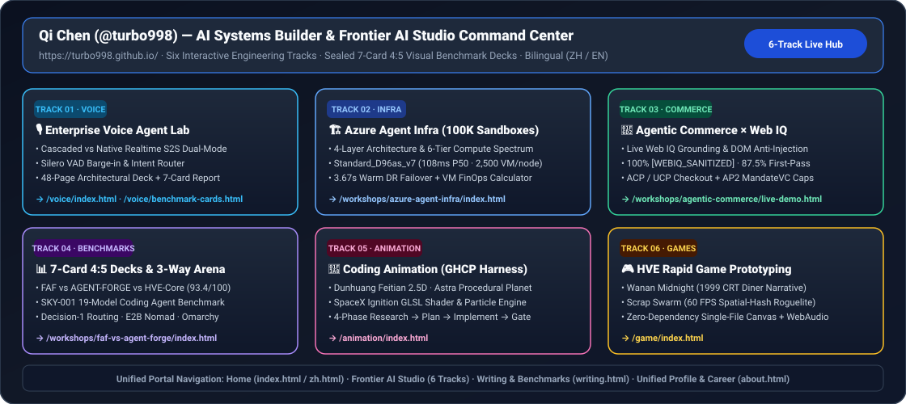

# Qi Chen (@turbo998) — AI Systems Builder, Frontier AI Studio & Technical Assets (English Edition)

> 🌐 **Language / 语言版本切换**: **[🇬🇧 English Homepage (README.en.md)](README.en.md)** | **[🇨🇳 中文主页 (README.zh-CN.md)](README.zh-CN.md)** | **[📘 Azure Agent Infra Playbook (English)](workshops/azure-agent-infra/README.en.md)** | **[📘 Azure Agent Infra Playbook (中文)](workshops/azure-agent-infra/README.md)**

Bilingual technical command center ([https://turbo998.github.io/](https://turbo998.github.io/)), **6-Track Frontier AI Studio** ([https://turbo998.github.io/frontier-ai-studio.html](https://turbo998.github.io/frontier-ai-studio.html)), **Sealed 7-Card 4:5 Benchmark Decks**, and interactive cloud architecture simulators maintained by **Qi Chen (@turbo998)**:

## 📌 Executive Summary — 6-Track Frontier AI Studio

| Track | Engineering Domain | Live Interactive Workbench | Sealed 7-Card 4:5 Benchmark Deck & Key Metrics |
| :--- | :--- | :--- | :--- |
| **Track 01** | **🎙️ Enterprise Voice Agent Lab (Stage 355)** | [Dual-Mode Voice Sandbox](https://turbo998.github.io/voice/index.html) · [48-Slide Deck](https://turbo998.github.io/voice/deck.html) | [Voice Agent 7-Card Deck](https://turbo998.github.io/voice/benchmark-cards.html) (Stage 355 · P703/P704 · 358 dims · 713 guardrails) |
| **Track 02** | **🏗️ Azure Agent Infra (Cycle #376 · 100K Sandboxes)** | [Playbook Atlas](https://turbo998.github.io/workshops/azure-agent-infra/index.html) · [AKSClaw×E2B Simulator](https://turbo998.github.io/workshops/azure-agent-infra/demo.html) · [100K Sizer & DR](https://turbo998.github.io/workshops/azure-agent-infra/selector.html) | [Agent Infra 7-Card Deck](https://turbo998.github.io/workshops/azure-agent-infra/cards.html) (384 Chapters · 377 IaC Blueprints · `108ms` P50 resume) |
| **Track 03** | **🛒 Agentic Commerce × Web IQ (Stage 1751)** | [Web IQ Live Grounding & Checkout Sandbox](https://turbo998.github.io/workshops/agentic-commerce/live-demo.html) | [Agentic Commerce 7-Card Deck](https://turbo998.github.io/workshops/agentic-commerce/benchmark-cards.html) (`87.5%` accuracy · `100%` injection block · 4,267 tests) |
| **Track 04** | **📊 7-Card Benchmarks & AI Infra (Phase 178)** | [Benchmark Reports Column](https://turbo998.github.io/benchmarks.html) · [FAF vs AGENT-FORGE vs HVE-Core Arena](https://turbo998.github.io/workshops/faf-vs-agent-forge/index.html) | [Supp 6 Gemini 4 Carbon](https://turbo998.github.io/workshops/benchmarks/gemini-4-carbon-cards.html) · [Supp 5 19-Model+SKY-001](https://turbo998.github.io/workshops/benchmarks/sky-001-cards.html) · [Supp 4 Sonnet 5.5+Sol](https://turbo998.github.io/workshops/benchmarks/coding-17-sonnet55-sol-cards.html) · [Decision-1 Routing](https://turbo998.github.io/workshops/benchmarks/decision-1-cards.html) · Phase 178 (`3,651` sources · `178` 7-Card decks) |
| **Track 05** | **🎨 Coding Animation (Stage 466 · 4 Live Demos)** | [Dunhuang Feitian · Astra Mars · SpaceX Launch · 🚲 Pelican Bicycle Arena](https://turbo998.github.io/animation/index.html) · [Pelican 3-Way Arena](https://turbo998.github.io/animation/demos/pelican-bicycle-arena/index.html) | Stage 466 (`522` curated works · `55/55` E2E green · Pelican Bicycle `HVE-Core 93.4` vs `AF 91.8` vs `FAF 90.5` + [7-Card Report](https://turbo998.github.io/animation/demos/pelican-bicycle-arena/test-report-cards.html)) |
| **Track 06** | **🎮 HVE Rapid Game Prototyping** | [Wanan 1999 Midnight Diner & Scrap Swarm](https://turbo998.github.io/game/index.html) | 60 FPS Spatial-Hash Roguelite + WebAudio Synthesizer Single-File Closures |

## Featured Playbooks & Repositories

- **[Coding Animation Column & Pelican Riding a Bicycle Showcase (Stage 466)](https://turbo998.github.io/animation/index.html)** · **[🚲 Pelican Riding a Bicycle 3-Way Arena](https://turbo998.github.io/animation/demos/pelican-bicycle-arena/index.html)** · **[HVE-Core Pelican 93.4](https://turbo998.github.io/animation/demos/pelican-bicycle-arena/demo-hve-pelican.html)** · **[Pelican 7-Card Report](https://turbo998.github.io/animation/demos/pelican-bicycle-arena/test-report-cards.html)** (`522` curated works, `4` live browser animations, Blender 4.5 LTS MCP normal/relief/GLB assets, `55/55` checks passing).
- **[AI Agent Infrastructure on Azure Playbook (English Edition)](workshops/azure-agent-infra/README.en.md)** · **[中文完整版](workshops/azure-agent-infra/README.md)** (`384` chapters, `377` production IaC blueprints, `376` deterministic simulators, `385/385` unit tests, 8 verified SVG diagrams, [English 7-Card Benchmark Report](workshops/azure-agent-infra/test-report.en.md), and [4-Page Bilingual H5 Suite](https://turbo998.github.io/workshops/azure-agent-infra/index.html)).
- **[Unified Builder Profile, Career Timeline & Certifications](https://turbo998.github.io/about.html)** · **[关于我（整合页）](https://turbo998.github.io/zh-about.html)**.
- **[Writing, Technical Reports & Benchmark Decks](https://turbo998.github.io/writing.html)** · **[分享与著作](https://turbo998.github.io/zh-writing.html)**.

