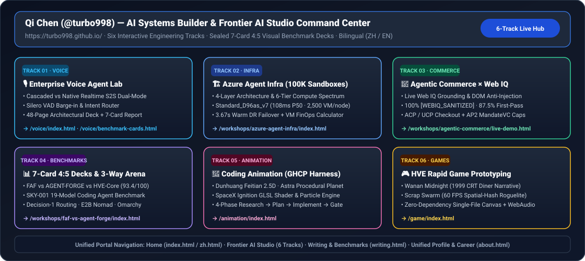

# Qi Chen (@turbo998) — AI Systems Builder, Frontier AI Studio & Technical Assets (English Edition)

> 🌐 **Language / 语言版本切换**: **[🇬🇧 English Homepage (README.en.md)](README.en.md)** | **[🇨🇳 中文主页 (README.zh-CN.md)](README.zh-CN.md)** | **[📘 Azure Agent Infra Playbook (English)](workshops/azure-agent-infra/README.en.md)** | **[📘 Azure Agent Infra Playbook (中文)](workshops/azure-agent-infra/README.zh-CN.md)**

Bilingual technical command center ([https://turbo998.github.io/](https://turbo998.github.io/)), **6-Track Frontier AI Studio** ([https://turbo998.github.io/frontier-ai-studio.html](https://turbo998.github.io/frontier-ai-studio.html)), **Sealed 7-Card 4:5 Benchmark Decks**, and interactive cloud architecture simulators maintained by **Qi Chen (@turbo998)**:

## 📌 Executive Summary — 6-Track Frontier AI Studio

| Track | Engineering Domain | Live Interactive Workbench | Sealed 7-Card 4:5 Benchmark Deck & Key Metrics |
| :--- | :--- | :--- | :--- |
| **Track 01** | **🎙️ Enterprise Voice Agent Lab** | [Dual-Mode Voice Sandbox](https://turbo998.github.io/voice/index.html) · [48-Slide Deck](https://turbo998.github.io/voice/deck.html) | [Voice Agent 7-Card Deck](https://turbo998.github.io/voice/benchmark-cards.html) (Cascaded vs. Native Realtime S2S, VAD Barge-in) |
| **Track 02** | **🏗️ Azure Agent Infra (100K Sandboxes)** | [Playbook Atlas](https://turbo998.github.io/workshops/azure-agent-infra/index.html) · [AKSClaw×E2B Simulator](https://turbo998.github.io/workshops/azure-agent-infra/demo.html) · [100K Sizer & DR](https://turbo998.github.io/workshops/azure-agent-infra/selector.html) | [Agent Infra 7-Card Deck](https://turbo998.github.io/workshops/azure-agent-infra/cards.html) (`108ms` P50 resume · `2,500` VMs/node · `3.67s` DR) |
| **Track 03** | **🛒 Agentic Commerce × Web IQ** | [Web IQ Live Grounding & Checkout Sandbox](https://turbo998.github.io/workshops/agentic-commerce/live-demo.html) | [Agentic Commerce 7-Card Deck](https://turbo998.github.io/workshops/agentic-commerce/benchmark-cards.html) (`87.5%` accuracy · `100%` injection block) |
| **Track 04** | **📊 7-Card Benchmarks & 3-Way Arena** | [FAF vs AGENT-FORGE vs HVE-Core Arena](https://turbo998.github.io/workshops/faf-vs-agent-forge/index.html) | [SKY-001 19-Model Deck](https://turbo998.github.io/workshops/benchmarks/sky-001-cards.html) · [Decision-1 Routing](https://turbo998.github.io/workshops/benchmarks/decision-1-cards.html) · [E2B Nomad Audit](https://turbo998.github.io/workshops/benchmarks/e2b-nomad-cards.html) |
| **Track 05** | **🎨 Coding Animation (GHCP Harness)** | [Feitian 2.5D · Astra Procedural Planet · SpaceX Ignition](https://turbo998.github.io/animation/index.html) | 4-Phase Research → Plan → Implement → Harness Gate (Zero External Dependencies) |
| **Track 06** | **🎮 HVE Rapid Game Prototyping** | [Wanan 1999 Midnight Diner & Scrap Swarm](https://turbo998.github.io/game/index.html) | 60 FPS Spatial-Hash Roguelite + WebAudio Synthesizer Single-File Closures |

## Featured Playbooks & Repositories

- **[AI Agent Infrastructure on Azure Playbook (English Edition)](workshops/azure-agent-infra/README.en.md)** · **[中文完整版](workshops/azure-agent-infra/README.zh-CN.md)** (`288` chapters, `281` production IaC blueprints, `280` deterministic simulators, `289/289` unit tests, 8 verified SVG diagrams, [English 7-Card Benchmark Report](workshops/azure-agent-infra/test-report.en.md), and [4-Page Bilingual H5 Suite](https://turbo998.github.io/workshops/azure-agent-infra/index.html)).
- **[Unified Builder Profile, Career Timeline & Certifications](https://turbo998.github.io/about.html)** · **[关于我（整合页）](https://turbo998.github.io/zh-about.html)**.
- **[Writing, Technical Reports & Benchmark Decks](https://turbo998.github.io/writing.html)** · **[分享与著作](https://turbo998.github.io/zh-writing.html)**.

