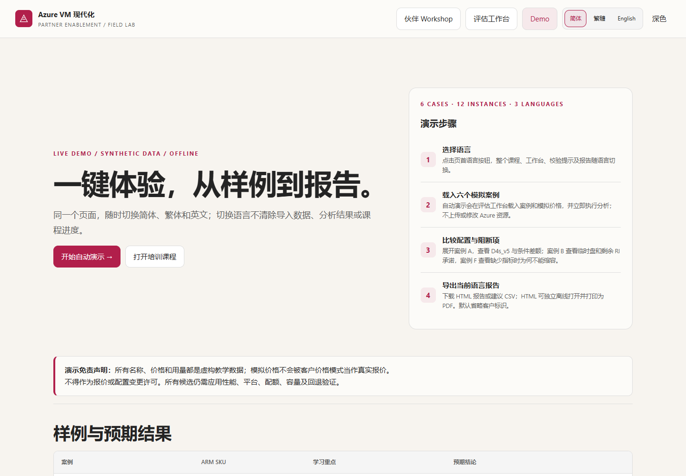
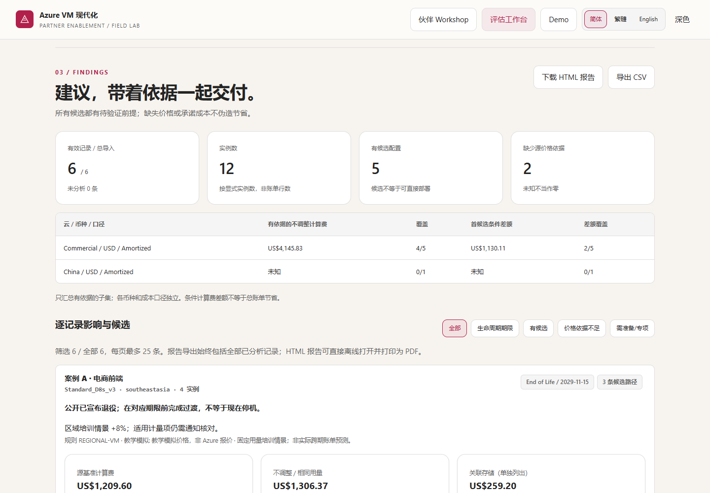
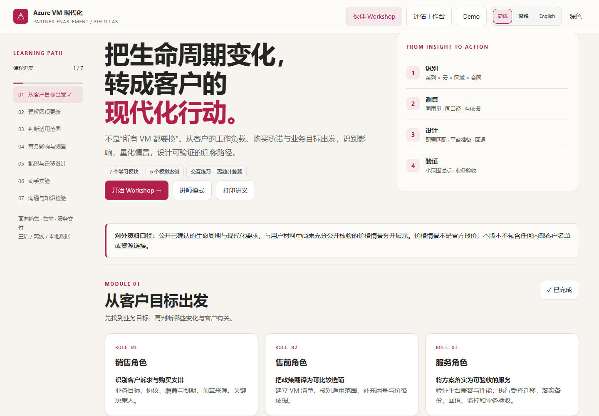

# Qi Chen — Personal Site & Technical Assets / 个人网站与技术作品

从技术分享走到动手实践：这里收录双语个人网站、技术作品、职业履历、AI 趋势文章与可离线使用的伙伴培训材料。个人网站使用纯 HTML/CSS/JS，无构建步骤；Workshop 的现成页面也可直接打开。

## 精选 Workshop：Azure VM 现代化，从客户目标到可验证的行动

**不只是讲解 VM 更新，而是把适用范围、用量依据、购买承诺与迁移前提串成一次可动手的评估。** 从六个虚构案例出发，学习如何比较候选配置、识别缺失依据，并把结论和不确定性一起交付。

面向 **Sales / 销售角色、Presales / 售前角色、Service / 服务角色**：销售识别客户目标与购买安排，售前建立清单和测算依据，服务团队验证平台前提、执行受控迁移与验收。

**[开始六案例 Demo](https://jolly-water-08e2a8b00.7.azurestaticapps.net/workshops/azure-vm-modernization/demo.html?lang=zh-CN)** · **[学习伙伴课程](https://jolly-water-08e2a8b00.7.azurestaticapps.net/workshops/azure-vm-modernization/workshop.html?lang=zh-CN)** · **[打开评估工作台](https://jolly-water-08e2a8b00.7.azurestaticapps.net/workshops/azure-vm-modernization/calculator.html?lang=zh-CN)** · **[下载完整离线 ZIP](https://jolly-water-08e2a8b00.7.azurestaticapps.net/workshops/azure-vm-modernization/Azure-VM-Partner-Workshop.zip)**

[English Demo](https://jolly-water-08e2a8b00.7.azurestaticapps.net/workshops/azure-vm-modernization/demo.html?lang=en) · [繁體 Demo](https://jolly-water-08e2a8b00.7.azurestaticapps.net/workshops/azure-vm-modernization/demo.html?lang=zh-TW)。以上为 **Azure Static Web Apps 在线体验**；GitHub 文件视图只展示源码，不执行 HTML。仓库保持私有，GitHub Pages 未启用。

| 你想完成的事 | Workshop 提供的能力 |
| --- | --- |
| 带不同角色一起学 | 7 个学习模块、角色分工、互动案例、知识测验与讲师模式 |
| 不准备客户数据也能体验 | 一键载入 6 个模拟案例；课程、工作台与 Demo 同页切换简体 / 繁體 / English，保留当前进度或结果 |
| 用自己的依据进行评估 | 浏览器本地 CSV/XLSX 导入、字段映射与校验、候选比较；缺失依据不当作零成本 |
| 把结论带进交付 | 导出当前语言的脱敏 HTML 报告与建议 CSV；HTML 可独立打开并打印为 PDF |
| 在培训现场离线使用 | 三份自包含 HTML，无需服务器、Node.js、登录、联网或 Azure 权限 |

分类：**分享与著作 / Writing & Talks → Workshop / 合作伙伴培训（Partner training）**。
主题标签：**Azure infrastructure（Azure 基础设施）· VM modernization（VM 现代化）· Cost optimization（成本优化）**。

### 看见完整闭环：真实 Demo 截图

以下均为现有交付包中的真实离线浏览器截图，使用虚构教学数据；图中金额不是 Azure 报价或客户节省承诺。选择任意缩略图可打开原尺寸图片。

| 演示与课程 | 分析与交付 |
| --- | --- |
| [](workshops/azure-vm-modernization/screenshots/demo-zh-CN-desktop.png)<br>**一键演示完整流程**：不用准备客户数据，从六个虚构案例开始。 | [](workshops/azure-vm-modernization/screenshots/calculator-zh-CN-results.png)<br>**有依据才出金额**：候选、覆盖范围与未知项同屏呈现，不把不确定性藏起来。 |
| [](workshops/azure-vm-modernization/screenshots/workshop-zh-CN-roles.png)<br>**三角色围绕同一目标协作**：从客户诉求到测算依据，再到迁移验证与验收。 | [](workshops/azure-vm-modernization/screenshots/report-zh-CN-desktop.png)<br>**把依据一起交付**：报告保留口径、数据覆盖与不确定性，而不只是一个金额。 |

### 一次实用的 Demo 体验

1. 打开在线 Demo，选择语言，按“开始自动演示”载入六个模拟案例并分析，无需上传文件。
2. 展开案例 A 看候选与条件差额；对比案例 B 的临时盘 / RI 承诺，以及案例 F 为什么在指标不全时不能直接缩容。
3. 切到“客户价格依据”模式，观察模拟金额被拒绝：教学价格不能充当合同报价。
4. 下载当前语言的 HTML 报告或建议 CSV；独立打开 HTML，通过浏览器打印保存 PDF。

### 离线包、源码与使用边界

**仓库文件：** [完整 Workshop 目录](workshops/azure-vm-modernization/) · [仓库内 ZIP](workshops/azure-vm-modernization/Azure-VM-Partner-Workshop.zip) · [使用说明与数据口径](workshops/azure-vm-modernization/README.md) · [三语样例与报告](workshops/azure-vm-modernization/sample-data/) · [CSV/XLSX 模板](workshops/azure-vm-modernization/templates/) · [TypeScript/React 源码与测试](workshops/azure-vm-modernization/source/)。

下载 ZIP 并解压，直接用较新的 Edge/Chrome 双击 `azure-vm-partner-workshop` 目录内的 HTML。保留完整目录以访问样例、模板、报告和跨工具链接。页面顶部可原地切换简体 / 繁體 / English，也可通过 `?lang=zh-CN`、`?lang=zh-TW`、`?lang=en` 指定初始语言。

**边界与隐私：** 客户输入在浏览器本地处理，不上传、不默认缓存到浏览器存储、不写入后端；刷新或关闭会丢失未导出的数据。所有样例、客户名称和价格都是虚构教学数据。原始材料中的具体涨幅、日期及商务处理规则尚未获得足够公开资料核验，仅用于明确标注的培训情景，**不是已确认的 Azure 政策或官方报价**。计算结果是固定用量比较，不是实际账单预测或部署许可；合同价、区域/配额/容量、应用性能和迁移前提需要单独验证。默认导出报告已脱敏，外发前仍需审查。

发布包不包含原始邮件、内部邮件摘录或链接、内部客户清单、凭据、`node_modules`、构建缓存或测试输出。源码维护命令见包内 README；运行现成页面无需安装依赖。第三方许可与通知随包保留。

下载 ZIP 原样保留，共 9,807,438 字节、256 个文件条目，含 37 张 PNG 截图；SHA-256：
`ba996b06697fcf0c926d9fdbf14ec67c5d76a2729cac291a2bd65648391332b5`。

## 网站目录与维护

Workshop 的中英文站点入口分别位于 [分享与著作](zh-writing.html) 和 [Writing & Talks](writing.html)，首页沿用现有导航链接。

```
website/
├── index.html          # 英文主页
├── zh.html             # 中文主页
├── writing.html        # Writing & Talks（英文）
├── zh-writing.html     # 分享与著作（中文）
├── style.css           # 共享样式（浅色、编号分节、技术报告风格）
├── main.js             # GitHub 仓库实时拉取 + 静态兜底数据
├── assets/
│   └── photo.jpg       # 个人照片（导航头像 / 档案卡 / OG 分享图）
├── articles/
│   ├── harness-engineering.html      # 第一篇文章（中文）
│   ├── harness-engineering.en.html   # 第一篇文章（英文）
│   ├── template.html                 # 文章模板（中文）
│   └── template.en.html              # 文章模板（英文）
├── workshops/
│   └── azure-vm-modernization/        # Azure VM 合作伙伴培训完整离线包
│       ├── workshop.html             # 同页三语课程
│       ├── calculator.html           # 本地评估计算器
│       ├── demo.html                 # 六案例自动演示入口
│       ├── Azure-VM-Partner-Workshop.zip  # 原始已核验下载包
│       ├── README.md                 # 字段口径、边界、维护说明
│       ├── sample-data/              # 三语模拟数据及 HTML/PDF 报告
│       ├── templates/                # CSV/XLSX 导入模板
│       ├── screenshots/              # 真实离线浏览器截图
│       ├── source/                   # 源码、测试与依赖 lockfile
│       └── third-party-licenses/     # 配合 THIRD_PARTY_NOTICES.txt 保留许可
└── README.md
```

### 本地预览

```bash
python -m http.server 8765
# 打开 http://localhost:8765
```

在仓库根目录运行上述命令；无需构建站点或 Workshop 页面。

### 部署到 GitHub Pages（可选参考）

以下是另行配置 Pages 的参考步骤，不是本仓库当前的部署方式；当前在线体验使用 Azure Static Web Apps，本次 README 更新不更改任何部署设置。

1. 在 GitHub 新建仓库（如 `turbo998.github.io`，则网址直接是 https://turbo998.github.io）：

```bash
cd website
git init
git add .
git commit -m "Personal site: bilingual portfolio + GitHub showcase"
git remote add origin https://github.com/turbo998/turbo998.github.io.git
git push -u origin main
```

2. 仓库 Settings → Pages → Source 选 `main` 分支根目录，保存。
3. 几分钟后访问 https://turbo998.github.io 。

若用其他仓库名（如 `homepage`），网址为 `https://turbo998.github.io/homepage/`。

### 写新文章

1. 复制 `articles/template.html` 为 `articles/<slug>.html`（英文版复制 `template.en.html` 命名为 `<slug>.en.html`），可参考已发布的 `harness-engineering.html`。
2. 替换标题、meta description、正文；保持编号分节（01/02/03…）风格。
3. 在 `writing.html` / `zh-writing.html` 的 Writing（分享与著作）列表中加一个 `.pub` 条目链接过去；首页已经链接到这两个分类页。

### GitHub 作品区维护

`main.js` 会实时调用 GitHub API 拉取 `turbo998` 的公开仓库（按更新时间排序，Fork 除外）。无需手动更新；如需：

- **置顶精选**：编辑 `main.js` 里的 `FEATURED` 数组（按数组顺序展示在最前）。
- **中文描述**：编辑 `ZH_DESC` 映射（中文页优先显示这里的描述）。
- **兜底快照**：API 限流/离线时展示 `FALLBACK` 数组，可定期同步一次。
