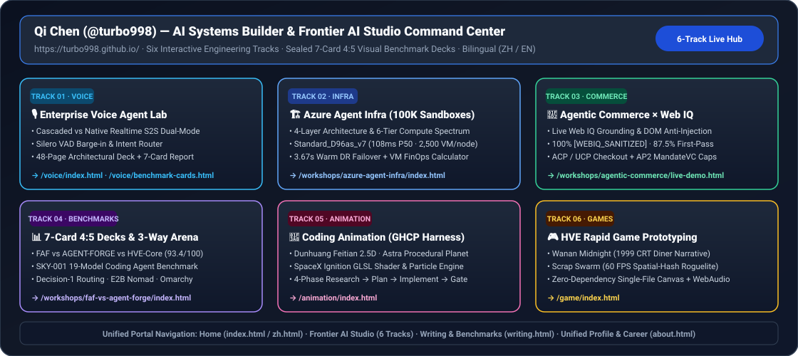

> 🌐 **Language / 语言版本切换**: **[🇨🇳 中文主页 (README.zh-CN.md)](README.zh-CN.md)** | **[🇬🇧 English Homepage (README.en.md)](README.en.md)** | **[📘 Azure Agent Infra Playbook (中文)](workshops/azure-agent-infra/README.md)** | **[📘 Azure Agent Infra Playbook (English)](workshops/azure-agent-infra/README.en.md)**

# Qi Chen — Personal Site, Frontier AI Studio & Technical Assets / 个人网站、七大工作台与技术作品

从技术分享走到动手实践：这里收录双语个人网站（[https://turbo998.github.io/](https://turbo998.github.io/)）、**Frontier AI Studio 七大交互工程主线**（[https://turbo998.github.io/frontier-ai-studio.html](https://turbo998.github.io/frontier-ai-studio.html)）、**7-Card 4:5 纵向视觉基准报告集**、职业履历与伙伴培训入口。个人网站使用纯 HTML/CSS/JS，无构建步骤。



## 📌 执行摘要 (Executive Summary — 7-Track Frontier AI Studio)

网站统一遵循 **架构解读 → 技术对比测评 → Demo 展示 → 详细分支资料**。
右上角 `EN / 中文` 保留查询参数和章节链接。Studio 主线依次为
**AI Infra、Agentic Commerce、Voice、Benchmarks & Harness、动画、Gaming、AI Security**，
每条主线均提供二级场景目录与四阶段跳转。场景深链示例：
`frontier-ai-studio.html?lang=zh-CN#infra/module/i-pill-2`；
阶段深链示例：`#infra/stage-4`。面包屑返回指挥中心，安全着陆区同时返回其 AI 安全父栏目。

正式 [Studio 总览](studio/zh-index.html) 连接七个独立双语主题页；首页为个人精选入口，
[完整档案](studio/zh-archive.html) 保留全部基线资源。Dark Aurora 默认深蓝门户样式位于 `assets/editorial/`，局部使用蓝紫青光场，保留显式浅色选择；
阅读页和专用演示分别使用作用域隔离的外围导航。门户不再嵌套完整 HTML 应用。
旧 `frontier-ai-studio.html` 主线、阶段和场景深链作为兼容入口保留。

运行 `node scripts\build-site.cjs` 从已批准静态模板和冻结路由清单重建正式门户。
使用 `python -m http.server 8797` 预览，再在已有 Puppeteer 的环境执行
`node tests\site-structure.cjs` 与 `node tests\production-routes.cjs`。
将 `SITE_ARTIFACT_DIR` 指向仓库外目录保存截图和 JSON。门户测试不等于演示验收：
真实专用 Demo 冒烟和全页链接/布局审计单独运行。
详见[迁移、语言策略、验证和发布说明](docs/redesign/production-migration.md)。

| 主线编号 | 核心工程主线 (Track) | 代表性交互工作台 (Live H5 Workbench) | 密封 7-Card 4:5 基准报告 / 核心指标 |
| :--- | :--- | :--- | :--- |
| **Track 01** | **🏗️ Azure Agent Infra (Cycle #376 · 100K Sandboxes)** | [全景 Playbook](https://turbo998.github.io/workshops/azure-agent-infra/index.html) · [AKSClaw×E2B 仿真台](https://turbo998.github.io/workshops/azure-agent-infra/demo.html) · [选型定容计算器](https://turbo998.github.io/workshops/azure-agent-infra/selector.html) | [Agent Infra 7-Card 报告](https://turbo998.github.io/workshops/azure-agent-infra/cards.html)（384 章节 · 377 蓝图 · `108ms` P50 恢复） |
| **Track 02** | **🛒 Agentic Commerce × Web IQ (Stage 1755)** | [Web IQ 实时接地与攻防沙盒](https://turbo998.github.io/workshops/agentic-commerce/live-demo.html) · [总结图 SVG](https://turbo998.github.io/workshops/agentic-commerce/03-agentic-commerce-2026-11-04-visual-summary.svg) | [Agentic Commerce 7-Card 报告](https://turbo998.github.io/workshops/agentic-commerce/benchmark-cards.html)（`18/18` 结账 · `12/12` 注入拦截 · 4,383 单测） |
| **Track 03** | **🎙️ Enterprise Voice Agent Lab (Stage 359)** | [语音双模对比沙盒](https://turbo998.github.io/voice/index.html) · [48页架构 Deck](https://turbo998.github.io/voice/deck.html) · [每日突破 SVG](https://turbo998.github.io/voice/05-daily-breakthrough-2026-11-04.svg) | [Voice Agent 7-Card 报告](https://turbo998.github.io/voice/benchmark-cards.html)（Stage 359 · P711/P712 · 362维 · 721护栏） |
| **Track 04** | **📊 7-Card Benchmarks & AI Infra (Phase 181)** | [Benchmark 独立报告专栏](https://turbo998.github.io/zh-benchmarks.html) · [FAF vs AGENT-FORGE vs HVE-Core 三方竞技场](https://turbo998.github.io/workshops/faf-vs-agent-forge/index.html) | [Phase 181 AI Infra 7-Card](https://turbo998.github.io/workshops/benchmarks/ai-infra-phase181-benchmark-cards.html) · [增补6 Gemini 4 Carbon](https://turbo998.github.io/workshops/benchmarks/gemini-4-carbon-cards.html) · [增补5 19模型+SKY-001](https://turbo998.github.io/workshops/benchmarks/sky-001-cards.html) · [增补4 Sonnet 5.5+Sol](https://turbo998.github.io/workshops/benchmarks/coding-17-sonnet55-sol-cards.html) · [Decision-1 路由](https://turbo998.github.io/workshops/benchmarks/decision-1-cards.html) · Phase 181（`3,745` 源 · `553` 套实验 · `181` 份 7-Card） |
| **Track 05** | **🎨 Coding Animation (Stage 466 · 四大实时演示)** | [敦煌飞天 · Astra 火星 · 白色火箭 · 🚲 鹈鹕骑自行车](https://turbo998.github.io/animation/index.html) · [鹈鹕三方竞技场](https://turbo998.github.io/animation/demos/pelican-bicycle-arena/index.html) | Stage 466（`522` 项精选作品 · `55/55` 全绿 · 鹈鹕骑车 `HVE-Core 93.4` vs `AF 91.8` vs `FAF 90.5` + [7-Card 报告](https://turbo998.github.io/animation/demos/pelican-bicycle-arena/test-report-cards.html)） |
| **Track 06** | **🎮 HVE Rapid Game Prototyping** | [晚安·1999 深夜食堂 & 废土机甲狂潮](https://turbo998.github.io/game/index.html) | 60 FPS 空间哈希碰撞 + WebAudio 程序化合成器单文件闭环 |
| **Track 07** | **🛡️ AI Security, Security AI Landing Zone & Multi-Agent Red Team** | [AI 安全总览中心](https://turbo998.github.io/zh-ai-security.html) · [专项子栏目：安全 AI 着陆区](https://turbo998.github.io/zh-security-ai-landing-zone.html) · [币安 $6B 级攻击链推演与红蓝对抗演练台](https://turbo998.github.io/workshops/ai-security/index.html) | [安全 AI 着陆区 7-Card](https://turbo998.github.io/workshops/ai-security/landing-zone-cards.html) · [DEFEND & SMB 工具包 7-Card](https://turbo998.github.io/workshops/ai-security/defend-cards.html) · [六大安全主线 7-Card](https://turbo998.github.io/workshops/ai-security/cards.html) · [AI Security Lab 7-Card](https://turbo998.github.io/workshops/ai-security/benchmark-cards.html) |
| **Track 08** | **📡 Proactive Durable News & GitHub AI Trending Radar (Every Night 23:00 CST)** | [GitHub 热榜雷达中文面板](https://turbo998.github.io/zh-github-radar.html) · [English Radar Desk](https://turbo998.github.io/github-radar.html) · [深度研究报告 (中/英)](workshops/github-trending-radar/README.md) · [2026-11-03 最新日报](workshops/github-trending-radar/daily/2026-11-03.md) | [GitHub AI Radar 7-Card 报告 (中文)](https://turbo998.github.io/workshops/github-trending-radar/cards.html) · [English 7-Card Deck](https://turbo998.github.io/workshops/github-trending-radar/cards.en.html) · [可视化总结 SVG](workshops/github-trending-radar/summary-2026-11-03.svg)（Pi-Durable × Jev HFS 六道门控 · 15 个最热 AI Repo P0–P3 评估） |

## 精选 Playbook：Azure AI Agent Infrastructure Playbook（四层架构 · 六大运行时 · AKSClaw × E2B 10万并发沙箱）

面向 AI Infra 与 Agent 平台架构师的端到端选型、定容与生产落地指南：涵盖 L1–L4 四层架构、六大运行时光谱（Foundry Hosted Agents · Durable Functions · ACA Dynamic Sessions · ACA Sandboxes Preview · AKS + Kata `AKSClaw` · E2B on Azure VMSS `Standard_D96as_v7` `108ms` Base / `132ms` Code-Interpreter 恢复）、Azure HorizonDB + PgBouncer 状态持久化、跨区域双活容灾（`3.67s` 热备 RTO）以及 41 套生产级 IaC/APIM/FinOps/SEV-SNP/零信任/GPU-MIG/OTel-ADX/Dapr-Saga/CUA/DAX/Swarm/Sovereign/Canary/Cascade/DiskANN/WebRTC/BuildKit-CAS/OneLake-DuckDB/CleanRoom-OIDC/Embodied-ROS2/Online-RFT-Verifier/PQC-FIPS203/GreenOps-Carbon/Hyperlight-WASI02/Chaos-Fencing/ManagedLustre-HBv4-HPC/ConfidentialLedger-Payment/A2A-VerifiedID-QUIC/Cyber-Detonation-SOAR/AzureLocal-IoTOperations-Edge/Healthcare-FHIR-CFR11/AzureQuantum-QIR-cuQuantum/Telco-ORAN-OperatorNexus/AzureOrbital-BPv7-SpaceEdge/SmartGrid-IEC61850-ACOPF/SupplyChain-AMR-MAPF/Media-OpenUSD-C2PA 蓝图。

**[打开全景 Playbook H5](https://turbo998.github.io/Azure-Infra-Lab/workshops/azure-agent-infra/index.html)** · **[AKSClaw × E2B 实时仿真台](https://turbo998.github.io/Azure-Infra-Lab/workshops/azure-agent-infra/demo.html)** · **[选型决策、10万沙箱定容与 DR 计算器](https://turbo998.github.io/Azure-Infra-Lab/workshops/azure-agent-infra/selector.html)** · **[7-Card 4:5 基准报告](https://turbo998.github.io/Azure-Infra-Lab/workshops/azure-agent-infra/cards.html)** · **[Step 04 客户 Workshop 执行手册](https://github.com/turbo998/Azure-Infra-Lab/blob/main/workshops/azure-agent-infra/workshop-runbook.md)**

## 精选 Workshop：Azure VM 现代化，从客户目标到可验证的行动

**不只是讲解 VM 更新，而是把适用范围、用量依据、购买承诺与迁移前提串成一次可动手的评估。** 从六个虚构案例出发，学习如何比较候选配置、识别缺失依据，并把结论和不确定性一起交付。

面向 **Sales / 销售角色、Presales / 售前角色、Service / 服务角色**：销售识别客户目标与购买安排，售前建立清单和测算依据，服务团队验证平台前提、执行受控迁移与验收。

**[开始六案例 Demo](https://turbo998.github.io/Azure-Infra-Lab/workshops/azure-vm-modernization/demo.html?lang=zh-CN)** · **[学习伙伴课程](https://turbo998.github.io/Azure-Infra-Lab/workshops/azure-vm-modernization/workshop.html?lang=zh-CN)** · **[打开评估工作台](https://turbo998.github.io/Azure-Infra-Lab/workshops/azure-vm-modernization/calculator.html?lang=zh-CN)** · **[下载完整离线 ZIP](https://turbo998.github.io/Azure-Infra-Lab/workshops/azure-vm-modernization/Azure-VM-Partner-Workshop.zip)**

[English Demo](https://turbo998.github.io/Azure-Infra-Lab/workshops/azure-vm-modernization/demo.html?lang=en) · [繁體 Demo](https://turbo998.github.io/Azure-Infra-Lab/workshops/azure-vm-modernization/demo.html?lang=zh-TW)。以上为公开 **Azure Infra Lab / GitHub Pages 在线体验**；GitHub 文件视图只展示源码，不执行 HTML。此个人网站仓库仍保持私有，未启用 GitHub Pages；其现有 Azure Static Web Apps 网站继续提供个人内容与旧入口跳转。

| 你想完成的事 | Workshop 提供的能力 |
| --- | --- |
| 带不同角色一起学 | 7 个学习模块、角色分工、互动案例、知识测验与讲师模式 |
| 不准备客户数据也能体验 | 一键载入 6 个模拟案例；课程、工作台与 Demo 同页切换简体 / 繁體 / English，保留当前进度或结果 |
| 用自己的依据进行评估 | 浏览器本地 CSV/XLSX 导入、字段映射与校验、候选比较；缺失依据不当作零成本 |
| 把结论带进交付 | 导出当前语言的脱敏 HTML 报告与建议 CSV；HTML 可独立打开并打印为 PDF |
| 在培训现场离线使用 | 三份自包含 HTML，无需服务器、Node.js、登录、联网或 Azure 权限 |

分类：**分享与著作 / Writing & Talks → Workshop / 合作伙伴培训（Partner training）**。
主题标签：**Azure infrastructure（Azure 基础设施）· VM modernization（VM 现代化）· Cost optimization（成本优化）**。
公开仓库分类：**Compute / Azure VM Modernization & FinOps**，完整包只在该仓库统一维护。

### 看见完整闭环：真实 Demo 截图

以下均为公开交付包中的真实离线浏览器截图，使用虚构教学数据；图中金额不是 Azure 报价或客户节省承诺。图片直接引用 Azure Infra Lab，不在本仓库重复保存；选择任意缩略图可打开原尺寸图片。

| 演示与课程 | 分析与交付 |
| --- | --- |
| [](https://raw.githubusercontent.com/turbo998/Azure-Infra-Lab/main/workshops/azure-vm-modernization/screenshots/demo-zh-CN-desktop.png)<br>**一键演示完整流程**：不用准备客户数据，从六个虚构案例开始。 | [](https://raw.githubusercontent.com/turbo998/Azure-Infra-Lab/main/workshops/azure-vm-modernization/screenshots/calculator-zh-CN-results.png)<br>**有依据才出金额**：候选、覆盖范围与未知项同屏呈现，不把不确定性藏起来。 |
| [](https://raw.githubusercontent.com/turbo998/Azure-Infra-Lab/main/workshops/azure-vm-modernization/screenshots/workshop-zh-CN-roles.png)<br>**三角色围绕同一目标协作**：从客户诉求到测算依据，再到迁移验证与验收。 | [](https://raw.githubusercontent.com/turbo998/Azure-Infra-Lab/main/workshops/azure-vm-modernization/screenshots/report-zh-CN-desktop.png)<br>**把依据一起交付**：报告保留口径、数据覆盖与不确定性，而不只是一个金额。 |

### 一次实用的 Demo 体验

1. 打开在线 Demo，选择语言，按“开始自动演示”载入六个模拟案例并分析，无需上传文件。
2. 展开案例 A 看候选与条件差额；对比案例 B 的临时盘 / RI 承诺，以及案例 F 为什么在指标不全时不能直接缩容。
3. 切到“客户价格依据”模式，观察模拟金额被拒绝：教学价格不能充当合同报价。
4. 下载当前语言的 HTML 报告或建议 CSV；独立打开 HTML，通过浏览器打印保存 PDF。

### 离线包、源码与使用边界

**公开仓库文件：** [完整 Workshop 目录](https://github.com/turbo998/Azure-Infra-Lab/tree/main/workshops/azure-vm-modernization) · [仓库内 ZIP](https://github.com/turbo998/Azure-Infra-Lab/blob/main/workshops/azure-vm-modernization/Azure-VM-Partner-Workshop.zip) · [使用说明与数据口径](https://github.com/turbo998/Azure-Infra-Lab/blob/main/workshops/azure-vm-modernization/README.md) · [三语样例与报告](https://github.com/turbo998/Azure-Infra-Lab/tree/main/workshops/azure-vm-modernization/sample-data) · [CSV/XLSX 模板](https://github.com/turbo998/Azure-Infra-Lab/tree/main/workshops/azure-vm-modernization/templates) · [TypeScript/React 源码与测试](https://github.com/turbo998/Azure-Infra-Lab/tree/main/workshops/azure-vm-modernization/source)。

下载 ZIP 并解压，直接用较新的 Edge/Chrome 双击 `azure-vm-partner-workshop` 目录内的 HTML。保留完整目录以访问样例、模板、报告和跨工具链接。页面顶部可原地切换简体 / 繁體 / English，也可通过 `?lang=zh-CN`、`?lang=zh-TW`、`?lang=en` 指定初始语言。

**边界与隐私：** 客户输入在浏览器本地处理，不上传、不默认缓存到浏览器存储、不写入后端；刷新或关闭会丢失未导出的数据。所有样例、客户名称和价格都是虚构教学数据。原始材料中的具体涨幅、日期及商务处理规则尚未获得足够公开资料核验，仅用于明确标注的培训情景，**不是已确认的 Azure 政策或官方报价**。计算结果是固定用量比较，不是实际账单预测或部署许可；合同价、区域/配额/容量、应用性能和迁移前提需要单独验证。默认导出报告已脱敏，外发前仍需审查。

公开发布包不包含原始邮件、内部邮件摘录或链接、内部客户清单、凭据、`node_modules`、构建缓存或测试输出。源码维护命令见公开包内 README；运行现成页面无需安装依赖。第三方许可与通知随公开包完整保留。

下载 ZIP 原样保留，共 9,807,438 字节、256 个文件条目，含 37 张 PNG 截图；SHA-256：
`ba996b06697fcf0c926d9fdbf14ec67c5d76a2729cac291a2bd65648391332b5`。

## 网站目录与维护

Workshop 的中英文站点入口分别位于 [分享与著作](zh-writing.html) 和 [Writing & Talks](writing.html)，首页沿用现有导航链接。分类页直接链接公开站点；旧 Azure Static Web Apps 的课程、计算器与 Demo 地址保留 `lang`、`demo`、`theme`、`scoutTheme` 及章节锚点后跳转，旧 ZIP 地址由服务器重定向至公开下载。本仓库 [迁移说明](workshops/azure-vm-modernization/README.md) 不包含第二份完整包；其他查询参数和客户数据不转发。

```
website/
├── index.html          # 英文主页
├── zh.html             # 中文主页
├── writing.html        # Writing & Talks（英文）
├── zh-writing.html     # 分享与著作（中文）
├── style.css           # 历史样式（保留兼容；新门户见 assets/editorial/）
├── main.js             # GitHub 仓库实时拉取 + 静态兜底数据
├── assets/
│   └── photo.jpg       # 个人照片（导航头像 / 档案卡 / OG 分享图）
├── articles/
│   ├── harness-engineering.html      # 第一篇文章（中文）
│   ├── harness-engineering.en.html   # 第一篇文章（英文）
│   ├── template.html                 # 文章模板（中文）
│   └── template.en.html              # 文章模板（英文）
├── workshops/
│   └── azure-vm-modernization/        # 仅保留公开仓库的迁移入口
│       ├── README.md                 # 公开包链接与迁移说明
│       └── index.html                # 旧 HTML 入口的主题适配跳转页
├── staticwebapp.config.json          # 只兼容旧 Workshop HTML / ZIP 路径
└── README.md
```

### 本地预览

```bash
python -m http.server 8765
# 打开 http://localhost:8765
```

在仓库根目录运行上述命令可预览个人网站；无需构建。旧 Workshop 路径的服务器兼容规则由 Azure Static Web Apps 应用，本地标准 HTTP 服务器不会执行这些规则；体验完整 Workshop 请打开公开站点或下载公开 ZIP。

### 部署到 GitHub Pages（可选参考）

个人站点发布目标为 `turbo998/turbo998.github.io` 的 GitHub Pages；源码同步到 `turbo998/Kee-Tech-Assets`。以目标 SHA 的 Pages Actions 和线上内容验证为准，不以无关 Azure Static Web Apps 作业判定发布成功。公开 Workshop 仍由 Azure Infra Lab 的 GitHub Pages 独立托管，旧 Workshop 路径保留兼容入口。

1. 在 GitHub 新建仓库（如 `turbo998.github.io`，则网址直接是 https://turbo998.github.io）：

```bash
cd website
git init
git add .
git commit -m "Personal site: bilingual portfolio + GitHub showcase"
git remote add origin https://github.com/turbo998/turbo998.github.io.git
git push -u origin main
```

2. 仓库 Settings → Pages → Source 选 `main` 分支根目录，保存。
3. 几分钟后访问 https://turbo998.github.io 。

若用其他仓库名（如 `homepage`），网址为 `https://turbo998.github.io/homepage/`。

### 写新文章

1. 复制 `articles/template.html` 为 `articles/<slug>.html`（英文版复制 `template.en.html` 命名为 `<slug>.en.html`），可参考已发布的 `harness-engineering.html`。
2. 替换标题、meta description、正文；保持编号分节（01/02/03…）风格。
3. 在 `writing.html` / `zh-writing.html` 的 Writing（分享与著作）列表中加一个 `.pub` 条目链接过去；首页已经链接到这两个分类页。

### GitHub 作品区维护

`main.js` 会实时调用 GitHub API 拉取 `turbo998` 的公开仓库（按更新时间排序，Fork 除外）。无需手动更新；如需：

- **置顶精选**：编辑 `main.js` 里的 `FEATURED` 数组（按数组顺序展示在最前）。
- **中文描述**：编辑 `ZH_DESC` 映射（中文页优先显示这里的描述）。
- **兜底快照**：API 限流/离线时展示 `FALLBACK` 数组，可定期同步一次。
