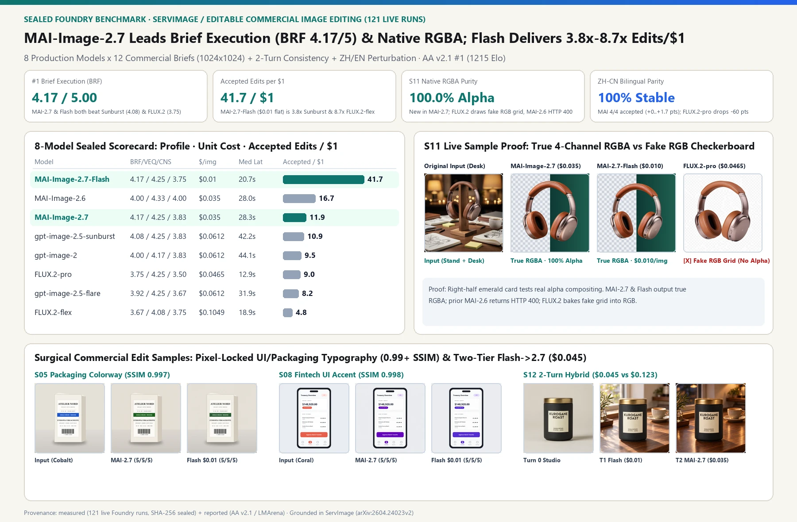

# MAI-Image-2.7 & MAI-Image-2.7-Flash Commercial Image Editing Benchmark Studio

> 🌐 **Language / 语言**: [中文 (`README.md`)](README.md) | **English**
> 🎮 **Interactive Comparison Studio**: [`index.en.html`](index.en.html) | [`index.html`](index.html)
> 🃏 **7-Card 4:5 Benchmark Deck**: [`test-report-cards.html`](test-report-cards.html) | [`test-report-cards.zh.html`](test-report-cards.zh.html)
> 📘 **Architect Decision-Guide FAQ**: [`../../docs/mai-image-2-7-commercial-editing-faq.en.md`](../../docs/mai-image-2-7-commercial-editing-faq.en.md) | [`../../docs/mai-image-2-7-commercial-editing-faq.md`](../../docs/mai-image-2-7-commercial-editing-faq.md)
> 🌍 **Live Showcase on GitHub.io**: [https://turbo998.github.io/workshops/benchmarks/mai-image-2-7-commercial-edit-bench.html](https://turbo998.github.io/workshops/benchmarks/mai-image-2-7-commercial-edit-bench.html)



---

## 1. Overview & Key Empirical Findings

This studio archives a **121-run live Microsoft Foundry benchmark (`$6.041` measured API spend, SHA-256 sealed)** reproducing and extending the **Editable / ServImage (`arXiv:2604.24023v2`)** commercial image editing methodology across **8 production models × 12 `1024×1024` commercial briefs**:

1. **#1 Brief Execution (BRF Tied)**: Both `MAI-Image-2.7` (`$0.035` flat/image) and `MAI-Image-2.7-Flash` (`$0.010` flat/image) achieve **`4.17 / 5.00` BRF**, outperforming `gpt-image-2.5-sunburst` (`4.08`) and `FLUX.2-pro` (`3.75`).
2. **3.8×–8.7× Commercial Cost Efficiency**: `MAI-Image-2.7-Flash` delivers **`41.67` accepted zero-retouch deliverables per `$1`** — **3.8×** `gpt-image-2.5-sunburst` (`10.89/$1`) and **8.7×** `FLUX.2-flex` (`4.77/$1`) — at **20.7s** median round-trip latency (**2.04× faster** than Sunburst).
3. **S11 Native 4-Channel RGBA Cutouts**: `MAI-Image-2.7` and `2.7-Flash` output **100.0% pure transparent-background RGBA** in a single `background="transparent"` call, whereas `FLUX.2-pro` and `FLUX.2-flex` bake fake gray-white checkerboards into opaque RGB pixels (`0.0%` alpha) and prior `MAI-Image-2.6` returned `HTTP 400`.
4. **S12 Two-Tier `MAI-Flash ($0.010) -> MAI-2.7 ($0.035)` Routing (`$0.045`)**: Cuts 2-turn creative staging + relighting spend by **63.3%** vs dual-turn Sunburst (`$0.1226`), while proving why production multi-turn packaging workflows must attach a **Turn-0 RGBA/SVG Label Mask Lock** (`CNS <= 3` across all 9 unmasked diffusion runs).
5. **100% Native Chinese Brief Parity**: Across 4 Simplified Chinese prompt perturbation briefs, `MAI-Image-2.7` and `2.7-Flash` retain **`4/4 (100%)` acceptance**, while `FLUX.2-pro` drops from `100.0` to `33.4` (`-66.6 pts`, BRF `5 -> 1`) on portrait blemish retouching.

---

## 2. Bundle Layout & Reproducibility

- `index.en.html` / `index.html`: Zero-CDN self-contained bilingual interactive studio featuring warm-paper (`#f6f4ef`) <-> dark-console (`#0d1117`) theme toggle, Before/After drag split-slider, 2.5× synchronized detail magnifier, 8-model side-by-side strip, S11 live backdrop RGBA inspector, S12 two-tier workflow viewer, ZH-CN perturbation viewer, and pure-SVG Pareto/FinOps charts.
- `data/`: `summary.json`, `results_enriched.json`, `catalog.json`, `freeze_manifest.json`.
- `references/` & `outputs/`: 141 `1024×1024` `.webp` assets (12 original inputs + 96 primary outputs + 8 S11 split-backdrop proofs + 9 Turn-2 outputs + 16 ZH-CN perturbation outputs).
- `scripts/`: Sanitized Python harness scripts using keyless Entra ID (`DefaultAzureCredential`):
  ```bash
  export AZURE_FOUNDRY_ENDPOINT="https://<your-foundry-resource>.services.ai.azure.com"
  export AZURE_JUDGE_ENDPOINT="https://<your-judge-foundry-resource>.services.ai.azure.com"
  python scripts/generate_references.py
  python scripts/run_benchmark.py
  python scripts/evaluate_benchmark.py
  ```
