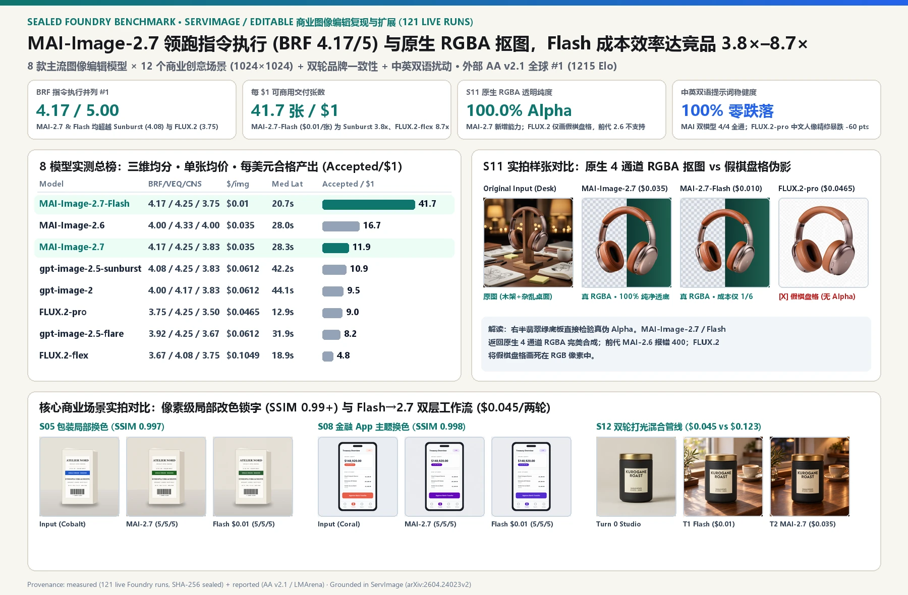

# MAI-Image-2.7 与 MAI-Image-2.7-Flash 商业图像编辑基准评测工作台

> 🌐 **Language / 语言**: **中文 (zh-CN)** | [English (`README.en.md`)](README.en.md)
> 🎮 **交互式对比工作台**: [`index.html`](index.html) | [`index.en.html`](index.en.html)
> 🃏 **7-Card 4:5 视觉评测报告**: [`test-report-cards.zh.html`](test-report-cards.zh.html) | [`test-report-cards.html`](test-report-cards.html)
> 📘 **架构师选型指南 (FAQ)**: [`../../docs/mai-image-2-7-commercial-editing-faq.md`](../../docs/mai-image-2-7-commercial-editing-faq.md) | [`../../docs/mai-image-2-7-commercial-editing-faq.en.md`](../../docs/mai-image-2-7-commercial-editing-faq.en.md)
> 🌍 **个人主页线上专题**: [https://turbo998.github.io/workshops/benchmarks/mai-image-2-7-commercial-edit-bench.html](https://turbo998.github.io/workshops/benchmarks/mai-image-2-7-commercial-edit-bench.html)



---

## 1. 工作台概述与核心发现

本目录完整归档基于 **ServImage (`arXiv:2604.24023v2`) / Editable 商业图像编辑评测方法学** 独立复现与扩展的 **121 次 Microsoft Foundry 生产级实测（总计实测花费 `$6.041`，全输入/输出 SHA-256 锁定）**。

在 **8 款主流商业图像编辑模型 × 12 个 `1024×1024` 商业创意场景** 的盲测评估中：

1. **商业指令执行度（BRF）并列全场 #1**：`MAI-Image-2.7`（`$0.035`/张固定计费）与 `MAI-Image-2.7-Flash`（`$0.010`/张固定计费）均取得 **`4.17 / 5.00`**，领先 `gpt-image-2.5-sunburst`（`4.08`）与 `FLUX.2-pro`（`3.75`）。
2. **每美元合格商业交付张数遥遥领先**：`MAI-Image-2.7-Flash` 达到 **`41.67` 张/$1**，分别是 `gpt-image-2.5-sunburst`（`10.89` 张/$1）的 **3.8 倍**、`FLUX.2-flex`（`4.77` 张/$1）的 **8.7 倍**，且中位延迟仅 **20.7 秒**（比 Sunburst 快 2.04 倍）。
3. **S11 原生 4 通道 RGBA 透明抠图代际跃迁**：`MAI-Image-2.7` 与 `2.7-Flash` 单次请求 `background="transparent"` 直出 **100.0% 纯净透明背景 RGBA**；而 `FLUX.2-pro` / `FLUX.2-flex` 将灰白棋盘格直接画入不透明 RGB 像素（Alpha 纯度 `0.0%`），前代 `MAI-Image-2.6` 返回 `HTTP 400` 降级为不透明底。
4. **S12 双层 `MAI-Flash ($0.010) -> MAI-2.7 ($0.035)` 路由与蒙版锁字结论**：两轮合计仅 **`$0.045`**（较双轮 Sunburst `$0.1226` 节省 **63.3%**），同时实证揭示所有 9 组无掩码纯扩散双轮重打光均会轻微改写微字号（`CNS <= 3`），明确了生产级管线“双层路由 + 原生 RGBA/SVG 标签锁”的黄金架构。
5. **中文商业 Brief 原生零衰减**：在 4 类中文提示词扰动实验中，`MAI-Image-2.7` 与 `2.7-Flash` 保持 **`4/4 (100%)` 商用直通**，而 `FLUX.2-pro` 在中文人像祛痘场景漏修瑕疵（百分制从 `100.0` 跌至 `33.4`，BRF 从 `5` 跌至 `1`）。

---

## 2. 目录结构与复现方法

- `index.html` / `index.en.html`：零外部 CDN 依赖的中英双语交互式对比工作台（支持暖纸 `#f6f4ef` 与暗色 `#0d1117` 主题切换、Before/After 拖拽分屏、2.5× 局部同步放大镜、8 模型同屏横评条、S11 RGBA 实时换底检验器、S12 双层工作流对比、中英扰动对比与原生 SVG Pareto 图表）。
- `data/`：`summary.json`、`results_enriched.json`、`catalog.json`、`freeze_manifest.json`（密封实测元数据）。
- `references/` & `outputs/`：12 张 `1024×1024` 原始商业参考图 + 96 张主矩阵输出 + 8 张 S11 双底板透明存证 + 9 张 Turn-2 输出 + 16 张中文指令扰动输出（共 141 张 `.webp`）。
- `scripts/`：已脱敏的可复现实验脚本（使用 `DefaultAzureCredential` 托管身份认证）：
  ```bash
  export AZURE_FOUNDRY_ENDPOINT="https://<your-foundry-resource>.services.ai.azure.com"
  export AZURE_JUDGE_ENDPOINT="https://<your-judge-foundry-resource>.services.ai.azure.com"
  python scripts/generate_references.py
  python scripts/run_benchmark.py
  python scripts/evaluate_benchmark.py
  ```
