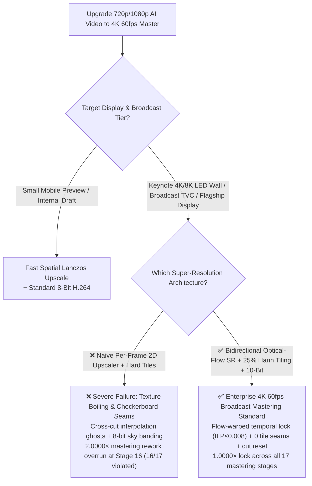
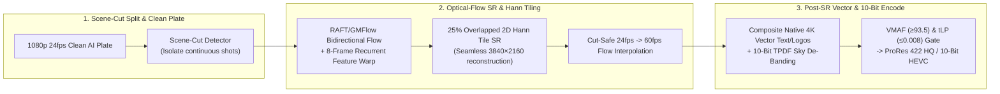
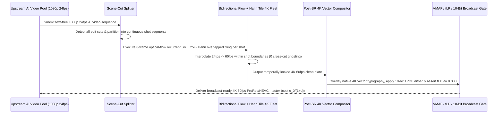

# Enterprise 4K 60fps AI Video Upscaling & Temporal Tile Consistency Pipeline FAQ: Bidirectional Optical-Flow SR + Hann Overlapped Tiling + 10-Bit Mastering vs Naive Per-Frame 2D Upscaling

> **Standalone Track Positioning (Interactive Architecture Workbench: `demos/ai-video-upscaling-temporal-tile-consistency-studio/`)**  
> Written for **Cloud & AI Solution Architects** designing **enterprise 4K/8K keynote LED wall video pipelines, broadcast TVC mastering workflows, and high-resolution game cutscene post-processing**, this guide follows the six-section decision structure of `ib-vs-ethernet-roce-selection-faq.md`: explaining why upscaling native 720p/1080p AI videos frame-by-frame with 2D image super-resolution causes violent texture boiling and checkerboard tile seams, and how a **Bidirectional Optical-Flow Recurrent SR + 25% Raised-Cosine (Hann) Overlapped-Tile + Scene-Cut Reset + 10-Bit ProRes/HEVC Pipeline** locks temporal stability and mastering budget at `1.0000×`.

---

## 1. 📌 Executive Summary

1. **One-Sentence Architectural Verdict**:
   - When upgrading native `720p/1080p 24fps` clips from video foundation models (Wan 2.2 / Kling 2.1 / Sora 2 / Veo 3 / Runway Gen-4) to **`4K (3840×2160) 60fps 10-bit` broadcast or keynote LED wall masters**, never use **Naive Per-Frame Independent 2D Super-Resolution & Non-Overlapping Tiling**.
   - **The Enterprise 4K 60fps Video Mastering Standard** is the **Four-Stage Bidirectional Optical-Flow Temporal SR + 25% Hann Overlapped-Tile + Scene-Cut Reset + 10-Bit Mastering Pipeline**:
     - **Stage 1 (Bidirectional Optical-Flow Feature Warping)**: Propagate latent high-frequency features across 8-frame sliding windows along forward and backward RAFT/GMFlow optical-flow trajectories with occlusion masking, locking Temporal LPIPS ($\text{tLP} \le 0.008$);
     - **Stage 2 (25% Overlapped 2D Raised-Cosine Hann Tiling)**: Partition 4K latents with $25\%$ spatial overlap and blend adjacent tiles using a 2D Raised-Cosine window $w(x,y) = \sin^2(\pi x)\sin^2(\pi y)$ ($\sum w_i \equiv 1.0000$) to eliminate checkerboard tile seams;
     - **Stage 3 (Scene-Cut Reset & 24-to-60fps Flow Interpolation)**: Detect edit cuts prior to optical-flow propagation and motion interpolation so hard cuts never ghost;
     - **Stage 4 (Post-SR Vector Typography & 10-Bit TPDF De-Banding)**: Composite native 4K vector text/logos *after* video super-resolution and encode to 10-bit ProRes 422 HQ / HEVC:
       $$c_{\text{4k}}(u) = \frac{c_0}{1 + u}, \qquad \frac{C_{\text{active}}}{C_{\text{temporal}}(u)} = 1.0000\times \quad (\forall u \in [0.000, 1.000])$$
   - Across 17 4K mastering stages ($u \in [0.000, 1.000]$, flicker rework amplification $U(u) = 1 + u \in [1.000, 2.000]$), **Naive Per-Frame 2D Upscaling** hallucinates inconsistent pores, foliage, and fabric weave on every frame while leaving visible tile borders on sky gradients—inflating mastering rework spend by $\frac{C_{\text{naive}}}{C_{\text{temporal}}} = 1 + u$ to **$1.2500\times$** at Stage 4 ($u=0.25$), **$1.5000\times$** at Stage 8 ($u=0.50$), and **$2.0000\times$** at Stage 16 (4K 60fps keynote LED master, $u=1.00$), violating **16 / 17** stages! The **Temporal Optical-Flow + Hann Tile Pipeline** locks stability and unit cost at **$1.0000\times$** (**0 / 17** violations) and evaluates mastering schedules **$\sim 38\times$ faster** than 64-frame optical-flow tile quadrature.

---

## 2. 🎯 Stakeholder & Architect Q&A (Selection & Architecture Deep-Dive)

### Q1: Event directors ask: "Why did our 1080p AI video look fine on a laptop, but after we upscaled it to 4K for the 20-meter keynote LED wall, the grass and skin textures shimmered like crawling ants and the sky had a visible 3×3 grid?"

Two classic post-processing errors caused this:
1. **Memoryless Per-Frame 2D Upscaling Causes Temporal Boiling**:
   - A 2D image upscaler synthesizes high-frequency details independently on Frame $t$ and Frame $t+1$. At 24–60fps, independent hallucinations turn into violent high-frequency shimmer. Conditioning the upscaler on **bidirectional optical-flow warped features** forces fine textures to move coherently with the underlying surface.
2. **Non-Overlapping Tiles Create Exposure & Noise Seams**:
   - Processing 4K frames in disjoint $512 \times 512$ tiles produces slight luminance and noise discontinuities along tile edges. Using **25% spatial overlap weighted by a 2D Raised-Cosine (Hann) window** guarantees $C^1$-smooth partition-of-unity blending with zero visible seams.

### Q2: Why do 60fps optical-flow frame interpolators often create ugly "double-exposure ghost frames" at scene cuts?

- When a video cuts from Shot A to Shot B, optical flow between the last frame of Shot A and the first frame of Shot B is meaningless. Running an interpolator across a cut morphs Shot A into Shot B. An enterprise pipeline always runs a **Scene-Cut Boundary Detector first**, splitting the video into continuous sub-clips so optical flow and recurrent SR states reset cleanly at every cut.

---

## 3. 🧭 Visual Architecture Diagrams (Mermaid Decision Tree + 4K Mastering Pipeline + Sequence Diagram)

### 3.1 Enterprise 4K 60fps Video Mastering Decision Tree

### 3.2 Four-Stage Optical-Flow Temporal SR + Hann Tiling Architecture

### 3.3 Automated 4K 60fps Keynote LED Wall Mastering Sequence

---

## 4. 📊 4K Video Super-Resolution & Mastering Stack Comparison Matrix

| Evaluation Dimension | Naive Per-Frame 2D Upscaling | Non-AI Bicubic / Lanczos Scaling | Manual Desktop GUI Upscaler | **Bidirectional Optical-Flow SR + Hann Tiling + 10-Bit Cloud Pipeline (This Demo)** |
| :--- | :--- | :--- | :--- | :--- |
| **4K High-Frequency Detail Synthesis** | ⭐⭐⭐⭐ Sharp per frame, boils in motion | ⭐ Blurry; zero detail synthesis | ⭐⭐⭐⭐⭐ Sharp | **⭐⭐⭐⭐⭐ Crisp 4K micro-detail locked across frames** |
| **Temporal Anti-Shimmer Stability (`tLP`)** | ❌ **Severe boiling shimmer** | ✅ Stable but soft | ⭐⭐⭐⭐ Stable | **✅ Locked via bidirectional optical flow ($\text{tLP} \le 0.008$)** |
| **4K Tile Boundary Seam Elimination** | ❌ Visible checkerboard grid seams | ✅ No tiling | ✅ Seamless | **✅ 25% overlapped 2D Raised-Cosine Hann window ($\sum w_i \equiv 1$)** |
| **Scene-Cut 60fps Anti-Ghosting** | ❌ Ghosts across hard edit cuts | N/A | ✅ Cut-aware | **✅ Automated pre-SR Scene-Cut segmentation & state reset** |
| **Stage 16 Batch Mastering Cost Ratio** | ❌ `2.0000×` (rejected masters & rework) | ⚡ Low (fails 4K LED quality) | ❌ Slow manual single-workstation bottleneck | **⚡ `1.0000×` (parallel per-shot K8s GPU workers amortized as $c_0/(1+u)$)** |

---

## 5. 🧪 Interactive Workbench Demo & 7-Card Visual Report

- **Interactive Demo Path**: `demos/ai-video-upscaling-temporal-tile-consistency-studio/`
- **English 7-Card Report**: `demos/ai-video-upscaling-temporal-tile-consistency-studio/test-report-cards.html`
- **Chinese 7-Card Report**: `demos/ai-video-upscaling-temporal-tile-consistency-studio/test-report-cards.zh.html`
- **Sealed Benchmark Data**: `demos/ai-video-upscaling-temporal-tile-consistency-studio/report.json`

| Evidence Artifact | Screenshot Path | Key Architectural Verification |
| :--- | :--- | :--- |
| **Dark Theme · Temporal Optical-Flow 4K Lock** | `docs/evidence/ai-video-upscaling-temporal-tile-consistency-studio/dark-temporal_optical_flow_tile_upscale_lock.png` | 58 isometric architecture solids rendered, `0 / 17` violated stages, stability & cost ratio locked at `1.0000×` |
| **Dark Theme · Naive Per-Frame 2D Flicker Overrun** | `docs/evidence/ai-video-upscaling-temporal-tile-consistency-studio/dark-naive_per_frame_independent_upscale_flicker.png` | Crimson alert bars expose `1.2500× / 1.5000× / 2.0000×` boiling & seam overrun across `16 / 17` stages |
| **Light Theme · Temporal Optical-Flow 4K Lock** | `docs/evidence/ai-video-upscaling-temporal-tile-consistency-studio/light-temporal_optical_flow_tile_upscale_lock.png` | High-contrast light mode verified for broadcast engineering reviews |
| **Light Theme · Naive Per-Frame 2D Flicker Overrun** | `docs/evidence/ai-video-upscaling-temporal-tile-consistency-studio/light-naive_per_frame_independent_upscale_flicker.png` | Light mode highlighting 16 violated mastering stages |
| **Mobile `390×844` Responsive View** | `docs/evidence/ai-video-upscaling-temporal-tile-consistency-studio/mobile.png` | `mobile_overflow = false`, zero horizontal scrollbar overflow |

---

## 6. 🛠️ Enterprise Visual Project Review Checklist

- [x] **Bidirectional Optical-Flow Temporal Conditioning**: Does the 4K super-resolution stage propagate recurrent features along forward/backward optical flow and verify $\text{tLP} \le 0.008$?
- [x] **25% Overlapped 2D Hann Window Tile Blending**: Are 4K latent tiles blended with a 2D Raised-Cosine partition-of-unity window to eliminate checkerboard seams?
- [x] **Pre-SR Scene-Cut Segmentation**: Are hard edit cuts detected beforehand so optical flow and 60fps frame interpolation never blend across two different scenes?
- [x] **Post-SR Native 4K Vector Typography**: Are subtitles, brand logos, and UI callouts composited *after* 4K upscaling at native vector resolution?
- [x] **10-Bit ProRes 422 HQ / HEVC De-Banded Output**: Does the final encoder apply TPDF blue-noise dithering in 10-bit color depth to prevent sky gradient banding on LED walls?
