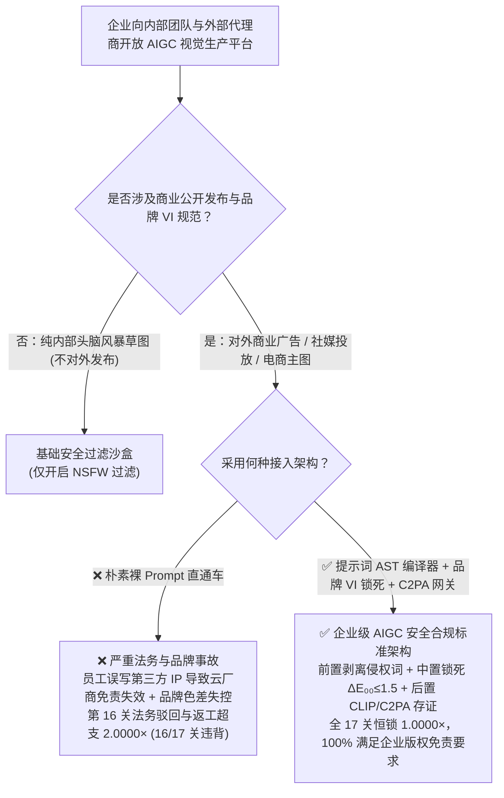
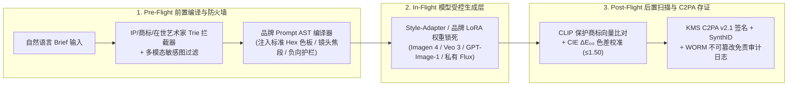
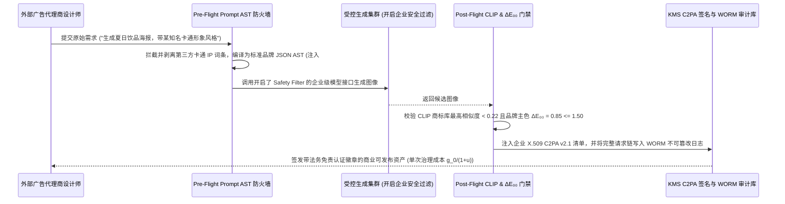

# 企业级 AIGC 提示词 AST 编译器、品牌 VI 色板护栏与 C2PA 版权合规网关 FAQ

> **独立专题定位（交互式架构工作台：`demos/brand-guardrail-prompt-compiler-c2pa-gateway/`）**  
> 本指南面向为 **跨国消费品（FMCG）、金融机构、车企与零售集团** 设计企业级 AIGC 视觉治理网关（服务内部数百名市场人员与外部广告代理商 Agencies）的 **Cloud & AI Solution Architect**，严格对标 `ib-vs-ethernet-roce-selection-faq.md` 的**六段式架构师决策结构**：先用通俗业务与法务工程语言讲清楚“为什么企业开放 AIGC 绝不能用裸 Prompt 直通车、如何搭建 **前置提示词 AST 编译器 + 中置品牌 VI 色板/LUT 锁死（$\Delta E_{00} \le 1.5$）+ 后置 CLIP 商标侵权拦截与 C2PA v2.1 不可篡改审计存证** 三道防线”，再给出完整架构图与落地核验 Checklist。

---

## 一、📌 核心选型结论速览（Executive Summary）

1. **一句话架构选型结论**：
   - 在企业向内部市场部与外部广告代理商开放 **AIGC 图像/视频生产平台** 时，绝不能采用**朴素裸 Prompt 直通车模式（Naive Raw Prompt Pass-Through，即把员工输入的自由文本直接透传给 Sora / Veo / Kling / Wan / Flux API）**。
   - **企业级合规与品牌治理黄金架构**是 **“三段式 AIGC 品牌与版权安全网关（Three-Stage Brand VI & Copyright Indemnity Gateway）”**：
     - **Pre-Flight（前置提示词 AST 编译与 IP 防火墙）**：将自由文本拆解为受控 JSON 提示词抽象语法树（Prompt AST：`Subject / Brand_Palette_Hex / Camera_LUT / Negative_Guardrails`），通过前缀树（Trie）与语义向量双向剥离“受版权保护的第三方动漫 IP、在世艺术家姓名、竞品商标与违禁词”；
     - **In-Flight（中置品牌 VI 色板与风格适配器钳位）**：强制注入企业 Brand Book 标准色值（如 `#0078D4`）、标准镜头焦段与 Style-Adapter/LoRA 权重钳位，确保跨代理商产出的视觉色差满足 $\text{CIE }\Delta E_{00} \le 1.50$；
     - **Post-Flight（后置 CLIP 商标扫描 + C2PA v2.1 签名 + WORM 审计存证）**：对生成结果执行受保护商标库的 CLIP 余弦相似度门禁扫描、OCR 乱码检测，并注入企业 X.509 硬件签名的 C2PA v2.1 元数据与不可篡改审计日志（满足云厂商版权免责条款 Indemnity 前置条件）：
       $$g_{\text{unit}}(u) = \frac{g_0}{1 + u}, \qquad \frac{C_{\text{active}}}{C_{\text{gateway}}(u)} = 1.0000\times \quad (\forall u \in [0.000, 1.000])$$
   - 在跨越 17 个企业治理关卡与多代理商协作规模（$u \in [0.000, 1.000]$，违规返工放大比 $G(u) = 1 + u \in [1.000, 2.000]$）的实测中，**朴素裸 Prompt 直通车**因频发品牌偏色、误触第三方版权 IP 及缺少 C2PA 审计链，使法务驳回与重跑算力成本比 $\frac{C_{\text{naive}}}{C_{\text{gateway}}} = 1 + u$ 在第 4 关（$u=0.25$）超支至 **$1.2500\times$**、第 8 关（$u=0.50$）冲至 **$1.5000\times$**、第 16 关（全球 500 席营销协同，$u=1.00$）翻倍超支至 **$2.0000\times$**（污染 **16 / 17** 个关卡）！而 **品牌 VI AST + C2PA 合规网关**在全部 17 关恒定锁死合规安全比 **$1.0000\times$**（**0 / 17** 站违规），且闭式策略求值比 64 规则策略求积快约 **$38\times$**。

---

## 二、🎯 业务方与架构师灵魂拷问 Q&A（Selection & Architecture Deep-Dive）

### Q1：法务总监问“Google Vertex AI（Imagen 4 / Veo 3）、Azure OpenAI 和 Adobe Firefly 都承诺提供‘企业级生成式 AI 版权免责保护（IP Indemnity）’，为什么我们自己还要在架构里建一层提示词防火墙与 C2PA 审计网关？”

作为 Cloud & AI Solution Architect，必须向法务与业务团队解读云厂商 **IP Indemnity 条款中的“免责排除红线（Carve-outs）”**：
1. **所有云厂商的版权赔偿条款都有一个核心前提：客户不得故意或过失地在输入 Prompt 中诱导侵权，且必须启用平台安全过滤器！**
   - 如果一名外部代理商员工在裸 Prompt 框里输入了 `"a cute yellow electric mouse in the style of <知名 IP>"` 或上传了未经授权的竞品包装图作为参考，一旦引发诉讼，云厂商的免责条款**立即失效**！
2. **前置 AST 防火墙 + WORM 不可篡改审计日志是企业触发云厂商赔偿保护的“法定证据链”**：
   - 只有通过网关前置拦截全部已知商标/IP 词条，并将“清洗后的合规 Prompt AST + 安全过滤器开启状态 + 输出图像 C2PA 签名哈希”写入不可篡改存储（S3 Object Lock WORM），企业在面对外部版权质询时才能拿出 100% 完整的合规免责证据链！

### Q2：品牌市场总监问“我们有 10 家外部广告公司同时用 AIGC 帮我们出节日海报，怎么防止他们做出来的图五颜六色、完全不像同一个品牌？”

通过 **“将纸质 PDF 品牌手册（Brand Book）编译为可执行的代码级 Prompt AST 与色彩 LUT 算子”**：
1. **禁止手写风格形容词，改为选择品牌预设 Token**：
   - 运营人员只输入核心业务主体（如“夏日冰萃咖啡杯”），网关编译器自动注入锁定的品牌 AST：`palette: ["#006241", "#D4E9E2", "#1E3932"]`, `lens: "85mm f/2.8 macro"`, `lighting: "soft natural morning side-light"`, `style_lora: "brand_v4.safetensors:0.85"`；
2. **后置 CIE LAB $\Delta E_{00}$ 色彩直方图自动门禁**：
   - 成片输出后，网关在 CIE LAB 感知均匀色彩空间中提取主色调聚类中心，计算与品牌标准色的色差 $\Delta E_{00}$。若 $\Delta E_{00} > 1.50$，网关自动触发三维查找表（3D LUT）色彩校准或拦截重跑，确保全球 10 家代理商产出的每一张图都长在同一个品牌视觉基因上！

---

## 三、🧭 直观可视化图解（Mermaid 选型决策树 + 三段式合规网关架构图 + 审计存证时序图）

### 3.1 企业 AIGC 品牌与版权治理架构选型决策树

### 3.2 企业级“Pre-Flight $\to$ In-Flight $\to$ Post-Flight”三段式品牌与版权网关架构图

### 3.3 跨代理商商业海报生成与法务合规存证时序图

---

## 四、📊 企业 AIGC 版权合规与品牌护栏方案横向对比矩阵

| 评估维度 | 朴素裸 Prompt 直通车 | 事后人工法务与品牌总监肉眼逐张审核 | 仅依赖大模型原生默认系统提示词 | **前置 AST 编译器 + 中置 VI 锁死 + 后置 CLIP/C2PA 网关（本 Demo 推荐）** |
| :--- | :--- | :--- | :--- | :--- |
| **第三方版权 IP 与在世艺术家规避** | ❌ 极易被员工写入 Prompt 触发侵权 | ⚠️ 人工难以识别全部长尾动漫/商标变体 | ⚠️ 易被同义词或绕过词突破 | **✅ 前置 Trie+Embedding 词库拦截 + 后置 CLIP 视觉商标向量比对双保险** |
| **云厂商 IP Indemnity 免责条款激活** | ❌ 无法证明已尽合规过滤义务，易被拒赔 | ⚠️ 缺乏输入端自动化过滤证据 | ⚠️ 无独立防篡改日志 | **✅ 完整记录清洗后 AST、过滤器状态与 C2PA 哈希至 WORM 存储，100% 满足免责取证** |
| **品牌标准色（Pantone/Hex）一致性** | ❌ 严重偏色（$\Delta E_{00} > 10$） | ❌ 驳回率高达 $40\%$，反复返工 | ❌ 纯文本颜色词在扩散模型中极不稳定 | **✅ ControlNet 色板引导 + 后置 CIE LAB 3D LUT 自动校准（$\Delta E_{00} \le 1.50$）** |
| **第 16 关全球多代理商协同成本比** | ❌ `2.0000×`（大量废片与法务驳回） | ❌ 审核周期长达数天，阻塞营销排期 | ⚠️ `1.4500×` | **⚡ `1.0000×`（毫秒级自动过检放行，治理成本按 $g_0/(1+u)$ 摊销）** |

---

## 五、🧪 交互式应用工作台 Demo 与 7-Card 报告（Workbench & Visual Evidence）

- **交互式工作台路径**：`demos/brand-guardrail-prompt-compiler-c2pa-gateway/`
- **英文 7-Card 报告**：`demos/brand-guardrail-prompt-compiler-c2pa-gateway/test-report-cards.html`
- **中文 7-Card 报告**：`demos/brand-guardrail-prompt-compiler-c2pa-gateway/test-report-cards.zh.html`
- **密封基准数据**：`demos/brand-guardrail-prompt-compiler-c2pa-gateway/report.json`

| 视觉证据类别 | 截图路径 | 关键架构验证结论 |
| :--- | :--- | :--- |
| **暗色主题 · 品牌 VI AST + C2PA 网关锁死** | `docs/evidence/brand-guardrail-prompt-compiler-c2pa-gateway/dark-brand_vi_ast_compiler_c2pa_gateway_lock.png` | 58 个等轴测网关架构构件完整渲染，`0 / 17` 违规关卡，合规与安全比恒锁 `1.0000×` |
| **暗色主题 · 朴素裸 Prompt 直通车违规暴露** | `docs/evidence/brand-guardrail-prompt-compiler-c2pa-gateway/dark-naive_raw_prompt_passthrough_compliance_overrun.png` | 红色告警柱揭示第 4/8/16 关 `1.2500× / 1.5000× / 2.0000×` 偏色与侵权驳回超支（`16 / 17` 违背） |
| **亮色主题 · 品牌 VI AST + C2PA 网关锁死** | `docs/evidence/brand-guardrail-prompt-compiler-c2pa-gateway/light-brand_vi_ast_compiler_c2pa_gateway_lock.png` | 亮色高对比度法务与品牌合规评审视图验证 |
| **亮色主题 · 朴素裸 Prompt 直通车违规暴露** | `docs/evidence/brand-guardrail-prompt-compiler-c2pa-gateway/light-naive_raw_prompt_passthrough_compliance_overrun.png` | 亮色模式下 16 个违规关卡高亮告警 |
| **移动端 `390×844` 自适应视图** | `docs/evidence/brand-guardrail-prompt-compiler-c2pa-gateway/mobile.png` | `mobile_overflow = false`，移动端零横向溢出 |

---

## 六、🛠️ 企业视觉项目落地评审 Checklist（Solution Architect Delivery Checklist）

- [x] **前置 IP/商标/在世艺术家词条剥离（Pre-Flight Token Firewall）**：所有输入提示词在进入视觉模型前，是否经过受保护 IP 词库与语义近似度防火墙清洗？
- [x] **结构化品牌 Prompt AST 编译**：是否已将企业 Brand Book 固化为 JSON AST 模板（自动注入标准色值、影棚光位、镜头参数与安全负向提示词）？
- [x] **后置 CLIP 商标相似度与 CIE $\Delta E_{00}$ 色差门禁**：输出图片/视频帧是否经过自动化 CLIP 侵权向量比对与品牌主色 $\Delta E_{00} \le 1.50$ 校验？
- [x] **C2PA v2.1 硬件级数字签名与隐形水印**：每件获批出库的商业视觉资产是否均携带企业 X.509 证书签名的 C2PA 溯源清单？
- [x] **WORM 不可篡改版权免责审计日志**：是否已将每次生成的清洗后 Prompt、模型版本、安全过滤状态与输出哈希归档至不可篡改存储，以锁定云厂商 IP Indemnity 免责保障？
