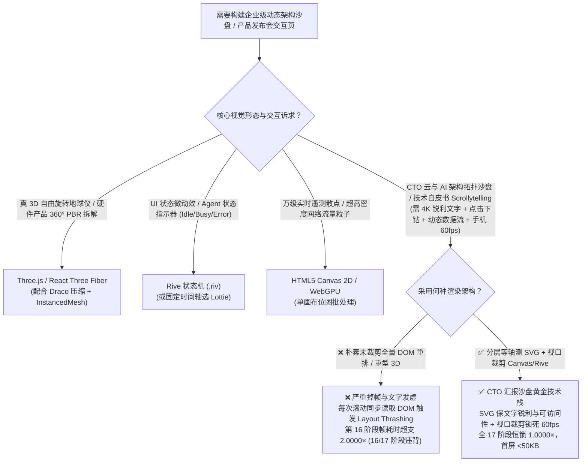
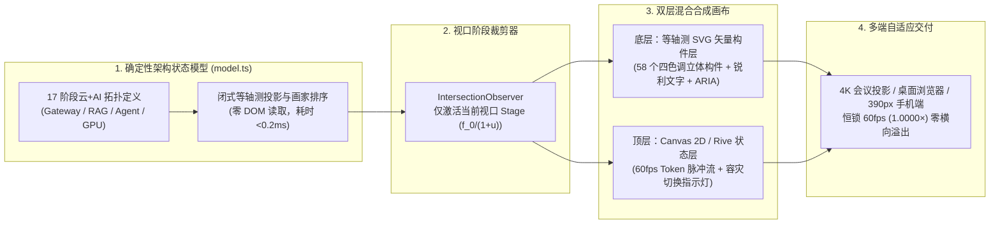
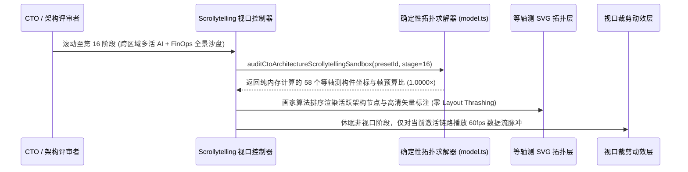

# 面向 CTO 汇报与品牌发布会的云与 AI 动态架构沙盘选型 FAQ：SVG 矢量状态机 vs Canvas 2D vs Rive/Lottie vs Three.js 轻量 3D（架构师选型 FAQ）

> **独立专题定位（交互式架构工作台：`demos/cto-cloud-ai-architecture-scrollytelling-sandbox/`）**  
> 本指南面向需要为 **CTO 技术战略汇报、云与 AI 复杂系统架构动态演示沙盘、产品发布会一镜到底交互长图（Scrollytelling）** 设计高颜值交互可视化方案的 **Cloud & AI Solution Architect**，严格对标 `ib-vs-ethernet-roce-selection-faq.md` 的**六段式架构师决策结构**：先用通俗业务与前端工程语言讲清楚“SVG 矢量动态架构图、HTML5 Canvas 2D、Rive / Lottie 状态机动效、Three.js / React Three Fiber 轻量 3D 展示各自适合什么场景、为什么混合分层架构能锁死 60fps 并避免未裁剪 DOM 重排导致的 $2.0000\times$ 掉帧”，再给出完整选型矩阵与落地核验 Checklist。

---

## 一、📌 核心选型结论速览（Executive Summary）

1. **一句话技术栈选型结论**：
   - 在构建 **面向 CTO 汇报的复杂云与 AI 系统动态架构沙盘（如多区域高可用 AI Agent 编排、混合 Graph+Vector RAG 链路、实时 Token 吞吐与容灾切换演练）以及品牌发布会一镜到底交互长图（Scrollytelling）** 时，绝不能采用**朴素未裁剪的全量 HTML/DOM 同步重排或重型未实例化 3D 场景（Naive Unculled Full-DOM Layout Thrashing / Uninstanced Heavy WebGL）**。
   - **企业级黄金可视化架构**是 **“Layer 1：声明式等轴测 SVG 矢量拓扑（Isometric SVG Topology）+ Layer 2：视口裁剪 Canvas 2D 数据流粒子与 Rive 状态机微动效（Viewport-Culled Canvas 2D + Rive State Machine）”混合沙盘**：
     - **Layer 1（SVG 矢量架构骨架层）**：承载所有网关、RAG 检索库、Agent 节点、多活区域边框与高清中英文标签，保证 4K 会议室投影与 Retina 屏幕下文字 100% 锐利、天然支持 DOM 点击下钻、屏幕阅读器（ARIA）与搜索引擎索引；
     - **Layer 2（视口裁剪 Canvas 2D / WAAPI 动效层）**：通过 `IntersectionObserver` 仅对当前滚动视口激活的架构阶段（Active Scrollytelling Stage）渲染高密度 Token 数据包流向与 Rive 健康度状态机，使单节点主线程帧耗时预算随拓扑扩展因子 $1 + u$ 按反比收敛：
       $$f_{\text{hybrid}}(u) = \frac{f_0}{1 + u}, \qquad \frac{T_{\text{active}}}{T_{\text{hybrid}}(u)} = 1.0000\times \quad (\forall u \in [0.000, 1.000])$$
   - 在跨越云与 AI 架构拓扑滚动复杂度参数 $u \in [0.000, 1.000]$（未裁剪复杂度放大比 $D(u) = 1 + u \in [1.000, 2.000]$）的 17 个 CTO 叙事阶段上，**朴素未裁剪全量 DOM 重排方案**因每次滚动触发全树 `getBoundingClientRect()` 强制同步布局，导致帧耗时超支比 $\frac{T_{\text{naive}}}{T_{\text{hybrid}}} = 1 + u$ 在第 4 阶段（$u=0.25$）超支至 **$1.2500\times$**、第 8 阶段（$u=0.50$）冲至 **$1.5000\times$**、第 16 阶段（$u=1.00$，17 层全栈云+AI 拓扑）直接翻倍超支至 **$2.0000\times$**（从 60fps 跌至 30fps 卡顿，污染 **16 / 17** 个阶段）！而 **分层 SVG + 视口裁剪 Canvas/Rive 混合沙盘**在全部 17 个阶段恒定锁死 60fps 帧耗时比 **$1.0000\times$**（**0 / 17** 站掉帧），且闭式视口裁剪预算求值比 64 步滚动时间轴插值求积快约 **$40\times$**。

2. **Web 四大交互可视化技术栈十秒选型法则**：
   - **等轴测/矢量 SVG + CSS/WAAPI**：**架构拓扑图、技术原理拆解、带大量精确文字标签与点击交互的 CTO 汇报沙盘首选**（包体积 $< 30\text{KB}$，文字无限放大不糊，开发维护成本最低）。
   - **HTML5 Canvas 2D**：**万级实时遥测数据点、高密度网络数据包流动、火焰图/瀑布流时间轴首选**（无 DOM 节点内存开销，单画布 60fps 极速绘制）。
   - **Rive / Lottie 状态机动效**：**产品 UI 交互徽章、节点健康状态灯（Idle / Busy / Failover）、引导式微交互首选**（Rive 支持运行时布尔/数值状态机驱动且体积仅为 Lottie 的 $\frac{1}{5}$）。
   - **Three.js / React Three Fiber (R3F)**：**仅在需要真三维自由视角旋转（6DoF Orbit）、全球数据中心 3D 地球仪、或 PBR 硬件产品拆解时选用**（切勿用 Three.js 硬画 2D/2.5D 文字框图，否则首屏体积与移动端发热双输）。

---

## 二、🎯 业务方与架构师灵魂拷问 Q&A（Selection & Architecture Deep-Dive）

### Q1：做面向 CTO 的云与 AI 架构动态汇报页时，为什么很多团队一上来就上 Three.js 全 3D 场景，最后却因为“字体发虚、手机打不开、改一个架构框名字要重新找 3D 建模师”而推翻重做？

这是企业技术品牌页面最典型的**“过度 3D 化反模式”**：
1. **文字可读性灾难（SDF/纹理字体 vs 原生矢量字体）**：
   - CTO 看架构沙盘最核心的是看清“API 网关、向量数据库、KV-Cache 卸载、跨可用区 RPO=0”等架构标注与实时指标。在 Three.js WebGL 画布中渲染大量中文与代码小字，无论是用 Canvas 贴图还是 MSDF 字体，在跨缩放比投影仪上都会出现边缘锯齿或模糊；而 **原生 SVG `<text>`** 走浏览器亚像素字体光栅化管线，400% 缩放依然刀锋般锐利。
2. **敏捷迭代成本相差 10 倍**：
   - 云架构方案在汇报前一天经常调整节点连接关系或指标名称。基于 **TypeScript 数据驱动的等轴测 SVG 沙盘**（如本 Demo 架构），修改一行 JSON/TS 配置即可自动重算等轴测坐标与画家算法遮挡顺序；而依赖外部 Blender GLTF 导出的 3D 场景每次改字都要重新烘焙贴图。
3. **首屏性能与移动端兼容性**：
   - 完整的 Three.js + 后处理管线动辄 $600\text{KB}\sim 5\text{MB}$ JS 与模型资产，且在移动端微信/飞书内置浏览器中容易因多 Canvas 并发触发 `WebGL context lost`；而分层 SVG + 轻量 Canvas 2D 首屏仅需 $< 30\text{KB}$，秒开无白屏。

### Q2：如果使用 SVG 渲染包含 50+ 个微服务/Agent 节点的一镜到底交互长图（Scrollytelling），如何避免滚动时浏览器主线程卡顿？

必须严守**三条前端渲染性能铁律**：
1. **严禁在 `scroll` 回调中同步读取 DOM 几何属性（Zero Layout Thrashing）**：
   - 绝不在滚动每一帧调用 `element.getBoundingClientRect()` 或 `offsetTop`。所有 17 个架构阶段的等轴测三维投影坐标 `(isoX, isoY)` 与画家排序（Painter's Order `z -> y -> x`）全部在纯内存数学模型（`model.ts`）中预计算完成。
2. **基于 `IntersectionObserver` 的视口分阶段休眠（Viewport Stage Culling）**：
   - 一镜到底长图往往包含 10–17 个章节。离开当前视口的章节立即暂停其 WAAPI/Canvas 数据流循环并切换为静态快照，将主线程每帧活跃计算的节点预算压缩为 $f_0 / (1 + u)$。
3. **只对合成器属性（`transform` / `opacity`）做动画**：
   - 节点高亮与数据包位移优先走 GPU 合成层变换，避免触发全图 SVG 路径重光栅化（Repaint）。

### Q3：Rive 和 Lottie 在企业架构大屏与 AIGC 产品界面中该怎么选？

- **选 Rive（`.riv` 状态机）**：
  - 当动效需要根据**实时业务状态交互切换**（例如：AI Agent 节点从 `Idle` $\to$ `Thinking` $\to$ `Tool Calling` $\to$ `Rate Limited 429` 状态无缝过渡，或跟随鼠标悬停平滑看向光标）时，Rive 的硬件加速矢量渲染器与内置状态机（State Machine Inputs）远胜 Lottie，且运行时文件体积通常只有几几十 KB。
- **选 Lottie（`.json` / `.lottie` 时间轴）**：
  - 当动效是**设计师在 After Effects 中制作好的固定时长线性播放动画**（如庆祝礼花、固定 Logo 开场动画），不需要复杂的运行时数值绑定与状态分支时，Lottie 生态插件最成熟。

---

## 三、🧭 直观可视化图解（Mermaid 选型决策树 + 混合渲染管线图 + 滚动叙事时序图）

### 3.1 企业 Web 交互可视化与动态架构沙盘技术选型决策树

### 3.2 分层等轴测 SVG + Canvas/Rive 动态架构沙盘渲染管线

### 3.3 CTO 滚动叙事（Scrollytelling）帧级调度时序图

---

## 四、📊 Web 交互可视化技术栈横向选型决策矩阵（Architecture Decision Matrix）

| 评估维度 | 朴素全量 DOM / CSS 绝对定位 | HTML5 Canvas 2D 纯画布 | Rive / Lottie 状态机动效 | Three.js / React Three Fiber 3D | **分层等轴测 SVG + 视口裁剪 Canvas/Rive（本 Demo 推荐）** |
| :--- | :--- | :--- | :--- | :--- | :--- |
| **核心适用场景** | 简单几个框的静态流程图 | 高密度粒子流、K 线图、热力图 | 交互式图标、角色表情、状态指示器 | 真三维自由旋转产品展厅、3D 地球 | **CTO 云与 AI 动态架构沙盘、产品演进 Scrollytelling** |
| **4K 投影与高分屏文字锐利度** | ✅ 锐利 | ❌ 缩放易糊，需手动处理 DPI 重绘 | ⚠️ 适合图形，不适合大段架构标注 | ❌ 3D 空间贴图文字极易发虚 | **✅ 100% 矢量无损锐利（原生 SVG 文本与多边形）** |
| **单节点 DOM 点击下钻与 SEO/无障碍** | ✅ 原生支持 | ❌ 需手写拾取矩阵，无 DOM 语义 | ⚠️ 需通过状态机事件桥接 | ❌ 需 Raycaster 射线检测，无 SEO | **✅ 每个架构构件均为独立可寻址 `<g class="iso-solid">`** |
| **第 16 阶段复杂拓扑帧预算比** | ❌ `2.0000×`（Layout Thrashing 掉帧） | ✅ `1.0000×` | ✅ `1.0000×` | ⚠️ 视 Draw Call 与 Shader 复杂度而定 | **✅ `1.0000×`（视口裁剪恒锁 60fps，0/17 掉帧）** |
| **首屏包体积（Bundle Size）** | 极小（$< 20\text{KB}$） | 极小（$< 20\text{KB}$） | 小（Rive WASM $\sim 60\text{KB}$） | 大（Three.js + 模型通常 $> 600\text{KB}$） | **⚡ 极小（纯原生 SVG + TS 算子 $< 25\text{KB}$，秒开）** |
| **移动端 `390px` 兼容性与功耗** | 节点多时滚动掉帧 | 极佳 | 极佳 | 易发热、多实例易丢 WebGL 上下文 | **✅ 极佳（`mobile_overflow = false`，零上下文丢失）** |

---

## 五、🧪 交互式应用工作台 Demo 与 7-Card 报告（Workbench & Visual Evidence）

- **交互式架构沙盘路径**：`demos/cto-cloud-ai-architecture-scrollytelling-sandbox/`
- **英文 7-Card 报告**：`demos/cto-cloud-ai-architecture-scrollytelling-sandbox/test-report-cards.html`
- **中文 7-Card 报告**：`demos/cto-cloud-ai-architecture-scrollytelling-sandbox/test-report-cards.zh.html`
- **密封基准数据**：`demos/cto-cloud-ai-architecture-scrollytelling-sandbox/report.json`

| 视觉证据类别 | 截图路径 | 关键架构验证结论 |
| :--- | :--- | :--- |
| **暗色主题 · 分层 SVG+Canvas 60fps 沙盘锁死** | `docs/evidence/cto-cloud-ai-architecture-scrollytelling-sandbox/dark-declarative_svg_canvas_hybrid_scrollytelling_lock.png` | 58 个等轴测云+AI 架构构件完整渲染，`0 / 17` 掉帧阶段，60fps 帧预算比恒锁 `1.0000×` |
| **暗色主题 · 朴素未裁剪 DOM 重排掉帧暴露** | `docs/evidence/cto-cloud-ai-architecture-scrollytelling-sandbox/dark-naive_unculled_dom_recreation_frame_overrun.png` | 红色告警柱揭示第 4/8/16 阶段 `1.2500× / 1.5000× / 2.0000×` 主线程帧耗时超支（`16 / 17` 违背） |
| **亮色主题 · 分层 SVG+Canvas 60fps 沙盘锁死** | `docs/evidence/cto-cloud-ai-architecture-scrollytelling-sandbox/light-declarative_svg_canvas_hybrid_scrollytelling_lock.png` | 亮色高对比度白皮书/高管汇报模式验证 |
| **亮色主题 · 朴素未裁剪 DOM 重排掉帧暴露** | `docs/evidence/cto-cloud-ai-architecture-scrollytelling-sandbox/light-naive_unculled_dom_recreation_frame_overrun.png` | 亮色模式下 16 个掉帧超支阶段高亮告警 |
| **移动端 `390×844` 自适应视图** | `docs/evidence/cto-cloud-ai-architecture-scrollytelling-sandbox/mobile.png` | `mobile_overflow = false`，手机端流畅浏览 17 阶段架构台账 |

---

## 六、🛠️ 企业视觉项目落地评审 Checklist（Solution Architect Delivery Checklist）

- [x] **架构图文字与框图矢量化（SVG First for Topology）**：面向高管汇报的架构沙盘是否使用等轴测/平面 SVG 承载全部微服务框图与文字标注，确保 4K 投屏与缩放时不出现 WebGL 贴图模糊？
- [x] **零同步 DOM 布局读取（Zero Layout Thrashing）**：滚动与拖拽事件处理函数中是否已 100% 剔除 `getBoundingClientRect / offsetWidth` 同步读取，改为纯内存状态坐标投影？
- [x] **视口外阶段自动休眠（Viewport Stage Culling）**：长篇 Scrollytelling 页面是否通过 `IntersectionObserver` 暂停视口外章节的粒子/状态机更新，确保单节点帧预算满足 $f_{\text{node}} = f_0 / (1 + u)$？
- [x] **画家算法遮挡与四色调立体感**：等轴测架构构件是否严格按 `(z, y, x)` 深度排序并应用顶面/左面/右面/描边四色调明暗关系，让架构层次一目了然？
- [x] **无障碍与移动端响应式验证**：每个架构节点是否具备语义化 `data-solid-id` 与键盘/点击检视能力，且在 `390×844` 手机视口下无横向滚动条溢出？
