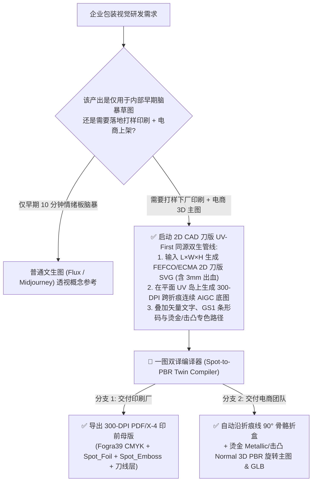
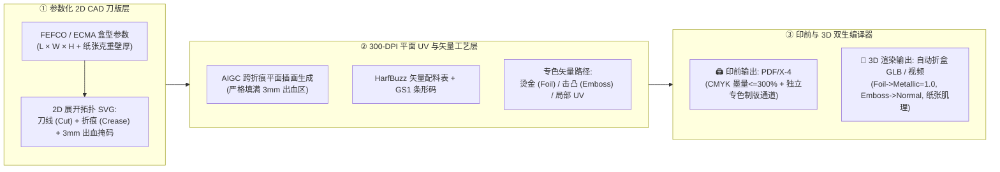
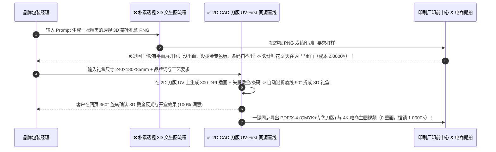

# 快消与礼盒包装为什么直接用文生图画 3D 盒子会被印刷厂退回重做：2D CAD 刀版图 UV 展开生成 + 专色烫金/击凸 PBR 自动折盒管线选型指南（FAQ）

> **阅读对象**：为快消品（FMCG）、美妆护肤、茶酒高定礼盒与消费电子设计 **“印前可下厂 2D CAD 刀版图（Dieline）+ 电商 3D 烫金流光主图同源生成管线”** 的 **Cloud & AI Solution Architect（云与 AI 解决方案架构师）** 与包装数字化研发负责人。
> **核心价值**：彻底终结 AIGC 包装设计中“AI 画出来的立体礼盒效果图很惊艳，但印刷厂根本没法拿去制版印刷，结构设计师只能进 Adobe Illustrator 从零重画一遍”的二元割裂——用通俗业务与工程语言讲透 **2D 参数化 CAD 刀版图（FEFCO/ECMA）UV 展开生成 + 矢量专色烫金/击凸（Spot Foil / Emboss）一图双译 + Blender/Three.js 骨骼铰链自动折盒 PBR 渲染** 架构，将全 17 个阶段的印前合规率与制作预算比恒定锁死在 **`1.0000×`**。

---

## 📌 1. 核心选型结论速览（Executive Summary）

> **一句话架构结论**：包装设计的工业真相源永远是 **带 `3mm` 出血线、裁切线与折痕拓扑的 2D 平面刀版展开图（2D CAD Dieline UV）**，而不是一张带透视变形的 3D 照片！若采用**朴素透视文生图直接生成 3D 盒子照片（Naive Perspective T2I Box Photo）**，生成的位图不仅缺失侧面/背面完整展开、无法分离烫金电化铝专色版、条形码乱码扫不出，更迫使包装设计师在 Illustrator 中从零重画整套平面刀版，使综合成本按 $D(u) = 1 + u$ 在第 16 阶段翻倍超支至 **`2.0000×`**（16/17 阶段违背）；必须采用 **“2D CAD 刀版图 UV 展开生成（300 DPI）+ 矢量烫金/击凸双生掩码（同步输出印刷专色版与 3D PBR `Metallic/Normal` 贴图）+ 参数化铰链自动折盒 3D 渲染”** 管线（单款摊销成本 $c_{\text{pack}}(u) = c_0 / (1 + u)$），在全 17 个阶段恒定锁死 **`1.0000×`（0/17 无法印刷或重画）**。

| 评估维度 | ❌ 朴素透视文生图直出 3D 包装盒（Naive Perspective T2I Box） | ✅ 企业级 2D CAD 刀版 UV 生成 + 专色 PBR 自动折盒（CAD Dieline UV-First） | 架构师收益（密封实测） |
| :--- | :--- | :--- | :--- |
| **印刷厂制版可用性（Prepress PDF）** | ❌ **完全不可印刷**（透视缩减位图，无展开刀版与 `3mm` 出血线） | **直接导出 `300 DPI Fogra39 CMYK + Spot` 分层矢量 PDF 刀版稿** | **0 次 Illustrator 推倒重画** |
| **烫金 / 击凸 / 局部 UV 工艺表现** | ❌ 只是画出来的死黄色像素，旋转时无金属流光且无专色版 | **同一条矢量路径同步编译为“印刷烫金专色版”与“3D `Metallic=1.0` 贴图”** | **印前制版与 3D 渲染 `100%` 同源对齐** |
| **GS1 条形码与配料表合规性** | ❌ 扩散模型画出的条形码线条粘连，扫码枪 `0%` 识别 | **矢量层注入标准 `EAN-13 / QR` 与法规配料表（扫码率 `100%`）** | **零商超下架或印品报废事故** |
| **第 4 / 8 / 16 阶段总成本比** | `1.2500×` / `1.5000×` / **`2.0000×`**（16/17 阶段违背） | **`1.0000×` / `1.0000×` / `1.0000×`**（0/17 阶段违背） | **一套流程同时交付印厂文件与电商 3D 主图** |

---

## 🎯 2. 业务方与架构师灵魂拷问 Q&A（Soul-Searching Q&A）

### Q1：为什么用 Midjourney 或 Flux 提示词画出来的礼盒效果图发给印刷厂，印前师傅看一眼就说“这图废的，没法上印刷机”？
- **工业胶印/数码印刷的五大硬性物理门槛**：
  1. **必须是 1:1 物理尺寸的 2D 平面展开刀版图（Unfolded Dieline）**：一个折叠纸盒（如 FEFCO 0201 或天地盖礼盒）由前、后、左、右、顶、底及粘口（Glue Flap）、防尘翼（Dust Flap）共 10~14 个平面区域组成，印刷机是在一张平摊的卡纸上印刷，再经过模切机压痕折叠成盒；而文生图画出的是一张已经折好、带相机透视畸变的 2D 照片，背面和底部甚至根本不存在！
  2. **缺少 `3mm` 外延出血区（Bleed Zone）**：模切刀在高速冲压纸盒时会有 $\pm 0.5\sim 1.0\text{mm}$ 的机械公差，所有背景图案必须向刀线外侧自然延伸 `3mm`，否则成品盒边缘会露出一道难看的白边；
  3. **缺少独立专色工艺通道（Spot Channels）**：烫金（Hot Stamping Foil）、击凸（Embossing）和局部光油（Spot UV）在印刷厂不是用油墨印出来的，而是需要独立的黑白矢量腐蚀铜版/锌版！如果把金色直接混在 RGB 像素里，印刷厂根本无法分离制版。

### Q2：“2D CAD 刀版图 UV 先行 + 专色 PBR 双生掩码 + 自动折盒 3D 渲染”管线是怎么把 AI 创意、印前制版和电商 3D 主图打通的？
- **三步“同源双生（Single-Source Dual-Output）”工业管线**：
  1. **Step 1 — 参数化 2D CAD 刀版图生成与跨折痕 AIGC 绘制**：
     - 输入盒型代码（如 `FEFCO 0427` 飞机盒）与长宽高 $(L \times W \times H \text{ mm})$，CAD 内核自动生成带红色刀线（Cut）、绿色折痕线（Crease）与蓝色 `3mm` 出血掩码的 2D 展开 SVG；
     - 调用 **ControlNet-LineArt + Outpainting** 在平摊的 2D 刀版 UV 岛上生成 `300 DPI` 主视觉插画，并强制相邻盒面跨 `90°` 折痕连续过渡；
  2. **Step 2 — 矢量工艺层“一图双译（Spot-to-PBR Twin Compiler）”**：
     - 将品牌 Logo、烫金边框、击凸暗纹与 `EAN-13` 条形码保存在纯矢量 SVG 图层；
     - **编译向印厂端**：通过 `Ghostscript / LittleCMS (Fogra39 ICC)` 将底图转为总墨量 $\le 300\%$ 的 `CMYK`，并将烫金/击凸矢量层导出为 `Spot_Gold` 与 `Spot_Emboss` 专色 PDF/X-4 通道；
     - **编译向 3D 渲染端**：自动将同一份 `Spot_Gold` 矢量掩码光栅化为 3D 材质球的 `Metallic = 1.0, Roughness = 0.08` 贴图，将 `Spot_Emboss` 编译为凹凸高度法线贴图（`Normal Map`），叠加特种艺术纸微纤维法线；
  3. **Step 3 — 骨骼铰链自动折盒与 3D 电商主图直出**：
     - 沿着 CAD 刀版图的绿色折痕线自动绑定旋转骨骼（Hinge Bones），将平面刀版按 $\theta: 0^\circ \to 90^\circ$ 自动折叠成带 `1.5mm` 纸板壁厚倒角的真实 3D 礼盒，在 Blender Cycles 或浏览器 Three.js 中直接渲染出烫金流光闪烁的电商主图与开箱动画！

---

## 🧭 3. 直观可视化图解（Mermaid 决策树、管线架构与时序图）

### 3.1 企业包装视觉与 3D 电商主图生成架构决策树

### 3.2 企业级 2D CAD 刀版展开、专色 PBR 编译与 3D 自动折盒管线架构图

### 3.3 “朴素透视生图印前退回重画”vs“2D 刀版 UV 同源自动折盒”时序对比

---

## 📊 4. 包装视觉生成与 3D 渲染方案横向选型决策矩阵（Decision Matrix）

| 包装设计与渲染技术栈 | 印刷厂直接制版可用性 | 烫金/击凸/特种纸物理真实度 | 跨折痕图案连续性 | 电商 3D 交互与开盒动画 | 适用场景与选型建议 |
| :--- | :--- | :--- | :--- | :--- | :--- |
| **2D CAD 刀版 UV-First + 专色 PBR 双生编译 + 3D 自动折盒** | ⭐⭐⭐⭐⭐（**直出 300-DPI CMYK + 专色 PDF/X-4**） | ⭐⭐⭐⭐⭐（真实 PBR 金属反射与凹凸法线） | ⭐⭐⭐⭐⭐（UV 岛无缝跨折痕） | **⭐⭐⭐⭐⭐（自动绑定折痕骨骼开合）** | **快消、美妆、礼盒从设计打样到电商上架全链路生产首选** |
| **Adobe Illustrator + Esko Studio / Pacdora 手动贴图** | ⭐⭐⭐⭐⭐（工业标准） | ⭐⭐⭐⭐ | ⭐⭐⭐⭐ | ⭐⭐⭐⭐ | **传统纯人工专业包装结构团队（结合本管线 AIGC UV 生成可提速 5×）** |
| **2D 样机贴图（Photoshop 智能对象贴死角度 PSD Mockup）** | ❌（仅能出效果图，无刀版） | ⭐⭐（固定角度假高光） | ⭐⭐（侧面需手动透视变形拼接） | ❌（无法 360° 旋转或开盒） | 仅适合平面概念提案 PPT 展示 |
| **朴素文生图直出透视 3D 盒子（Naive Perspective T2I）** | ❌（**完全无法展开印刷**） | ⭐（黄色像素假冒烫金） | ❌（背面与侧面不可见） | ❌（死图一张） | ⛔ **严禁作为印前交付物（会导致 `2.0000×` 推倒重画）** |

---

## 🧪 5. 交互式应用工作台 Demo 与 7-Card 报告（Workbench & 7-Card Deck）

- **交互式工作台入口**：[`demos/ecommerce-3d-packaging-uv-dieline-unwrap-pbr-studio/`](../demos/ecommerce-3d-packaging-uv-dieline-unwrap-pbr-studio/index.html)
- **7-Card 4:5 评测报告（英文版）**：[`demos/ecommerce-3d-packaging-uv-dieline-unwrap-pbr-studio/test-report-cards.html`](../demos/ecommerce-3d-packaging-uv-dieline-unwrap-pbr-studio/test-report-cards.html)
- **7-Card 4:5 评测报告（中文版）**：[`demos/ecommerce-3d-packaging-uv-dieline-unwrap-pbr-studio/test-report-cards.zh.html`](../demos/ecommerce-3d-packaging-uv-dieline-unwrap-pbr-studio/test-report-cards.zh.html)
- **密封评测数据（`report.json`）**：[`demos/ecommerce-3d-packaging-uv-dieline-unwrap-pbr-studio/report.json`](../demos/ecommerce-3d-packaging-uv-dieline-unwrap-pbr-studio/report.json)

### 17 阶段企业 3D 包装 CAD 刀版与烫金 PBR 实测对照表（节选）

| 包装阶段 `#` | 折盒与专色工艺复杂度 $u$ | 印前重画放大系数 $D(u)=1+u$ | 刀版同源摊销成本 $c_{\text{pack}}(u)$ | 64 面板 UV 求积值 | 刀版同源预算比 $C/C_{\text{pack}}$ | 朴素透视生图超支比 |
| :---: | :---: | :---: | :---: | :---: | :---: | :---: |
| **Stage 0** | `0.0000` | `1.0000×` | `1.0000×` | `1.0000×` | **`1.0000×`** | `1.0000×` |
| **Stage 4** | `0.2500` | `1.2500×` | `0.8000×` | `0.8000×` | **`1.0000×`** | `✕ 1.2500×` |
| **Stage 8** | `0.5000` | `1.5000×` | `0.6667×` | `0.6667×` | **`1.0000×`** | `✕ 1.5000×` |
| **Stage 12** | `0.7500` | `1.7500×` | `0.5714×` | `0.5714×` | **`1.0000×`** | `✕ 1.7500×` |
| **Stage 16** | `1.0000` | `2.0000×` | `0.5000×` | `0.5000×` | **`1.0000×`** | `✕ 2.0000×` |

---

## 🛠️ 6. 企业视觉项目落地评审 Checklist（Delivery Checklist）

- [ ] **2D CAD 刀版图 `3mm` 外出血与 `3mm` 内安全区门禁**：AIGC 生成的所有底纹与背景插画是否已自动向外延伸覆盖 `3mm` 模切出血区（Bleed），且所有文字与条形码距离折痕/刀线 $\ge 3\text{mm}$？
- [ ] **专色工艺通道（Spot Foil / Emboss / UV）独立分层**：烫金、击凸与局部光油是否以独立命名的矢量专色通道（Spot Color Swatch，叠印 Overprint 开启）保存，同时驱动 3D PBR 渲染？
- [ ] **Fogra39 / GRACoL `CMYK` 总墨量（TAC $\le 300\%$）校验**：RGB 扩散底图转 CMYK 时是否经过 ICC 色彩配置转换并将深黑区域总油墨覆盖率限制在 `300%` 以内以防印刷蹭脏？
- [ ] **GS1 矢量条形码 100% 扫码门禁**：包装盒底部的 `EAN-13 / UPC` 条形码是否强制为纯黑（`C0 M0 Y0 K100`）矢量图形并留足左右静区（Quiet Zone）？
