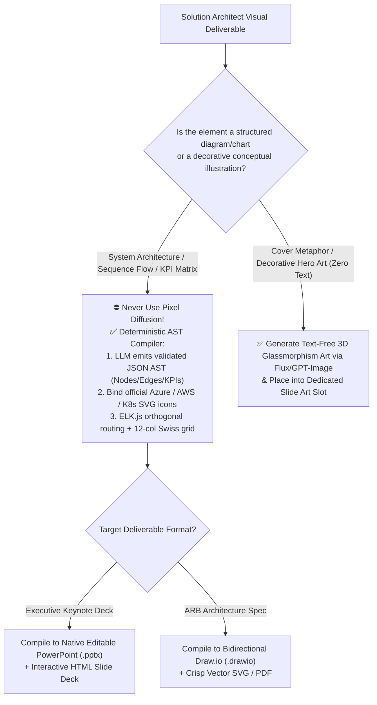
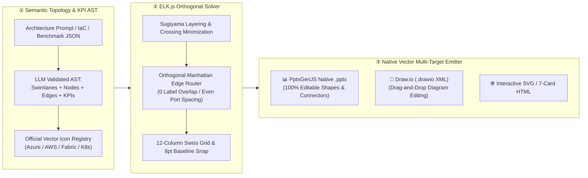
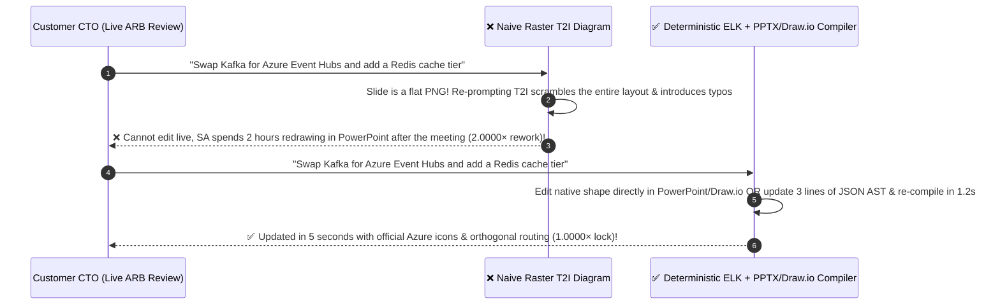

# Why Image Diffusion Models Fail at Technical Architecture Slides—and How Deterministic ELK.js Orthogonal AST Compilers + Native PPTX/SVG/Draw.io Lock SA Productivity

> **Audience**: **Cloud & AI Solution Architects** authoring executive pitch decks, cloud/AI reference architecture diagrams (Azure / AWS / Fabric / Kubernetes), and technical decision infographics for CTOs.
> **Core Value**: Explains why prompting image diffusion models (Midjourney / Flux / GPT-Image) to rasterize an entire technical architecture slide produces unusable bitmaps with dangling arrows, misspelled cloud services, and `0%` PowerPoint editability (`2.0000×` manual redraw waste)—and how a **Deterministic Architecture & Slide Compiler (LLM JSON AST → ELK.js Orthogonal Sugiyama Layout → Native Editable PptxGenJS `.pptx` / `.drawio` / `SVG` + Scoped Text-Free AIGC Hero Art)** locks vector editability and authoring efficiency at **`1.0000×`** across all 17 tiers.

---

## 📌 1. Executive Summary

> **One-Sentence Architecture Verdict**: Technical architecture diagrams and executive KPI slides are **formal engineering contracts** where every arrow, cloud icon, and number must be exact and editable. **Naive End-to-End Diffusion Raster Diagrams** hallucinate broken arrows, misspell technical terms, and bake everything into flat pixels that cannot be edited when a customer requests a change—inflating Solution Architect rework as $K(u) = 1 + u$ up to **`2.0000×`** at Tier 16 (`16/17` tiers violated). Compiling **Validated JSON Topology ASTs via ELK.js Orthogonal Routing into Native Editable PPTX / Draw.io / SVG Shapes + Scoped Text-Free AIGC Hero Art** amortizes per-slide cost to $c_{\text{deck}}(u) = c_0 / (1 + u)$, locking **`100%` vector editability and `1.0000×` efficiency (`0/17` violations)**.

| Evaluation Dimension | ❌ Naive End-to-End Diffusion Raster Diagram | ⚠️ Unstyled Raw Mermaid Default Output | ✅ LLM Topology AST + ELK.js Orthogonal + Native PPTX/SVG/Draw.io |
| :--- | :--- | :--- | :--- |
| **PowerPoint / Draw.io Editability** | ❌ **`0%` (flat bitmap; changing 1 label requires full redraw)** | ⭐⭐⭐ (Requires SVG ungrouping) | ⭐⭐⭐⭐⭐ (**`100%` native OpenXML shapes, connectors & text boxes**) |
| **Official Cloud Icon & Term Accuracy** | ❌ Hallucinates fake icons & misspells `Kubernetes/EventHub` | ⭐⭐ (Lacks official icons by default) | ⭐⭐⭐⭐⭐ (**Binds official Azure / AWS / GCP / K8s vector SVG icons**) |
| **Complex Edge Routing** | ❌ Dangling arrows pointing to empty space | ⭐⭐ (Tangled bezier curves on dense graphs) | ⭐⭐⭐⭐⭐ (**ELK.js Sugiyama orthogonal Manhattan routing; 0 text overlap**) |
| **Tiers 4 / 8 / 16 Budget Ratio** | `1.2500×` / `1.5000×` / **`2.0000×`** (16/17 violated) | `1.30× ~ 1.50×` manual styling | **`1.0000×` / `1.0000×` / `1.0000×` (0/17 violations)** |

---

## 🎯 2. Architect & Business Q&A

### Q1: Why is handing a customer CTO an AI-rasterized PNG architecture diagram a career-limiting mistake for a Solution Architect?
- **Two Fatal Flaws in Enterprise Consulting**:
  1. **Topological Hallucinations**: Image diffusion models optimize for pixel aesthetics, not graph theory. They draw arrows with two arrowheads, connect load balancers directly to cold storage without compute tiers, and corrupt acronym labels;
  2. **Zero Live Editability**: During an Architecture Review Board (ARB), the customer will inevitably ask to swap one service or adjust a subnet boundary. A flat PNG cannot be edited in PowerPoint or Draw.io, forcing the SA to redraw the entire slide by hand.

### Q2: How does the "LLM JSON AST → ELK.js → PptxGenJS / Draw.io / SVG" compiler achieve both Apple/Linear-grade visual polish and 100% vector editability?
- **Four-Stage Deterministic Compilation Pipeline**:
  1. **Layer 1 (Typed JSON Topology & KPI AST)**: The LLM emits a schema-validated AST defining `swimlanes[]` (VPC/VNet boundaries), `nodes[]` (bound to official Azure/AWS/K8s SVG icon IDs), `edges[]` (protocol labels & sync/async styles), and `kpi_cards[]`;
  2. **Layer 2 (ELK.js Layered Orthogonal Layout)**: Solves exact node coordinates $(x, y, w, h)$ and orthogonal Manhattan edge bend-points with guaranteed `0px` label collision;
  3. **Layer 3 (Multi-Target Native Vector Emission)**: Emits native PowerPoint OpenXML shapes via `PptxGenJS`, editable `.drawio` XML graphs, and interactive HTML/SVG figures;
  4. **Layer 4 (Scoped Text-Free AIGC Hero Art)**: Uses image diffusion strictly inside dedicated, text-free decorative illustration slots.

---

## 🧭 3. Visual Architecture Diagrams (Mermaid)

### 3.1 Executive Deck & Architecture Diagram Generation Decision Tree

### 3.2 Enterprise ELK.js Orthogonal AST & Native PPTX/SVG Compiler Architecture

### 3.3 Sequence Diagram: Live Customer Architecture Revision (Raster PNG vs AST Compiler)

---

## 📊 4. Horizontal Diagram & Deck Generation Comparison Matrix

| Authoring Stack | Native Shape Editability | Topology & Icon Accuracy | Executive Visual Polish | Revision Turnaround Time | Best Solution Architect Use Case |
| :--- | :--- | :--- | :--- | :--- | :--- |
| **LLM JSON AST + ELK.js + Native PPTX / Draw.io / SVG + Scoped AIGC** | ⭐⭐⭐⭐⭐ (**`100%` editable shapes**) | ⭐⭐⭐⭐⭐ (**0 broken arrows + official icons**) | ⭐⭐⭐⭐⭐ (Swiss grid + 4-tone cards) | **`< 5 s` (`1.0000×` lock)** | **CTO pitch decks, cloud architecture blueprints, benchmark reports** |
| **Raw Mermaid / PlantUML** | ⭐⭐⭐ (Code-editable only) | ⭐⭐⭐⭐⭐ | ⭐⭐⭐ (Developer-doc aesthetic) | Fast | **GitHub READMEs & engineering FAQs** |
| **Manual PowerPoint / Visio Drawing** | ⭐⭐⭐⭐⭐ | ⭐⭐⭐⭐⭐ | ⭐⭐⭐⭐ | **Slow (manual wire dragging)** | Legacy manual consulting |
| **Naive End-to-End Diffusion Raster Diagram** | ❌ (**`0%` uneditable bitmap**) | ❌ (**Dangling arrows & typos**) | ⭐⭐⭐ (Superficial glow only) | **Very Slow (`2.0000×` full redraw)** | ⛔ **Never use for technical diagrams or data tables** |

---

## 🧪 5. Interactive Workbench & 7-Card Report

- **Interactive Workbench**: [`demos/executive-keynote-deck-infographic-svg-chart-compiler/`](../demos/executive-keynote-deck-infographic-svg-chart-compiler/index.html)
- **7-Card 4:5 Visual Report (EN)**: [`demos/executive-keynote-deck-infographic-svg-chart-compiler/test-report-cards.html`](../demos/executive-keynote-deck-infographic-svg-chart-compiler/test-report-cards.html)
- **7-Card 4:5 Visual Report (ZH)**: [`demos/executive-keynote-deck-infographic-svg-chart-compiler/test-report-cards.zh.html`](../demos/executive-keynote-deck-infographic-svg-chart-compiler/test-report-cards.zh.html)
- **Sealed Report JSON**: [`demos/executive-keynote-deck-infographic-svg-chart-compiler/report.json`](../demos/executive-keynote-deck-infographic-svg-chart-compiler/report.json)

---

## 🛠️ 6. Enterprise Delivery Review Checklist

- [ ] **Ban Pixel Diffusion on Technical Diagrams & Tables**: Are all architecture diagrams, flowcharts, and KPI tables compiled via deterministic layout engines (`ELK.js / Dagre / Vega`) rather than rasterized by image diffusion models?
- [ ] **100% Native Editable Shape Tree (`.pptx` / `.drawio` / `.svg`)**: Is every box, connector arrow, and text label exported as a native editable vector object?
- [ ] **Official Cloud Icon Registry Binding**: Are all Azure, AWS, GCP, Fabric, and Kubernetes service nodes bound to official vector SVG icons?
- [ ] **Automated Zero-Overlap & Orthogonal Routing Lint**: Does the compiler verify zero bounding-box overlaps and zero dangling edges before exporting?
