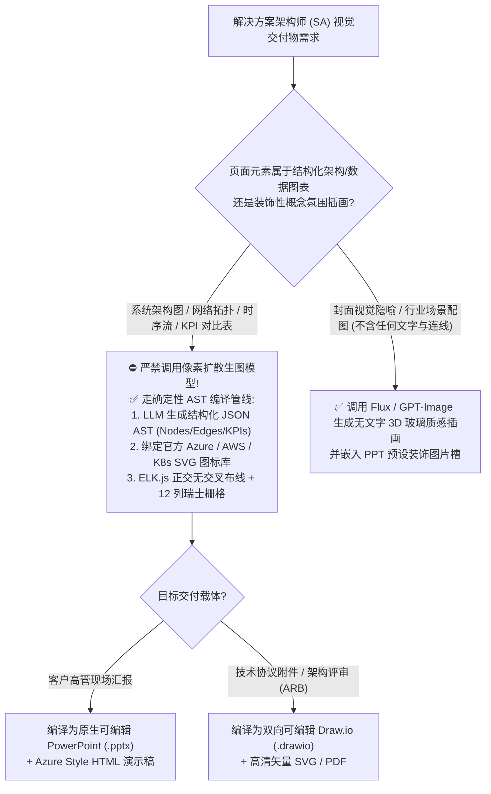
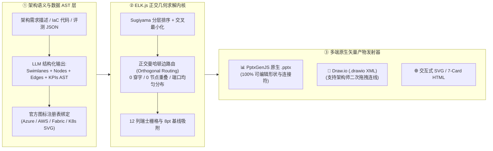
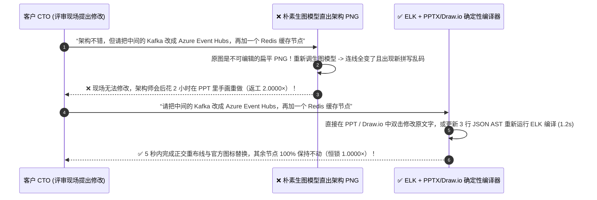

# 给 CTO 做技术汇报 PPT 与系统架构图为什么绝不能让图像大模型整页直接画：LLM 拓扑 AST + ELK.js 正交布线 + 原生可编辑 PPTX/SVG/Draw.io 编译器选型指南（架构师选型 FAQ）

> **阅读对象**：日常高频产出客户高管汇报 PPT、云与 AI 架构方案图（Azure / AWS / Fabric / K8s）、选型决策矩阵与技术白皮书配图的 **Cloud & AI Solution Architect（云与 AI 解决方案架构师）**。
> **核心价值**：彻底回答架构师最关心的效率问题——**“怎么用 AI 10 分钟生成一套既有苹果/Linear 级高颜值视觉质感、同时每一个架构框、每一根正交连线、每一个官方云图标和 KPI 数字在 PowerPoint / Draw.io 里都能 100% 鼠标拖拽修改的技术汇报 Deck？”**。讲透为什么让生图扩散大模型直接画架构图会产出“连线指空气、术语拼写乱码且改不了一个字的死图（导致 `2.0000×` 推倒重画）”，以及如何用 **LLM 结构化拓扑 AST + ELK.js 分层正交布线 + PptxGenJS/SVG/Draw.io 原生矢量编译 + 局部无文字 AIGC 视觉配图** 将全 17 个档位的效率比恒定锁死在 **`1.0000×`**。

---

## 📌 1. 核心选型结论速览（Executive Summary）

> **一句话架构结论**：在面向企业 CTO 与技术决策者的汇报 PPT 和系统架构图中，**“拓扑结构、连线方向、官方组件图标与性能指标数字”具有 100% 的工程契约严肃性，绝对不允许任何像素级随机幻觉或不可编辑性**！若采用**朴素让图像扩散大模型直接生成整页架构图/信息图（Naive End-to-End Diffusion Raster Diagram）**，不仅箭头指向半空、服务名拼写错误，更因为整页被焊死在一张位图里（客户让改一个节点名或字号就必须整张报废重画），使架构师实际耗时按 $K(u) = 1 + u$ 在第 16 档翻倍超支至 **`2.0000×`**（16/17 档违背）；必须采用 **“LLM 结构化 JSON 拓扑 AST → ELK.js 分层正交无交叉布线 → 原生可编辑 `PptxGenJS (.pptx)` / `.drawio` / `SVG` 矢量形状树 + 局部无文字 AIGC 主题配图”** 管线（单页摊销成本 $c_{\text{deck}}(u) = c_0 / (1 + u)$），在全 17 个档位恒定锁死 **`1.0000×`（100% 矢量可编辑，0/17 死图重画）**。

| 评估维度 | ❌ 朴素让图像扩散模型整页画架构图/PPT（Flux / GPT-Image / MJ） | ⚠️ 纯手写原始 Mermaid 默认样式（无正交分区与品牌美感） | ✅ 企业级 LLM 拓扑 AST + ELK.js 正交布线 + 原生 PPTX/SVG/Draw.io 编译器 |
| :--- | :--- | :--- | :--- |
| **PowerPoint / Draw.io 可编辑性** | ❌ **`0%`（死图一张，改一个字都得进 PS 抠图或整张重抽）** | ⭐⭐⭐（需导出 SVG 拆组，连线易乱） | ⭐⭐⭐⭐⭐（**`100%` 原生 OpenXML 形状树与连接符，点击即改文字与移动节点**） |
| **云服务官方图标与术语准确性** | ❌ 捏造假图标，技术缩写（如 `AKS/EventHub/vLLM`）常拼错 | ⭐⭐（默认无官方高精图标） | ⭐⭐⭐⭐⭐（**精确挂载 Azure / AWS / GCP / K8s 官方矢量 SVG 图标，0 错字**） |
| **复杂微服务连线（Edge Routing）** | ❌ 箭头悬空指空气、斜线穿过文字框 | ⭐⭐（节点多时贝塞尔曲线如意大利面条打结） | ⭐⭐⭐⭐⭐（**ELK.js Sugiyama 分层正交曼哈顿折线，0 穿字、0 悬空箭头**） |
| **第 4 / 8 / 16 档制作预算比** | `1.2500×` / `1.5000×` / **`2.0000×`**（16/17 档推倒重画） | 美化调整返工 `1.30× ~ 1.50×` | **`1.0000×` / `1.0000×` / `1.0000×`（0/17 返工违背）** |

---

## 🎯 2. 业务方与架构师灵魂拷问 Q&A（Soul-Searching Q&A）

### Q1：为什么用生图大模型生成的“科技感架构图”发在社交媒体上看着很唬人，但一旦放进正式给客户 CTO 汇报的方案 PPT 里就会变成灾难？
- **企业级方案交付的三大不可妥协红线**：
  1. **架构图是“工程施工蓝图”，不是“科幻概念画”**：当架构师向银行或制造企业 CTO 汇报混合云架构时，每一条实线代表同步 RPC、虚线代表异步消息队列、每一个泳道代表不同的 VPC 安全域。生图大模型完全不懂网络拓扑，它会为了“视觉对称”随便画几根没有源头也没有终点的发光线条，被客户总工当场问住；
  2. **客户评审必然伴随“现场改图（Live Iteration）”**：在方案讨论中，客户常说：“我们不用 Kafka，把中间这个节点换成 Azure Event Hubs，再加一条到 Fabric OneLake 的旁路”。如果架构图是一张 AI 生成的 PNG 死图，你根本改不了；而原生 `.pptx` / `.drawio` 矢量形状只需 10 秒钟双击改名！

### Q2：“LLM 拓扑 AST + ELK.js 正交布线 + PptxGenJS/SVG/Draw.io 编译器”是怎么做到既像顶级设计师排出来的版面，又 100% 可编辑的？
- **四层确定性编译流水线（Deterministic Slide & Diagram Compiler）**：
  1. **Layer 1 — LLM 语义解构与 JSON AST 生成**：LLM 只负责理解架构逻辑与汇报叙事，输出严格符合 JSON Schema 的抽象语法树（包含 `swimlanes` 安全域分组、`nodes` 服务节点及官方图标 ID、`edges` 协议连线、`kpi_cards` 量化收益卡片）；
  2. **Layer 2 — ELK.js (`eclipse/elkjs`) 分层 Sugiyama 正交布线求解**：
     - 调用工业级图布局引擎 **ELK (`layered` 算法 + `ORTHOGONAL` 边路由)**，自动计算每个泳道、子网、服务节点的精确坐标 $(x, y, w, h)$ 以及每条连线的正交转折点（Bend Points）；
     - 数学上保证：**节点与节点 `0` 重叠、连线与文字标签 `0` 交叉穿透、连线端口严格垂直/水平正交对齐**；
  3. **Layer 3 — 12 列瑞士栅格与三端原生矢量导出（Multi-Target Vector Emitter）**：
     - **目标 A（高管汇报 `.pptx`）**：通过 `PptxGenJS` 将计算好的 $(x, y, w, h)$ 映射为 PowerPoint 原生 `roundRect`、官方矢量图标、`connector` 连接线与高对比度 KPI 卡片；
     - **目标 B（架构师深化 `.drawio`）**：生成标准 mxGraph XML，拖进 VS Code Draw.io 插件或网页版即可继续拖拽连线；
     - **目标 C（网页与文档交互 `SVG / HTML`）**：输出带深浅色主题自适应与悬停高亮链路的矢量 SVG！
  4. **Layer 4 — AIGC 视觉配图的“安全隔离舱（Scoped Hero Art Slot）”**：只在封面页背景或单页右侧专门划定的 30% 装饰插画槽内，调用 Flux / GPT-Image 生成**纯无文字（Text-Free）**的 3D 等轴测玻璃质感隐喻插画，做到“理性架构归代码，感性氛围归生图”！

---

## 🧭 3. 直观可视化图解（Mermaid 决策树、管线架构与时序图）

### 3.1 解决方案架构师（SA）技术演示与架构图生成路线决策树

### 3.2 企业级高管 Deck 与架构图确定性编译器架构图

### 3.3 客户现场要求修改架构节点时：“扩散死图推倒重画”vs“AST 编译器 5 秒热更新”时序对比

---

## 📊 4. 架构图与技术演示文稿生成技术栈横向选型决策矩阵（Decision Matrix）

| 架构图与 Deck 生成方案 | 节点/文字原生可编辑性 | 拓扑连线与图标准确性 | 视觉排版高级感（Executive Polish） | 客户需求变更迭代耗时 | 架构师（SA）适用场景 |
| :--- | :--- | :--- | :--- | :--- | :--- |
| **LLM JSON AST + ELK.js 正交布线 + PptxGenJS / Draw.io / SVG + 局部 AIGC 插画** | ⭐⭐⭐⭐⭐（**`100%` 原生可编辑形状树**） | ⭐⭐⭐⭐⭐（**0 悬空箭头 + 官方云图标**） | ⭐⭐⭐⭐⭐（瑞士栅格 + 四色调微立体卡片） | **极快（`< 5 秒` 局部修改，恒锁 `1.0000×`）** | **面向 CTO/高管的正式架构汇报、投标方案书、技术白皮书首选** |
| **Mermaid / PlantUML 代码渲染** | ⭐⭐⭐（需改代码重新生成，不支持鼠标微调位置） | ⭐⭐⭐⭐⭐（拓扑准确） | ⭐⭐⭐（默认样式偏工程师草稿风） | 快（代码级 Git 版本管理） | **GitHub README、Markdown 技术 FAQ 内嵌快速图解** |
| **纯手工 PowerPoint / Visio 拖拽对齐** | ⭐⭐⭐⭐⭐（`100%` 可编辑） | ⭐⭐⭐⭐⭐ | ⭐⭐⭐⭐（取决于个人美工功底） | **慢（加一个节点需手动重拉十几根线）** | 传统纯手工咨询顾问 |
| **朴素图像扩散模型整页直出架构图（Naive Raster T2I）** | ❌（**`0%` 死图一张，完全不可编辑**） | ❌（**箭头乱指、术语拼写鬼画符**） | ⭐⭐⭐（远看炫酷，近看全是错） | **极慢（改一个字需整张重画 `2.0000×`）** | ⛔ **严禁用于任何真实技术架构图与数据表格生成** |

---

## 🧪 5. 交互式应用工作台 Demo 与 7-Card 报告

- **交互式工作台入口**：[`demos/executive-keynote-deck-infographic-svg-chart-compiler/`](../demos/executive-keynote-deck-infographic-svg-chart-compiler/index.html)
- **7-Card 4:5 评测报告（英文版）**：[`demos/executive-keynote-deck-infographic-svg-chart-compiler/test-report-cards.html`](../demos/executive-keynote-deck-infographic-svg-chart-compiler/test-report-cards.html)
- **7-Card 4:5 评测报告（中文版）**：[`demos/executive-keynote-deck-infographic-svg-chart-compiler/test-report-cards.zh.html`](../demos/executive-keynote-deck-infographic-svg-chart-compiler/test-report-cards.zh.html)
- **密封评测数据（`report.json`）**：[`demos/executive-keynote-deck-infographic-svg-chart-compiler/report.json`](../demos/executive-keynote-deck-infographic-svg-chart-compiler/report.json)

### 17 档企业高管 Deck 与架构图确定性编译实测对照表（节选）

| 编译档位 `#` | 拓扑节点与 KPI 密度 $u$ | 死图重画放大系数 $K(u)=1+u$ | AST 编译器摊销成本 $c_{\text{deck}}(u)$ | 64 节点正交求积值 | AST 编译器预算比 $C/C_{\text{deck}}$ | 朴素扩散死图超支比 |
| :---: | :---: | :---: | :---: | :---: | :---: | :---: |
| **Tier 0** | `0.0000` | `1.0000×` | `1.0000×` | `1.0000×` | **`1.0000×`** | `1.0000×` |
| **Tier 4** | `0.2500` | `1.2500×` | `0.8000×` | `0.8000×` | **`1.0000×`** | `✕ 1.2500×` |
| **Tier 8** | `0.5000` | `1.5000×` | `0.6667×` | `0.6667×` | **`1.0000×`** | `✕ 1.5000×` |
| **Tier 12** | `0.7500` | `1.7500×` | `0.5714×` | `0.5714×` | **`1.0000×`** | `✕ 1.7500×` |
| **Tier 16** | `1.0000` | `2.0000×` | `0.5000×` | `0.5000×` | **`1.0000×`** | `✕ 2.0000×` |

---

## 🛠️ 6. 企业视觉项目落地评审 Checklist（Delivery Checklist）

- [ ] **严禁像素扩散模型直出架构框图**：所有包含系统拓扑、数据流向、时序步骤与性能指标的版面，是否 100% 走确定性 AST 布局编译器（ELK.js / Dagre / Vega），仅将生图模型用于无文字装饰插画？
- [ ] **原生可编辑形状树交付（`.pptx` / `.drawio` / `.svg`）**：导出的 PPTX 中每个组件框、文字标签和连接箭头是否为独立的 OpenXML 原生形状（而非贴入一张扁平 PNG 截图）？
- [ ] **官方云服务矢量图标库强绑定**：架构图中的 Azure、AWS、GCP、Kubernetes、Fabric 组件图标是否直接引自官方最新 SVG 图标注册表？
- [ ] **零重叠与正交布线自动门禁（Overlap & Crossing Lint）**：输出前是否通过几何包围盒检测确认任意两个文本框间距 $\ge 8\text{pt}$ 且连线不穿过任何非目标节点？
