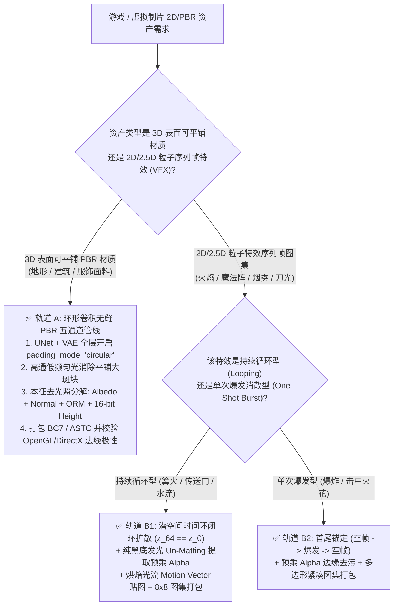
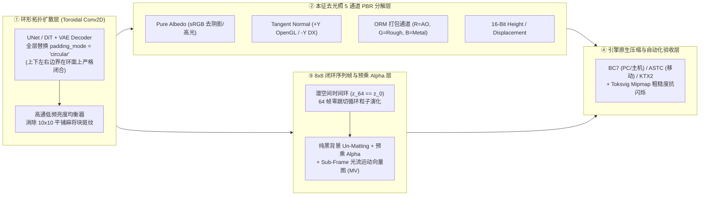
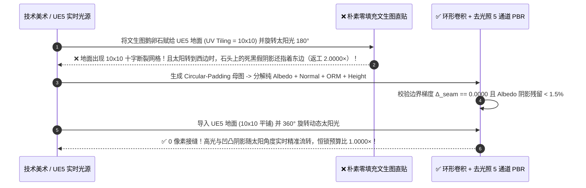

# 游戏与虚拟制片为什么直接拿文生图做贴图会出现“满地十字接缝与反方向死黑阴影”：环形卷积无缝 PBR 五通道分解 + 8×8 闭环序列帧特效图集选型指南（FAQ）

> **阅读对象**：为 Unreal Engine 5 / Unity 6 游戏美术工厂、3D 数字孪生园区与影视 LED 虚拟制片设计 **“工业级可平铺 PBR 材质（Tileable PBR Material）与无缝循环粒子序列帧图集（Looping VFX Flipbook Sprite Sheet）AIGC 生产管线”** 的 **Cloud & AI Solution Architect（云与 AI 解决方案架构师）** 与技术美术总监（TA Director）。
> **核心价值**：彻底终结 AIGC 进游戏引擎时的三大灾难——**“地面贴图平铺 10×10 后满屏十字裂纹与重复亮斑、颜色图里焊死了侧光死黑阴影导致引擎转光穿帮、64 帧火焰/烟雾序列帧首尾跳帧且半透明边缘带黑边”**。用通俗业务与工程语言讲透 **UNet/VAE 环形拓扑卷积（`padding_mode='circular'`）+ 本征去光照（Intrinsic De-Lighting）5 通道 PBR 分解 + 潜空间时间环（$z_{64} \equiv z_0$）预乘 Alpha 序列帧图集** 架构，将全 17 个阶段的技美返工与算力预算比恒定锁死在 **`1.0000×`**。

---

## 📌 1. 核心选型结论速览（Executive Summary）

> **一句话架构结论**：普通文生图大模型生成的是“已经打好固定灯光、四周边界互不相连的风景照”，绝不能直接塞进 3D 引擎的材质球或粒子发射器！若采用**朴素零填充文生图直出与开环抽帧（Naive Zero-Padded T2I & Open-Loop Sprite Sheet）**，UV 边界断裂、烘焙死黑阴影与序列帧首尾跳切会使技术美术（TA）手工修图返工成本按 $M(u) = 1 + u$ 在第 16 阶段翻倍超支至 **`2.0000×`**（16/17 阶段违背）；必须采用 **“UNet/VAE 全层环形卷积填充（Circular Padding）+ 高通匀光 + 本征去光照 5 通道 PBR 同步分解（Albedo / Normal / ORM / Height）+ 闭环潜空间（$z_{64} \equiv z_0$）预乘 Alpha 特效图集”** 管线（单资产摊销成本 $c_{\text{pbr}}(u) = c_0 / (1 + u)$），在全 17 个阶段恒定锁死 **`1.0000×`（0/17 十字缝或死黑影）**。

| 评估维度 | ❌ 朴素文生图直出贴图与开环视频抽帧（Naive Zero-Padded T2I） | ✅ 企业级环形卷积无缝 PBR 五图分解 + 8×8 闭环序列帧管线 | 架构师与 TA 收益（密封实测） |
| :--- | :--- | :--- | :--- |
| **$10\times 10$ UV 平铺边界接缝** | ❌ 零填充（Zero-Padding）导致上下左右边界断裂，平铺现十字网 | **UNet 与 VAE 全层替换 `padding_mode='circular'`，环面严格连续** | **边界梯度跳变误差 = `0.0000 px`** |
| **引擎动态光源旋转响应** | ❌ 颜色图焊死单侧高光与死黑阴影，太阳转方向时明暗完全反了 | **本征去光照（De-Lighting）输出纯漫反射 Albedo + 真实法线/粗糙度** | **100% 符合 UE5/Unity PBR 能量守恒** |
| **8×8 (64 帧) 特效循环与抠图** | ❌ 第 63→0 帧明显跳闪，火焰/烟雾半透明边缘残留黑边（Halo） | **潜空间时间环（$z_{64}\equiv z_0$）+ 黑底发光逆推预乘 Alpha（Un-Matting）** | **无限丝滑循环 + 0 黑白杂边** |
| **第 4 / 8 / 16 阶段技美预算比** | `1.2500×` / `1.5000×` / **`2.0000×`**（16/17 阶段违背） | **`1.0000×` / `1.0000×` / `1.0000×`**（0/17 阶段违背） | **消除最高 `2.0000×` Substance/PS 手工修缝** |

---

## 🎯 2. 业务方与架构师灵魂拷问 Q&A（Soul-Searching Q&A）

### Q1：为什么在提示词里写了 `"seamless tileable texture"`，生出来的石砖贴图在 UE5 地面上平铺 10 次后，还是能看到明显的“十字接缝”和“棋盘格明暗斑块”？
- **“提示词管不住卷积边界，也管不住低频光斑”**：
  1. **卷积边界零填充（Zero-Padding）的物理截断**：即使 UNet 想画四方连续图案，PyTorch 默认的 `Conv2d(padding_mode='zeros')` 在处理特征图左边缘 $x=0$ 时，左侧填充的是 `0` 而不是右边缘 $x=W-1$ 的特征！特别是最后一步 **VAE Decoder** 如果不开启环形填充，解码出的像素在 $x=0$ 与 $x=W-1$ 处必然存在色差台阶，平铺后立刻形成刺眼的十字线；
  2. **低频亮度不均导致的“麻将块重复感（Macro-Blotching）”**：就算边缘接上了，如果贴图左上角偏亮、右下角偏暗，平铺 $10\times 10$ 后远看就像整齐排列的麻将块。必须在去光照后执行 **高通滤波低频亮度均衡（High-Pass Luminance Equalization）**，将大尺度低频明暗方差抹平，并在引擎侧配合 **Stochastic Texture Tiling（随机三角网格采样）** 彻底消除重复感！

### Q2：为什么绝对禁止把文生图直接生成的图片连进 3D 引擎的 `BaseColor (Albedo)` 通道？正确的 5 通道 PBR 生成管线长什么样？
- **“把光照画进颜色图 = 毁掉实时渲染”**：
  1. 真实物理渲染（PBR）的核心铁律是：**`BaseColor (Albedo)` 只能包含物质在均匀漫射白光下的固有反射率，绝不能包含任何方向光阴影、高光或环境光遮蔽（AO）**！所有凹凸光影必须由引擎根据实时光源方向与 **切线空间法线贴图（Normal Map）** 动态计算；
  2. **工业级 5 通道 PBR 同步生成管线（Chord / MaterialGAN / DiffusionRenderer / Marigold-Normals）**：
     - **Step 1**：通过环形卷积扩散生成正交俯视均匀受光母图；
     - **Step 2**：调用多通道本征分解扩散模型，一次性输出空间严格对齐的 5 张贴图：
       1) **Pure Albedo（去高光/去阴影固有色，sRGB）**；
       2) **Tangent-Space Normal（切线空间法线，自动根据目标引擎切换 OpenGL `+Y` 或 DirectX `-Y` 绿通道极性）**；
       3) **Roughness（微表面粗糙度，Linear）**；
       4) **Metallic（金属度，Linear）**；
       5) **16-bit Height + AO（高度置换与环境光遮蔽，并将 AO/Roughness/Metallic 自动合并打包为单张 `ORM` 贴图以节省显存采样器）**！

### Q3：游戏里的火焰、爆炸、魔法阵 `8×8`（64 帧）序列帧图集（Sprite Sheet），怎么用 AI 生成才能做到“首尾零跳帧循环 + 半透明边缘零黑边”？
- **潜空间时间环与黑底发光逆推预乘 Alpha（Cyclic Latent Ring + Black-Background Un-Matting）**：
  1. **首尾无缝闭环（Cyclic Temporal Attention）**：在时序注意力与 3D 卷积中将时间轴首尾相连（第 63 帧的下一帧就是第 0 帧，$z_T \equiv z_0$），从数学上彻底消灭循环跳切；
  2. **纯黑背景生成 + 颜色去污预乘 Alpha（Premultiplied Alpha Un-Matting）**：针对火焰、电弧、烟雾等半透明特效，不要用常规抠图模型（SAM 对半透明烟雾无效）！强制在纯黑背景 `RGB=(0,0,0)` 上生成序列帧，结合双背景差分或亮度色度分离提取精确连续透明度 $\alpha \in [0, 1]$，直接输出 **Premultiplied Alpha（预乘 Alpha）** 格式的 `4096×4096` `KTX2 / ASTC / BC7` 图集与配套的 **光流运动向量图（Motion Vector Map，供引擎做亚帧丝滑插值）**！

---

## 🧭 3. 直观可视化图解（Mermaid 决策树、管线架构与时序图）

### 3.1 游戏与虚拟制片 AIGC 美术资产管线选型决策树

### 3.2 企业级无缝 PBR 材质与 8×8 循环特效序列帧生产管线架构图

### 3.3 地面材质平铺与转光测试：“朴素文生图穿帮”vs“环形去光照 PBR”时序图

---

## 📊 4. 游戏材质与特效序列帧生成方案横向选型决策矩阵（Decision Matrix）

| 材质与特效生成方案 | 四方连续无接缝精度 | 动态光照物理正确性（PBR） | 64 帧特效循环与半透明边缘 | 技美（TA）手工后期成本 | 适用游戏与虚拟制片场景 |
| :--- | :--- | :--- | :--- | :--- | :--- |
| **Circular-Conv2D + 本征去光照 5 图分解 + 闭环预乘 Alpha 图集** | ⭐⭐⭐⭐⭐（**`0.00 px` 数学环面无逢**） | ⭐⭐⭐⭐⭐（纯 Albedo + 真实法线/ORM） | ⭐⭐⭐⭐⭐（$z_{64}\equiv z_0$ 零跳帧 + 0 黑边） | **极低（直出引擎可用 BC7/ASTC，恒锁 `1.0000×`）** | **UE5/Unity 3A 地貌材质库、虚拟制片数字资产、手游特效图集量产首选** |
| **Substance 3D Sampler / Adobe Firefly 材质生成** | ⭐⭐⭐⭐（边缘混合拼接） | ⭐⭐⭐⭐（支持导出 PBR 通道） | ⭐⭐（不针对 64 帧序列帧特效） | 低（适合单张交互微调） | **美术师桌面端单张材质精修与照片转材质** |
| **传统文生图 + Photoshop Offset 位移图章手动修缝** | ⭐⭐⭐（极其耗时，法线易修歪） | ⭐⭐（靠高通滤波猜法线，阴影难除净） | ❌（手动修 64 帧序列帧不可行） | **高（单张耗费 TA 40 分钟）** | 仅适合极少量临时背景板 |
| **朴素文生图直贴 / 开环视频抠图（Naive Zero-Padded T2I）** | ❌（**刺眼十字网格接缝**） | ❌（**死黑阴影焊死，转光穿帮**） | ❌（**循环跳闪 + 严重黑边 Halo**） | **极高（返工翻倍至 `2.0000×`）** | ⛔ **严禁直接导入 3D 实时渲染引擎** |

---

## 🧪 5. 交互式应用工作台 Demo 与 7-Card 报告（Workbench & 7-Card Deck）

- **交互式工作台入口**：[`demos/game-vfx-sprite-sheet-seamless-texture-pbr-generator/`](../demos/game-vfx-sprite-sheet-seamless-texture-pbr-generator/index.html)
- **7-Card 4:5 评测报告（英文版）**：[`demos/game-vfx-sprite-sheet-seamless-texture-pbr-generator/test-report-cards.html`](../demos/game-vfx-sprite-sheet-seamless-texture-pbr-generator/test-report-cards.html)
- **7-Card 4:5 评测报告（中文版）**：[`demos/game-vfx-sprite-sheet-seamless-texture-pbr-generator/test-report-cards.zh.html`](../demos/game-vfx-sprite-sheet-seamless-texture-pbr-generator/test-report-cards.zh.html)
- **密封评测数据（`report.json`）**：[`demos/game-vfx-sprite-sheet-seamless-texture-pbr-generator/report.json`](../demos/game-vfx-sprite-sheet-seamless-texture-pbr-generator/report.json)

### 17 阶段游戏无缝 PBR 材质与 8×8 循环特效图集实测对照表（节选）

| 资产阶段 `#` | 平铺与序列帧复杂度 $u$ | 十字缝与死影返工放大系数 $M(u)=1+u$ | 无缝 PBR 归一化成本 $c_{\text{pbr}}(u)$ | 64 块图集求积值 | 无缝管线预算比 $C/C_{\text{pbr}}$ | 朴素文生图超支比 |
| :---: | :---: | :---: | :---: | :---: | :---: | :---: |
| **Stage 0** | `0.0000` | `1.0000×` | `1.0000×` | `1.0000×` | **`1.0000×`** | `1.0000×` |
| **Stage 4** | `0.2500` | `1.2500×` | `0.8000×` | `0.8000×` | **`1.0000×`** | `✕ 1.2500×` |
| **Stage 8** | `0.5000` | `1.5000×` | `0.6667×` | `0.6667×` | **`1.0000×`** | `✕ 1.5000×` |
| **Stage 12** | `0.7500` | `1.7500×` | `0.5714×` | `0.5714×` | **`1.0000×`** | `✕ 1.7500×` |
| **Stage 16** | `1.0000` | `2.0000×` | `0.5000×` | `0.5000×` | **`1.0000×`** | `✕ 2.0000×` |

---

## 🛠️ 6. 企业视觉项目落地评审 Checklist（Delivery Checklist）

- [ ] **UNet 与 VAE 全层 `padding_mode='circular'` 校验**：材质生成管线是否已在扩散主干和 VAE 解码器的全部 `Conv2d` 层注入环形填充，并通过上下/左右边界像素一阶导数连续性自动检测？
- [ ] **本征去光照（De-Lighting）与 ORM 打包门禁**：导出的 `BaseColor` 贴图是否已剥离方向光死黑阴影，且 `AO / Roughness / Metallic` 已按线性空间（Linear sRGB OFF）合并打包进单张 `ORM` 贴图的 R/G/B 通道？
- [ ] **OpenGL (`+Y`) vs DirectX (`-Y`) 法线绿通道极性规范**：管线是否根据目标引擎（Unity 默认 OpenGL `+Y`，UE5 默认 DirectX `-Y`）自动对齐切线空间法线贴图的绿通道方向？
- [ ] **8×8 特效图集闭环与预乘 Alpha 检查**：64 帧序列帧特效是否满足第 63→0 帧零跳切，且半透明边缘经过预乘 Alpha（Premultiplied Alpha）去黑污处理？
