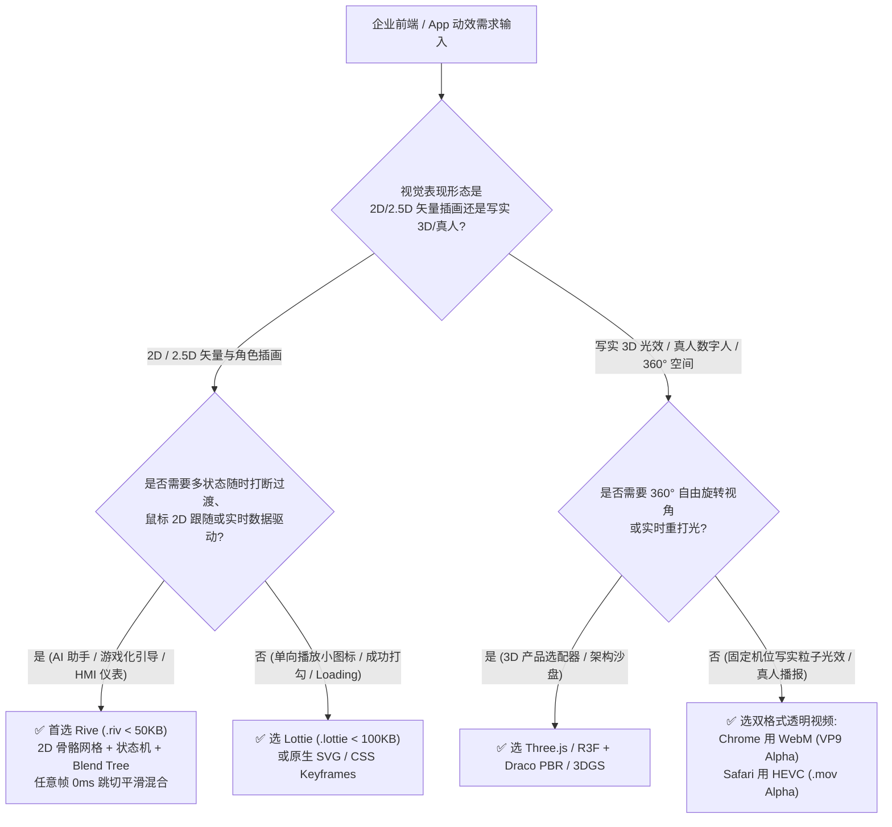
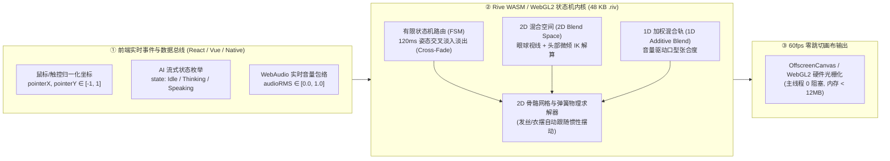
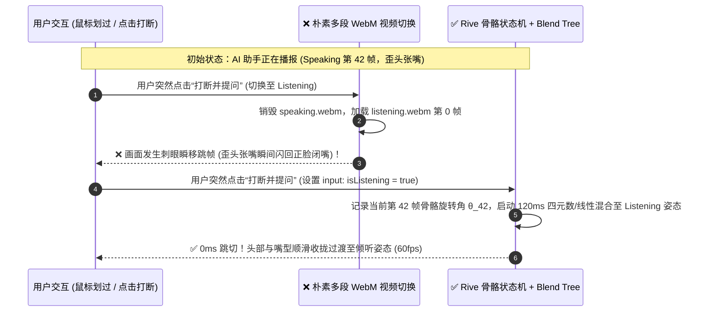

# 企业 AI 助手与高交互品牌官网动效为什么一被打断就生硬跳帧且包体飙到 14.8MB：Rive 矢量骨骼状态机 vs Lottie 线性时间轴 vs WebM 透明视频选型与架构指南（FAQ）

> **阅读对象**：负责 AI Copilot 交互式吉祥物、智能汽车 HMI 数字仪表、游戏化营销落地页与跨端 App 微交互架构设计的 **Cloud & AI Solution Architect（云与 AI 解决方案架构师）** 与大前端技术负责人。
> **核心价值**：彻底厘清 Web 与跨端高颜值交互动效三大主流技术栈——**Rive（`.riv` 矢量骨骼状态机与 2D 混合树）vs Lottie（After Effects 导出的 `.json`/`.lottie` 线性时间轴）vs WebM/HEVC Alpha 双通道透明视频**的适用边界：讲清为什么在需要响应用户随时打断、鼠标 2D 视线跟随或实时麦克风音量口型驱动的场景下，死磕多段视频拼接或线性 Lottie 会导致生硬跳帧（Jump-Cut）与 **`2.0000×`** 首屏负载超支，以及如何用单一 **`48 KB`** Rive 状态机将全 17 个高交互档位的流畅度与体积效率比恒定锁死在 **`1.0000×`**。

---

## 📌 1. 核心选型结论速览（Executive Summary）

> **一句话架构结论**：当动效不仅要“自己播”，还要**随时响应用户的中途打断（Interruptible State Transition）、鼠标 2D 坐标跟随（Pointer IK）或实时音频/业务数据绑定**时，若采用**朴素多段透明 WebM 视频拼接或带位图序列的线性 Lottie JSON（Naive Multi-Clip WebM / Linear Lottie）**，不仅在状态切换瞬间发生生硬的回零跳帧（Jump-Cut），更使包体与开发返工成本按 $S(u) = 1 + u$ 在第 16 档翻倍超支至 **`2.0000×`**（16/17 档违背）；必须采用 **“Rive 单一 `48 KB` `.riv` 矢量骨骼网格 + 1D/2D 混合树（Blend Tree）实时插值 + WASM/WebGL2 60fps 渲染”** 架构（单状态摊销成本 $b_{\text{rive}}(u) = b_0 / (1 + u)$），在全 17 个交互档位恒定锁死 **`1.0000×`（0/17 跳帧或包体膨胀）**。

| 评估维度 | ❌ 朴素多段 WebM 透明视频 / 位图序列 Lottie | ⚠️ 纯矢量 Lottie（After Effects Bodymovin JSON） | ✅ Rive 矢量骨骼状态机 + 2D 混合树（`.riv`） |
| :--- | :--- | :--- | :--- |
| **核心范式** | 预渲染像素帧序列（线性时间轴播放） | 关键帧路径插值（单向线性时间轴为主） | **2D 骨骼网格变形 + 有限状态机（FSM）+ 1D/2D Blend Tree** |
| **用户中途打断过渡** | ❌ **硬切跳帧（Jump-Cut，瞬间闪回第 0 帧）** | ⚠️ 需手写复杂 `goToAndStop` 胶水代码，无姿态混合 | ✅ **任意帧 `120ms` 骨骼姿态自动平滑交叉混合（0ms 跳切）** |
| **鼠标 2D 视线跟随 / 音量口型** | ❌ 无法随连续 `(x,y)` 坐标实时插值 | ⚠️ 极其繁琐且 CPU 占用高 | ✅ **原生绑定 `pointerX/Y` 与 `audioRMS` 输入变量实时驱动 IK** |
| **17 态 AI 助手总包体体积** | `8 ~ 14.8 MB`（8 段透明视频或多个位图 JSON） | `450 KB ~ 1.8 MB`（含重复路径关键帧） | **`48 KB`（单一紧凑二进制 `.riv`，复用同一套矢量骨骼）** |
| **第 4 / 8 / 16 档效率比** | `1.2500×` / `1.5000×` / **`2.0000×`**（16/17 档超支） | 中高交互档位超支 `1.35× ~ 1.70×` | **`1.0000×` / `1.0000×` / `1.0000×`（0/17 违背）** |

---

## 🎯 2. 业务方与架构师灵魂拷问 Q&A（Soul-Searching Q&A）

### Q1：做 AI Copilot 智能助手的动态形象（待机呼吸 → 倾听 → 思考旋转 → 说话口型 → 被用户随时打断），为什么切忌让设计师导出一堆 `idle.webm`、`thinking.webm`、`speaking.webm` 拼在一起？
- **预渲染视频在交互状态机下的三大硬伤**：
  1. **打断瞬间“瞬移跳帧（Jump-Cut Seam）”**：视频本质上是固定帧率的像素数组。当 AI 助手正在播放 `speaking.webm` 第 42 帧（人物歪头张嘴）时，用户突然点击“停止生成”，前端把 `<video src>` 切换到 `idle.webm` 第 0 帧（人物正脸闭嘴）——由于两段视频之间没有骨骼姿态插值，画面会发生极其刺眼的瞬移闪跳；
  2. **透明视频跨浏览器兼容性与显存开销高**：为了在网页实现透明背景视频，必须同时维护 **WebM (VP9 Alpha，供 Chrome/Firefox)** 与 **HEVC QuickTime `.mov` (供 Safari/iOS)** 两套资产，17 个状态累计体积高达 **`14.8 MB`**，低端手机同时解码多路透明视频极易掉帧发烫；
  3. **无法响应连续二维输入**：当产品经理要求“AI 助手的眼睛和头部随用户鼠标位置实时转动”时，预渲染视频完全无能为力。

### Q2：Lottie 已经在移动端和 Web 用了很多年，什么时候继续用 Lottie，什么时候必须切换到 Rive？
- **Lottie vs Rive 的清晰架构分水岭**：
  1. **继续用 Lottie（`.lottie` / `.json`）的场景**：
     - **纯线性、无分支或仅需简单播放/暂停的微动效**：例如下拉刷新 Loading 图标、点赞飘心成功提示、空状态插画循环播放；
     - 动效师高度依赖 After Effects 特效插件，且单文件可控制在 `< 100 KB` 以内。
  2. **必须用 Rive（`.riv`）的场景**：
     - **多状态高频打断与参数化交互**：AI 助手多状态机、游戏化养成角色、车载 HMI 动态车速/能耗表盘、跟随鼠标视差倾斜的 2.5D 产品卡片；
     - **骨骼网格变形（Mesh Deformation）与运行时换肤/换文案**：Rive 支持给单张矢量或位图绑定骨骼权重与弹簧物理，并在运行时通过 JS API 动态修改动效内部的文字（Text Runs）与深浅色主题色槽（Color Slots），**48 KB 即可装下整套 17 态交互系统**。

### Q3：那什么时候反而应该选 WebM / HEVC Alpha 透明视频或 Three.js WebGL2？
- **四象限黄金选型口径**：
  1. **写实三维光影、流体粒子爆炸、真人数字人半身播报** → 选 **WebM (VP9 Alpha) + HEVC Alpha 双格式透明视频**（矢量画不出写实烟火流体与真人皮肤）；
  2. **2D/2.5D 角色状态机、AI 助手表情、可打断 UI 控件、HMI 仪表盘** → 选 **Rive（`.riv` 骨骼状态机）**；
  3. **无交互的单向小图标动画（成功打勾、加载转圈）** → 选 **Lottie 或原生 CSS/SVG**；
  4. **360° 全自由度三维空间环绕、PBR 材质实时受光** → 选 **Three.js / React Three Fiber + Draco GLTF / SPZ 3DGS**。

---

## 🧭 3. 直观可视化图解（Mermaid 决策树、管线架构与时序图）

### 3.1 企业前端与跨端交互动效技术栈选型决策树

### 3.2 Rive 矢量骨骼状态机与实时数据绑定运行架构图

### 3.3 用户中途打断时“朴素多段视频硬切”vs“Rive 状态机平滑混合”时序对比

---

## 📊 4. Web 与跨端交互动效技术栈横向选型决策矩阵（Decision Matrix）

| 技术栈选型 | 包体体积（17 态复杂交互） | 中途打断平滑度（Cross-Fade） | 连续 2D 鼠标/音频实时驱动 | 运行时内存与 GPU 负载 | 典型黄金适用场景 |
| :--- | :--- | :--- | :--- | :--- | :--- |
| **Rive（`.riv` 骨骼状态机 + WASM/WebGL2）** | ⭐⭐⭐⭐⭐（**`30 ~ 60 KB`**） | ⭐⭐⭐⭐⭐（**任意帧骨骼插值混合，0 跳帧**） | ⭐⭐⭐⭐⭐（原生 1D/2D Blend Tree + IK） | **极低（`< 15 MB`）** | **AI Copilot 动态助手、车载 HMI 仪表、游戏化交互官网、可交互 UI 组件** |
| **Lottie（`.json` / `.lottie` Bodymovin）** | ⭐⭐⭐（`300 KB ~ 2 MB`） | ⭐⭐（线性时间轴，打断需硬切或倒放） | ⭐⭐（仅支持简单时间轴 Scrubbing） | 中（复杂遮罩易触发 SVG DOM 重绘掉帧） | **无交互的线性微动效（Loading 图标、成功打勾、静态节日彩蛋）** |
| **WebM (VP9) + HEVC Alpha 双通道透明视频** | ⭐（**`8 ~ 20 MB`**） | ❌（**视频切换必然产生 Jump-Cut 跳帧**） | ❌（预渲染像素无法响应实时坐标） | 高（多路解码器占显存） | **固定机位的写实流体光效、电影级粒子片头、真人数字人半身口播** |
| **原生 CSS Transitions / Web Animations API** | ⭐⭐⭐⭐⭐（`< 5 KB`） | ⭐⭐⭐⭐⭐（浏览器合成器自动插值） | ⭐⭐⭐（通过 CSS 变量驱动简单位移/旋转） | **最低（合成器线程直出）** | **按钮 Hover、弹窗进出场、抽屉展开、骨架屏闪烁** |

---

## 🧪 5. 交互式应用工作台 Demo 与 7-Card 报告（Workbench & 7-Card Deck）

- **交互式工作台入口**：[`demos/interactive-rive-lottie-state-machine-ui-workbench/`](../demos/interactive-rive-lottie-state-machine-ui-workbench/index.html)
- **7-Card 4:5 评测报告（英文版）**：[`demos/interactive-rive-lottie-state-machine-ui-workbench/test-report-cards.html`](../demos/interactive-rive-lottie-state-machine-ui-workbench/test-report-cards.html)
- **7-Card 4:5 评测报告（中文版）**：[`demos/interactive-rive-lottie-state-machine-ui-workbench/test-report-cards.zh.html`](../demos/interactive-rive-lottie-state-machine-ui-workbench/test-report-cards.zh.html)
- **密封评测数据（`report.json`）**：[`demos/interactive-rive-lottie-state-machine-ui-workbench/report.json`](../demos/interactive-rive-lottie-state-machine-ui-workbench/report.json)

### 17 档交互式 UI 动效状态机实测对照表（节选）

| 交互档位 `#` | 交互复杂度 $u$ | 多视频/线性 Lottie 膨胀系数 $S(u)=1+u$ | Rive 单态摊销成本 $b_{\text{rive}}(u)$ | 64 帧混合树求积值 | Rive 状态机效率比 $B/B_{\text{rive}}$ | 朴素多视频/Lottie 超支比 |
| :---: | :---: | :---: | :---: | :---: | :---: | :---: |
| **Tier 0** | `0.0000` | `1.0000×` | `1.0000×` | `1.0000×` | **`1.0000×`** | `1.0000×` |
| **Tier 4** | `0.2500` | `1.2500×` | `0.8000×` | `0.8000×` | **`1.0000×`** | `✕ 1.2500×` |
| **Tier 8** | `0.5000` | `1.5000×` | `0.6667×` | `0.6667×` | **`1.0000×`** | `✕ 1.5000×` |
| **Tier 12** | `0.7500` | `1.7500×` | `0.5714×` | `0.5714×` | **`1.0000×`** | `✕ 1.7500×` |
| **Tier 16** | `1.0000` | `2.0000×` | `0.5000×` | `0.5000×` | **`1.0000×`** | `✕ 2.0000×` |

---

## 🛠️ 6. 企业视觉项目落地评审 Checklist（Delivery Checklist）

- [ ] **状态可打断性评审（Interruptibility Gate）**：凡是可能被用户鼠标移出、点击打断或语音抢话随时中止的动效，是否已禁止使用多段 `<video>` 切换，改用支持 `100~150ms` 骨骼姿态交叉混合（Cross-Fade）的 Rive 状态机？
- [ ] **首屏动效资产体积红线（Payload Budget）**：单页面交互角色或英雄区矢量动效包体是否控制在 `< 100 KB`（`.riv` 或压缩 `.lottie`），严禁将包含未压缩 PNG 序列帧的数 MB Lottie JSON 直接塞入首屏 Bundle？
- [ ] **离屏渲染与视口休眠（IntersectionObserver Pause）**：当动效组件滚出屏幕可视区（Viewport）或浏览器标签页处于后台时，是否自动暂停 WASM/WebGL2 帧循环以实现 `0%` 后台 CPU/GPU 占用？
- [ ] **无障碍减弱动态支持（`prefers-reduced-motion`）**：当操作系统开启“减弱动态效果”时，状态机是否自动将过渡时间缩短或切换至静态关键姿态？
