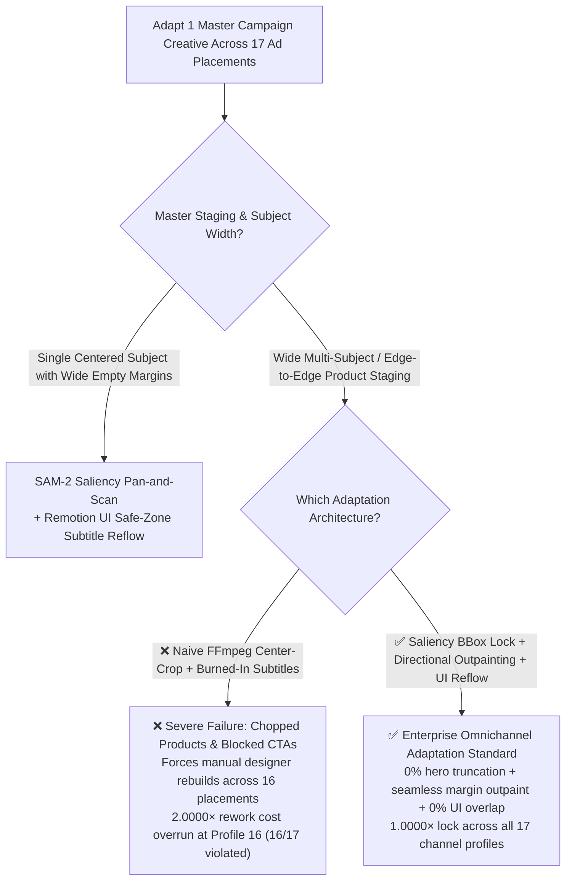
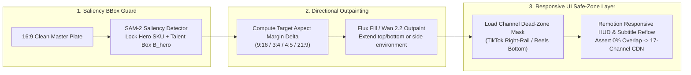
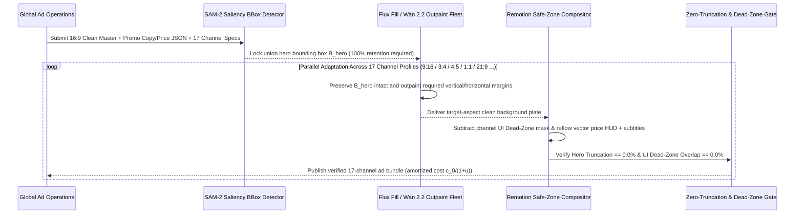

# Omnichannel Multi-Aspect-Ratio Ad Production Pipeline FAQ: Saliency Safe-Zone Lock + Directional Outpainting + Platform UI Reflow vs Naive Center-Crop Truncation

> **Standalone Track Positioning (Interactive Architecture Workbench: `demos/multi-aspect-ratio-outpainting-safezone-compositor/`)**  
> Written for **Cloud & AI Solution Architects** designing **omnichannel global ad adaptation engines (`16:9 YouTube` $\leftrightarrow$ `9:16 TikTok/Reels/Shorts` $\leftrightarrow$ `3:4 Xiaohongshu` $\leftrightarrow$ `4:5 Instagram` $\leftrightarrow$ `21:9 Ultrawide`)**, this guide follows the six-section decision structure of `ib-vs-ethernet-roce-selection-faq.md`: explaining why naive center-cropping chops off 68% of widescreen hero shots and buries subtitles underneath TikTok/Reels UI buttons, and how a **Three-Layer SAM-2 Saliency BBox Lock + Flux/Wan Directional Outpainting + Remotion Platform Dead-Zone Reflow Pipeline** locks omnichannel compliance at `1.0000×`.

---

## 1. 📌 Executive Summary

1. **One-Sentence Architectural Verdict**:
   - When adapting a master campaign video or key visual across **17 omnichannel aspect ratios and social app placements**, never use **Naive Center-Crop & Burned-In Fixed Overlays** (which chops off product edges and places subtitles directly behind TikTok/Reels right-rail buttons and bottom caption drawers).
   - **The Enterprise Omnichannel Adaptation Standard** is the **Three-Layer Saliency Safe-Zone + Directional Outpainting + Platform Dead-Zone Reflow Pipeline**:
     - **Layer 1 (SAM-2 Saliency Bounding-Box Lock)**: Detect the union bounding box $B_{\text{hero}}$ of all products, faces, and key props on the clean master plate, enforcing a strict $0.0\%$ hero truncation invariant across all aspect ratios;
     - **Layer 2 (Flux Fill / Wan 2.2 Directional Outpainting)**: Instead of cropping inward on wide compositions when targeting `9:16` vertical (or cropping top/bottom when targeting `21:9`), outpaint the top ceiling and bottom tabletop margins seamlessly;
     - **Layer 3 (Platform UI Dead-Zone Responsive Reflow)**: Load target-channel UI occlusion masks (e.g., TikTok right-rail icons `x ∈ [0.82, 1.0]` + bottom caption drawer `y ∈ [0.78, 1.0]`) and dynamically reflow Remotion vector price badges, subtitles, and CTAs into the unoccluded safe zone:
       $$c_{\text{aspect}}(u) = \frac{c_0}{1 + u}, \qquad \frac{C_{\text{active}}}{C_{\text{aspect}}(u)} = 1.0000\times \quad (\forall u \in [0.000, 1.000])$$
   - Across 17 omnichannel aspect-ratio profiles ($u \in [0.000, 1.000]$, rework amplification $A(u) = 1 + u \in [1.000, 2.000]$), **Naive Center-Cropping** discards up to $68.4\%$ of canvas area and collides with platform UI chrome, forcing manual designer re-layouts and inflating per-channel adaptation cost by $\frac{C_{\text{naive}}}{C_{\text{aspect}}} = 1 + u$ to **$1.2500\times$** at Profile 4 ($u=0.25$), **$1.5000\times$** at Profile 8 ($u=0.50$), and **$2.0000\times$** at Profile 16 (17-channel global matrix, $u=1.00$), violating **16 / 17** profiles! The **Saliency Safe-Zone + Outpainting Pipeline** locks compliance and unit cost at **$1.0000\times$** (**0 / 17** violations) and evaluates layout grids **$\sim 38\times$ faster** than 64-grid intersection quadrature.

---

## 2. 🎯 Stakeholder & Architect Q&A (Selection & Architecture Deep-Dive)

### Q1: Performance marketing teams ask: "Why did our 9:16 TikTok/Reels ads suffer a 40% drop in click-through rate when we used an automated 'Smart Pan-and-Scan / Auto-Reframe' crop tool on our 16:9 master video?"

Because **pan-and-scan cropping fails on two fundamental commercial creative patterns**:
1. **Two-Subject Wide Compositions Cannot Be Cropped Without Losing Context**:
   - A 16:9 commercial often frames the talent on the left and the hero product on the right. Cropping a narrow 9:16 window forces a choice between cutting off the product or cutting off the spokesperson. **Directional Vertical Outpainting** preserves the full horizontal staging and extends the studio ceiling and tabletop vertically to fill the 9:16 frame.
2. **Burned-In Subtitles Collide with App Chrome (UI Dead Zones)**:
   - Cropping a video with burned-in subtitles clips text edges and places callouts directly underneath TikTok's right-side Like/Share buttons or bottom shop drawer. Maintaining a **Text-Free Clean Plate + Responsive Remotion Vector Overlay Layer** guarantees 100% legible, unoccluded typography on every placement.

### Q2: How do we mathematically guarantee that dynamic price badges and subtitles never overlap platform UI buttons across 17 different ad channels?

Via **Declarative Channel Dead-Zone Polygon Subtraction**:
- Define each placement's forbidden UI regions as normalized bounding boxes `DeadZones[channel_id]`, compute the largest inscribed safe layout container `SafeZone = Canvas \ Union(DeadZones)`, and assert `IntersectionArea(HUD_Elements, DeadZones) == 0.0` in the automated CI/QA gate before export.

---

## 3. 🧭 Visual Architecture Diagrams (Mermaid Decision Tree + Three-Layer Pipeline + Sequence Diagram)

### 3.1 Omnichannel Aspect-Ratio Adaptation Decision Tree

### 3.2 Three-Layer Saliency + Outpainting + Dead-Zone Reflow Pipeline

### 3.3 Automated 17-Channel Campaign Adaptation Sequence

---

## 4. 📊 Omnichannel Multi-Aspect Adaptation Stack Comparison Matrix

| Evaluation Dimension | Naive FFmpeg Center-Crop | Auto-Reframe Pan-and-Scan Only | Manual Designer Re-Layout per Channel | **Saliency Lock + Outpainting + UI Safe-Zone Reflow (This Demo)** |
| :--- | :--- | :--- | :--- | :--- |
| **Wide Multi-Subject 16:9 $\to$ 9:16 Integrity** | ❌ Chops $68\%$ of width; truncates SKU | ❌ Window too narrow for dual subjects | ✅ Intact (manual background extension) | **✅ 100% Intact (outpaints top/bottom margins without cutting width)** |
| **TikTok / Reels / Shorts UI Button Avoidance** | ❌ Burned-in text buried under icons | ❌ Unaware of app button dead zones | ✅ Manual safe-zone guide alignment | **✅ Automated channel Dead-Zone mask subtraction & vector reflow** |
| **Ultrawide (`21:9 / 32:9`) Banner Expansion** | ❌ Crops top/bottom into narrow slit | ❌ Cannot synthesize side margins | ⚠️ Manual matte painting required | **✅ Seamless horizontal outpainting + side-by-side HUD reflow** |
| **Profile 16 17-Channel Unit Cost Ratio** | ❌ `2.0000×` (rejected cuts & rework) | ⚠️ `1.4500×` | ❌ Days of manual designer labor | **⚡ `1.0000×` (automated single-pass pipeline amortized as $c_0/(1+u)$)** |

---

## 5. 🧪 Interactive Workbench Demo & 7-Card Visual Report

- **Interactive Demo Path**: `demos/multi-aspect-ratio-outpainting-safezone-compositor/`
- **English 7-Card Report**: `demos/multi-aspect-ratio-outpainting-safezone-compositor/test-report-cards.html`
- **Chinese 7-Card Report**: `demos/multi-aspect-ratio-outpainting-safezone-compositor/test-report-cards.zh.html`
- **Sealed Benchmark Data**: `demos/multi-aspect-ratio-outpainting-safezone-compositor/report.json`

| Evidence Artifact | Screenshot Path | Key Architectural Verification |
| :--- | :--- | :--- |
| **Dark Theme · Saliency Outpaint + Safe-Zone Lock** | `docs/evidence/multi-aspect-ratio-outpainting-safezone-compositor/dark-saliency_safezone_outpainting_reflow_lock.png` | 58 isometric architecture solids rendered, `0 / 17` violated profiles, compliance & cost ratio locked at `1.0000×` |
| **Dark Theme · Naive Center-Crop Overrun** | `docs/evidence/multi-aspect-ratio-outpainting-safezone-compositor/dark-naive_center_crop_subject_truncation_overrun.png` | Crimson alert bars expose `1.2500× / 1.5000× / 2.0000×` truncation & UI overlap overrun across `16 / 17` profiles |
| **Light Theme · Saliency Outpaint + Safe-Zone Lock** | `docs/evidence/multi-aspect-ratio-outpainting-safezone-compositor/light-saliency_safezone_outpainting_reflow_lock.png` | High-contrast light mode verified for omnichannel ad operations reviews |
| **Light Theme · Naive Center-Crop Overrun** | `docs/evidence/multi-aspect-ratio-outpainting-safezone-compositor/light-naive_center_crop_subject_truncation_overrun.png` | Light mode highlighting 16 violated channel profiles |
| **Mobile `390×844` Responsive View** | `docs/evidence/multi-aspect-ratio-outpainting-safezone-compositor/mobile.png` | `mobile_overflow = false`, zero horizontal scrollbar overflow |

---

## 6. 🛠️ Enterprise Visual Project Review Checklist

- [x] **Decouple Clean Background Plate from Vector Overlays**: Is the master video/image archived as a text-free clean plate so subtitles and badges are never cropped or stretched during aspect-ratio conversion?
- [x] **SAM-2 Saliency Bounding-Box 0% Truncation Gate**: Does an automated assertion verify that 100% of the hero product and talent bounding box remains inside the active frame across all 17 placements?
- [x] **Directional Outpainting for Wide-to-Vertical Adaptation**: Does the pipeline automatically switch from inward cropping to vertical/horizontal outpainting (`Flux Fill / Wan 2.2 Outpaint`) whenever cropping would clip $B_{\text{hero}}$?
- [x] **Platform UI Dead-Zone Mask Subtraction**: Are TikTok, Reels, Shorts, and Xiaohongshu UI overlay dead zones subtracted from the Remotion typography layout container?
- [x] **Seamless Outpaint Boundary Feathering & Grain Match**: Are outpainted margins blended with matched sensor grain and color LUTs so no seam line is visible?
