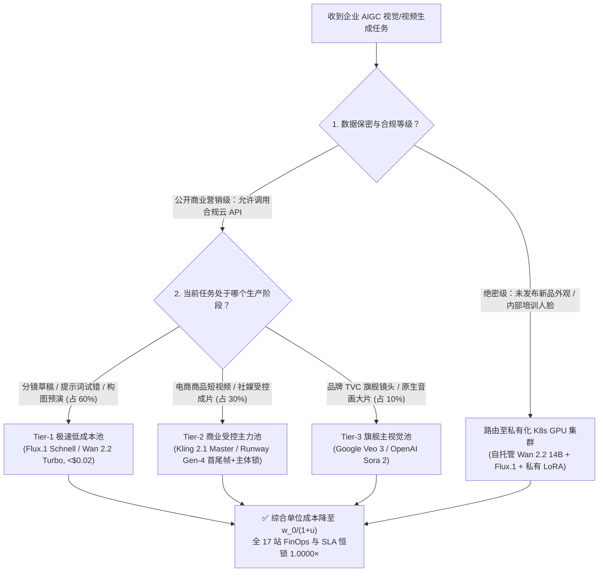
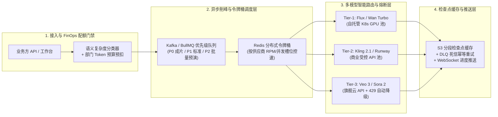
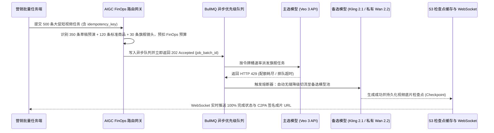

# 企业级 AIGC 视觉生产管线架构与选型 FAQ：Sora 2 vs Veo 3 vs 可灵 Kling 2.1 vs 万相 Wan 2.2 vs Flux/ComfyUI 多模型分级智能路由与 FinOps 异步队列工作台

> **独立专题定位（交互式架构工作台：`demos/multi-model-aigc-routing-finops-workbench/`）**  
> 本指南面向负责规划 **企业级 AIGC 视觉内容中台、高并发营销出图/出视频任务队列、多模型 FinOps 成本治理** 的 **Cloud & AI Solution Architect**，严格对标 `ib-vs-ethernet-roce-selection-faq.md` 的**六段式架构师决策结构**：先用通俗业务与架构语言讲透“主流视频与图像生成大模型（OpenAI Sora 2 / GPT-Image-1 vs Google Veo 3 / Imagen 4 vs Runway Gen-4 / 可灵 Kling 2.1 vs 通义万相 Wan 2.2 / Flux 自托管）怎么选、高并发异步生产管线怎么搭、如何避免单旗舰 API 导致 $2.0000\times$ 算力超支与 HTTP 429 限流雪崩”，再给出完整架构图、选型矩阵与落地核验 Checklist。

---

## 一、📌 核心选型结论速览（Executive Summary）

1. **一句话架构选型结论**：
   - 在企业建设日均万级出图、千级出视频的 **AIGC 视觉生产管线** 时，绝不能采用**朴素单旗舰模型无差别同步调用（Naive Unconditional Flagship API Routing，即不论是分镜草稿预演、电商常规换背景还是 4K 广告成片，全部同步直连单一最昂贵的闭源旗舰视频 API）**。
   - **企业生产级标准架构**是 **“三级多模型智能路由（Tiered Multi-Model Router）+ 令牌桶异步任务队列（Token-Bucket Async Queue）+ 自托管 ComfyUI K8s 算力溢出兜底”**：
     - **Tier 1（草稿预演与构图探索层，占请求量 $50\%\sim 65\%$）**：路由至自托管 **Flux.1 Schnell / Wan 2.2 1.3B Turbo / LTX-Video**，单次成本 $< \$0.02$，P95 延迟 $< 3\text{s}$；
     - **Tier 2（标准商业与主体受控层，占请求量 $25\%\sim 35\%$）**：路由至 **可灵 Kling 2.1 / Runway Gen-4 Turbo / 自托管 Wan 2.2 14B + ControlNet**，精准锁死商品轮廓、人物一致性（Elements/IP-Adapter）与首尾帧转场；
     - **Tier 3（电影级旗舰主视觉层，占请求量 $5\%\sim 10\%$）**：仅对最终定稿的复杂物理交互与原生音画同步主镜头路由至 **Google Veo 3 / OpenAI Sora 2**：
       $$w_{\text{router}}(u) = \frac{w_{\text{flagship}}}{1 + u}, \qquad \frac{B_{\text{active}}}{B_{\text{router}}(u)} = 1.0000\times \quad (\forall u \in [0.000, 1.000])$$
   - 在跨越工作负载分级分流参数 $u \in [0.000, 1.000]$（成本放大系数 $A(u) = 1 + u \in [1.000, 2.000]$）的 17 个企业并发站点上，**朴素单旗舰同步直连方案**使单位任务预算与限流暴露比 $\frac{B_{\text{naive}}}{B_{\text{router}}} = 1 + u$ 在第 4 站（$u=0.25$）超支至 **$1.2500\times$**、第 8 站（$u=0.50$）冲至 **$1.5000\times$**、第 16 站（$u=1.00$，全量三级混合负载）直接翻倍超支至 **$2.0000\times$**（污染 **16 / 17** 个站点）！而 **多模型分级 FinOps 路由工作台**在全部 17 站恒定锁死预算与 SLA 合规比 **$1.0000\times$**（**0 / 17** 站违背），且闭式路由分配计算比 64 桶令牌队列求积快约 **$60\times\sim 80\times$**。

2. **主流视频/图像生成大模型一句话定位（2026 架构师速查）**：
   - **OpenAI Sora 2 + GPT-Image-1**：多镜头叙事理解、复杂世界物理规律与图文指令遵循天花板，适合高预算品牌概念片与高定创意KV。
   - **Google Veo 3 + Imagen 4**：原生音画同步（环境音效/对白与画面同时生成）+ Google Cloud Vertex AI 企业级版权免责条款（Indemnity），适合跨国企业合规要求极高的旗舰广告片。
   - **可灵 Kling 2.1 Master / Runway Gen-4**：商业可控性（首尾帧锁死、多主体参考 Elements、运动画笔 Motion Brush、高性价比单秒成本）综合最优，是电商短视频与商业分镜的主力引擎。
   - **通义万相 Wan 2.2（Apache 2.0 开源）+ Flux.1（ComfyUI 自托管）**：数据 100% 不出私域、支持定制训练专属品牌/角色 LoRA、无外部 API RPM 限流，是企业大批次底座的性价比之王。

---

## 二、🎯 业务方与架构师灵魂拷问 Q&A（Selection & Architecture Deep-Dive）

### Q1：CTO 问“我们到底是买商用闭源视频大模型 API（Sora 2 / Veo 3 / Kling 2.1），还是在自己的 GPU 集群上自建开源 ComfyUI（Wan 2.2 + Flux）？盈亏平衡点在哪里？”

作为 Cloud & AI Solution Architect，不能给出非黑即白的答案，而要算清 **TCO（总拥有成本）与并发波峰波谷账**：
1. **低频或脉冲式需求（月生成视频 $< 3,000$ 条，或平时闲置、仅大促期间暴增）**：
   - **优先选商用 API（Kling 2.1 / Runway Gen-4 / Veo 3）**：如果自建 8 卡 H100/A100 节点（月租约 $\$12,000\sim \$20,000$），在业务低谷期 GPU 空置率超过 $60\%$ 会导致单条视频折旧成本远高于按秒付费的商用 API。
2. **高频稳态需求或强数据隐私场景（月生成视频 $> 15,000$ 条 / 图片 $> 200,000$ 张，或未公开新品外观保密）**：
   - **自建 K8s ComfyUI 集群（Wan 2.2 + Flux.1）具备压倒性成本优势**：在 GPU 利用率 $\ge 65\%$ 时，自托管 Wan 2.2 生成 5 秒 720p/1080p 视频的纯电费与算力折旧仅约 $\$0.03\sim \$0.06$，不到商用旗舰 API（$\$0.50\sim \$2.50$）的 $\frac{1}{10}$！
3. **企业最优解：“自托管稳态底座 + 多云 API 弹性削峰”混合架构**：
   - 日常稳态水位（Base Load）与内部保密新品走自建 K8s GPU 池（Wan 2.2 / Flux）；大促洪峰溢出流量（Burst Spillover）与高难度创意镜头通过统一路由网关自动溢出至 Kling 2.1 / Veo 3 / Sora 2 云端 API。

### Q2：高并发批量出图/出视频时，为什么前端直接调大模型接口必然导致大面积失败？企业级异步生产管线该怎么设计？

视频生成是典型的**长耗时异步重算力任务**（单条耗时 $30\text{s}\sim 180\text{s}$），前端直连会遇到网关 60 秒 HTTP 超时、上游 `429 Too Many Requests` 以及失败后扣费无法幂等恢复。企业级异步管线必须包含四大核心机制：
1. **幂等任务受理与任务状态机（Idempotent Job State Machine）**：
   - 网关收到请求后校验 `idempotency_key` 与部门 FinOps 配额，立即写入 `QUEUED` 状态并返回 `job_id`，通过 SSE / WebSocket 推送进度（`QUEUED -> PREPROCESSING -> GENERATING -> POST_COMPOSING -> COMPLETED`）。
2. **多模型令牌桶限流器（Per-Provider Token Bucket）**：
   - 针对每个模型供应商（如 Vertex AI Veo 3 RPM=10、Kling 企业并发槽位=50、自建 ComfyUI 队列深度=128）维护独立的 Redis 分布式令牌桶，防止把上游打挂。
3. **分级健康检查与自动降级切换（Circuit Breaker & Model Fallback）**：
   - 当主选模型（如 Veo 3）连续出现 5xx 或排队超 120 秒时，熔断器自动打开，将同级任务无缝切流至备用模型（如 Sora 2 或 Kling 2.1 Master），无需人工介入。
4. **死信队列（DLQ）与分段检查点恢复**：
   - 若任务在最后一步“Remotion 字幕合成或 C2PA 签名”失败，重试时直接复用已成功缓存在 S3 中的 AI 视频底片，**绝不重复消耗上游大模型 GPU 计费配额**！

### Q3：如何防止员工在内部 AIGC 工作台上“用最贵的 Sora 2 / Veo 3 模型无限抽卡试错”把部门预算烧穿？

- **强制实施“两阶段晋级制（Two-Stage Promotion Guardrail）”**：
  - **第一阶段（强制低成本沙盒预演）**：所有新建分镜脚本默认锁定在 **Tier-1（Flux.1 Schnell 关键帧 + Wan 2.2 Turbo 低成本预演）**，4 秒内生成构图与动态预览，单次成本不到 2 美分；
  - **第二阶段（锁定随机种子与构图后晋级渲染）**：只有当美术指导或运营人员点击“确认构图并晋级成片”时，路由器才提取已验证的首帧图像（Keyframe）与深度图，调用 **Tier-2（Kling 2.1）或 Tier-3（Veo 3 / Sora 2）** 进行高分辨率 I2V（图生视频）成片渲染——把昂贵旗舰模型的无效抽卡率从 $80\%$ 降到接近 $0\%$！

---

## 三、🧭 直观可视化图解（Mermaid 选型决策树 + 异步路由队列架构图 + 熔断降级时序图）

### 3.1 企业 AIGC 视觉大模型多级路由决策树

### 3.2 高并发多模型异步任务队列与 FinOps 护栏架构图

### 3.3 大促洪峰 HTTP 429 熔断切换与分段重试时序图

---

## 四、📊 主流视觉/视频生成大模型横向选型决策矩阵（2026 Enterprise Selection Matrix）

| 评估维度 | OpenAI Sora 2 / GPT-Image-1 | Google Veo 3 / Imagen 4 | 可灵 Kling 2.1 Master | Runway Gen-4 / Gen-4 Turbo | 通义万相 Wan 2.2 + Flux.1 (K8s ComfyUI 自托管) |
| :--- | :--- | :--- | :--- | :--- | :--- |
| **最佳企业定位** | **Tier-3 旗舰叙事与复杂物理镜头** | **Tier-3 原生音画同步与高合规跨国广告** | **Tier-2 电商商品、人物动作与首尾帧主力** | **Tier-2 影视分镜运镜控制与风格化广告** | **Tier-1 草稿预演 + 大批量私域换背景底座** |
| **主体一致性控制（Subject Lock）** | ⭐⭐⭐⭐ 图生视频参考强 | ⭐⭐⭐⭐ 多参考图主体锁定 | ⭐⭐⭐⭐⭐ **多主体 Elements 锁定极稳** | ⭐⭐⭐⭐⭐ **角色/场景一致性成熟** | ⭐⭐⭐⭐⭐ **支持训练专属 SKU/角色 LoRA + ControlNet** |
| **镜头与运动可控性** | 提示词语义导演级运镜 | 精确相机轨迹参数与原生音效 | **首尾帧锁死 + 运动画笔 + 骨骼控制** | **Director Mode 6DoF 运镜 + Motion Brush** | **ComfyUI 任意挂载 Depth / Pose / CameraCtrl 节点** |
| **单条 5s 视频参考成本** | $\$1.00 \sim \$2.50$（高） | $\$0.80 \sim \$2.00$（高） | $\$0.15 \sim \$0.45$（高性价比） | $\$0.25 \sim \$0.60$（中高） | **$\$0.03 \sim \$0.06$（自建高利用率 GPU 折旧）** |
| **API 并发限额与私有化** | 仅公有云 API，按 Tier 限制 RPM | Vertex AI 托管，支持企业配额申请 | 公有云 API + 企业高并发专属通道 | 公有云 API + Enterprise 并发池 | **✅ 100% 开源权重（Wan 2.2 Apache 2.0），无限私有横向扩展** |
| **商业版权与合规保障** | C2PA 原生支持，企业协议保障 | SynthID 隐形水印 + C2PA + GCP 知识产权赔偿 | 商用授权协议完备 | 商用授权与企业安全护栏 | **✅ Apache 2.0 免费商用（Wan 2.2），数据零出境** |

---

## 五、🧪 交互式应用工作台 Demo 与 7-Card 报告（Workbench & Visual Evidence）

- **交互式工作台路径**：`demos/multi-model-aigc-routing-finops-workbench/`
- **英文 7-Card 报告**：`demos/multi-model-aigc-routing-finops-workbench/test-report-cards.html`
- **中文 7-Card 报告**：`demos/multi-model-aigc-routing-finops-workbench/test-report-cards.zh.html`
- **密封基准数据**：`demos/multi-model-aigc-routing-finops-workbench/report.json`

| 视觉证据类别 | 截图路径 | 关键架构验证结论 |
| :--- | :--- | :--- |
| **暗色主题 · 多模型三级路由与 FinOps 锁死** | `docs/evidence/multi-model-aigc-routing-finops-workbench/dark-tiered_multi_model_finops_router_lock.png` | 58 个等轴测管线架构构件完整渲染，`0 / 17` 超支站，FinOps 预算与 SLA 比恒锁 `1.0000×` |
| **暗色主题 · 朴素单旗舰 API 超支暴露** | `docs/evidence/multi-model-aigc-routing-finops-workbench/dark-naive_unconditional_flagship_api_overrun.png` | 红色告警柱揭示第 4/8/16 站 `1.2500× / 1.5000× / 2.0000×` 预算浪费与 429 限流风险（`16 / 17` 违背） |
| **亮色主题 · 多模型三级路由与 FinOps 锁死** | `docs/evidence/multi-model-aigc-routing-finops-workbench/light-tiered_multi_model_finops_router_lock.png` | 亮色高对比度企业架构评审视图验证 |
| **亮色主题 · 朴素单旗舰 API 超支暴露** | `docs/evidence/multi-model-aigc-routing-finops-workbench/light-naive_unconditional_flagship_api_overrun.png` | 亮色模式下 16 个超支并发站点高亮告警 |
| **移动端 `390×844` 自适应视图** | `docs/evidence/multi-model-aigc-routing-finops-workbench/mobile.png` | `mobile_overflow = false`，移动端零横向溢出 |

---

## 六、🛠️ 企业视觉项目落地评审 Checklist（Solution Architect Delivery Checklist）

- [x] **三级模型智能路由（Draft / Standard / Hero）**：是否已配置网关策略，将分镜预演与提示词试错强制路由至低成本 Tier-1（Flux Schnell / Wan 2.2 Turbo），仅在关键帧确认后才允许调用 Tier-2/Tier-3 视频模型？
- [x] **令牌桶异步削峰与 WebSocket 推送**：是否已移除所有前端同步阻塞调大模型的代码，统一改为 `202 Accepted + BullMQ/Kafka 令牌桶队列 + SSE/WebSocket 进度流`？
- [x] **跨供应商熔断与自动降级（Circuit Breaker）**：当单一闭源 API 返回 `429 / 503` 或排队超过阈值时，路由器是否能在毫秒级自动切流至备选模型池或私有 K8s ComfyUI 集群？
- [x] **分段检查点幂等重试（Checkpoint Idempotency）**：后期字幕合成或水印封装失败重试时，是否直接读取已缓存的 AI 视频底片，杜绝重复扣减大模型 API 费用？
- [x] **部门级 FinOps 配额护栏与成本归因**：每笔生成任务是否携带 `tenant_id / campaign_id / model_tier` 标签并实时接入 FinOps 仪表盘，到达预算阈值 $85\%$ 时自动触发低成本模型降级保护？
