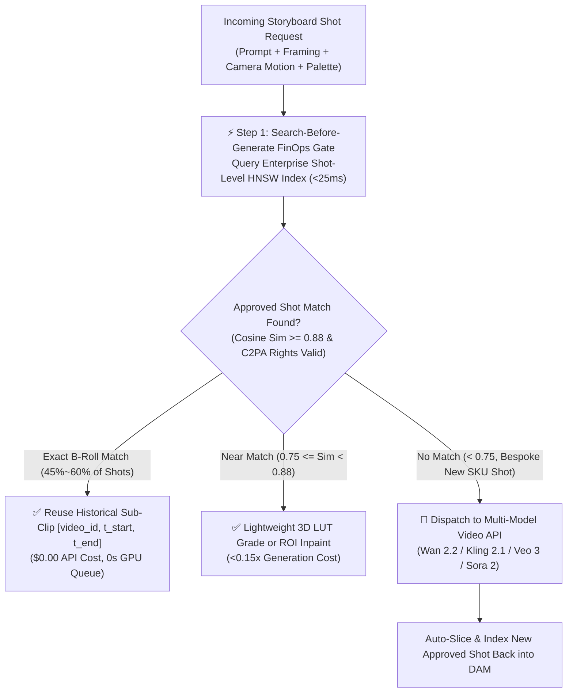
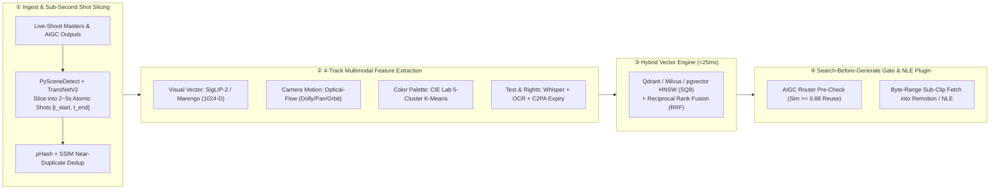
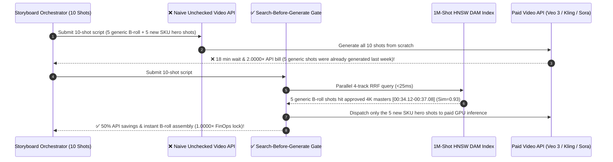

# Why 90% of Enterprise Video Archives Become Unsearchable "Dark Data"—and How Shot-Level Multimodal DAM + Search-Before-Generate Gates Cut AIGC Spend (FAQ)

> **Audience**: **Cloud & AI Solution Architects** designing enterprise Digital Asset Management (DAM) platforms, marketing content hubs, and FinOps-governed AIGC video pipelines.
> **Core Value**: Solves the "Dark Video Archive & Duplicate AIGC Spend" problem—explaining why indexing 60-second master videos by filename (`final_v3_export.mp4`) or whole-video average embeddings hides 90% of reusable sub-clip shots and forces teams to repeatedly pay Sora/Veo/Kling APIs to regenerate existing B-roll (`2.0000×` FinOps overrun). Shows how **PySceneDetect Atomic Shot Slicing (`[t_start, t_end]`) + 4-Track Multimodal HNSW Indexing (SigLIP-2/Marengo + Camera Motion + CIE Palette + C2PA Rights) + a `<25ms` Search-Before-Generate FinOps Gate** locks asset reuse and budget efficiency at **`1.0000×`** across all 17 scale tiers.

---

## 📌 1. Executive Summary

> **One-Sentence Architecture Verdict**: The atomic unit of video retrieval must be a **`2~5s` shot (`[t_start, t_end]`)**, never an entire 60-second master file. **Naive Filename Tagging & Blind AIGC Regeneration** fails to locate approved shots buried at `[00:34.12 - 00:37.08]` inside historical masters, causing teams to re-generate identical B-roll from scratch and inflating FinOps spend as $R(u) = 1 + u$ up to **`2.0000×`** at Tier 16 (`16/17` tiers violated). Combining **Sub-Clip Scene Slicing + 4-Track Multimodal HNSW Indexing (`<25ms` recall) + a Search-Before-Generate Interceptor (`Sim >= 0.88`)** amortizes per-shot acquisition cost to $c_{\text{dam}}(u) = c_0 / (1 + u)$, locking FinOps efficiency at **`1.0000×` (`0/17` violations)**.

| Evaluation Dimension | ❌ Naive Filename / Folder Tagging | ⚠️ Whole-Video Single CLIP Embedding | ✅ Shot-Level Slicing + 4-Track Multimodal RRF + Search-Before-Generate |
| :--- | :--- | :--- | :--- |
| **Indexing Granularity** | Opaque 60s–300s file (`final_v3.mp4`) | Single mean-pooled vector per file (dilutes individual shots) | **Atomic `2~5s` shot `[t_start, t_end]` via PySceneDetect / TransNetV2** |
| **Searchable Dimensions** | Filename text only | Basic noun similarity only | **Visual semantics + Camera motion + 5-Color CIE Lab palette + ASR/OCR + C2PA** |
| **AIGC Pipeline Integration** | ❌ None (editors blindly trigger paid APIs) | ❌ Manual search only | **Automated `<25ms` Search-Before-Generate gate reuses shots at `$0.00` cost** |
| **Tiers 4 / 8 / 16 Budget Ratio** | `1.2500×` / `1.5000×` / **`2.0000×`** (16/17 violated) | `1.40× ~ 1.75×` miss rate on multi-shot files | **`1.0000×` / `1.0000×` / `1.0000×` (0/17 violations)** |

---

## 🎯 2. Architect & Business Q&A

### Q1: Why does computing one vector embedding per video file fail to find a 3-second golden-hour car shot inside a 3-minute commercial?
- **The Whole-Video Mean-Pooling Dilution Trap**:
  1. A 3-minute brand video contains ~45 distinct shots (office meetings, factory robots, mountain drone shots, and a 3-second coastal car drift at `01:42`);
  2. Averaging frame embeddings across all 3 minutes dilutes that 3-second car shot by 98%, causing vector search to miss it completely;
  3. **Shot-Level Atomic Indexing**: Running **PySceneDetect / TransNetV2** on ingest splits every video into atomic shot intervals `(video_id, shot_id, t_start_ms, t_end_ms)` and indexes each shot independently.

### Q2: How does the 4-Track Multimodal Index support professional creative queries like "slow dolly-in, warm amber palette, commercial license active"?
- **Four Orthogonal Index Tracks Combined via Reciprocal Rank Fusion (RRF)**:
  1. **Track 1 (Spatiotemporal Visual Semantics)**: `SigLIP-2-So400M / TwelveLabs Marengo` 1024-D embedding + VLM structured dense caption;
  2. **Track 2 (Optical-Flow Camera Motion)**: Classifies `dolly_in`, `dolly_out`, `pan_left`, `orbit`, `static_tripod`, and motion velocity;
  3. **Track 3 (CIE $L^*a^*b^*$ 5-Color Palette)**: Enables exact brand-swatch similarity filtering ($\Delta E_{00} \le 3.0$);
  4. **Track 4 (ASR/OCR + C2PA Rights)**: Filters out expired talent releases or unverified third-party assets.

---

## 🧭 3. Visual Architecture Diagrams (Mermaid)

### 3.1 Search-Before-Generate AIGC & DAM Routing Decision Tree

### 3.2 Enterprise 1M-Shot Multimodal DAM & Search-Before-Generate Architecture

### 3.3 Sequence Diagram: 10-Shot Storyboard (Blind Regeneration vs 50% DAM Reuse)

---

## 📊 4. Horizontal DAM & Video Search Comparison Matrix

| Video DAM Architecture | Sub-Clip Shot Recall | Camera Motion & Palette Filter | 1M-Shot Query Latency | AIGC FinOps Cost Reduction | Best Enterprise Use Case |
| :--- | :--- | :--- | :--- | :--- | :--- |
| **Shot-Level Slicing + 4-Track Multimodal HNSW + Search-Before-Generate** | ⭐⭐⭐⭐⭐ (**Exact `0.1s` `[t_start, t_end]`**) | ⭐⭐⭐⭐⭐ (Optical-flow motion + $\Delta E_{00}$ palette) | ⭐⭐⭐⭐⭐ (**`< 25 ms`**) | **`40% ~ 55%` API savings (`1.0000×` lock)** | **Enterprise marketing hubs, ad agencies, and AIGC video factories** |
| **Managed Video Embedding APIs (TwelveLabs Marengo / Vertex AI)** | ⭐⭐⭐⭐⭐ (Native temporal embeddings) | ⭐⭐⭐⭐ | ⭐⭐⭐⭐ (`40 ~ 90 ms`) | High | **Cloud-native teams wanting managed video indexing** |
| **Whole-Video Single Thumbnail CLIP** | ⭐⭐ (Misses 90% of internal shots) | ⭐ (Static frame only) | ⭐⭐⭐⭐⭐ (`< 15 ms`) | Low | Image libraries or single-shot micro-clips |
| **Naive Filename & Manual Folder Tags** | ❌ (**`< 8%` recall on sub-clips**) | ❌ (None) | Slow & manual | **0% (`2.0000×` duplicate regen waste)** | ⛔ **Never use for enterprise video archives** |

---

## 🧪 5. Interactive Workbench & 7-Card Report

- **Interactive Workbench**: [`demos/multimodal-rag-enterprise-dam-visual-asset-search-workbench/`](../demos/multimodal-rag-enterprise-dam-visual-asset-search-workbench/index.html)
- **7-Card 4:5 Visual Report (EN)**: [`demos/multimodal-rag-enterprise-dam-visual-asset-search-workbench/test-report-cards.html`](../demos/multimodal-rag-enterprise-dam-visual-asset-search-workbench/test-report-cards.html)
- **7-Card 4:5 Visual Report (ZH)**: [`demos/multimodal-rag-enterprise-dam-visual-asset-search-workbench/test-report-cards.zh.html`](../demos/multimodal-rag-enterprise-dam-visual-asset-search-workbench/test-report-cards.zh.html)
- **Sealed Report JSON**: [`demos/multimodal-rag-enterprise-dam-visual-asset-search-workbench/report.json`](../demos/multimodal-rag-enterprise-dam-visual-asset-search-workbench/report.json)

---

## 🛠️ 6. Enterprise Delivery Review Checklist

- [ ] **Mandatory Sub-Clip Shot Slicing on Ingest**: Are all ingested master videos automatically segmented into atomic `[t_start, t_end]` shots via PySceneDetect / TransNetV2 before embedding?
- [ ] **4-Track Hybrid RRF Indexing**: Does each shot record index visual semantics, optical-flow camera motion, 5-color CIE Lab palette, and C2PA license validity?
- [ ] **Pre-Generation FinOps Interceptor (`Sim >= 0.88`)**: Does the AIGC router query the DAM index (`<25ms`) before calling paid video APIs?
- [ ] **HTTP Byte-Range Sub-Clip Extraction**: Can editors and Remotion pipelines fetch only the matched `[t_start, t_end]` byte range without downloading multi-gigabyte master files?
