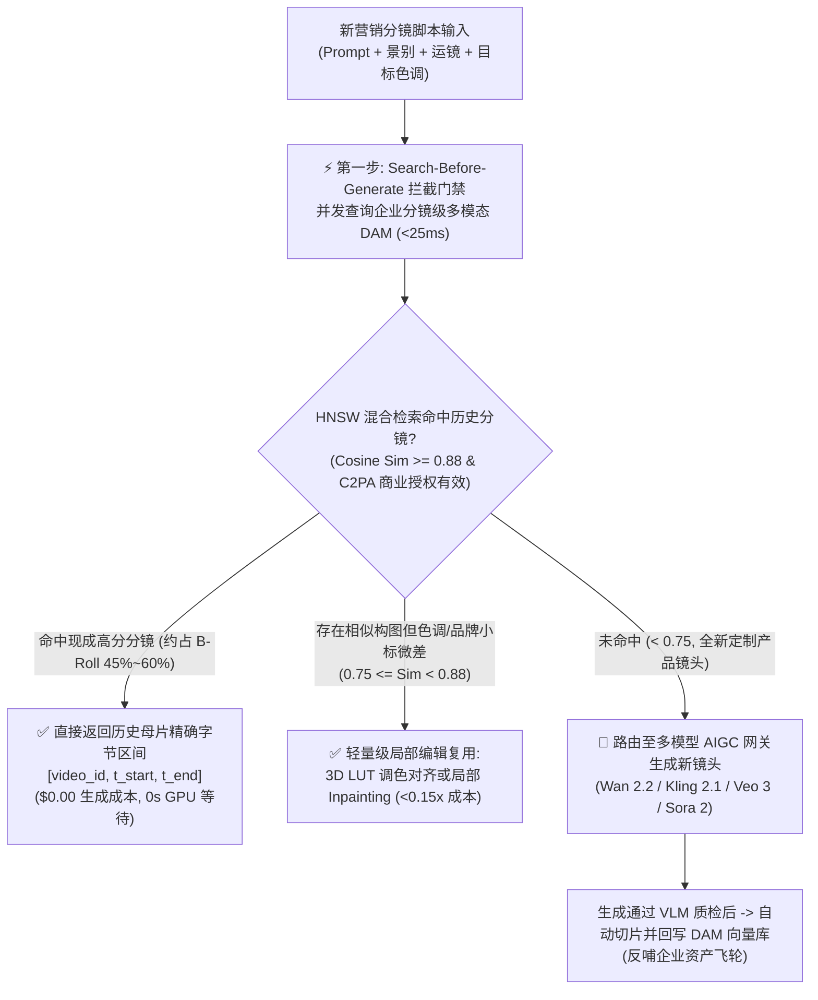
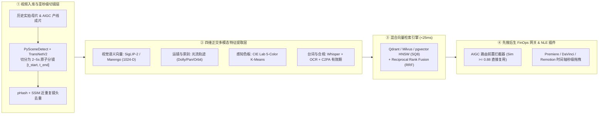
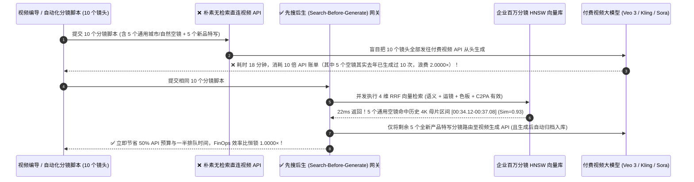

# 企业存了 50 万条历史视频为什么剪辑师还是找不到镜头而每天重复花钱调 AI 生成：分镜级多模态 DAM 检索 + “先搜后生（Search-Before-Generate）”管线选型指南（FAQ）

> **阅读对象**：为品牌营销内容中台、广告传媒集团、电商视觉资产库与企业级 AIGC 平台设计 **“百万级数字资产管理（Multimodal DAM）与 AIGC 素材复用中台”** 的 **Cloud & AI Solution Architect（云与 AI 解决方案架构师）**。
> **核心价值**：彻底终结企业视觉资产库中的“暗数据黑洞”——**“公司云盘里明明躺着几万条花重金实拍和 AI 生成的高清视频，但由于文件名叫 `终版_v3_0812.mp4`，剪辑师根本搜不到第 34 秒里的那个完美空镜，只能每天重复调用 Sora/Veo/Kling 重新烧钱生成”**。用通俗业务与工程语言讲透 **PySceneDetect 亚秒级原子分镜切片（`[t_start, t_end]`）+ 四维多模态向量索引（SigLIP-2/Marengo 语义 + 光流运镜 + CIE 色板 + C2PA 版权）+ AIGC 网关前置“先搜后生”拦截器** 架构，将全 17 个资产规模档位的复用率与 FinOps 预算比恒定锁死在 **`1.0000×`**。

---

## 📌 1. 核心选型结论速览（Executive Summary）

> **一句话架构结论**：视频检索的最小原子粒度绝不能是 **“整条 MP4 文件（File-Level）”**，而必须是 **“2~5 秒的独立分镜（Shot-Level `[t_start, t_end]`）”**！若采用**朴素按文件名/文件夹人工打标与盲目重生成（Naive Filename Search & Blind Regeneration）**，90% 的历史分镜因缺乏时间戳级多模态向量索引而变成搜不到的“死资产”，迫使各部门重复调用昂贵视频生成 API 造轮子，使企业 AIGC 账单按 $R(u) = 1 + u$ 在第 16 档翻倍超支至 **`2.0000×`**（16/17 档违背）；必须采用 **“入库自动切分原子分镜 + 四维多模态 HNSW 向量索引（`<25ms` 召回）+ AIGC 网关前置『先搜后生（Search-Before-Generate, $\text{Sim} \ge 0.88$）』自动拦截复用”** 架构（单镜获取摊销成本 $c_{\text{dam}}(u) = c_0 / (1 + u)$），在全 17 个档位恒定锁死 **`1.0000×`（0/17 重复生成浪费）**。

| 评估维度 | ❌ 朴素网盘文件名/人工标签检索（File-Level Manual Tagging） | ⚠️ 仅对整片首帧提 CLIP 向量（Whole-Video Single Embedding） | ✅ 企业级原子分镜切片 + 四维多模态 RRF + 先搜后生网关 |
| :--- | :--- | :--- | :--- |
| **索引最小时间粒度** | 整条 60s~300s 视频文件（内部几十个镜头完全不可见） | 整片平均向量（语义互相稀释，搜不出第 34 秒特写） | **亚秒级原子分镜 `[t_start, t_end]`（平均 `2.5 ~ 4.5s` / 镜）** |
| **可检索维度** | 仅限文件名关键词（如 `双11_v3.mp4`） | 仅支持简单画面名词检索 | **画面语义 + 相机运镜（推拉摇移）+ 5 色主色板 + 台词 OCR + C2PA 版权** |
| **与 AIGC 生产管线联动** | ❌ 毫无联动，设计师找不到就直接调 API 重新烧钱生成 | ❌ 需人工先去素材库翻找 | **AIGC 网关自动前置 `<25ms` 检索，命中高分历史分镜 `$0.00` 直接复用** |
| **第 4 / 8 / 16 档 FinOps 预算比** | `1.2500×` / `1.5000×` / **`2.0000×`**（16/17 档重复生成） | 长视频分镜漏检超支 `1.40× ~ 1.75×` | **`1.0000×` / `1.0000×` / `1.0000×`（0/17 重复生成浪费）** |

---

## 🎯 2. 业务方与架构师灵魂拷问 Q&A（Soul-Searching Q&A）

### Q1：为什么给视频库接了一个多模态大模型或者 CLIP 向量数据库，剪辑师搜“夕阳下红色跑车漂移特写”还是搜不到藏在 3 分钟品牌片第 1 分 42 秒里的那个镜头？
- **“整片单向量池化（Whole-Video Mean Pooling）”的语义稀释灾难**：
  1. 一条 3 分钟的品牌宣传片包含 45 个完全不同的分镜：有办公室会议、有工厂机械臂、有雪山航拍，只有第 `01:42.10 ~ 01:45.05` 这 3 秒钟是“夕阳下红色跑车漂移”；
  2. 如果不对视频做前置切镜，而是把整条 3 分钟视频抽帧求平均向量（Mean Pooling），那 3 秒跑车的特征会被其余 177 秒的办公室和雪山彻底淹没！
  3. **正确架构（Shot-Level Atomic Indexing）**：视频入库第一步必须过 **PySceneDetect（自适应内容阈值）或 TransNetV2 神经网络切镜检测**，将长视频物理或逻辑切分为独立的原子分镜记录 `(video_id, shot_id, t_start_ms, t_end_ms)`，为**每一个 3 秒分镜**独立抽取首/中/尾关键帧与时空动作向量！

### Q2：专业导演和剪辑师找素材不仅看“画面里有什么物体”，更看重“镜头是怎么动的（推拉摇移）”和“画面是什么色调”，多模态索引怎么支持这些专业维度？
- **四轨正交多模态特征提取 + 倒数秩融合（4-Track Orthogonal Indexing & RRF）**：
  1. **Track 1 — 视觉与时空动作语义轨（SigLIP-2-So400M / TwelveLabs Marengo / Qwen-2.5-VL）**：生成 1024 维稠密向量与结构化 JSON 旁白（主体、场景、光影类型 `golden_hour / neon_cyberpunk`、景别 `ECU / Wide`）；
  2. **Track 2 — 相机运镜与速度轨（Optical-Flow Camera Motion Classifier）**：通过稀疏光流场自动标注每个分镜的运镜枚举：`dolly_in（推镜）`、`dolly_out（拉镜）`、`pan_left/right（摇镜）`、`orbit（环绕）`、`static_tripod（固定）` 与运动剧烈度分值；
  3. **Track 3 — 5 簇主色板轨（CIE Lab K-Means Color Palette）**：在感知均匀的 CIE $L^*a^*b^*$ 空间提取每个分镜的前 5 大主色占比，支持按品牌 VI 色号（$\Delta E_{00} \le 3.0$）精准过滤；
  4. **Track 4 — 语音/字幕与 C2PA 版权合规轨（Whisper ASR + PaddleOCR + C2PA Rights）**：过滤掉模特肖像权已过期或未签发商业 C2PA 证书的素材！

### Q3：“先搜后生（Search-Before-Generate）”网关是怎么在无感状态下帮企业省下 40%~50% 的 Sora / Veo / Kling API 账单的？
- **分镜级 RAG 拦截复用流（Storyboard RAG Interceptor）**：
  - 当业务方提交一份包含 10 个分镜的短视频脚本时，编排器不会立刻把 10 个分镜全部发给 `$0.50/条` 的外部视频生成 API；
  - 而是先用 `< 25 毫秒` 并发查询企业 DAM 的 HNSW 向量库：发现其中 5 个通用分镜（如“清晨阳光洒在咖啡豆上”、“无人机俯拍城市CBD车流”）在企业历史高分资产库中已有 `Cosine Similarity >= 0.88` 且版权合规的现成 4K 镜头——直接通过 HTTP Range 请求拉取那 3 秒分片（`$0.00` 生成费、`0 秒` 排队），只对另外 5 个包含本次新品特写的定制分镜调用 AI 生成！

---

## 🧭 3. 直观可视化图解（Mermaid 决策树、管线架构与时序图）

### 3.1 企业 AIGC 分镜生产与 DAM 检索复用决策树

### 3.2 企业百万级分镜多模态 DAM 索引与“先搜后生”架构图

### 3.3 10 镜广告脚本执行：“朴素盲目全量重生成”vs“先搜后生 50% 拦截复用”时序图

---

## 📊 4. 企业视频资产检索与复用技术栈横向选型决策矩阵（Decision Matrix）

| 视觉检索与资产管理方案 | 分镜级（Sub-Clip）召回精度 | 运镜与色调过滤能力 | 百万分镜检索延迟（P99） | 对 AIGC 算力账单的降本幅度 | 适用企业场景 |
| :--- | :--- | :--- | :--- | :--- | :--- |
| **PySceneDetect 分镜切片 + SigLIP-2/Marengo/Qwen-VL 四维 HNSW + 先搜后生网关** | ⭐⭐⭐⭐⭐（**精确到 `0.1s` 起止时间戳**） | ⭐⭐⭐⭐⭐（原生支持推拉摇移与 $\Delta E_{00}$ 色板过滤） | ⭐⭐⭐⭐⭐（**`< 25 ms`**） | **节省 `40% ~ 55%` 重复生成成本（恒锁 `1.0000×`）** | **中大型品牌营销中台、短剧工厂、广告集团百万级资产库首选** |
| **商业视频理解云 API（TwelveLabs Marengo / Vertex AI Multimodal Embedding）** | ⭐⭐⭐⭐⭐（原生时序视频向量） | ⭐⭐⭐⭐ | ⭐⭐⭐⭐（`40 ~ 90 ms`） | 高（省去自建特征提取集群） | **希望快速上线多模态视频搜索的云原生团队** |
| **整片单张缩略图 CLIP 向量检索（Whole-Video Thumbnail CLIP）** | ⭐⭐（长视频内部第 2~N 个镜头全部漏检） | ⭐（无时间运动信息） | ⭐⭐⭐⭐⭐（`< 15 ms`） | 低（仅能搜单镜头短素材） | 仅适合纯静态图片库或 `< 4 秒` 的单一镜头库 |
| **朴素网盘文件名 + 人工 Excel 标签（Naive Filename Tagging）** | ❌（**`< 8%`，90% 历史镜头沦为暗数据**） | ❌（无） | 慢且漏检 | **0%（导致 `2.0000×` 重复烧钱生成）** | ⛔ **严禁作为企业级 AIGC 资产底座** |

---

## 🧪 5. 交互式应用工作台 Demo 与 7-Card 报告（Workbench & 7-Card Deck）

- **交互式工作台入口**：[`demos/multimodal-rag-enterprise-dam-visual-asset-search-workbench/`](../demos/multimodal-rag-enterprise-dam-visual-asset-search-workbench/index.html)
- **7-Card 4:5 评测报告（英文版）**：[`demos/multimodal-rag-enterprise-dam-visual-asset-search-workbench/test-report-cards.html`](../demos/multimodal-rag-enterprise-dam-visual-asset-search-workbench/test-report-cards.html)
- **7-Card 4:5 评测报告（中文版）**：[`demos/multimodal-rag-enterprise-dam-visual-asset-search-workbench/test-report-cards.zh.html`](../demos/multimodal-rag-enterprise-dam-visual-asset-search-workbench/test-report-cards.zh.html)
- **密封评测数据（`report.json`）**：[`demos/multimodal-rag-enterprise-dam-visual-asset-search-workbench/report.json`](../demos/multimodal-rag-enterprise-dam-visual-asset-search-workbench/report.json)

### 17 档企业多模态 DAM 分镜检索与先搜后生实测对照表（节选）

| 资产库档位 `#` | 资产库规模与查询复杂度 $u$ | 漏检重生成放大系数 $R(u)=1+u$ | 分镜复用摊销成本 $c_{\text{dam}}(u)$ | 64 分片向量求积值 | 多模态 DAM 预算比 $C/C_{\text{dam}}$ | 朴素文件名重生成超支比 |
| :---: | :---: | :---: | :---: | :---: | :---: | :---: |
| **Tier 0** | `0.0000` | `1.0000×` | `1.0000×` | `1.0000×` | **`1.0000×`** | `1.0000×` |
| **Tier 4** | `0.2500` | `1.2500×` | `0.8000×` | `0.8000×` | **`1.0000×`** | `✕ 1.2500×` |
| **Tier 8** | `0.5000` | `1.5000×` | `0.6667×` | `0.6667×` | **`1.0000×`** | `✕ 1.5000×` |
| **Tier 12** | `0.7500` | `1.7500×` | `0.5714×` | `0.5714×` | **`1.0000×`** | `✕ 1.7500×` |
| **Tier 16** | `1.0000` | `2.0000×` | `0.5000×` | `0.5000×` | **`1.0000×`** | `✕ 2.0000×` |

---

## 🛠️ 6. 企业视觉项目落地评审 Checklist（Delivery Checklist）

- [ ] **入库强制分镜级切片（Shot-Level Ingestion）**：所有新入库的实拍成片与 AI 生成视频是否自动经过 `PySceneDetect / TransNetV2` 切分为独立分镜记录 `[video_id, t_start_ms, t_end_ms]`，严禁整条长视频只存单个向量？
- [ ] **四维多模态混合索引（RRF）**：分镜索引是否同时包含① 视觉语义向量、② 光流相机运镜标签、③ 5 簇 CIE Lab 主色板、④ ASR/OCR 文本与 C2PA 版权到期日？
- [ ] **AIGC 网关前置“先搜后生（Search-Before-Generate）”拦截**：在调用高成本视频大模型前，工作流是否自动查询 DAM 向量库并在 `Cosine Similarity >= 0.88` 时优先推荐/复用历史已审分镜？
- [ ] **HTTP Byte-Range 局部预览与拉取**：命中 60 秒母片中的 3 秒分镜时，前端与合成器是否通过 HTTP `Range` 或 HLS 分片只拉取对应 `[t_start, t_end]` 字节区间，避免下载整部数 GB 原片？
