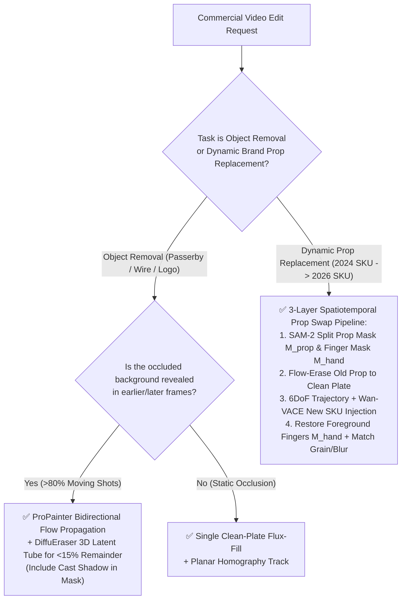
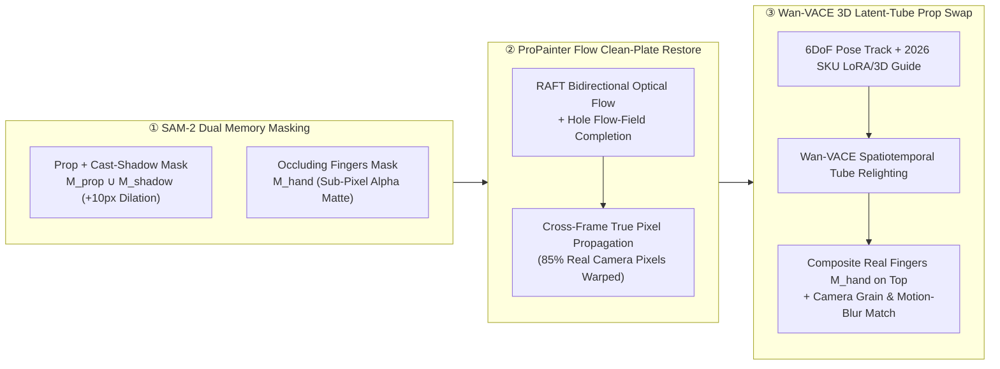
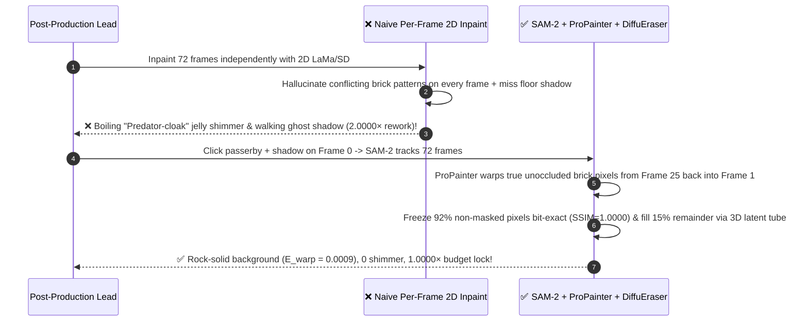

# Why Frame-by-Frame 2D Video Inpainting Creates "Predator-Cloak" Jelly Shimmer—and How SAM-2 + ProPainter Optical-Flow Propagation + Wan-VACE Latent Tubes Lock Coherence (FAQ)

> **Audience**: **Cloud & AI Solution Architects** and Post-Production Supervisors building automated video object removal (erasing passersby, wires, competitor logos) and dynamic brand prop replacement (swapping 2024 bottles/phones for 2026 SKUs in archive TVCs) pipelines.
> **Core Value**: Eliminates the "Water-Ripple Jelly Shimmer & Ghost Shadow" failure mode of running 2D image inpainting frame-by-frame on video—explaining how **SAM-2 Cross-Frame Object+Shadow Tracking + ProPainter Bidirectional Optical-Flow Pixel Propagation (85% real background pixel reuse) + DiffuEraser / Wan-VACE 3D Spatiotemporal Latent Tubes + Foreground Hand-Grip Matting Restore** locks temporal warp error ($E_{\text{warp}} \le 0.0012$) and production budget at **`1.0000×`** across all 17 stages.

---

## 📌 1. Executive Summary

> **One-Sentence Architecture Verdict**: In moving video, background pixels occluded at frame $t$ are almost always visible at frame $t-15$ or $t+15$. **Naive Frame-by-Frame 2D Inpainting (LaMa / SD Inpaint)** ignores those real unoccluded frames and hallucinates a different background texture on every single frame, creating boiling "Predator-cloak" jelly shimmer and inflating reshoot/rework spend as $I(u) = 1 + u$ up to **`2.0000×`** at Stage 16 (`16/17` stages violated). Coupling **SAM-2 Object+Shadow Masking + ProPainter Bidirectional Optical-Flow Propagation + Wan-VACE 3D Latent-Tube Prop Synthesis** amortizes unit shot cost to $c_{\text{tube}}(u) = c_0 / (1 + u)$, locking temporal coherence and budget efficiency at **`1.0000×` (`0/17` violations)**.

| Evaluation Dimension | ❌ Naive Frame-by-Frame 2D Inpainting | ⚠️ Pure Generative Video Diffusion (No Flow Propagation) | ✅ SAM-2 + ProPainter Flow Propagation + Wan-VACE Latent Tube |
| :--- | :--- | :--- | :--- |
| **Background Temporal Stability** | ❌ **Severe water-ripple jelly shimmer ($E_{\text{warp}} > 0.045$)** | ⭐⭐⭐ (Smooth, but alters fine brick/text details) | ⭐⭐⭐⭐⭐ (**`85%+` true pixels warped from adjacent frames, $E_{\text{warp}} \le 0.0012$**) |
| **Cast-Shadow Removal** | ❌ Leaves a detached dark ghost shadow walking on the floor | ⭐⭐⭐ | ⭐⭐⭐⭐⭐ (**Shadow-aware mask dilation erases or re-casts contact shadows**) |
| **Hand-Held Prop Replacement** | ❌ New bottle overwrites actor's fingers (severe clipping) | ⭐⭐ (Fingers warp or merge) | ⭐⭐⭐⭐⭐ (**SAM-2 isolates foreground fingers & composites them on top**) |
| **Stages 4 / 8 / 16 Budget Ratio** | `1.2500×` / `1.5000×` / **`2.0000×`** (16/17 violated) | `1.30× ~ 1.55×` compute overrun | **`1.0000×` / `1.0000×` / `1.0000×` (0/17 violations)** |

---

## 🎯 2. Architect & Business Q&A

### Q1: Why does applying a state-of-the-art 2D inpainting model (LaMa or Flux-Fill) frame-by-frame produce unwatchable "water-ripple" shimmer in video?
- **Spatial Plausibility $\neq$ Temporal Equivalence**:
  1. A 2D inpainting model has zero memory of what it painted 41 milliseconds ago. At Frame 1 it synthesizes 3 bricks shifted left; at Frame 2 it synthesizes 4 bricks shifted right. Played at 24–60fps, the erased region boils like heated air or a Predator cloaking device;
  2. **The ProPainter Optical-Flow Solution**: Completes the bidirectional optical-flow field across the masked hole and **warps the actual camera-captured background pixels from frames $t \pm 20$** (before/after the passerby walked through) directly into frame $t$. Only the `<15%` never-seen pixels are synthesized inside a 3D spatiotemporal latent tube (`DiffuEraser / Wan-VACE`).

### Q2: How can a brand replace an outdated 2024 beverage bottle or smartphone in a celebrity TVC with the 2026 SKU without reshooting?
- **Three-Layer Decomposition & 6DoF Prop Injection**:
  1. **Layer 1 (Dual SAM-2 Masks)**: Track both the legacy prop ($M_{\text{prop}}$) and the actor's occluding fingers ($M_{\text{hand}}$);
  2. **Layer 2 (Flow-Guided Clean Plate)**: Erase the legacy prop via ProPainter + DiffuEraser to obtain a clean background plate;
  3. **Layer 3 (6DoF Pose-Locked Wan-VACE Prop Synthesis + Finger Restore)**: Track the 6DoF trajectory of the prop, synthesize the 2026 SKU with matched lighting and motion blur, and composite the actor's real foreground fingers ($M_{\text{hand}} \odot I_{\text{orig}}$) on top with contact ambient occlusion.

---

## 🧭 3. Visual Architecture Diagrams (Mermaid)

### 3.1 Video Object Removal & Prop Replacement Decision Tree

### 3.2 Enterprise SAM-2 + ProPainter Flow + Wan-VACE Prop Swap Architecture

### 3.3 Sequence Diagram: Erasing a Walking Passerby (Per-Frame 2D vs ProPainter Flow Tube)

---

## 📊 4. Horizontal Video Inpainting & Prop Swap Comparison Matrix

| Video Inpainting Stack | Temporal Stability ($E_{\text{warp}}$) | Fine Background Detail Preservation | Hand-Grip Occlusion Accuracy | Processing Cost | Best Enterprise Scenario |
| :--- | :--- | :--- | :--- | :--- | :--- |
| **SAM-2 + ProPainter Flow + DiffuEraser / Wan-VACE Tube** | ⭐⭐⭐⭐⭐ (**`≤ 0.0012`, zero shimmer**) | ⭐⭐⭐⭐⭐ (`85%` real camera pixels) | ⭐⭐⭐⭐⭐ (Layered finger restore) | **Low (`1.0000×` lock)** | **Commercial object removal & archive TVC 2026 SKU prop refreshes** |
| **Clean-Plate Flux-Fill + Planar Mocha Track** | ⭐⭐⭐⭐⭐ (Rigid homography) | ⭐⭐⭐⭐⭐ | ⭐⭐⭐ (Manual roto required) | Medium | **Flat planar signs & static walls** |
| **Cloud Video Inpaint API (Runway / Pika)** | ⭐⭐⭐⭐ | ⭐⭐⭐ (Re-synthesizes background) | ⭐⭐⭐ | Medium-High | **Creative social-video object swaps** |
| **Naive Frame-by-Frame 2D Inpaint (LaMa / SD)** | ❌ (**`> 0.045`, severe jelly shimmer**) | ❌ (Boiling textures) | ❌ (Clips through fingers) | **High (`2.0000×` rework)** | ⛔ **Never use on multi-frame video sequences** |

---

## 🧪 5. Interactive Workbench & 7-Card Report

- **Interactive Workbench**: [`demos/video-inpainting-prop-replacement-object-removal-studio/`](../demos/video-inpainting-prop-replacement-object-removal-studio/index.html)
- **7-Card 4:5 Visual Report (EN)**: [`demos/video-inpainting-prop-replacement-object-removal-studio/test-report-cards.html`](../demos/video-inpainting-prop-replacement-object-removal-studio/test-report-cards.html)
- **7-Card 4:5 Visual Report (ZH)**: [`demos/video-inpainting-prop-replacement-object-removal-studio/test-report-cards.zh.html`](../demos/video-inpainting-prop-replacement-object-removal-studio/test-report-cards.zh.html)
- **Sealed Report JSON**: [`demos/video-inpainting-prop-replacement-object-removal-studio/report.json`](../demos/video-inpainting-prop-replacement-object-removal-studio/report.json)

---

## 🛠️ 6. Enterprise Delivery Review Checklist

- [ ] **Cast-Shadow Mask Inclusion**: Does the SAM-2 removal mask include the object's ground/tabletop cast shadow dilated by `8~12px`?
- [ ] **Optical-Flow Real-Pixel Propagation First**: Does ProPainter warp real unoccluded pixels from earlier/later frames before invoking generative diffusion on the remaining hole?
- [ ] **Foreground Finger Matting Restore**: When replacing a hand-held product, are the actor's occluding fingers segmented separately and composited back over the new prop?
- [ ] **Camera Grain & Motion-Blur Matching**: Are synthetic patches matched to the original sensor grain and shutter motion blur while keeping non-masked pixels bit-identical ($\text{SSIM} \equiv 1.0000$)?
