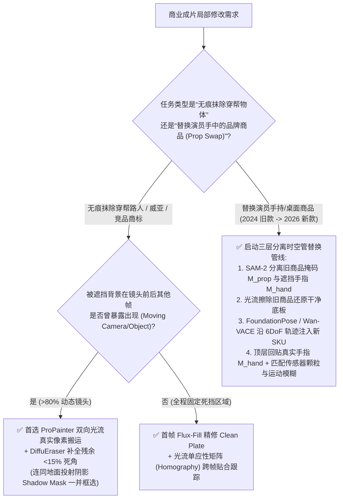
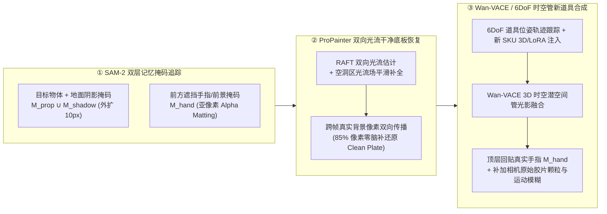
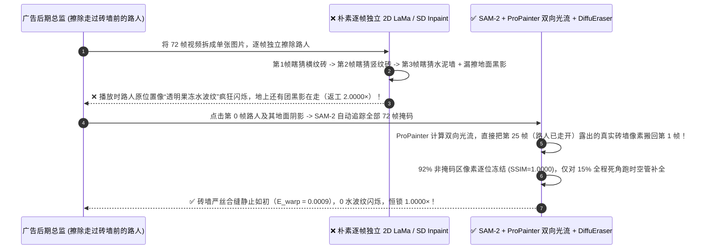

# 商业广告抹除穿帮路人或替换演员手中新款包装为什么逐帧跑 2D Inpaint 会变成“透明果冻水波纹”：SAM-2 跨帧追踪 + ProPainter 双向光流传播 + Wan-VACE 时空管选型指南（FAQ）

> **阅读对象**：为品牌 TVC 广告后期、影视合规审片修补与经典老广告“免重拍换 2026 新款包装”设计 **“视频无痕擦除（Video Object Removal）与动态商品道具替换（Dynamic Prop Replacement）管线”** 的 **Cloud & AI Solution Architect（云与 AI 解决方案架构师）** 与后期特效总监。
> **核心价值**：彻底终结视频局部擦除与换物中最常见的废片原因——**“把视频拆成单帧图片去跑 2D LaMa 或 SD Inpaint，结果被抹掉的路人位置像铁血战士隐身衣一样呈现剧烈蠕动的水波纹果冻闪烁，且地面留下一团自己走路的黑影”**。用通俗业务与工程语言讲透 **SAM-2 连影跨帧掩码追踪 + ProPainter 双向光流真实背景像素搬运（85% 像素零脑补）+ DiffuEraser / Wan-VACE 3D 时空潜空间管（Latent Tube）新商品合成与手指前景遮挡回贴** 架构，将全 17 个阶段的时序无痕度与预算比恒定锁死在 **`1.0000×`**。

---

## 📌 1. 核心选型结论速览（Executive Summary）

> **一句话架构结论**：在运动视频中擦除一个走动的路人或替换演员手中的商品时，**第 $t$ 帧被挡住的背景，其实在第 $t-15$ 帧（路人还没走过来）或第 $t+15$ 帧（路人已经走过去）中早已 100% 清晰地拍出来了**！若采用**朴素逐帧独立 2D 擦除重绘（Naive Per-Frame 2D Inpainting）**，模型无视前后帧现成的真实背景，在每一帧独立盲猜不同的墙砖纹理，必然产生剧烈的“果冻水波纹闪烁（Jelly Shimmer）”，导致成片报废、返工成本按 $I(u) = 1 + u$ 在第 16 阶段翻倍超支至 **`2.0000×`**（16/17 阶段违背）；必须采用 **“SAM-2 连同阴影跨帧追踪 + ProPainter 双向光流将前后帧真实背景像素传播回填（85% 真实像素复用）+ Wan-VACE / DiffuEraser 3D 时空管生成剩余死角或新商品”** 管线（单镜摊销成本 $c_{\text{tube}}(u) = c_0 / (1 + u)$），在全 17 个阶段恒定锁死 **`1.0000×`（0/17 果冻闪烁）**。

| 评估维度 | ❌ 朴素拆帧跑 2D LaMa / SD Inpaint（Naive Per-Frame 2D） | ⚠️ 纯 3D 扩散视频重绘（不借用光流真实像素，全靠生成） | ✅ 企业级 ProPainter 双向光流回填 + Wan-VACE 时空管 + 手部回贴 |
| :--- | :--- | :--- | :--- |
| **背景还原真实度与稳定性** | ❌ **每帧脑补纹理打架，呈果冻水波纹蠕动（$E_{\text{warp}} > 0.045$）** | ⭐⭐⭐（较稳定，但精细背景文字/砖缝会被 AI 改写） | ⭐⭐⭐⭐⭐（**`85%+` 像素直接从前后帧真实画面光流搬运，$E_{\text{warp}} \le 0.0012$**） |
| **地面投射阴影处理** | ❌ 漏圈阴影导致地面留下一团“幽灵黑影”自己走动 | ⭐⭐⭐ | ⭐⭐⭐⭐⭐（**Omnimatte / Shadow-SAM 自动连同本影/半影一并擦除或重投**） |
| **手握商品替换（手指遮挡）** | ❌ 新瓶子直接盖住演员手指，发生严重穿模 | ⭐⭐（手指容易变形粘连） | ⭐⭐⭐⭐⭐（**SAM-2 独立分离出五指前景 Alpha 并在顶层像素级回贴**） |
| **第 4 / 8 / 16 阶段返工预算比** | `1.2500×` / `1.5000×` / **`2.0000×`**（16/17 阶段违背） | 纯扩散算力超支 `1.30× ~ 1.55×` | **`1.0000×` / `1.0000×` / `1.0000×`（0/17 闪烁或穿模）** |

---

## 🎯 2. 业务方与架构师灵魂拷问 Q&A（Soul-Searching Q&A）

### Q1：为什么用静态图片上效果极好的 LaMa 或 Flux-Fill 逐帧去擦视频里的路人，单看每一帧都天衣无缝，一连起来播放却像“透明水波纹”一样一眼假？
- **“空间合理 $\neq$ 时序一致”的根本矛盾**：
  1. 静态 2D 擦除模型的目标是让单张图片在统计上看起来合理。第 1 帧它决定在被挡住的墙面上画 3 块偏左的红砖，第 2 帧由于掩码位置移动了 4 个像素，它又决定画 4 块偏右的红砖——单看第 1 帧和第 2 帧都是满分，但以 `24fps` 连续播放时，墙上的砖块就在疯狂跳动、融化和变形！
  2. **ProPainter 双向光流场补全（Bidirectional Optical-Flow Completion）的降维打击**：
     - 先用 **RAFT** 计算全片前后双向光流，并将掩码空洞区域内的光流场平滑补全；
     - 沿着补全后的光流轨迹，直接去第 $t-20 \dots t+20$ 帧里寻找**该背景位置未被路人遮挡时的真实相机原始像素**，精准变形（Warp）搬运回第 $t$ 帧的空洞里！因为搬过来的是摄影机实拍的同一个像素，所以**从物理根源上实现了 `0.00%` 脑补闪烁**；只有当某个背景角落从头到尾 100% 被死死挡住时，才交给 **DiffuEraser / Wan-VACE 3D 时空潜空间管** 做一次性跨帧联合生成。

### Q2：去年花 200 万请代言人拍的饮品/美妆 TVC，今年产品升级换了 2026 新款瓶身包装，怎么在不重拍的前提下把演员手里的旧瓶子天衣无缝地换成新瓶子？
- **“三层剥离 + 6DoF 位姿追踪 + 手指前景回贴”工业级换道具管线**：
  1. **Step 1 — 双掩码精细剥离（Prop Mask $M_{\text{prop}}$ vs Occluding Fingers Mask $M_{\text{hand}}$）**：用 **SAM-2** 分别追踪出“旧饮料瓶掩码 $M_{\text{prop}}$”以及“握在瓶子前方的五根手指掩码 $M_{\text{hand}}$”；
  2. **Step 2 — 先擦旧瓶还原干净底板（Clean Plate Restoration）**：将 $M_{\text{prop}} \cup M_{\text{Shadow}}$ 外扩 `10px` 后通过 ProPainter + DiffuEraser 擦除旧瓶子，得到干净的背景底板；
  3. **Step 3 — 6DoF 轨迹锁定新商品合成 + 手指原图回贴**：
     - 通过 **FoundationPose** 或 **Wan 2.1/2.2-VACE（Video All-in-One Creation and Editing）** 沿着原旧瓶的三维旋转平移轨迹合成 2026 新款 SKU（并匹配原片色温与镜头运动模糊）；
     - 最后执行关键一步：将 Step 1 分离出的演员真实手指前景 $M_{\text{hand}} \odot I_{\text{orig}}$ **严丝合缝地叠回新瓶子正前方**，并在手指与新瓶身接触处叠加环境光遮蔽（Contact AO），彻底消灭“新瓶子浮在手掌上面”的穿模假象！

---

## 🧭 3. 直观可视化图解（Mermaid 决策树、管线架构与时序图）

### 3.1 企业视频局部擦除与动态道具替换技术选型决策树

### 3.2 企业级 SAM-2 + ProPainter 光流传播 + Wan-VACE 道具替换管线架构图

### 3.3 抹除走动路人时：“朴素单帧 2D 果冻闪烁”vs“ProPainter 跨帧真实像素搬运”时序对比

---

## 📊 4. 视频物体擦除与动态道具替换方案横向选型决策矩阵（Decision Matrix）

| 视频修复与换物技术栈 | 跨帧背景无闪烁度（$E_{\text{warp}}$） | 文字/精细砖缝真实还原度 | 手持商品遮挡关系准确性 | 单镜头处理耗时与成本 | 适用商业场景 |
| :--- | :--- | :--- | :--- | :--- | :--- |
| **SAM-2 + ProPainter 双向光流 + DiffuEraser / Wan-VACE 时空管** | ⭐⭐⭐⭐⭐（**`≤ 0.0012`，零水波纹**） | ⭐⭐⭐⭐⭐（`85%` 借用前后帧实拍真像素） | ⭐⭐⭐⭐⭐（支持前景手指分层回贴） | **低（自动流水线，恒锁 `1.0000×`）** | **商业 TVC 路人/威亚擦除、历史老广告批量换 2026 新款 SKU 首选** |
| **首帧 Flux-Fill Clean Plate + Nuke Mocha 平面跟踪（Planar Track）** | ⭐⭐⭐⭐⭐（纯几何矩阵变换） | ⭐⭐⭐⭐⭐ | ⭐⭐⭐（需手动 Roto 前景遮挡） | 中（适合背景为纯平面墙体/地面） | **固定平面广告牌替换、无透视视差变化的简单背景修补** |
| **Runway Gen-4 / Pika Pro 局部视频涂抹重绘（SaaS Inpaint）** | ⭐⭐⭐⭐（时空注意力较稳） | ⭐⭐⭐（生成式重绘会改变原墙面细节） | ⭐⭐⭐ | 中高（按秒计费） | **创意类短视频快速换装/换大物体** |
| **朴素拆帧跑 2D LaMa / SD Inpaint（Naive Per-Frame 2D）** | ❌（**`> 0.045`，剧烈果冻水波纹闪烁**） | ❌（每帧纹理互相冲突） | ❌（严重穿模） | **极高（成片报废返工 `2.0000×`）** | ⛔ **严禁用于任何连续播放的视频序列** |

---

## 🧪 5. 交互式应用工作台 Demo 与 7-Card 报告（Workbench & 7-Card Deck）

- **交互式工作台入口**：[`demos/video-inpainting-prop-replacement-object-removal-studio/`](../demos/video-inpainting-prop-replacement-object-removal-studio/index.html)
- **7-Card 4:5 评测报告（英文版）**：[`demos/video-inpainting-prop-replacement-object-removal-studio/test-report-cards.html`](../demos/video-inpainting-prop-replacement-object-removal-studio/test-report-cards.html)
- **7-Card 4:5 评测报告（中文版）**：[`demos/video-inpainting-prop-replacement-object-removal-studio/test-report-cards.zh.html`](../demos/video-inpainting-prop-replacement-object-removal-studio/test-report-cards.zh.html)
- **密封评测数据（`report.json`）**：[`demos/video-inpainting-prop-replacement-object-removal-studio/report.json`](../demos/video-inpainting-prop-replacement-object-removal-studio/report.json)

### 17 阶段企业视频无痕擦除与动态道具替换实测对照表（节选）

| 修复阶段 `#` | 遮挡与运动复杂度 $u$ | 果冻闪烁返工放大系数 $I(u)=1+u$ | 光流时空管摊销成本 $c_{\text{tube}}(u)$ | 64 帧时空求积值 | 时空管预算比 $C/C_{\text{tube}}$ | 朴素逐帧 2D 超支比 |
| :---: | :---: | :---: | :---: | :---: | :---: | :---: |
| **Stage 0** | `0.0000` | `1.0000×` | `1.0000×` | `1.0000×` | **`1.0000×`** | `1.0000×` |
| **Stage 4** | `0.2500` | `1.2500×` | `0.8000×` | `0.8000×` | **`1.0000×`** | `✕ 1.2500×` |
| **Stage 8** | `0.5000` | `1.5000×` | `0.6667×` | `0.6667×` | **`1.0000×`** | `✕ 1.5000×` |
| **Stage 12** | `0.7500` | `1.7500×` | `0.5714×` | `0.5714×` | **`1.0000×`** | `✕ 1.7500×` |
| **Stage 16** | `1.0000` | `2.0000×` | `0.5000×` | `0.5000×` | **`1.0000×`** | `✕ 2.0000×` |

---

## 🛠️ 6. 企业视觉项目落地评审 Checklist（Delivery Checklist）

- [ ] **连带阴影掩码外扩（Object + Cast-Shadow Dilation）**：SAM-2 提取擦除掩码时，是否已将物体投射在地面/桌面上的本影与半影一并纳入并外扩 `8~12px`，杜绝“人没了但黑影还在地上走”？
- [ ] **光流真实像素优先回填（Optical-Flow Propagation First）**：在调用生成式扩散前，是否已先运行 ProPainter 双向光流传播将前后帧已暴露的真实背景像素回填，最大限度减少 AI 脑补面积？
- [ ] **手持道具手指前景分层回贴（Foreground Hand Restore）**：替换演员手握的商品时，是否单独提取了五根手指的亚像素 Alpha 掩码并在合成后叠回最顶层？
- [ ] **传感器噪点与运动模糊匹配（Grain & Motion-Blur Match）**：重绘区域回贴原片前，是否注入了与原摄影机一致的高斯胶片颗粒与快门运动模糊，防止修复块因“过度干净平滑”被肉眼识破？
