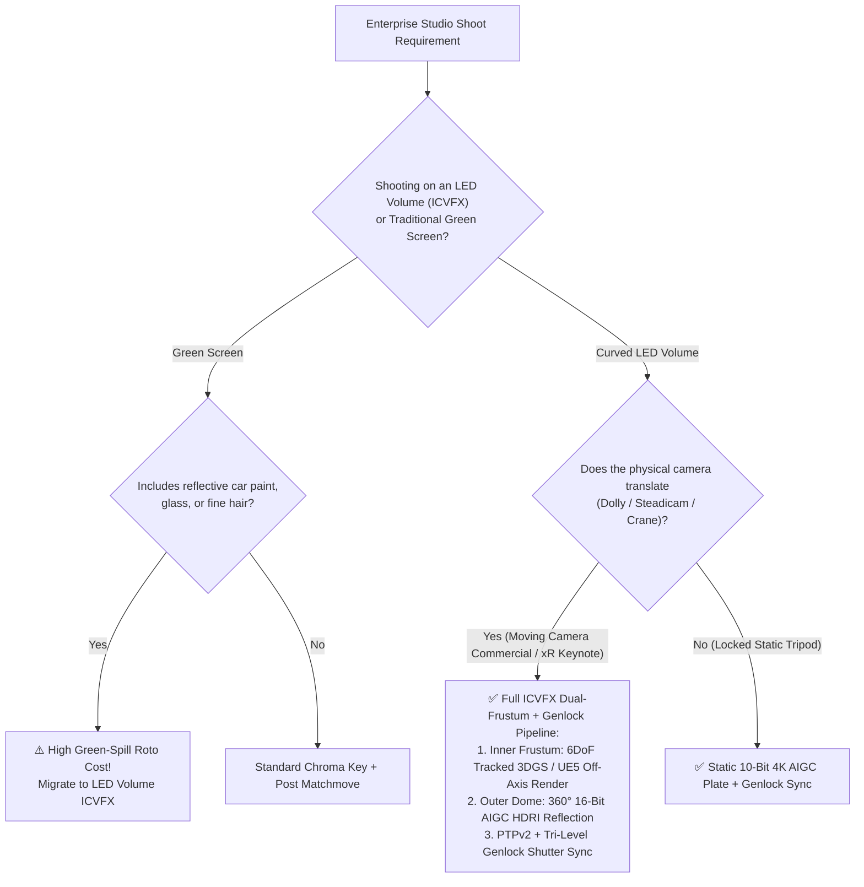
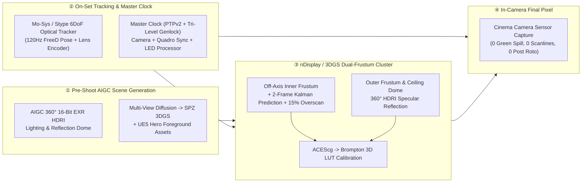
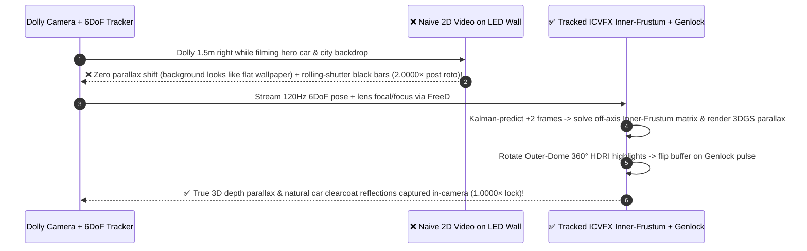

# Why Playing Untracked 2D AI Video on LED Walls Ruins Moving Camera Shots—and How ICVFX Off-Axis Inner-Frustum 3DGS + AIGC HDRI Domes + Genlock Lock Final Pixels

> **Audience**: **Cloud & AI Solution Architects** and Virtual Production (VP) Supervisors designing enterprise xR keynotes, automotive LED-volume commercials, and broadcast virtual studios.
> **Core Value**: Explains why displaying a flat 2D AI video on an LED wall during moving camera shots immediately collapses 3D motion parallax and triggers rolling-shutter scanline banding—and how **6DoF Camera-Tracked Off-Axis Inner-Frustum Rendering (3DGS/UE5) + Outer-Dome 360° 16-Bit AIGC HDRI Reflections + PTPv2/Tri-Level Genlock Phase Locking** achieves **In-Camera Final Pixels (`1.0000×` budget lock)** with zero green-screen rotoscoping across all 17 stages.

---

## 📌 1. Executive Summary

> **One-Sentence Architecture Verdict**: In an LED-volume virtual stage, **Naive Untracked 2D Video Playback or Green-Screen Shooting** either destroys 3D parallax the instant the camera moves on a dolly/crane, introduces rolling-shutter scanline bars without Genlock, or contaminates automotive paint and hair with green spill—inflating post-production rotoscoping and screen-replacement cost as $L(u) = 1 + u$ up to **`2.0000×`** at Stage 16 (`16/17` stages violated). Coupling **6DoF Camera-Tracked Off-Axis Inner-Frustum 3DGS/UE5 Rendering + Outer-Dome 360° AIGC HDRI Reflections + PTPv2/Genlock Shutter Sync** amortizes unit production cost to $c_{\text{icvfx}}(u) = c_0 / (1 + u)$, locking In-Camera Final-Pixel efficiency at **`1.0000×` (`0/17` violations)**.

| Evaluation Dimension | ❌ Traditional Green-Screen Stage | ⚠️ Naive Untracked 2D Video on LED Wall | ✅ Enterprise ICVFX (Tracked Inner-Frustum 3DGS + Outer HDRI + Genlock) |
| :--- | :--- | :--- | :--- |
| **Moving Camera (Dolly/Crane) Parallax** | Requires post-shoot 3D matchmove | ❌ **Instant flat-poster parallax collapse** | ⭐⭐⭐⭐⭐ (**Real-time 6DoF off-axis asymmetric frustum projection**) |
| **Car Paint / Eyeglasses / Hair Reflections** | ❌ **Severe green spill & manual roto** | ⭐⭐ (Reflections lack perspective sync) | ⭐⭐⭐⭐⭐ (**360° 16-bit AIGC HDRI outer dome; 0 green spill, 0 roto**) |
| **Rolling-Shutter Scanline Banding** | None | ❌ **Black scanline bars without Genlock** | ⭐⭐⭐⭐⭐ (**PTPv2 + Tri-Level Genlock phase lock; 0 banding**) |
| **Stages 4 / 8 / 16 Budget Ratio** | `1.3500×` / `1.6500×` / **`2.0000×`** (post roto) | `1.2500×` / `1.5000×` / **`2.0000×`** (screen replace) | **`1.0000×` / `1.0000×` / `1.0000×` (In-Camera Final Pixel)** |

---

## 🎯 2. Architect & Business Q&A

### Q1: When can a team play a 2D AIGC video on an LED wall, and when is a 6DoF-tracked 3DGS/UE5 Inner Frustum mandatory?
- **The Motion Parallax Boundary**:
  1. **Locked Tripod Exception (Stage 0)**: If the physical camera is bolted to a static tripod with zero translational movement, a 10-bit 4K 2D AIGC plate (with Genlock) works for distant backgrounds;
  2. **Moving Camera Mandate (Stages 1–16)**: The moment the camera translates horizontally or vertically, foreground and background elements must shift at different angular velocities according to their 3D depth ($Z$). Playing a flat 2D video on the LED wall freezes relative parallax, instantly revealing a flat wall. Transforming AIGC multi-view generations into **SPZ 3D Gaussian Splatting (3DGS) / UE5 scenes** driven by a `120Hz` optical camera tracker (`Mo-Sys / Stype FreeD`) restores true off-axis 3D parallax.

### Q2: How do the "Inner Frustum" and "Outer Dome" work together in an AIGC-powered LED volume?
- **Dual-Zone Rendering Architecture**:
  1. **Inner Frustum (High-Acuity Camera Patch)**: Renders only the camera's exact field of view (plus a `15%` Kalman-predicted overscan buffer) at native 90fps 3DGS/UE5 resolution;
  2. **Outer Frustum & Ceiling Dome (360° AIGC HDRI IBL)**: Wraps the rest of the curved LED wall and ceiling in a **16-bit 360° equirectangular AIGC HDRI map**, casting physically accurate sunset, neon, or studio reflections onto automotive clearcoat, actors' skin, and eyeglasses.

### Q3: How do PTPv2/Genlock and 2-Frame Kalman Prediction prevent scanline bars and frustum lag?
- **Hardware Phase Lock & Latency Compensation**:
  - **Tri-Level Genlock + IEEE-1588 PTPv2** locks the camera sensor readout, NVIDIA Quadro Sync GPU frame buffer flip, and Brompton/Megapixel LED PWM refresh to the same sub-microsecond clock;
  - **2-Frame Kalman Motion Prediction** extrapolates camera pose `33ms` ahead to compensate for tracker-to-photon latency during fast whip-pans.

---

## 🧭 3. Visual Architecture Diagrams (Mermaid)

### 3.1 Virtual Production Technical Stack Decision Tree

### 3.2 Enterprise AIGC + 3DGS/UE5 LED-Volume ICVFX Pipeline Architecture

### 3.3 Sequence Diagram: Camera Dolly Move (Untracked 2D Wall vs Tracked ICVFX Frustum)

---

## 📊 4. Horizontal Virtual Production Comparison Matrix

| Virtual Production Stack | Moving-Camera 3D Parallax | Reflective Subject Realism (Cars/Glass) | Post-Production Roto Cost | Locations Shot per Day | Best Enterprise Use Case |
| :--- | :--- | :--- | :--- | :--- | :--- |
| **ICVFX Tracked Inner-Frustum (3DGS/UE5) + AIGC HDRI + Genlock** | ⭐⭐⭐⭐⭐ (**True 6DoF off-axis parallax**) | ⭐⭐⭐⭐⭐ (**Physical LED reflections, 0 spill**) | **Minimal (In-Camera Final Pixel, `1.0000×` lock)** | **`15 ~ 24 locations / day`** | **Automotive TVCs, CEO xR keynotes, multi-location commercial shoots** |
| **Locked Tripod + 10-Bit 2D AIGC LED Plate + Genlock** | ⭐⭐ (Static camera only) | ⭐⭐⭐⭐ (Real LED lighting) | Low (if camera never moves) | `30+ backdrops / day` | **Static sit-down interviews, podcast sets, fixed-camera livestreams** |
| **Traditional Green Screen + Post 3D Matchmove & Roto** | ⭐⭐⭐⭐ (Post-tracked) | ⭐ (**Severe green spill on cars/hair**) | **Very High (frame-by-frame roto)** | Unlimited (in post) | **Heavy destructive VFX shots with no reflective foregrounds** |
| **Naive Untracked 2D Video on LED + Moving Camera** | ❌ (**Flat-poster parallax collapse**) | ⭐⭐ (Mismatched perspective) | **Very High (`2.0000×` screen replacement)** | — | ⛔ **Never use for moving-camera shoots** |

---

## 🧪 5. Interactive Workbench & 7-Card Report

- **Interactive Workbench**: [`demos/virtual-production-led-stage-icvfx-frustum-sync-studio/`](../demos/virtual-production-led-stage-icvfx-frustum-sync-studio/index.html)
- **7-Card 4:5 Visual Report (EN)**: [`demos/virtual-production-led-stage-icvfx-frustum-sync-studio/test-report-cards.html`](../demos/virtual-production-led-stage-icvfx-frustum-sync-studio/test-report-cards.html)
- **7-Card 4:5 Visual Report (ZH)**: [`demos/virtual-production-led-stage-icvfx-frustum-sync-studio/test-report-cards.zh.html`](../demos/virtual-production-led-stage-icvfx-frustum-sync-studio/test-report-cards.zh.html)
- **Sealed Report JSON**: [`demos/virtual-production-led-stage-icvfx-frustum-sync-studio/report.json`](../demos/virtual-production-led-stage-icvfx-frustum-sync-studio/report.json)

---

## 🛠️ 6. Enterprise Delivery Review Checklist

- [ ] **End-to-End `Tri-Level Genlock + PTPv2` Lock**: Are the cinema camera, GPU Quadro Sync cards, camera tracker, and Brompton/Megapixel LED processors locked to a single master sync generator with zero scanline banding?
- [ ] **2-Frame Kalman Prediction & 15% Frustum Overscan**: Is tracker-to-photon latency measured and compensated so fast pans never expose the edge of the Inner Frustum?
- [ ] **Moire-Free Subject-to-LED Standoff Distance (`>= 3.5m`)**: Is the foreground subject positioned far enough ahead of the LED pitch (`<= P2.6`) so the physical lens bokeh blurs the LED pixel grid?
- [ ] **Closed-Loop ACEScg 3D LUT Calibration**: Is the LED wall calibrated through the actual hero camera sensor and lens to prevent color shifts in skin tones and shadows?
