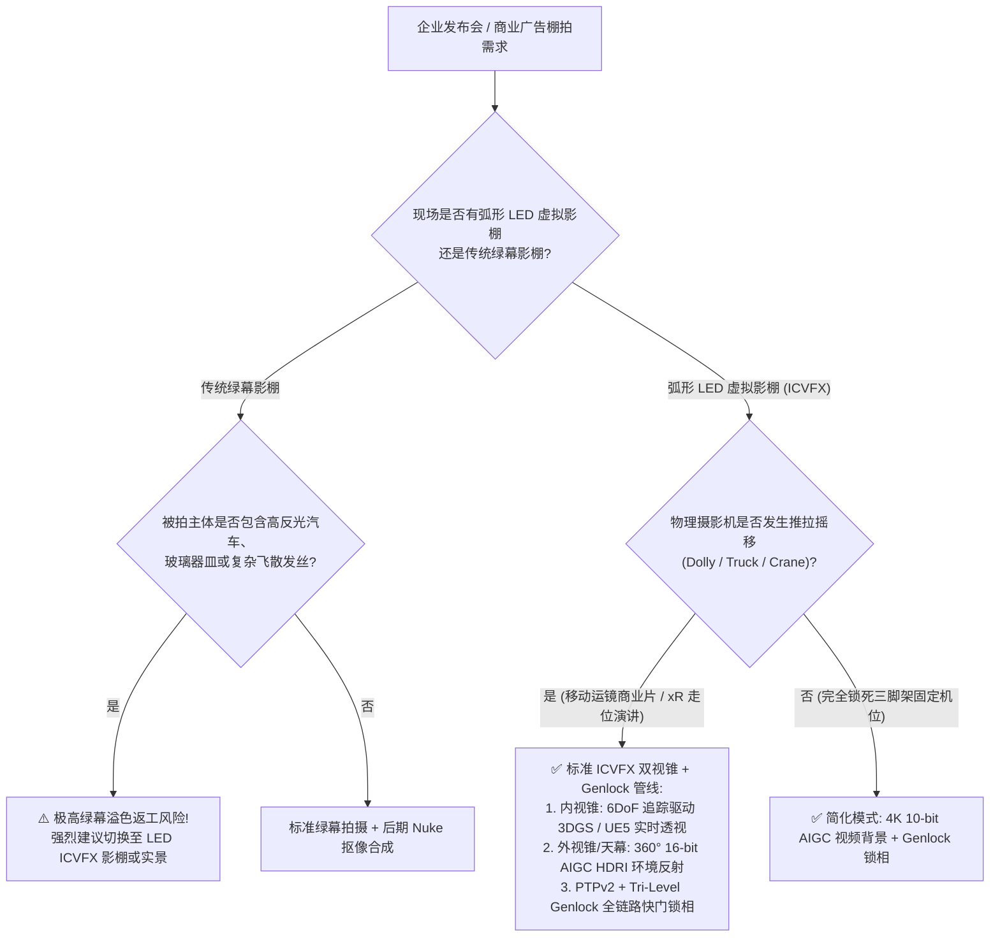
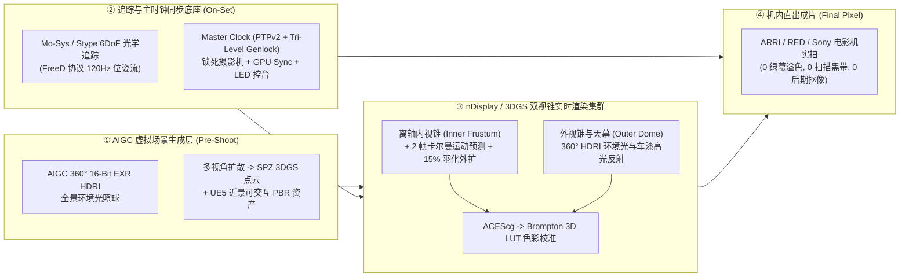
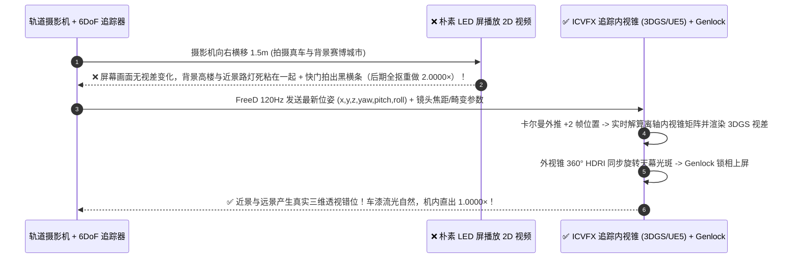

# 企业与影视 LED 虚拟制片（ICVFX）为什么直接在巨幕上放 2D AI 视频一动镜头就穿帮：6DoF 追踪内视锥（3DGS/UE5）+ 外视锥 AIGC 全景天幕照明 + Genlock 锁相选型指南（架构师选型 FAQ）

> **阅读对象**：为企业 CEO 年度 xR 发布会、汽车商业大片 LED 虚拟影棚（LED Volume）、广电演播室与短剧虚拟制片基地设计 **“AIGC + 3DGS/UE5 机内直出虚拟制片（In-Camera VFX, ICVFX）管线”** 的 **Cloud & AI Solution Architect（云与 AI 解决方案架构师）** 与虚拟制片技术总监（VP Supervisor）。
> **核心价值**：彻底厘清为什么“租一块弧形 LED 巨幕，把 Sora/Veo/Wan 生成的 2D 视频直接全屏播放并在前面推轨道车拍人和车”会引发灾难性的透视穿帮与扫描黑带——用通俗业务与工程语言讲透 **6DoF 摄影机追踪离轴内视锥（Off-Axis Inner Frustum 3DGS/UE5）+ 外视锥 360° 16-bit AIGC HDRI 环境反射照明 + PTPv2/Genlock 快门相位锁死** 架构，实现零绿幕抠像的 **“机内直出（Final Pixel）”**，将全 17 个阶段的制作与后期返工预算比恒定锁死在 **`1.0000×`**。

---

## 📌 1. 核心选型结论速览（Executive Summary）

> **一句话架构结论**：在弧形 LED 虚拟影棚中，LED 屏幕必须同时扮演两个物理角色——**被摄影机镜头直接拍到的“内视锥窗口（Inner Frustum）”**，以及**不被镜头直接拍到、但负责把真实环境光反射到高管眼镜、演员皮肤和汽车清漆上的“外视锥与天幕（Outer Frustum & Ceiling Dome）”**。若采用**朴素无相机追踪的 2D AI 视频直接投屏或传统绿幕抠像（Naive Static 2D LED / Green-Screen Spill）**，摄影机一旦推拉摇移就会暴露“扁平壁纸透视错误”，未锁相快门会拍出黑色扫描横条，绿幕溢色更会污染车漆发丝，使后期逐帧抠像重做成本按 $L(u) = 1 + u$ 在第 16 阶段翻倍超支至 **`2.0000×`**（16/17 阶段违背）；必须采用 **“6DoF 追踪离轴内视锥（3DGS/UE5）+ 外视锥 360° AIGC HDRI 照明 + PTPv2/Genlock 快门锁相”** 管线（单镜摊销成本 $c_{\text{icvfx}}(u) = c_0 / (1 + u)$），在全 17 个阶段恒定锁死 **`1.0000×`（0/17 穿帮或后期抠像）**。

| 评估维度 | ❌ 传统绿幕影棚（Green Screen Chroma Key） | ⚠️ 朴素 LED 屏直放无追踪 2D AI 视频 | ✅ 企业级 ICVFX（追踪内视锥 3DGS/UE5 + 外视锥 AIGC HDRI + Genlock） |
| :--- | :--- | :--- | :--- |
| **摄影机推拉横移（Dolly/Orbit）透视** | 需后期反求摄像机轨迹合成 | ❌ **移动瞬间透视坍塌（像站在平面电视机前拍照）** | ⭐⭐⭐⭐⭐（**6DoF 实时解算离轴透视矩阵，真实三维视差**） |
| **汽车车漆 / 高管眼镜 / 发丝光影** | ❌ **严重绿幕溢色（Green Spill），后期逐帧擦除极贵** | ⭐⭐（有环境光，但透视与机位脱节） | ⭐⭐⭐⭐⭐（**外视锥与天幕 360° 16-bit HDRI 真实物理流光反射，0 抠像**） |
| **快门频闪黑条与果冻效应** | 无屏幕频闪 | ❌ **未接 Genlock 导致满屏滚转黑横带** | ⭐⭐⭐⭐⭐（**PTPv2 + Tri-Level Genlock 全链路锁相，0 黑带**） |
| **第 4 / 8 / 16 阶段总成本比** | `1.3500×` / `1.6500×` / **`2.0000×`**（后期抠像超支） | `1.2500×` / `1.5000×` / **`2.0000×`**（穿帮重做） | **`1.0000×` / `1.0000×` / `1.0000×`（机内直出 Final Pixel）** |

---

## 🎯 2. 业务方与架构师灵魂拷问 Q&A（Soul-Searching Q&A）

### Q1：AIGC 生成的视频画面那么逼真，为什么不能直接投在 LED 巨幕上当背景拍？什么情况下能用 2D 视频，什么情况下必须转成 3DGS / UE5 实时场景？
- **“机位动不动，决定了是 2D 投屏还是 3D 视锥追踪”**：
  1. **唯一允许直接播 2D AIGC 视频的例外（Stage 0）**：物理摄影机**完全锁死在三脚架上不动**（或仅围绕镜头光学节点做纯旋转 Nodal Pan），且背景在无限远处（如高管坐着不动录制访谈，窗外是远景云海）；
  2. **只要摄影机发生任何水平横移（Truck）、前后推拉（Dolly）或摇臂升降（Crane）**：真实世界里，当摄像机向右移动 $1\text{m}$ 时，距离演员 $3\text{m}$ 的柱子应该相对于远方 $100\text{m}$ 的雪山发生显著的横向错位（运动视差 Motion Parallax）。如果屏幕上放的是死板的 2D 视频，柱子和雪山被焊死在同一个平面上，摄像机一动，观众大脑会在 `0.2 秒` 内识别出“那只是一块平面壁纸”！
  3. **AIGC 进入 ICVFX 的正确方式**：用多视角扩散模型（Multi-View Diffusion / WonderWorld / CAT3D）或实景航拍生成 **SPZ 压缩 3D Gaussian Splatting（3DGS）场景** 并导入 Unreal Engine 5（Luma / XScene 插件），由摄影机头顶的 **Mo-Sys StarTracker / Stype RedSpy** 红外/光学追踪器以 `120Hz` 实时驱动 **离轴非对称内视锥（Off-Axis Asymmetric Inner Frustum）**，在机位移动时实时渲染正确的三维透视关系！

### Q2：既然内视锥（Inner Frustum）只占巨幕中间被镜头拍到的那一小块，那弧形屏剩下的“外视锥（Outer Frustum）”和头顶天幕屏干嘛用？
- **“内视锥负责被拍到，外视锥负责打光与反射（IBL Lighting）”**：
  1. 在拍摄豪华汽车广告或戴金属框眼镜的 CEO 演讲时，车身清漆和眼镜片就像一面曲率镜子，会把整个摄影棚 360° 的环境映照出来；
  2. 如果不用全包围 LED 棚而用绿幕，整辆车都会变成绿油油的，后期特效师花几周时间都擦不干净；
  3. 在 ICVFX 架构中，我们用 AIGC 全景生成模型（Skybox AI / DiffusionLight / 16-bit EXR HDRI Generator）生成匹配的 **360° 等距柱状高动态范围全景图（Equirectangular HDRI）**，投射在整个外视锥与天幕 LED 上——无需昂贵的物理打光师布灯，夕阳、霓虹街景就能以 `100%` 物理正确的角度在真实车身流转！

### Q3：为什么虚拟制片现场经常出现“内视锥框跟不上镜头甩动（拖尾穿帮）”以及“画面里有一道道黑横条”？架构上怎么锁死？
- **两道硬件同步护栏（Genlock + 2-Frame Kalman Prediction）**：
  1. **消灭黑横条（Tri-Level Genlock + PTPv2）**：摄影机快门開啟时刻必须与 LED 灯珠刷新周期严格对齐。必须部署主时钟发生器（Sync Generator），通过 `Tri-Level Genlock` 与 `IEEE-1588 PTPv2` 同时锁死 **摄影机传感器、渲染工作站 NVIDIA Quadro Sync 卡与 Brompton Tessera / Megapixel HELIOS 处理器**；
  2. **消灭内视锥拖尾（Tracker-to-Photon Kalman Prediction）**：从追踪器采集位置 → UE5/3DGS 渲染 → LED 控台上屏通常有 `2 ~ 3 帧（约 33~50ms）` 的端到端链路延迟。快速摇镜头时，必须在渲染节点开启 **2 帧卡尔曼运动外推预测（Motion Prediction）** 并将内视锥边界外扩 `15%` 缓冲羽化带（Overscan Feathering），确保镜头怎么甩都拍不到内视锥框外！

---

## 🧭 3. 直观可视化图解（Mermaid 决策树、管线架构与时序图）

### 3.1 企业虚拟制片（xR 发布会 / 棚拍广告）技术栈选型决策树

### 3.2 企业级 AIGC + 3DGS/UE5 LED 虚拟制片（ICVFX）生产管线架构图

### 3.3 摄影机横移时“静态 2D 壁纸穿帮”vs“ICVFX 追踪内视锥实时透视”时序图

---

## 📊 4. 虚拟制片与实景合成技术路线横向选型决策矩阵（Decision Matrix）

| 拍摄与虚拟背景技术路线 | 移动机位三维透视真实度 | 高反光主体（汽车/眼镜/发丝）自然度 | 后期抠像与擦除成本 | 单日可切换全球场景数 | 适用企业与影视场景 |
| :--- | :--- | :--- | :--- | :--- | :--- |
| **ICVFX 追踪内视锥（3DGS/UE5）+ AIGC HDRI 天幕 + Genlock** | ⭐⭐⭐⭐⭐（**真实 6DoF 离轴透视**） | ⭐⭐⭐⭐⭐（**物理级环境光反射，0 绿边**） | **极低（机内直出 Final Pixel，恒锁 `1.0000×`）** | **`15 ~ 24 个场景 / 天`** | **高端汽车 TVC、CEO xR 旗舰发布会、科幻/古装精品剧集首选** |
| **固定三脚架 + LED 屏播放 10-bit AIGC 视频 + Genlock** | ⭐⭐（仅限固定机位不移动） | ⭐⭐⭐⭐（具备真实环境光） | 低（机位不动无需抠像） | `30+ 个场景 / 天` | **固定机位播客访谈、坐姿数字人录播、电商主播固定背景** |
| **传统绿幕拍摄 + 后期 Nuke 3D 摄像机反求与抠像** | ⭐⭐⭐⭐（依赖后期 Matchmove） | ⭐（**严重绿幕溢色，车漆/眼镜难处理**） | **极高（逐帧 Roto 与溢色修复）** | 无限（全靠后期） | **无高反光物体、预算允许长周期后期的传统特效镜头** |
| **朴素无追踪 2D 视频上 LED 屏 + 移动机位（Naive Static LED）** | ❌（**瞬间暴露平面壁纸假象**） | ⭐⭐（透视与反光不一致） | **极高（屏幕全部穿帮需抠掉重做 `2.0000×`）** | — | ⛔ **严禁在任何移动机位拍摄中使用** |

---

## 🧪 5. 交互式应用工作台 Demo 与 7-Card 报告

- **交互式工作台入口**：[`demos/virtual-production-led-stage-icvfx-frustum-sync-studio/`](../demos/virtual-production-led-stage-icvfx-frustum-sync-studio/index.html)
- **7-Card 4:5 评测报告（英文版）**：[`demos/virtual-production-led-stage-icvfx-frustum-sync-studio/test-report-cards.html`](../demos/virtual-production-led-stage-icvfx-frustum-sync-studio/test-report-cards.html)
- **7-Card 4:5 评测报告（中文版）**：[`demos/virtual-production-led-stage-icvfx-frustum-sync-studio/test-report-cards.zh.html`](../demos/virtual-production-led-stage-icvfx-frustum-sync-studio/test-report-cards.zh.html)
- **密封评测数据（`report.json`）**：[`demos/virtual-production-led-stage-icvfx-frustum-sync-studio/report.json`](../demos/virtual-production-led-stage-icvfx-frustum-sync-studio/report.json)

### 17 阶段企业 LED 虚拟制片（ICVFX）内视锥与 Genlock 实测对照表（节选）

| 制片阶段 `#` | 运镜视差与反射复杂度 $u$ | 穿帮与抠像返工放大系数 $L(u)=1+u$ | ICVFX 摊销单镜成本 $c_{\text{icvfx}}(u)$ | 64 射线视锥求积值 | ICVFX 机内直出比 $C/C_{\text{icvfx}}$ | 朴素静态/绿幕超支比 |
| :---: | :---: | :---: | :---: | :---: | :---: | :---: |
| **Stage 0** | `0.0000` | `1.0000×` | `1.0000×` | `1.0000×` | **`1.0000×`** | `1.0000×` |
| **Stage 4** | `0.2500` | `1.2500×` | `0.8000×` | `0.8000×` | **`1.0000×`** | `✕ 1.2500×` |
| **Stage 8** | `0.5000` | `1.5000×` | `0.6667×` | `0.6667×` | **`1.0000×`** | `✕ 1.5000×` |
| **Stage 12** | `0.7500` | `1.7500×` | `0.5714×` | `0.5714×` | **`1.0000×`** | `✕ 1.7500×` |
| **Stage 16** | `1.0000` | `2.0000×` | `0.5000×` | `0.5000×` | **`1.0000×`** | `✕ 2.0000×` |

---

## 🛠️ 6. 企业视觉项目落地评审 Checklist（Delivery Checklist）

- [ ] **全链路 `Tri-Level Genlock + PTPv2` 锁相核验**：开拍前是否已确认摄影机、渲染工作站（Quadro Sync）、相机追踪器与 LED 处理器（Brompton/Megapixel）锁定在同一主时钟且快门测试 `0` 扫描线黑带？
- [ ] **内视锥 2 帧运动预测与外扩羽化（Overscan）**：是否已测量 `Tracker-to-Photon` 端到端延迟（目标 `< 3 帧`）并配置卡尔曼运动预测与 `15%` 内视锥边缘柔化过渡？
- [ ] **镜头焦点距離与防摩尔纹安全间距**：被拍演员/商品与后方 LED 屏幕之间是否保持了至少 `3.5m ~ 5.0m` 的光学景深安全距离，使 LED 灯珠晶格自然散焦虚化以彻底杜绝摩尔纹（Moire）？
- [ ] **ACEScg 相机到屏幕色彩校准（3D LUT）**：是否已使用色卡对“LED 屏幕发光 → 摄影机 CMOS 采集”做闭环 3D LUT 校色，防止二次拍摄导致肤色偏洋红或暗部死黑？
