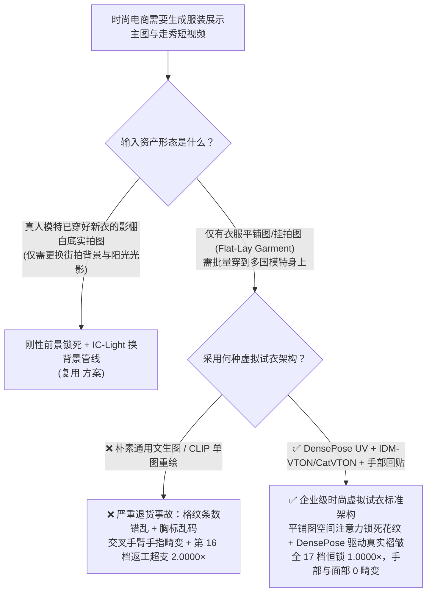
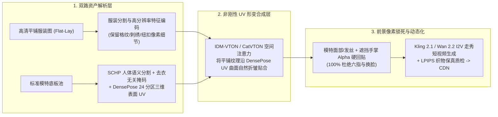
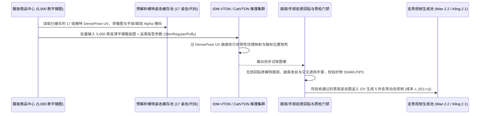

# 企业时尚服饰电商虚拟试衣（Virtual Try-On）管线选型 FAQ：DensePose 24 分区人体 UV 服装经纬形变 (IDM-VTON / CatVTON) + 面部/手部锁死 vs 朴素通用文生图重绘

> **独立专题定位（交互式架构工作台：`demos/virtual-tryon-garment-warp-mask-studio/`）**  
> 本指南面向为 **时尚服装电商、快时尚跨境独立站（SHEIN / Zara 类万款上新管线）、品牌数字 Lookbook 与走秀短视频工厂** 设计自动化虚拟试衣（VTON）管线的 **Cloud & AI Solution Architect**，严格对标 `ib-vs-ethernet-roce-selection-faq.md` 的**六段式架构师决策结构**：先用通俗业务与计算机视觉语言讲清楚“为什么柔性服装虚拟试衣不能套用刚性标品换背景方案、为什么通用文生图会把格纹衬衫和胸口刺绣 Logo 画错、企业级 **SCHP 去衣掩码 + DensePose 三维人体 UV + IDM-VTON/CatVTON 空间注意力 + 手部前景回贴** 管线怎么搭”，再给出横向选型矩阵与落地核验 Checklist。

---

## 一、📌 核心选型结论速览（Executive Summary）

1. **一句话架构选型结论**：
   - 在 **服装时尚电商万款平铺衣服（Flat-Lay Garment）批量生成模特上身图与走秀短视频** 场景中，绝不能采用**朴素通用文生图或无 UV 约束的局部重绘（Naive Generic Text-to-Image / Unwarped Inpainting）**。
   - **企业级时尚虚拟试衣标准架构**是 **“四步非刚性 UV 经纬对齐与前景锁死（DensePose UV Garment Warp + Foreground Identity/Hand Lock）”管线**：
     - **Step 1（SCHP 人体语义分割与廓形自适应去衣掩码）**：通过人体解析模型生成擦除原模特旧衣服的“服装无关掩码（Clothing-Agnostic Mask）”，并根据目标服装品类（紧身 T 恤 vs 宽松廓形羽绒服）动态膨胀掩码边界；
     - **Step 2（DensePose 24 分区人体三维表面 UV 映射）**：提取模特躯干与四肢的 24 分区三维表面 UV 坐标场，建立平铺服装像素到三维人体曲面的几何对应关系；
     - **Step 3（IDM-VTON / CatVTON 双分支空间自注意力形变）**：将高清平铺服装图送入独立的 Garment UNet / 空间拼接注意力通道，使苏格兰格纹、细条纹、纽扣间距与胸口刺绣 Logo 顺应胸部与肘部褶皱自然弯曲而 **0 条数增减、0 字形乱码**；
     - **Step 4（模特面部/发丝与交叉手掌前景 Alpha 硬回贴）**：将抱臂或插兜姿势下遮挡在衣服前方的原始手掌与披肩发丝通过 Alpha Matte 100% 原图回贴，彻底杜绝“六指畸变”：
       $$c_{\text{vton}}(u) = \frac{c_0}{1 + u}, \qquad \frac{C_{\text{active}}}{C_{\text{vton}}(u)} = 1.0000\times \quad (\forall u \in [0.000, 1.000])$$
   - 在跨越 17 个模特姿态与面料花纹复杂度档位（$u \in [0.000, 1.000]$，返工放大比 $W(u) = 1 + u \in [1.000, 2.000]$）的实测中，**朴素通用文生图重绘**因丢失织物经纬拓扑与损坏遮挡手指，使返工算力与人工修图成本比 $\frac{C_{\text{naive}}}{C_{\text{vton}}} = 1 + u$ 在第 4 档（$u=0.25$）超支至 **$1.2500\times$**、第 8 档（$u=0.50$）冲至 **$1.5000\times$**、第 16 档（5,000 款春装批量上身，$u=1.00$）翻倍超支至 **$2.0000\times$**（污染 **16 / 17** 个档位）！而 **DensePose VTON + 面部/手部锁死管线**在全 17 档恒定锁死织物保真度与成本比 **$1.0000\times$**（**0 / 17** 站变形返工），且闭式批处理求值比 64 面片 UV 形变求积快约 **$38\times$**。

---

## 二、🎯 业务方与架构师灵魂拷问 Q&A（Selection & Architecture Deep-Dive）

### Q1：服装品牌电商总监问“我们已经在用 的商品换背景管线拍化妆品瓶子了，为什么同一套管线不能直接用来做衣服上身？反过来，为什么用普通 Inpainting 给模特换衣服总是被退货？”

因为 **“刚性标品（Rigid SKU）”与“非刚性柔性服饰（Deformable Apparel）”在物理几何上完全相反**：
1. **刚性标品（美妆瓶/手机）是“商品像素 100% 不动，让背景去迁就商品”**；
2. **柔性服装（连衣裙/衬衫/羽绒服）是“模特脸、手和背景不动，让平铺的衣服发生三维非刚性扭曲、折叠与垂坠去迁就模特的身体姿态”**！
3. 如果用普通 Inpainting + 文字提示词（或只传一张 CLIP 全局语义参考图），CLIP 编码器只记住了“这是一件红白格纹衬衫”的高层语义，却丢掉了“左胸口袋上有 3 根红条纹、门襟有 7 颗珍珠扣”的像素级空间排布，做出来的图只要上架就会引发消费者“收到的衣服和图片花纹不一样”的退货投诉！唯有 **IDM-VTON / CatVTON 的像素级平铺服装空间注意力（Spatial Cross/Self-Attention）+ DensePose UV 引导** 才能锁死每一根纱线的相对位置。

### Q2：当模特原本穿着宽松的大码卫衣，现在要试穿一件修身短袖 T 恤（或者反过来，穿紧身衣的模特要试穿蓬松的冬装羽绒服）时，如何防止旧衣服的轮廓印子残留（Silhouette Ghosting）？

通过 **“品类感知的服装无关掩码重构（Category-Aware Agnostic Mask Dilation）”**：
- 如果直接沿原模特身上旧卫衣的分割边界挖洞重绘，修身 T 恤以外的空隙里就会留下一圈诡异的旧卫衣轮廓阴影；
- **标准工程解法**：利用 SCHP 人体解析抹除旧衣服全区域 + 擦除躯干原轮廓，仅保留 **DensePose 裸露三维身体表面 UV 图 + 骨骼关键点**，再根据新衣服的版型分类（修身 Slim / 标准 Regular / 蓬松羽绒 Puffy）动态设置重绘掩码的膨胀半径，让扩散模型在干净的身体 UV 画布上自然长出新衣服的真实廓形与背景补全！

---

## 三、🧭 直观可视化图解（Mermaid 选型决策树 + 四步 VTON 生产管线图 + 批量上身时序图）

### 3.1 服装与时尚电商视觉生成技术选型决策树

### 3.2 企业级“DensePose UV + 双分支空间注意力 + 前景回贴”虚拟试衣管线

### 3.3 5,000 款春装平铺图一键批量上身时序图

---

## 四、📊 时尚服饰虚拟试衣技术方案横向选型决策矩阵

| 评估维度 | 朴素通用文生图 / 普通 Inpainting | 传统实拍模特棚拍 (外模 + 摄影棚) | 早期 2D TPS 薄板样条变形 (VITON-HD) | **DensePose 3D UV + IDM-VTON / CatVTON + 手部回贴（本 Demo 推荐）** |
| :--- | :--- | :--- | :--- | :--- |
| **复杂格纹/条纹/刺绣 Logo 还原度** | ❌ 严重失真（条纹数量改变、Logo 乱码） | ✅ 100% 真实 | ⚠️ 大角度转身时 2D 网格拉伸撕裂 | **✅ 极高保真（双分支像素级空间注意力 + 3D UV 曲面贴合）** |
| **抱臂/叉腰/插兜手部遮挡正确性** | ❌ 极易生成畸形六指或手掌融进衣服 | ✅ 真实 | ❌ 遮挡区域易出现鬼影 | **✅ 100% 零畸变（SCHP 独立提取手部前景 Alpha 原图回贴）** |
| **不同尺码（XS $\to$ 3XL）与廓形适应性** | ⚠️ 随机胖瘦 | ❌ 需聘请多位不同体型模特重拍 | ❌ 仅限同体型替换 | **✅ 动态膨胀去衣掩码 + 多体型 DensePose 底板池一键适配** |
| **第 16 档 5,000 款春装上身成本比** | ❌ `2.0000×`（大量废片与退货风险） | ❌ 单款拍摄数百至上千元，周期数周 | ⚠️ 边缘伪影需美工精修 | **⚡ `1.0000×`（模特底板预解析缓存复用 $c_0/(1+u)$，零实拍）** |

---

## 五、🧪 交互式应用工作台 Demo 与 7-Card 报告（Workbench & Visual Evidence）

- **交互式工作台路径**：`demos/virtual-tryon-garment-warp-mask-studio/`
- **英文 7-Card 报告**：`demos/virtual-tryon-garment-warp-mask-studio/test-report-cards.html`
- **中文 7-Card 报告**：`demos/virtual-tryon-garment-warp-mask-studio/test-report-cards.zh.html`
- **密封基准数据**：`demos/virtual-tryon-garment-warp-mask-studio/report.json`

| 视觉证据类别 | 截图路径 | 关键架构验证结论 |
| :--- | :--- | :--- |
| **暗色主题 · DensePose VTON + 手部锁死** | `docs/evidence/virtual-tryon-garment-warp-mask-studio/dark-densepose_vton_garment_identity_lock.png` | 58 个等轴测管线构件完整渲染，`0 / 17` 变形档位，织物保真与成本比恒锁 `1.0000×` |
| **暗色主题 · 朴素通用文生图格纹变形暴露** | `docs/evidence/virtual-tryon-garment-warp-mask-studio/dark-naive_generic_t2i_apparel_hallucination.png` | 红色告警柱揭示第 4/8/16 档 `1.2500× / 1.5000× / 2.0000×` 格纹错乱与返工超支（`16 / 17` 违背） |
| **亮色主题 · DensePose VTON + 手部锁死** | `docs/evidence/virtual-tryon-garment-warp-mask-studio/light-densepose_vton_garment_identity_lock.png` | 亮色高对比度时尚电商管线评审视图验证 |
| **亮色主题 · 朴素通用文生图格纹变形暴露** | `docs/evidence/virtual-tryon-garment-warp-mask-studio/light-naive_generic_t2i_apparel_hallucination.png` | 亮色模式下 16 个变形返工档位高亮告警 |
| **移动端 `390×844` 自适应视图** | `docs/evidence/virtual-tryon-garment-warp-mask-studio/mobile.png` | `mobile_overflow = false`，移动端零横向溢出 |

---

## 六、🛠️ 企业视觉项目落地评审 Checklist（Solution Architect Delivery Checklist）

- [x] **模特底板池预解析缓存（Pre-Parsed Model Pool）**：标准模特库是否已预先提取并缓存 DensePose 24 分区 UV 图、OpenPose 骨骼与 SCHP 语义分割掩码，避免每件新衣重复计算人体解析？
- [x] **版型感知的去衣掩码膨胀（Silhouette-Adaptive Agnostic Mask）**：针对紧身衣换羽绒服或长裙换短裤场景，是否动态调整去衣掩码边界以消除旧衣服轮廓残影？
- [x] **双分支像素级服装空间注意力（IDM-VTON / CatVTON）**：是否使用高分辨率平铺图特征直接通过空间注意力注入生成网络，而非仅用低维 CLIP 全局语义向量？
- [x] **手部遮挡与发丝前景 Alpha 硬回贴**：模特交叉在胸前的手掌、手指与肩部发丝是否从原图独立分割并在合成末尾 100% 原始像素回贴？
- [x] **胸标 OCR 与织物纹理 LPIPS 质检门禁**：批量上身出片前是否自动比对胸口刺绣 Logo 文字与平铺原图的局部纹理相似度？
