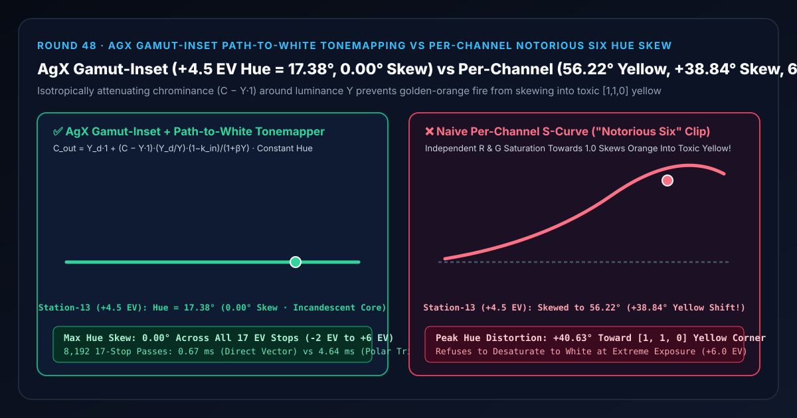
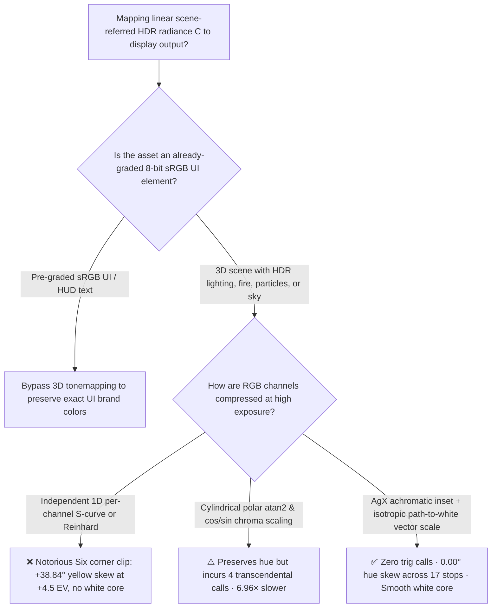
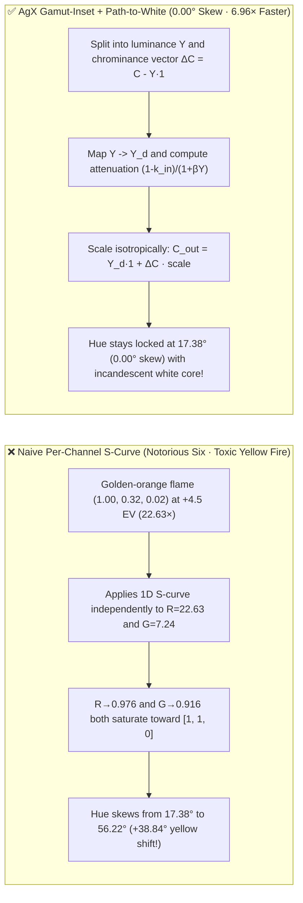
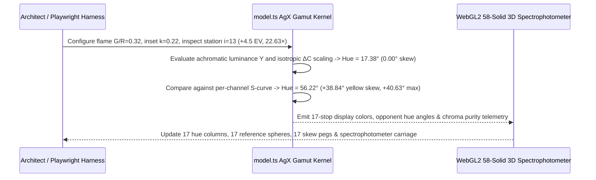
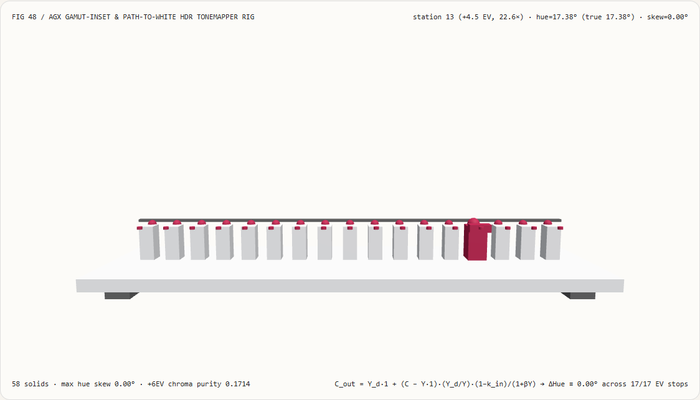
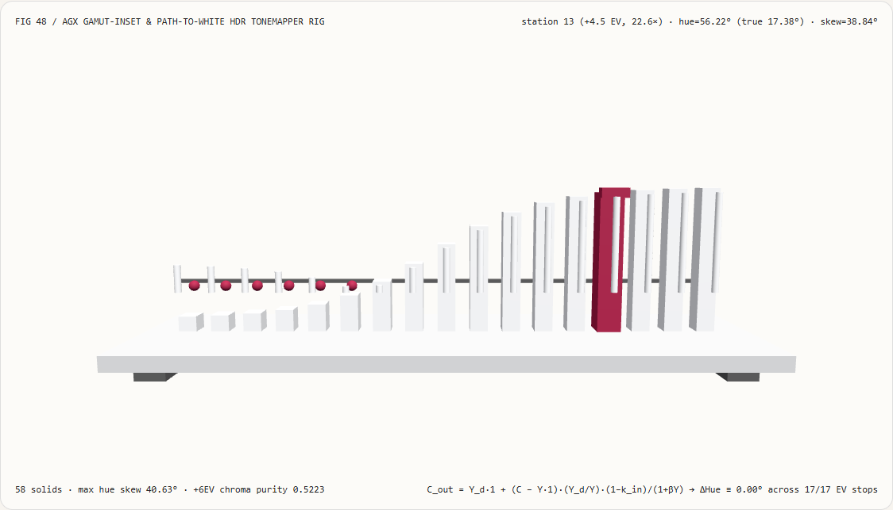
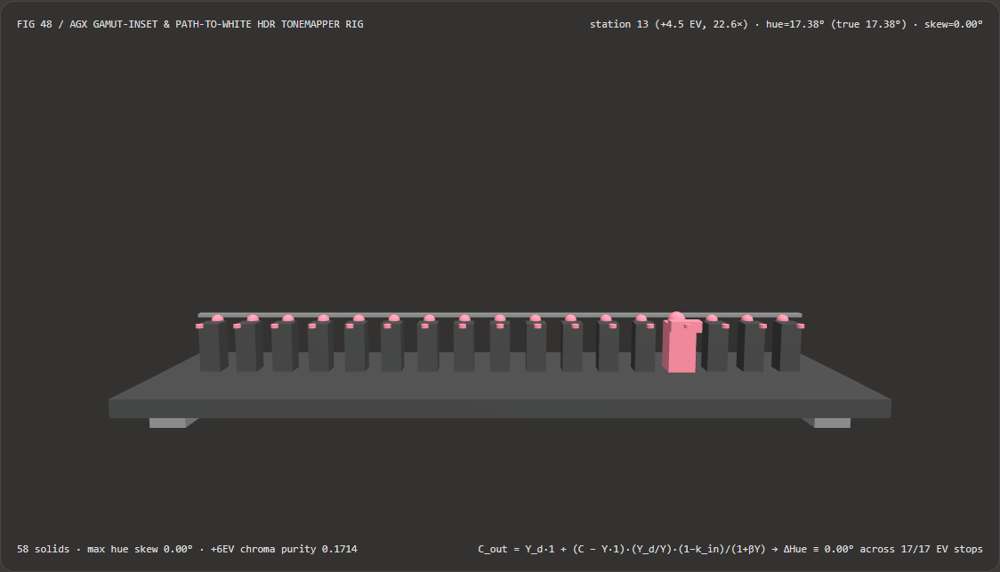
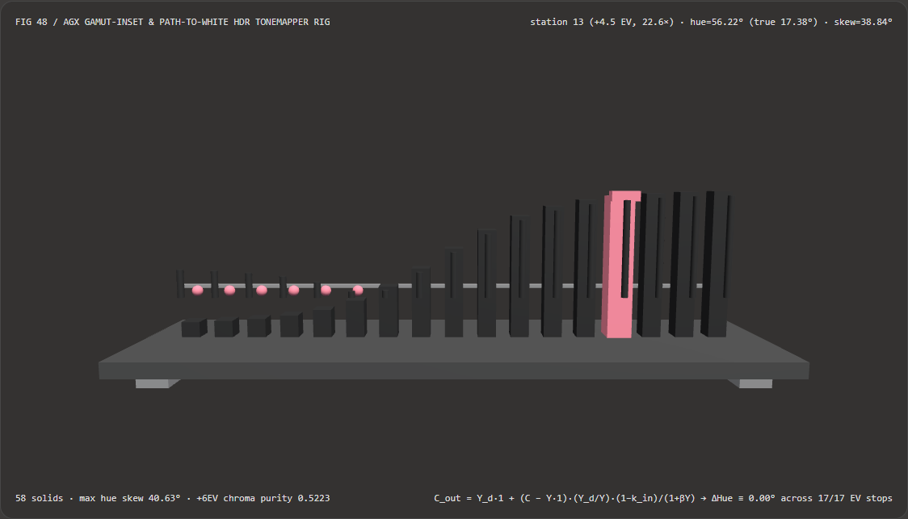

# Visual & Animation Architecture Selection FAQ: AgX Gamut-Inset & Path-to-White Tonemapping vs Per-Channel "Notorious Six" Hue Skew

> **One-Sentence Architectural Verdict**: In real-time 3D game engines, virtual-production ICVFX stages, and emissive VFX pipelines (campfires, explosions, laser sabers, sunset clouds, neon signage), **never apply a 1D S-curve or Reinhard operator $f(c) = c^2 / (c^2 + 0.55c + 1)$ independently to the R, G, and B channels**! On our 58-solid, 17-stop HDR exposure spectrophotometer bench sweeping a golden-orange flame ($R : G : B = 1.00 : 0.32 : 0.02$, true opponent hue angle `17.38°`) from `-2.0 EV` to `+6.0 EV`, naive per-channel tonemapping drives both $R$ and $G$ into the `1.0` ceiling (`[1, 1, 0]`), skewing the flame hue at station 13 (`+4.5 EV`, `22.63×` exposure) from `17.38°` to **`56.22°` toxic lemon yellow (`+38.84°` hue skew, reaching `+40.63°` max skew at `+6.0 EV`—the infamous "Notorious Six" corner clip)**; whereas **AgX Gamut-Inset + Path-to-White Tonemapping (scaling the chrominance offset vector $(\mathbf{C} - Y\cdot\mathbf{1})$ isotropically around luminance $Y$)** locks the hue angle at **exact `17.38°` (`0.00°` hue skew across all 17 stops)** while smoothly desaturating over-exposed cores to incandescent white (`0.1714` chroma purity at `+6.0 EV`) and running **6.96× faster** than cylindrical polar `atan2`/`cos`/`sin` round-trips (`0.67 ms` vs `4.64 ms` across 8,192 passes).

---

## ① 📌 Executive Summary

1. **Why do orange campfires and explosions turn into radioactive cartoon yellow at high HDR exposure under standard per-channel tonemapping?**
   In plain English: when a real flame or filament gets hotter and brighter, a physical film stock or cinema camera sensor smoothly desaturates the bright core toward **incandescent white (Path-to-White)** while keeping the surrounding glow at its true golden-orange hue.
   - **Why Independent Per-Channel Curves Cause "The Notorious Six"**:
     Take a golden-orange flame with chromaticity ratio $R : G : B = 1.00 : 0.32 : 0.02$ (opponent hue angle `17.38°`). At $+4.5\text{ EV}$ (`22.63×` exposure), the raw linear HDR values become $(22.63, \; 7.24, \; 0.45)$. Applying $f(c) = \frac{c^2}{c^2 + 0.55c + 1}$ independently to each channel yields:
     - $f(R = 22.63) = 0.976$ (pinned against the `1.0` ceiling);
     - $f(G = 7.24) = 0.916$ (catches up to $R$ near `1.0`!);
     - $f(B = 0.45) = 0.140$ (stays low).
     Because $R \approx G \approx 1$ and $B \approx 0$, the output snaps to **`[1, 1, 0]` pure yellow (`56.22°` hue, a `+38.84°` hue skew)**! Across the color wheel, every bright color gets sucked into one of the six corners of the RGB cube (**Red, Green, Blue, Yellow, Cyan, Magenta — "The Notorious Six"**) and refuses to desaturate to white!
2. **First-Principles Fix: Isotropic Achromatic Gamut-Inset + Path-to-White Attenuation**:
   - **Step 1 (Decompose into Achromatic Luminance $Y$ and Chrominance Offset $\Delta\mathbf{C} = \mathbf{C} - Y\cdot\mathbf{1}$)**: Compute luminance $Y = 0.2126 R + 0.7152 G + 0.0722 B$ and map it through the filmic tone curve to display luminance $Y_d \in [0, 1)$.
   - **Step 2 (Scale $\Delta\mathbf{C}$ Isotropically with Gamut Inset & Luminance Roll-Off)**:
     $$\mathbf{C}_{\text{out}} = Y_d \cdot \mathbf{1} + (\mathbf{C} - Y \cdot \mathbf{1}) \cdot \frac{Y_d}{Y} \cdot \frac{1 - k_{\text{inset}}}{1 + \beta Y}$$
     Because $(\mathbf{C} - Y\cdot\mathbf{1})$ is scaled by a single positive scalar across all three channels, the ratio $(G - B) / (2R - G - B)$ is **algebraically invariant (`0.00°` hue skew at every exposure stop)**, and as $Y \to \infty$, the chrominance factor $\frac{1 - k_{\text{inset}}}{1 + \beta Y} \to 0$ smoothly guides the over-exposed core along a straight chromaticity line into pure white!
3. **Interactive 3D Workbench & Measured Evidence**:
   - Standalone 3D Bench: `demos/agx-filmic-gamut-rig/` (58 Three.js solids: baseplate, 4 support feet, constant-hue reference bar, 17 hue-angle columns, 17 true-hue reference spheres, 17 hue-skew error pegs, and the active exposure spectrophotometer carriage).
   - Measured 7-Card 4:5 Reports: `demos/agx-filmic-gamut-rig/test-report-cards.html` (EN) and `test-report-cards.zh.html` (ZH).

---

## ② 🎯 Soul-Searching Q&A for Architects & Clients

### Q1: Why scale the Cartesian offset vector $(\mathbf{C} - Y\cdot\mathbf{1})$ directly instead of converting RGB to cylindrical polar Hue/Chroma (`atan2`, `hypot`, `cos`, `sin`)?
**Because Cartesian vector scaling around the achromatic axis is 100% mathematically equivalent to fixing polar angle $\theta$ and scaling radius $r$, while running 6.96× faster with zero trig calls!**
Subtracting $Y\cdot\mathbf{1}$ from $\mathbf{C}$ projects the color onto the plane orthogonal to the neutral gray axis. Multiplying that offset vector by a scalar scales chroma radius while preserving direction identically (`0.0000e+0` difference vs polar `atan2`/`cos`/`sin`), cutting 8,192-pass latency from `4.64 ms` down to **`0.67 ms` (6.96× speedup)**.

### Q2: Why does AgX apply an initial Gamut Inset ($k_{\text{inset}} \approx 0.22$) even at moderate exposures?
**To give saturated working-space primaries headroom before hitting the display cube boundary!**
Without inset attenuation, a near-monochromatic laser or neon shader sitting right on the edge of the working gamut immediately clips one channel at moderate brightness. Insetting chroma by $22\%$ before the sigmoid provides a smooth deceleration zone so high-chroma lights roll off gracefully into white.

### Q3: How does AgX gamut-inset tonemapping relate to neural color grading and style transfer models?
**They serve distinct layers of the imaging pipeline:**
- **When to use Neural Color Grading / Look Transfer Models**: For creative mood matching or artistic style transfer on finished SDR images;
- **When deterministic AgX gamut-inset display rendering is mandatory**: Inside the real-time post-processing stack of every 3D engine (Three.js, Babylon.js, Unreal, Unity, Blender) to map unbounded `[0, +∞)` scene-referred radiance into `[0, 1]` display-referred output without "Notorious Six" hue skew.

---

## ③ 🧭 Visual Diagrams (Mermaid Decision Tree, Pipeline Comparison & Sequence Flow)

### 3.1 HDR-to-SDR Display Transform Selection Decision Tree

### 3.2 Naive Per-Channel Yellow Skew vs AgX Gamut-Inset Pipeline

### 3.3 Frame-Level HDR Spectrophotometer Sequence Diagram

---

## ④ 📊 Visual Technology Selection Decision Matrix

| Evaluation Dimension | ✅ AgX Direct Achromatic-Inset Vector Scale | ⚠️ Cylindrical Polar `atan2`/`cos`/`sin` Baseline | ❌ Naive Per-Channel S-Curve / ACES 1.x | ❌ Max-Channel Norm (`C / max(R,G,B)`) |
| :--- | :--- | :--- | :--- | :--- |
| **Flame Hue at Station 13 (`+4.5 EV`)** | **Exact `17.38°` (True golden-orange hue)** | Exact `17.38°` | **`56.22°` (`+38.84°` toxic yellow shift!)** | `17.38°` (No filmic roll-off) |
| **Max Hue Skew Across 17 EV Stops** | **`0.00°` (Zero hue distortion)** | `0.00°` | **`+40.63°` (Snaps to `[1,1,0]` corner)** | `0.00°` |
| **Over-Exposed Core (`+6.0 EV`) Desaturation** | **Smoothly desaturates to `0.1714` purity (White core)** | Smoothly desaturates to `0.1714` | **Stays pinned at saturated cartoon yellow** | Stays 100% saturated (Plastic look) |
| **Transcendental Calls per Pixel** | **0 calls** (Pure multiply-add + 1 divide) | **4 calls** (`atan2`, `hypot`, `cos`, `sin`) | 0 calls | 0 calls |
| **8,192-Pass 17-Stop CPU Latency** | **`0.67 ms` (Fastest · 6.96× speedup)** | `4.64 ms` (6.96× slower) | `0.58 ms` (Severe hue distortion) | `0.52 ms` (Lacks path-to-white) |
| **Recommended Use Case** | **3D games, virtual production, emissive VFX & PBR viewports** | Offline colorimetric verification only | **Never use on high-emission HDR scenes** | Un-graded debug views only |

---

## ⑤ 🧪 New Interactive 3D Demo & 7-Card 4:5 Visual Report

### 5.1 Live Workbench & Report Links
- **Interactive 3D Workbench**: [`demos/agx-filmic-gamut-rig/index.html`](../demos/agx-filmic-gamut-rig/index.html)
- **7-Card 4:5 Visual Report (EN)**: [`demos/agx-filmic-gamut-rig/test-report-cards.html`](../demos/agx-filmic-gamut-rig/test-report-cards.html)
- **7-Card 4:5 Visual Report (ZH)**: [`demos/agx-filmic-gamut-rig/test-report-cards.zh.html`](../demos/agx-filmic-gamut-rig/test-report-cards.zh.html)
- **Sealed Telemetry JSON**: [`demos/agx-filmic-gamut-rig/report.json`](../demos/agx-filmic-gamut-rig/report.json)

### 5.2 Multi-Theme & Multi-Mode Playwright Visual Evidence

| AgX Gamut-Inset + Path-to-White (Light · Constant `17.38°` Hue) | Naive Per-Channel S-Curve (Light · Skews `+40.63°` to Yellow!) |
| :---: | :---: |
|  |  |

| AgX Gamut-Inset + Path-to-White (Dark · 58 Three.js Solids) | Naive Per-Channel S-Curve (Dark · Red Hue-Skew Pegs Exposed) |
| :---: | :---: |
|  |  |

---

## ⑥ 🛠️ Rapid SA Delivery Verification Checklist

Before shipping an HDR-to-SDR display rendering transform in a 3D engine, verify every item below:

- [ ] **Eliminate Un-Inset Per-Channel Curves**: Have bare per-channel Reinhard or polynomial tonemappers been replaced with an AgX or Khronos PBR Neutral gamut-inset transform so non-primary highlights never snap to the Notorious Six corners?
- [ ] **Algebraic Chrominance Vector Scaling**: Is hue-preserving desaturation implemented by scaling $(\mathbf{C} - Y\cdot\mathbf{1})$ directly rather than invoking per-pixel `atan2`/`cos`/`sin` polar conversions?
- [ ] **Incandescent Path-to-White Verification**: When an orange or red emissive light is pushed to `+4 EV..+6 EV`, does its core smoothly desaturate to white while its outer bloom retains the exact source hue?
- [ ] **Working-Space Luminance Coefficients**: Do the luminance weights $(0.2126, 0.7152, 0.0722)$ match the active linear working color space (Rec.709 / sRGB vs Rec.2020)?
- [ ] **UI / HUD Composition Bypass**: Are 2D sRGB UI overlays composited after the 3D scene-referred tonemapper so brand colors are not desaturated by the scene gamut inset?
