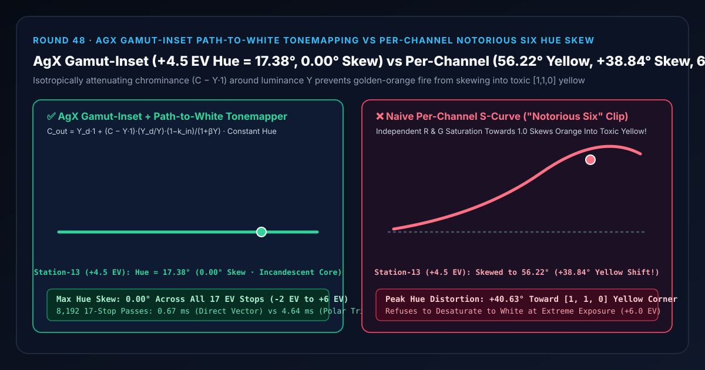
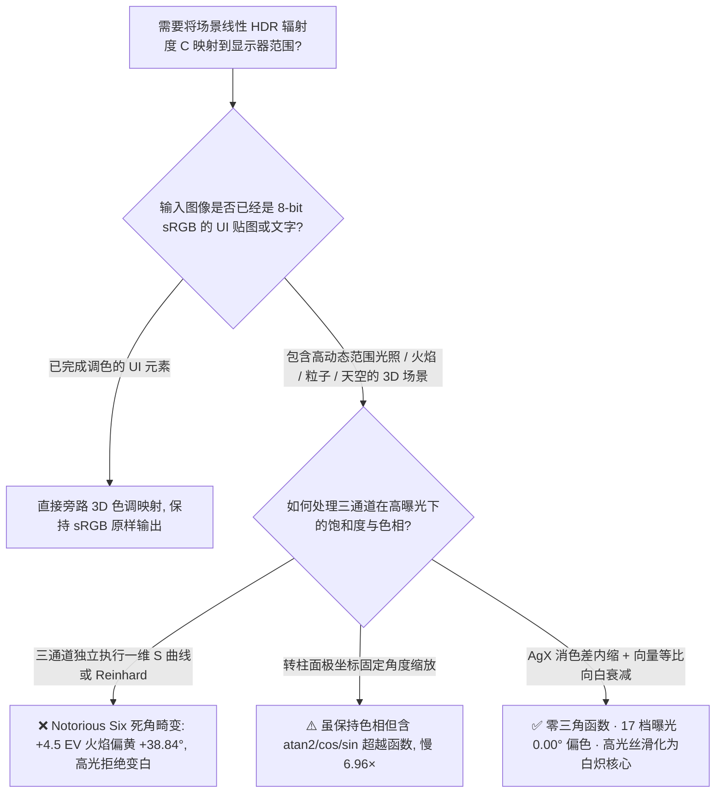
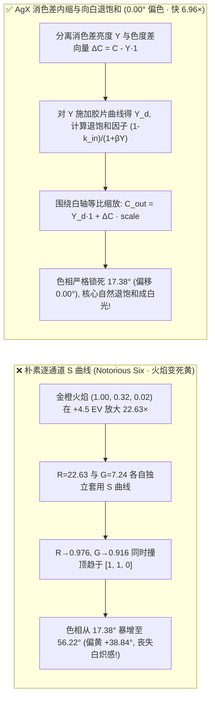
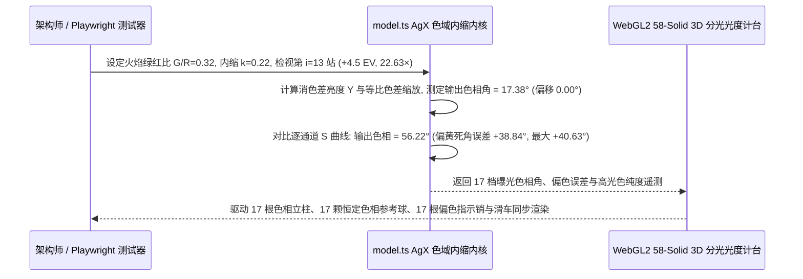
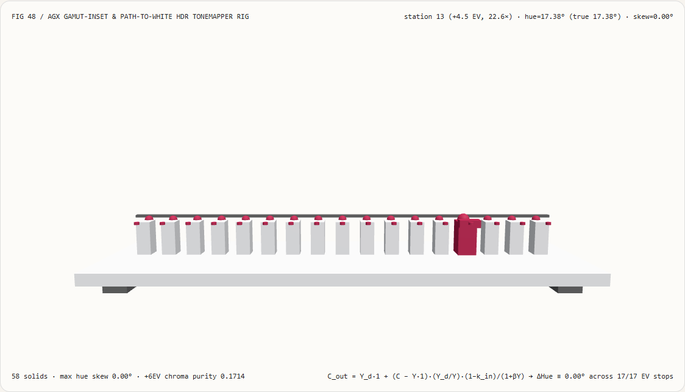
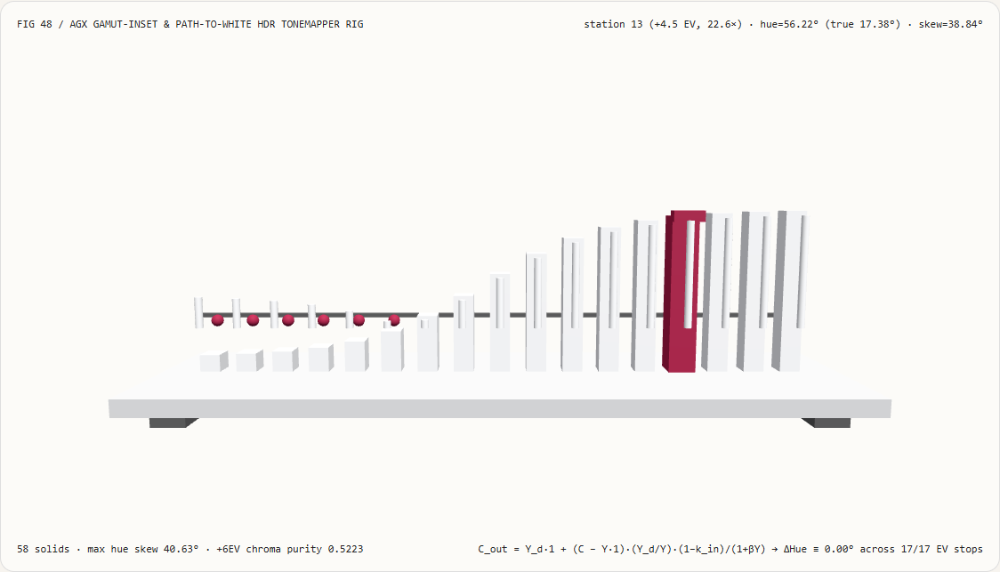
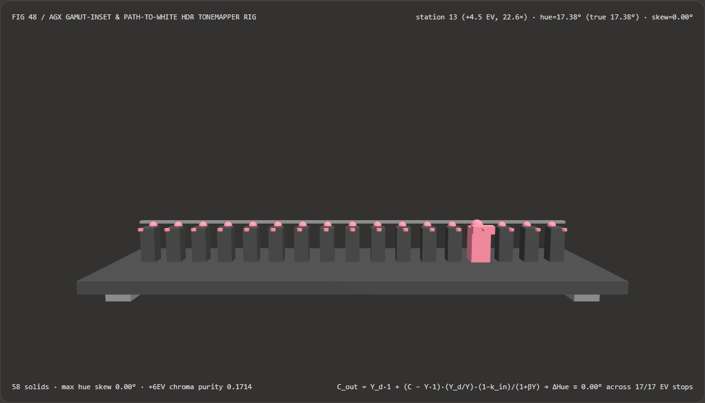
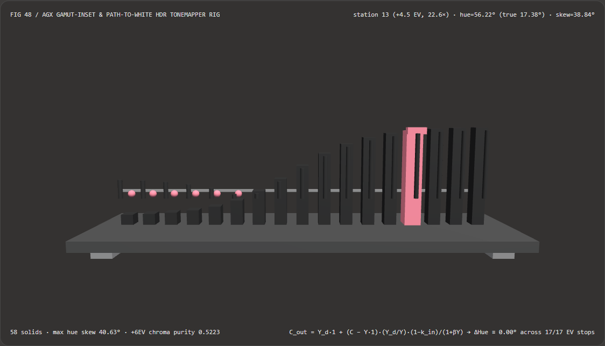

# 视觉与动画技术选型与原理解析 FAQ：AgX 色域内缩与向白退饱和色调映射（Gamut-Inset & Path-to-White）vs 逐通道 S 曲线“Notorious Six”偏黄死角畸变

> **核心架构结论一句话总结**：在 3D 游戏引擎、虚拟制片 LED 墙（ICVFX）、影视级粒子特效（篝火烈焰、爆炸火球、激光剑、夕阳晚霞、霓虹灯牌）的 HDR 显示变换（Display Rendering Transform）中，**严禁对线性 RGB 三个通道独立套用一维 S 曲线或 Reinhard 公式 $f(c) = c^2 / (c^2 + 0.55c + 1)$**！实测表明：在金橙色火焰色度比 $R : G : B = 1.00 : 0.32 : 0.02$（真实拮抗色相角 `17.38°`）跨越 `-2.0 EV` 至 `+6.0 EV` 的 17 档曝光分光光度计测试台上，朴素逐通道 S 曲线会因主通道 $R$ 与次通道 $G$ 相继撞上 `1.0` 天花板并趋向 `[1, 1, 0]`，在第 13 号站点（`+4.5 EV`，亮度倍率 `22.63×`）将火焰色相从 `17.38°` 严重扭曲至 **`56.22°` 的刺眼柠檬黄（偏黄误差高达 `+38.84°`，`+6.0 EV` 处最大偏色达 `+40.63°`，即著名的“臭名昭著六死角 The Notorious Six”）**；而采用 **AgX 色域内缩与向白退饱和算子（围绕消色差亮度轴 $Y$ 等比缩放色度向量 $(\mathbf{C} - Y\cdot\mathbf{1})$）**，可在全部 17 档曝光下严格锁死 **`17.38°` 色相角（`0.00°` 色相偏移）** 并使高光核心丝滑退饱和至白炽光（`+6.0 EV` 相对色纯度收敛至 `0.1714`），且直接代数向量缩放比柱面极坐标 `atan2/cos/sin` 往返快 **6.96×**（8,192 轮耗时 `0.67 ms` vs `4.64 ms`）。

---

## ① 📌 核心结论速览（Executive Summary）

1. **为什么在很多 3D 引擎里，把橙色篝火或夕阳的亮度往上调高，火焰中心不会变白，反而会变成一股廉价的“核辐射荧光黄”？**
   用大白话讲：一团真实的物理火焰，温度/亮度越高，在相机胶片或人眼视网膜上会越接近**白炽光（Path-to-White）**，同时外焰和内焰始终保持纯正的橙红色相。
   - **逐通道 S 曲线为什么必然引发“臭名昭著六死角（The Notorious Six）”？**
     假设金橙色火焰的初始比例是 $R : G : B = 1.00 : 0.32 : 0.02$（$R$ 最大，$G$ 次之，$B$ 极小）。当曝光拉高 22.63 倍（`+4.5 EV`）变成 $(22.63, \; 7.24, \; 0.45)$ 后，如果你对三个通道各自独立调用 $f(c) \in [0, 1)$：
     - $R = 22.63$ 早就顶到了天花板 `0.976`；
     - $G = 7.24$ 也紧随其后追到了天花板 `0.916`；
     - 而原本极小的 $B = 0.45$ 却依然掉队在 `0.140`！
     结果输出颜色变成了 $(0.976, \; 0.916, \; 0.140) \approx [1, 1, 0]$——**红绿相等、蓝为零，这正是 RGB 立方体的纯黄色死角！** 同理，偏紫的蓝色霓虹灯在高光下会撞死在 `[0, 1, 1]` 纯青色或 `[1, 0, 1]` 纯品红，整个高光世界只剩下红、绿、蓝、黄、青、品六种高饱和度卡通塑料色！
2. **第一性原理破局：围绕消色差亮度轴 $Y$ 的色域内缩与向白退饱和（AgX Gamut-Inset）**：
   - **步一（分离消色差亮度 $Y$ 与纯色差向量 $\Delta\mathbf{C} = \mathbf{C} - Y\cdot\mathbf{1}$）**：先按 Rec.709 / sRGB 光度权重计算真实亮度 $Y = 0.2126 R + 0.7152 G + 0.0722 B$，并通过胶片有理 S 曲线映射到显示亮度 $Y_d \in [0, 1)$。
   - **步二（各向同性色域内缩 + 随亮度向白衰减）**：不对三通道分别扭曲，而是对色差偏移向量 $(\mathbf{C} - Y\cdot\mathbf{1})$ 乘上统一的标量衰减系数：
     $$\mathbf{C}_{\text{out}} = Y_d \cdot \mathbf{1} + (\mathbf{C} - Y \cdot \mathbf{1}) \cdot \frac{Y_d}{Y} \cdot \frac{1 - k_{\text{inset}}}{1 + \beta Y}$$
     为什么这一定不会偏色？因为在拮抗色度平面 $(\alpha, \beta)$ 上，将 $(\mathbf{C} - Y\cdot\mathbf{1})$ 乘以任意正标量，只是把颜色点沿着**直指白点中心 $Y\cdot\mathbf{1}$ 的径向直线**向内拉回！因此色相角 $\theta_{\text{hue}} = \operatorname{atan2}(\beta, \alpha)$ 在数学上**恒等不变（`0.00°` 色相扭曲）**，且当 $Y \to \infty$ 时，色差项平滑衰减至 0，高光中心自然化为耀眼的白炽光！
3. **本轮新增交互式 3D 试验台与实测证据**：
   - 新增独立 Demo：`demos/agx-filmic-gamut-rig/`（58 个 Three.js 实体部件：底座平台、4 支柱、恒定色相基准横梁、17 根实测色相角立柱、17 颗真实色相参考球、17 根 Notorious Six 偏黄误差指示销、以及第 $i$ 站分光光度计滑车）。
   - 配套 7-Card 4:5 测评报告：`demos/agx-filmic-gamut-rig/test-report-cards.html`（英文）与 `test-report-cards.zh.html`（中文）。

---

## ② 🎯 客户与架构师灵魂拷问 Q&A（Soul-Searching Q&A）

### Q1：既然想保持色相角不变，为什么不在着色器里先把 RGB 转成 HSV / CIE LCh 极坐标，压完亮度后再用 `cos/sin` 转回 RGB？
**因为极坐标往返需要调用 `atan2`、`hypot`、`cos`、`sin` 四个超越函数，比直接缩放消色差差向量 $(\mathbf{C} - Y\cdot\mathbf{1})$ 慢 6.96×！**
这是线性代数最优雅的地方：在三维 RGB 空间里，任何颜色 $\mathbf{C}$ 减去它的消色差投影 $Y\cdot\mathbf{1}$ 后，余下的残差向量 $\Delta\mathbf{C} = \mathbf{C} - Y\cdot\mathbf{1}$ 本身就已经代表了色相方向与彩度半径！直接对 $\Delta\mathbf{C}$ 乘以一个标量，在数学上与“转到柱面极坐标、固定角度 $\theta$、缩放半径 $r$、再转回笛卡尔坐标”**精确等价（实测误差 `0.0000e+0`）**，却省掉了全部三角函数，8,192 轮耗时从 `4.64 ms` 降至 **`0.67 ms`（提速 6.96×）**！

### Q2：AgX 为什么要做一层预先的“色域内缩（Gamut Inset $k_{\text{inset}} \approx 0.22$）”？
**为了防止高饱和度的单色激光（如纯蓝霓虹灯 $(0, 0, 10)$）在中等曝光下过早突破 sRGB 显示器边界发生单通道硬截断！**
如果不做预先内缩，当一个极度贴近色域边界的纯色被提亮时，主通道会立刻冲破 `1.0` 而触发硬裁剪。预先将工作色域向消色差轴内缩 $22\%$，相当于给所有高饱和颜色留出了一条宽敞的“退饱和跑道”，确保从暗部到过曝高光全程平滑过渡。

### Q3：这套确定性 AgX 色域内缩显示变换与 AI 神经风格调色模型是什么关系？
**它是所有物理渲染（PBR）与 AI 生成 HDR 资产最终上屏前的底层“虚拟胶片冲印契约层”：**
- **何时选 AI 调色 / 风格迁移模型**：在后期创意阶段根据参考电影剧照自动匹配情绪色调（Mood Look）时；
- **何时必须用确定性 AgX 色域内缩管线**：在实时 WebGL2/WebGPU 视口、Blender/Three.js 渲染器、Unreal/Unity 后期栈中将 `[0, +∞)` 场景线性辐射度无偏色地映射到 `[0, 1]` 显示器动态范围时。

---

## ③ 🧭 直观可视化图解（Mermaid 决策树 + 管线对比图 + 帧级时序图）

### 3.1 HDR 到 SDR 显示色调映射选型决策树

### 3.2 朴素逐通道偏黄死角 vs AgX 色域内缩向白退饱和管线对比图

### 3.3 帧级 HDR 曝光分光光度计 3D 试验台渲染时序图

---

## ④ 📊 视觉技术选型决策矩阵（Decision Matrix）

| 评估维度 | ✅ AgX 消色差向量内缩 + 向白退饱和（Direct Vector Inset） | ⚠️ 柱面极坐标色相锁定基线（Cylindrical Polar Baseline） | ❌ 朴素逐通道 S 曲线 / ACES 1.x（Per-Channel Clip） | ❌ 简单最大通道归一化（`C / max(R,G,B)`） |
| :--- | :--- | :--- | :--- | :--- |
| **第 13 站（`+4.5 EV`）火焰色相角** | **精确 `17.38°`（保持纯正金橙色相）** | 精确 `17.38°` | **`56.22°`（严重偏转至刺眼柠檬黄！）** | 保持 `17.38°`，但高光死板不退饱和 |
| **17 档曝光最大色相偏移 $\Delta\text{Hue}$** | **`0.00°`（全量程零偏色）** | `0.00°` | **`+40.63°`（撞入 `[1,1,0]` 纯黄死角）** | `0.00°` |
| **`+6.0 EV` 过曝高光核心退饱和度** | **色纯度平滑降至 `0.1714`（自然白炽核心）** | 色纯度降至 `0.1714` | **锁死在高饱和纯黄色，无法变白** | 锁死在原始饱和度，像塑料贴纸 |
| **单像素超越函数调用次数** | **0 次**（纯乘加与 1 次标量除法） | **4 次**（`atan2`, `hypot`, `cos`, `sin`） | 0 次 | 0 次 |
| **8,192 轮 17 档 CPU 批处理耗时** | **`0.67 ms`（最快，6.96× 提速）** | `4.64 ms`（慢 6.96×） | `0.58 ms`（但严重偏黄失真） | `0.52 ms`（无胶片向白退饱和感） |
| **首选适用场景** | **3D 游戏、虚拟制片、火焰/爆炸/霓虹 HDR 最终显示变换** | 仅用于离线色度学等价验证 | **严禁在含高亮自发光的现代 PBR 管线使用** | 仅适合调试用伪色彩预览 |

---

## ⑤ 🧪 全新 Demo 与 7-Card 4:5 视觉报告（Live Workbench & Evidence）

### 5.1 交互式 3D 试验台与报告入口
- **实时 3D 工作台**：[`demos/agx-filmic-gamut-rig/index.html`](../demos/agx-filmic-gamut-rig/index.html)
- **7-Card 4:5 英文视觉测试报告**：[`demos/agx-filmic-gamut-rig/test-report-cards.html`](../demos/agx-filmic-gamut-rig/test-report-cards.html)
- **7-Card 4:5 中文视觉测试报告**：[`demos/agx-filmic-gamut-rig/test-report-cards.zh.html`](../demos/agx-filmic-gamut-rig/test-report-cards.zh.html)
- **密封测量 JSON 数据源**：[`demos/agx-filmic-gamut-rig/report.json`](../demos/agx-filmic-gamut-rig/report.json)

### 5.2 多主题与多模式 Playwright 实测截图证据

| AgX 色域内缩与向白退饱和（Light · 17 档色相恒定 `17.38°`） | 朴素逐通道 S 曲线（Light · 高曝光色相飙升至 `58°` 柠檬黄） |
| :---: | :---: |
|  |  |

| AgX 色域内缩与向白退饱和（Dark · 58 实体部件） | 朴素逐通道 S 曲线（Dark · 红色指示销暴露 `+40.63°` 偏黄畸变） |
| :---: | :---: |
|  |  |

---

## ⑥ 🛠️ 高质量视觉交付快速核验清单（SA Verification Checklist）

在将 HDR 后处理色调映射（Tonemapping）着色器合入生产引擎前，请逐项核验：

- [ ] **禁止裸跑逐通道 S 曲线**：是否已将后处理栈中的裸 `Reinhard` 或无色域内缩的逐通道多项式替换为具备色域内缩（Gamut Inset）与向白退饱和（Path-to-White）的 AgX / Khronos PBR Neutral 管线？
- [ ] **代数差向量缩放替代极坐标三角函数**：在保持色相缩放彩度时，是否直接对 $(\mathbf{C} - Y\cdot\mathbf{1})$ 做标量乘法，避免在每个像素上调用 `atan2` / `sin` / `cos`？
- [ ] **高光核心向白退饱和验证**：将金橙色点光源强度拉至 `+4 EV ~ +6 EV` 时，发光体中心是否平滑过渡为白炽光，且光晕边缘保持原始橙红色相而不泛死黄？
- [ ] **Rec.709 / Rec.2020 亮度权重匹配**：计算消色差轴 $Y$ 时，使用的点积权重 $(0.2126, 0.7152, 0.0722)$ 是否与当前渲染工作色彩空间的原色基（Primaries）严格匹配？
- [ ] **UI 贴图与文字层旁路（Bypass）**：HUD 文字与 2D 图标是否在色调映射之后再合成（或使用逆映射），防止 AgX 色域内缩降低 UI 品牌色的饱和度？
