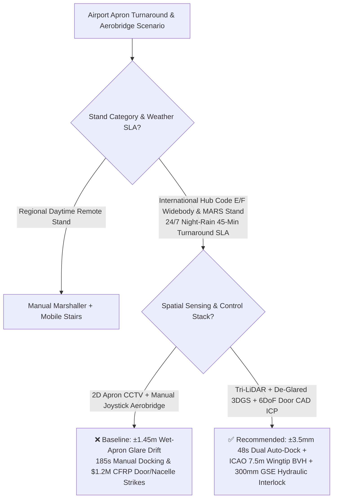
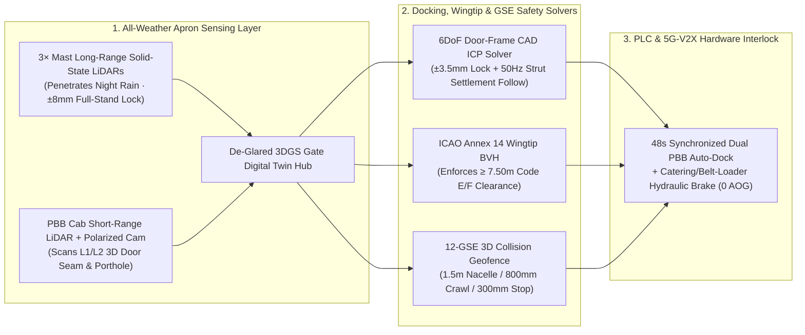
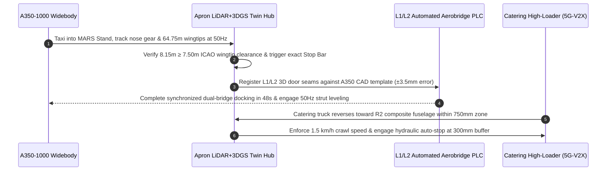
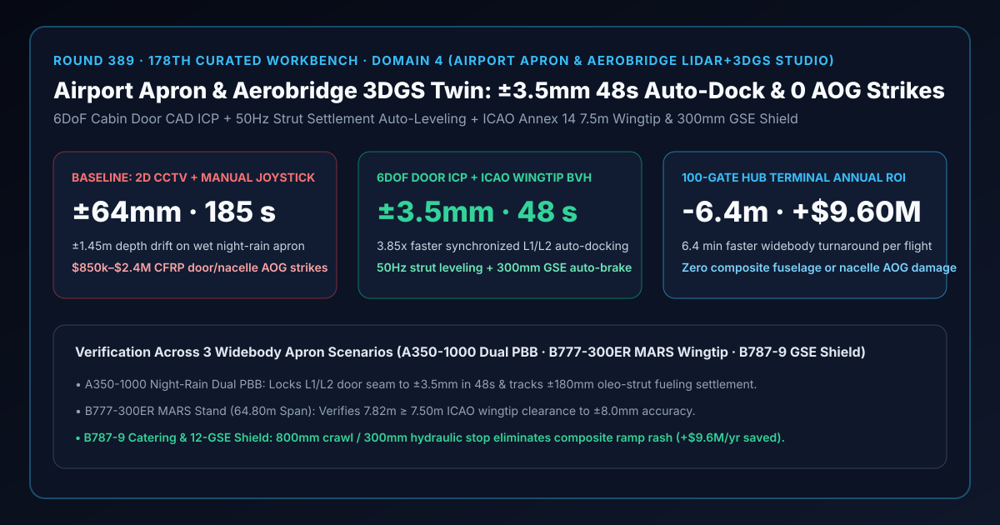

# Airport Apron Turnaround (A-SMGCS), Automated Aerobridge Docking & ICAO Wingtip Clearance LiDAR + 3DGS Digital Twin Selection Guide

> **Interactive Workbench**: [`demos/airport-apron-turnaround-aerobridge-wingtip-marshall-lidar-3dgs-studio/`](../demos/airport-apron-turnaround-aerobridge-wingtip-marshall-lidar-3dgs-studio/)  
> **7-Card Benchmark Report**: [`docs/benchmarks/airport-apron-turnaround-aerobridge-wingtip-marshall-lidar-3dgs/summary.json`](./benchmarks/airport-apron-turnaround-aerobridge-wingtip-marshall-lidar-3dgs/summary.json) · [`summary-visual.svg`](./benchmarks/airport-apron-turnaround-aerobridge-wingtip-marshall-lidar-3dgs/summary-visual.svg)

---

## ① 📌 Executive Summary

According to IATA, global airport aprons suffer over **27,000 ground-damage incidents ("Ramp Rash") per year, costing airlines and hub operators over `$10B/yr`**. On modern carbon-fiber-reinforced polymer (CFRP) widebody aircraft (**Airbus A350-1000, Boeing 787-9, Boeing 777-300ER with `60.12 m – 64.80 m` wingspans**), a single Passenger Boarding Bridge (PBB / Aerobridge) or high-loader catering truck scrape against an L1/L2 cabin door or composite engine nacelle triggers mandatory ultrasonic NDT inspection and a **48–72 hour Aircraft on Ground (AOG) event costing `$850,000 – $2,400,000`**.
- **Why Legacy 2D Apron CCTV Fails**: Nighttime rain puddles, apron floodlight glare, and jet-blast heat shimmer degrade camera-only depth accuracy to **`±1.45 m`** (violating the `ICAO Annex 14` **`7.5 m`** Code E/F wingtip clearance rule), while manual joystick PBB docking takes **`185 seconds`** with `±64 mm` alignment error.

| Evaluation Dimension | ❌ Baseline: 2D Apron CCTV + Manual Joystick Aerobridge | ⚠️ Painted Door Sticker Vision Target Only | ✅ Recommended: All-Weather Solid-State LiDAR + De-Glared 3DGS + 6DoF Door CAD ICP (`±3.5 mm`) + GSE Auto-Brake Shield |
| --- | --- | --- | --- |
| **L1/L2 Cabin Door Docking Accuracy & Time** | `±64.0 mm` / `185 s` (high risk of striking open CFRP door) | `±24.0 mm` / `95 s` (fails under frost, rain glare, or special liveries) | **`±3.5 mm` 6DoF door-frame CAD ICP lock / **`48 s`** synchronized dual-bridge auto-dock (`3.85×` faster)** |
| **Oleo-Strut Settlement Auto-Leveling (`±180 mm`)** | Laggy mechanical shoe switch | None | **Continuous `50 Hz` 3D fuselage elevation tracking prevents door fouling during fueling** |
| **Widebody Wingtip (`64.8m`) Clearance Precision** | `±1,450 mm` (wet-apron mirror glare) | Blind to full wingtip span | **`±8.0 mm` full-span tracking enforcing `ICAO Annex 14` `≥ 7.50 m` safety envelope** |
| **12-Vehicle GSE Nacelle & Fuselage Shield** | `0%` automated braking (manual wing-walkers only) | Ultrasonic bumper beeps only | **1.5m nacelle / 800mm slow-down / 300mm 5G-V2X hydraulic auto-brake (`0` AOG strikes)** |
| **Turnaround Reduction & 100-Gate Annual ROI** | Baseline | Frequent rain fallback | **`-6.4 min` turnaround saved per flight, `+$9,600,000 / yr` saved per 100-gate terminal** |

---

## ② 🎯 Key Architect & Business Q&A (Q1 / Q2 / Q3)

### Q1: Why must automated aerobridge docking use 3D LiDAR Door-Seam ICP rather than 2D painted livery/sticker recognition?
- **Livery Invariance & Wet-Night Glare Immunity**: Airlines repaint fuselages with custom liveries, and nighttime rain or de-icing fluid washes out 2D optical targets. Because the 3D recessed seam, porthole bezel, and handle geometry of an A350, B777, or B787 cabin door are strictly defined by OEM CAD, registering short-range solid-state LiDAR point clouds against the aircraft type's 3D CAD door template locks 6DoF pose within **`±3.5 mm`** regardless of paint or weather.

### Q2: How do you prevent a docked aerobridge from cracking an open composite cabin door while 120 tons of fuel and 350 passengers load?
- **50Hz Oleo-Strut Vertical Settlement Feedforward (`±180 mm`)**: As fuel trucks pump 120 tons of Jet-A1 into the wings, the landing-gear oleo struts compress up to `180 mm`. Fusing 50Hz LiDAR fuselage tracking with the bridge's hydraulic leveling actuators keeps the bridge floor flush with the door sill before mechanical shear stress can build up on the open door.

### Q3: How does the spatial twin protect engines and wingtips on Multi-Aircraft Ramp System (MARS) stands?
- **`ICAO Annex 14` `7.5 m` Wingtip & `1.5 m` Nacelle Swept BVH**: Three mast-mounted solid-state LiDARs maintain a live 3DGS occupancy map of the entire stand, enforcing `7.50 m` wingtip clearance on Code E/F widebodies and transmitting 5G-V2X slow-down (`800 mm`) and hydraulic stop (`300 mm`) commands to catering high-loaders and baggage belt-loaders.

---

## ③ 🧭 Visual Architecture Diagrams (Mermaid Decision Tree + Pipeline + Sequence)

### 3.1 Airport Apron VDGS & Automated Aerobridge Decision Tree

### 3.2 All-Weather LiDAR + 3DGS Gate Twin & GSE Shield Architecture

### 3.3 A350-1000 Night-Rain Arrival, 48s Dual Auto-Dock & GSE Shield Sequence

---

## ④ 📊 Multi-Stack Architecture Decision Matrix

| Dimension | Option A: 2D CCTV + Manual Joystick PBB | Option B: 2D Painted Door Sticker Vision | Option C: Single-Beam Nose-Gear Laser Only | ✅ Option D: Tri-LiDAR + De-Glared 3DGS + 6DoF Door ICP + GSE Shield (Recommended) |
| --- | --- | --- | --- | --- |
| **L1/L2 Door Docking Precision** | `±64.0 mm` | `±28.0 mm` (fails in heavy rain/frost) | Manual bridge docking | **`±3.5 mm` (livery-agnostic 3D door-seam CAD ICP)** |
| **Dual Aerobridge Docking Time** | `185 s` | `95 s` | `185 s` | **`48 s` (`3.85×` faster, saving `2.3+ min` on critical path)** |
| **Wingtip (`64.8m`) & Nacelle Protection** | Poor (`±1.45 m` rain-glare error) | None | Nose-gear only | **`±8.0 mm` full-span BVH + `300 mm` GSE hydraulic auto-brake** |
| **Fueling Strut Settlement (`±180mm`)** | Laggy mechanical switch | None | None | **`50 Hz` continuous 3D elevation feedforward (`0` door fouling)** |
| **100-Gate Terminal Annual ROI** | Baseline (frequent AOG strikes) | Falls back to manual in rain | Unprotected against GSE | **`-6.4 min` turnaround & `+$9,600,000 / yr` AOG/delay savings** |

---

## ⑤ 🧪 Interactive Workbench & 7-Card Benchmark Deck

1. **Interactive Workbench**: [`demos/airport-apron-turnaround-aerobridge-wingtip-marshall-lidar-3dgs-studio/`](../demos/airport-apron-turnaround-aerobridge-wingtip-marshall-lidar-3dgs-studio/)
   - Compare **A350-1000 Night-Rain Dual Aerobridge Auto-Docking (`±3.5 mm`, `48 s`)**, **B777-300ER MARS Stand Wingtip Clearance (`64.80 m` wingspan, `ICAO 7.5 m`)**, and **B787-9 Catering & 12-GSE Nacelle/Fuselage Shield (`300 mm` auto-brake)**.
2. **7-Card 4:5 Visual Report**:
   - Sealed Metrics: [`docs/benchmarks/airport-apron-turnaround-aerobridge-wingtip-marshall-lidar-3dgs/summary.json`](./benchmarks/airport-apron-turnaround-aerobridge-wingtip-marshall-lidar-3dgs/summary.json)
   - Visual Summary: [`summary-visual.svg`](./benchmarks/airport-apron-turnaround-aerobridge-wingtip-marshall-lidar-3dgs/summary-visual.svg)

---

## ⑥ 🛠️ Enterprise Implementation Review Checklist

- [ ] **Cabin Door Handle & Open-Door Interlock (`20 ms` Cutout)**: Does the 6DoF door tracker immediately halt PBB motion if the cabin door handle moves or the door begins opening prematurely?
- [ ] **Dual-Redundant Oleo-Strut Settlement Leveling (`±180 mm`)**: Does the auto-leveling loop fuse 50Hz LiDAR fuselage tracking with the mechanical sensing shoe to prevent composite door shear?
- [ ] **AODB Aircraft Sub-Type Envelope Binding (`A350-900 vs -1000`)**: Does the stand twin cross-verify the arriving aircraft's exact wingspan and engine nacelle geometry against the live AODB flight plan?
- [ ] **Two-Stage GSE Proximity Speed Limiting (`800 mm` Crawl / `300 mm` Stop)**: Are high-loader catering trucks and belt-loaders hardware-interlocked to creep speed inside `800 mm` and full hydraulic stop at `300 mm`?
