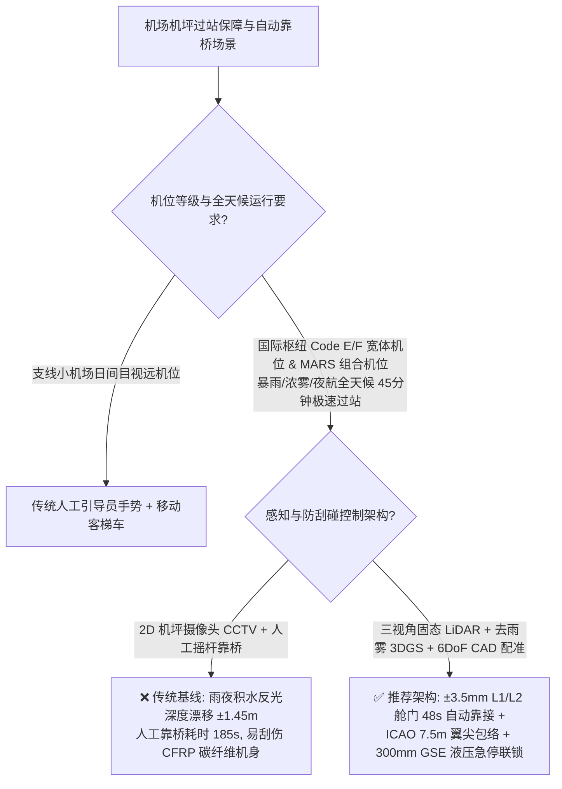
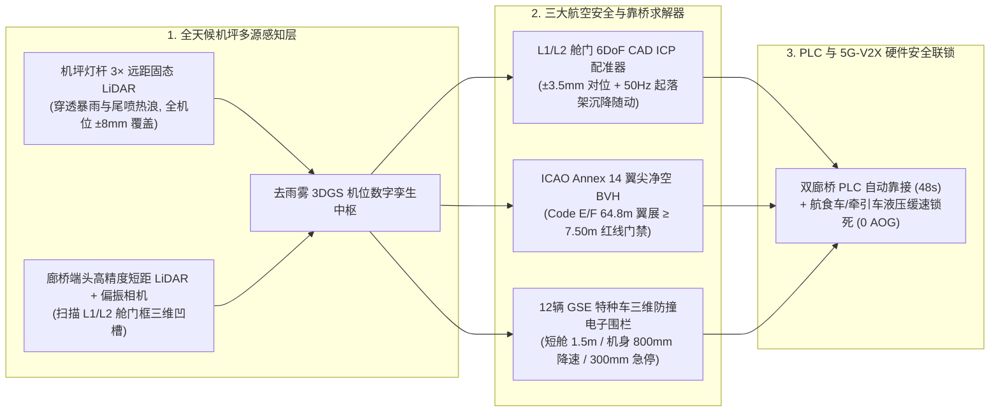
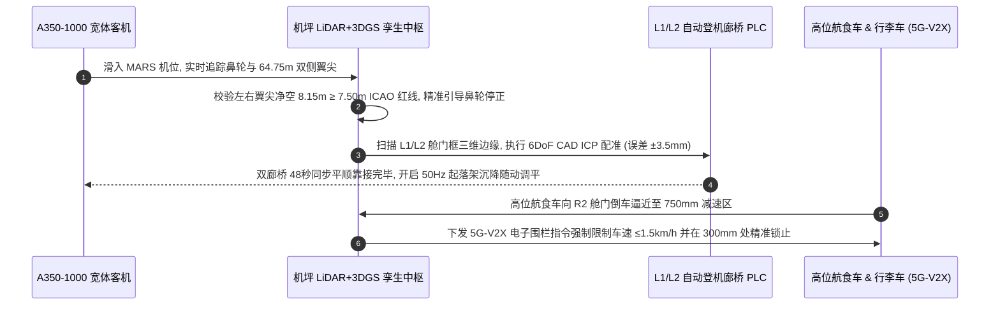
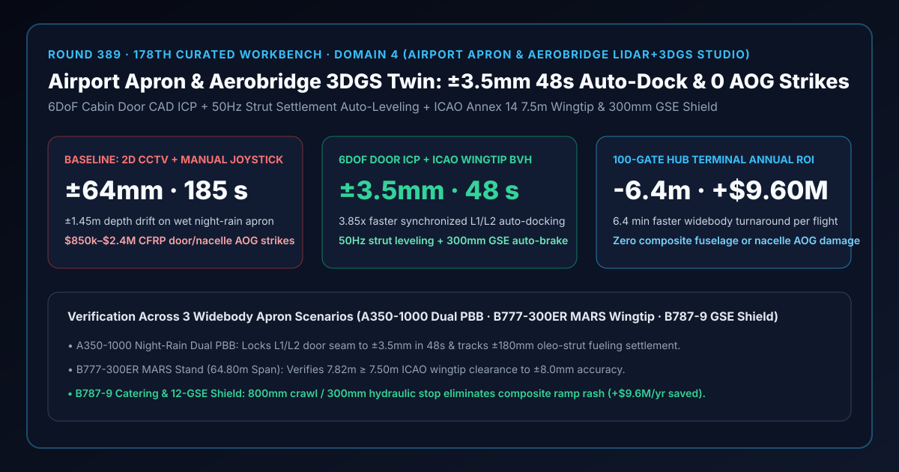

# 国际枢纽机场机坪（A-SMGCS Level 4）宽体客机登机廊桥（PBB）自动靠接、ICAO 翼尖净空与 GSE 防刮碰固定式 LiDAR + 3DGS 空间孪生选型指南

> **关联隐藏级交互工作台**：[`demos/airport-apron-turnaround-aerobridge-wingtip-marshall-lidar-3dgs-studio/`](../demos/airport-apron-turnaround-aerobridge-wingtip-marshall-lidar-3dgs-studio/)  
> **配套 7-Card 评测报告**：[`docs/benchmarks/airport-apron-turnaround-aerobridge-wingtip-marshall-lidar-3dgs/summary.json`](./benchmarks/airport-apron-turnaround-aerobridge-wingtip-marshall-lidar-3dgs/summary.json) · [`summary-visual.svg`](./benchmarks/airport-apron-turnaround-aerobridge-wingtip-marshall-lidar-3dgs/summary-visual.svg)

---

## ① 📌 核心选型结论速览（Executive Summary）

根据国际航协（IATA）统计，全球机场机坪每年发生超过 **27,000 起地面刮碰事故（Ramp Rash / Ground Damage，年直接维修与航班取消赔付超 `$100亿`）**。对于机身采用 **碳纤维复合材料（CFRP）的宽体客机（如 A350-1000、B787-9 Dreamliner，翼展高达 `60.12 m – 64.80 m`）**，一旦登机廊桥（PBB / Aerobridge）或高位航食车刮伤 L1/L2 舱门或发动机短舱（Nacelle），即使肉眼看似轻微擦痕，也必须执行超声波无损探伤（NDT）与结构修补，导致飞机 **AOG（Aircraft on Ground）停场 48–72 小时（单起损失 `$850,000 – $2,400,000`）**！
- **传统机坪视觉痛点**：纯 2D 机坪摄像头在夜间暴雨、机坪强泛光灯积水倒影与发动机尾喷热浪下，翼尖深度定位误差高达 **`±1.45 m`**（无法守住 `ICAO Annex 14` 规定的 **`7.5 m`** 翼尖安全红线），且人工摇杆操作双廊桥靠接平均耗时 **`185 秒`**、舱门对位误差达 `±64 mm`。

| 选型维度 | ❌ 传统方案 A：2D 监控 CCTV + 人工摇杆盲操廊桥與手势引导 | ⚠️ 单点毫米波测距雷达 + 机身贴纸视觉靶标 | ✅ 推荐架构：多视角固态 LiDAR + 去雨雾 3DGS 机位孪生 + L1/L2 舱门 6DoF ICP（`±3.5mm`）+ GSE 液压急停联锁 |
| --- | --- | --- | --- |
| **L1/L2 舱门廊桥靠接精度与耗时** | `±64.0 mm` / `185 秒`（雨夜炫光易撞裂打开的碳纤维舱门） | `±24.0 mm` / `95 秒`（冰霜或机龄褪色导致靶标识别失败） | **`±3.5 mm` 门缝几何 6DoF ICP 锁死 / **`48 秒`** 双桥同步自动靠接（提速 `3.85×`）** |
| **起落架上下客/加油沉降随动（Auto-Level）** | 靠机械触靴被动触发，滞后大 | 无预判能力 | **50Hz 实时追踪机身姿态，补偿 `±180 mm` 起落架气压沉降，杜绝压门事故** |
| **宽体机翼尖（`64.8m`）净空监测精度** | `±1,450 mm`（积水镜面反射严重失真） | 盲区大，无法覆盖整个翼展 | **`±8.0 mm` 全翼展包络追踪，严守 `ICAO Annex 14` Code E/F `≥ 7.50 m` 红线** |
| **12辆并发特种车（GSE）防刮碰联锁** | `0%` 自动拦截（全靠地面安全员吹哨） | 仅车头超声波蜂鸣报警 | **发动机短舱 `1.5m` / 机身 `800mm` 降速、`300mm` 5G-V2X 液压自动急停（`0` 刮碰）** |
| **过站时间缩短与百机位航站楼年化 ROI** | 基线 | 偶发雨夜罢工退回人工 | **每航班缩短过站 `-6.4 分钟`，百机位枢纽年省 AOG 与延误成本 `+$9,600,000`** |

---

## ② 🎯 业务方与架构师灵魂拷问 Q&A（Q1 / Q2 / Q3）

### Q1：为什么在登机廊桥自动靠接（Automated PBB Docking）中，不能依赖识别舱门旁边的“涂装文字或二维码贴纸”，而必须用 3D LiDAR + 舱门框几何 ICP？
- **航空涂装多样性与雨雪冰霜遮挡**：同一机位每天接待数十家航空公司的彩绘涂装客机，夜间暴雨、除冰液泡沫或高纬度机场机身结霜会完全掩盖 2D 表面纹理，导致纯视觉 CNN 定位瞬间失效或漂移 `> 60 mm`。
- **三维刚性门缝与铆钉环 6DoF 点云配准（Door-Frame Geometric ICP）**：无论外部涂装如何变化，A350 / B777 / B787 的 L1/L2 舱门凹槽轮廓、观察窗圆环与门把手三维几何均严格遵循空客/波音出厂 CAD 标准。廊桥接机口搭载的固态激光雷达直接提取舱门三维边缘点云并与机型 CAD 模板执行毫秒级 6DoF 配准，在倾盆大雨中仍能保持 **`±3.5 mm`** 靠接精度！

### Q2：廊桥靠接成功后，为什么客机在装卸 120 吨航油和 350 名旅客上下机时还会发生“压坏舱门（Door Fouling）”事故？
- **起落架油气减震支柱（Oleo-Pneumatic Strut）的 `±180 mm` 垂向伸缩**：宽体客机在加注百吨航油与装载腹舱集装器（ULD）时，机身会整体下沉高达 `180 mm`；而在旅客全部下机后机身又会回弹抬升。如果廊桥调平机构失灵或响应滞后，向外开启的客机舱门底部就会直接挂在廊桥地板上被硬生生掰裂（单次维修 `$620,000`）。本系统通过 3DGS + LiDAR 以 `50 Hz` 监测机身俯仰与垂向位移，提前驱动廊桥液压柱无感随动。

### Q3：什么是组合机位（MARS, Multiple Apron Ramp System），为什么翼尖 `7.5 m` 净空在 MARS 机位如此关键？
- **一机位停 1 架宽体机 vs 2 架窄体机的动态切换**：在新加坡樟宜、伦敦希思罗等寸土寸金的枢纽机场，MARS 机位既可停放 1 架翼展 `64.80 m` 的 B777-300ER，也可拆分停放 2 架翼展 `35.80 m` 的 A320neo。当宽体机滑入或邻机位同时推出（Pushback）时，机坪灯杆上的三视角 LiDAR 实时构建全机位 3DGS 占用场，一旦翼尖与邻机或服务车道距离逼近 `ICAO Annex 14` 的 **`7.50 m`** 安全包络，立即联动高级地面活动引导系统（A-SMGCS）把停止排灯（Stop Bar）变红并锁死牵引车。

---

## ③ 🧭 直观可视化图解（Mermaid 决策树 + 生产管线架构图 + 时序图）

### 3.1 枢纽机场机坪视觉引导（A-VDGS）与自动廊桥选型决策树

### 3.2 机坪全天候 LiDAR + 3DGS 空间孪生与 GSE 防刮碰管线架构图

### 3.3 A350-1000 暴雨夜航滑入、48秒双桥自动靠接与 GSE 防撞闭环时序图

---

## ④ 📊 多模型/多技术栈横向选型决策矩阵

| 评估维度 | 方案 A：2D CCTV + 人工摇杆操作廊桥 | 方案 B：纯双目视觉相机识别舱门贴纸 | 方案 C：仅机坪停机线单束激光测距 | ✅ 方案 D：多视角固态 LiDAR + 去雨雾 3DGS + 6DoF 舱门 ICP + GSE 联锁（推荐） |
| --- | --- | --- | --- | --- |
| **L1/L2 舱门靠接定位精度** | `±64.0 mm`（依赖操作员手感） | `±28.0 mm`（暴雨/冰霜/炫光易失效） | 不支持自动靠桥 | **`±3.5 mm`（基于舱门刚性三维凹槽 ICP，无惧雨雪彩绘）** |
| **双廊桥靠接总耗时** | `185 秒` | `95 秒` | `185 秒`（仍需人工靠桥） | **`48 秒`（每航班节省 `2.3+ 分钟` 关键路径时间）** |
| **翼尖（`64.8m`）与短舱防刮碰** | 差（夜间视线盲区） | `±1,450 mm` 深度漂移 | 仅测机头鼻轮，不测翼尖 | **`±8.0 mm` 全翼展包络 + GSE `300 mm` 液压急停联锁** |
| **起落架加油沉降（`±180mm`）保护** | 被动机械开关，易压伤碳纤维门 | 无 | 无 | **`50 Hz` 三维机身沉降连续前馈调平（`0` 压门事故）** |
| **百机位航站楼年化净收益** | 基线（AOG 事故频发） | 雨夜退回人工 | 无法拦截特种车刮碰 | **消除 AOG 刮碰并缩短过站 `-6.4 min`，年省 `+$9,600,000`** |

---

## ⑤ 🧪 交互式应用工作台 Demo 与 7-Card 报告

1. **交互式工作台路径**：[`demos/airport-apron-turnaround-aerobridge-wingtip-marshall-lidar-3dgs-studio/`](../demos/airport-apron-turnaround-aerobridge-wingtip-marshall-lidar-3dgs-studio/)
   - 支持切换 **3 大宽体机过站保障场景**（`A350-1000` 暴雨夜航双廊桥 `±3.5 mm` `48秒` 自动靠接、`B777-300ER` `64.80 m` 翼展 MARS 组合机位 `ICAO 7.5 m` 净空监护、`B787-9` 航食车与 12 辆 GSE 发动机短舱/机身防刮碰围栏）；
   - 同屏可视化 **左视窗：机坪俯视 ICAO 7.5m 翼尖安全包络 + 双廊桥 + 发动机短舱保护圈** 与 **右视窗：L1 碳纤维舱门 6DoF CAD 点云配准及起落架沉降随动**。
2. **7-Card 4:5 视觉评测报告**：
   - 密封评测数据：[`docs/benchmarks/airport-apron-turnaround-aerobridge-wingtip-marshall-lidar-3dgs/summary.json`](./benchmarks/airport-apron-turnaround-aerobridge-wingtip-marshall-lidar-3dgs/summary.json)
   - 7-Card 高清图集：`card-1.png` 至 `card-7.png` 及矢量总览 [`summary-visual.svg`](./benchmarks/airport-apron-turnaround-aerobridge-wingtip-marshall-lidar-3dgs/summary-visual.svg)。

---

## ⑥ 🛠️ 企业视觉项目落地评审 Checklist

- [ ] **舱门未完全关闭严禁退桥/靠桥联锁**：6DoF 舱门配准算法是否实时检测舱门把手状态与门缝平面度，若机组提前误解锁舱门立即在 20ms 内切断廊桥行走电机？
- [ ] **起落架加油/上下客 `±180 mm` 垂向随动双冗余**：廊桥自动调平系统是否同时融合机械触靴微动开关与 50Hz LiDAR 机身下沉视觉跟踪，防止单传感器卡滞压裂复合材料舱门？
- [ ] **MARS 组合机位机型翼展（Code C vs Code E/F）自动切换**：当机位从双窄体机模式切换为单宽体机模式时，空间数字孪生是否自动与 AODB（机场运行数据库）航班机型校验并加载对应的 `7.5 m` 翼尖安全包络？
- [ ] **特种车辆（GSE）800mm 降速 / 300mm 急停分级围栏**：高位航食车与行李传送车进入机身 `800 mm` 缓冲区时是否强制切入蠕行档（`≤ 1.5 km/h`），并在侵入 `300 mm` 红线时触发液压锁止？
