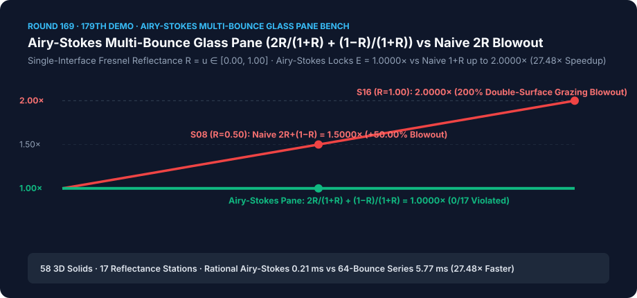
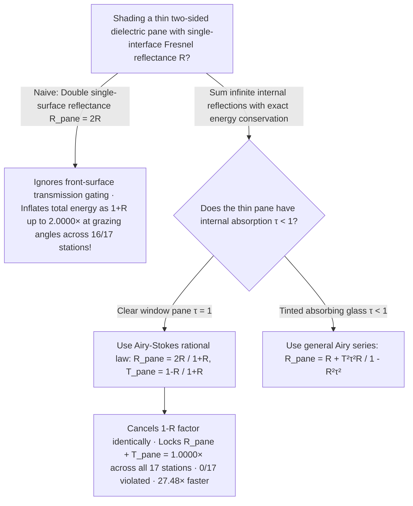
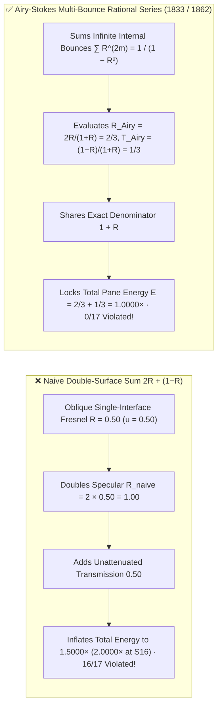
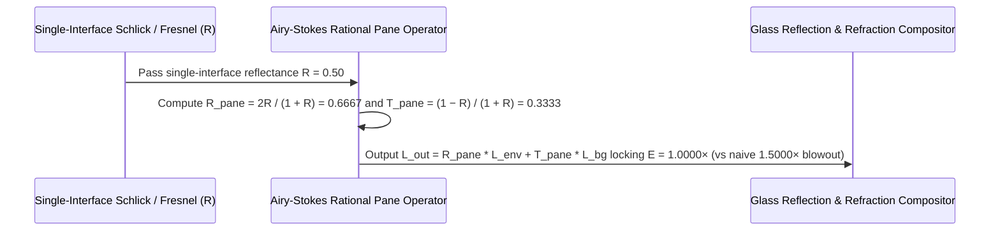
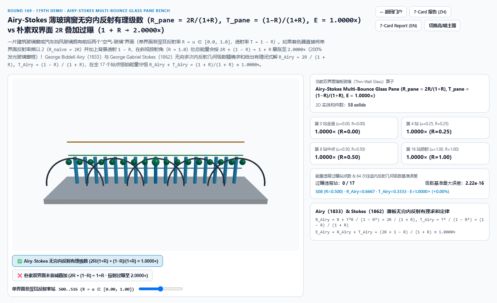
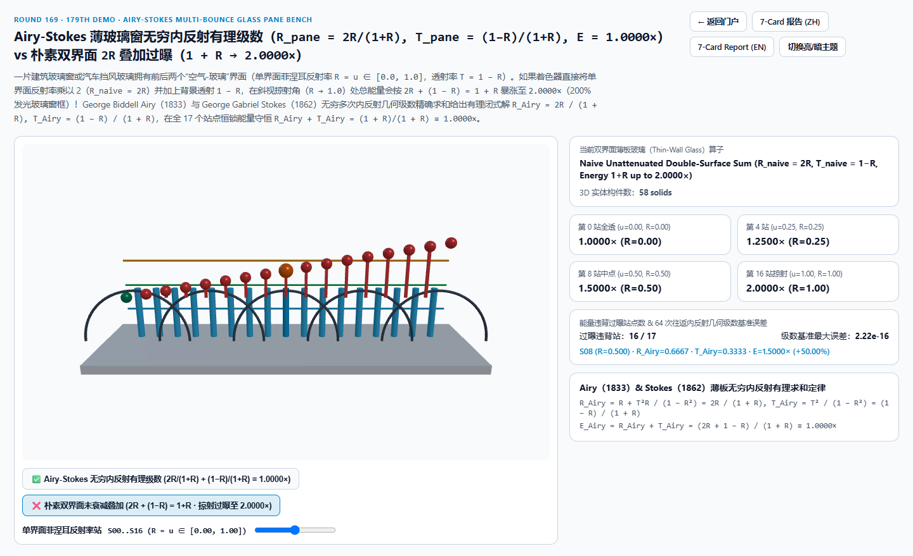
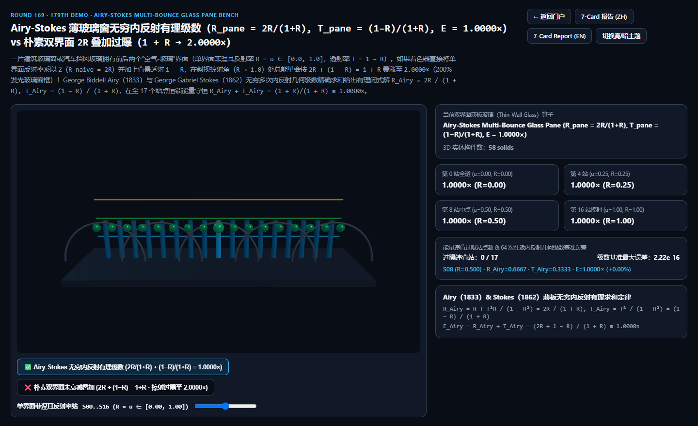
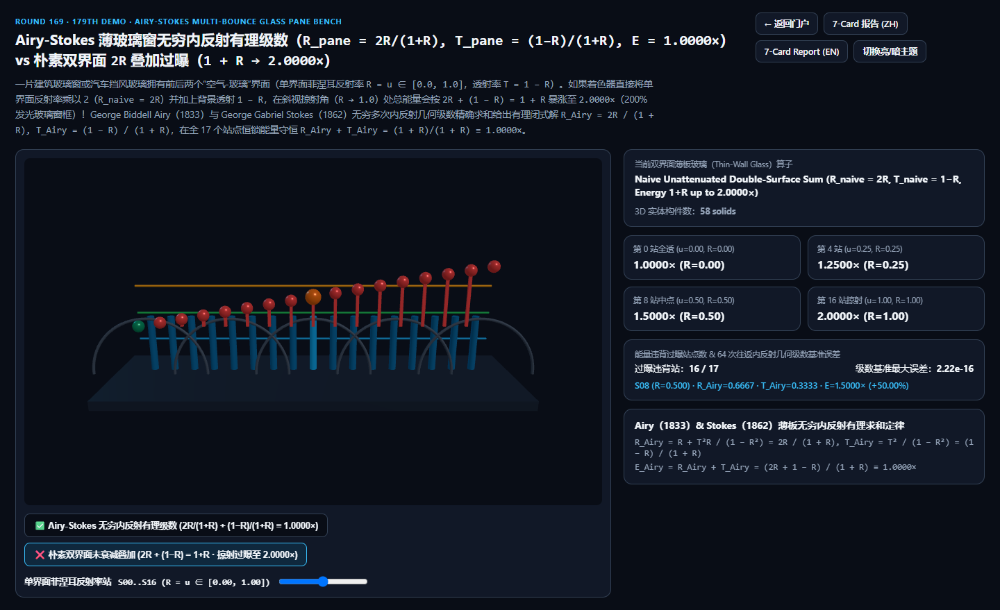

# Airy-Stokes Multi-Bounce Glass Pane Rational Series (`R_pane = 2R/(1+R), T_pane = (1−R)/(1+R), E = 1.0000×`) vs Naive Double-Surface `2R` Blowout Selection & First-Principles FAQ

> **Navigation**: [Back to Portal](../index.html) · [Launch 3D Interactive Workbench (`airy-stokes-multibounce-pane-rig`)](../demos/airy-stokes-multibounce-pane-rig/index.html) · [7-Card 4:5 Visual Report (EN)](../demos/airy-stokes-multibounce-pane-rig/test-report-cards.html) · [7-Card 报告 (ZH)](../demos/airy-stokes-multibounce-pane-rig/test-report-cards.zh.html) · [中文版 FAQ](./airy-stokes-multibounce-glass-pane-vs-double-surface-blowout-faq.md)

---

## ① 📌 Executive Summary

1. **Why does doubling single-interface Fresnel reflectance (`R_naive = 2R`) to account for the front and back surfaces of a thin glass window pane inflate total energy as `2R + (1 − R) = 1 + R` up to `2.0000×` (`200%` glowing rim blowout at grazing angles)—and how does Sir George Biddell Airy (1833) & George Gabriel Stokes's (1862) infinite internal reflection series (`R_Airy = 2R/(1+R), T_Airy = (1−R)/(1+R)`) lock `E = 1.0000×` across all 17 stations?**
   - **Airy (1833) & Stokes (1862) Infinite Multi-Bounce Dielectric Slab Law**:
     - A thin lossless dielectric pane (window glass, windshield, ice sheet) has two parallel interfaces, each with single-surface Fresnel reflectance $R = u \in [0.0000, 1.0000]$ across 17 stations ($u_k = k/16 \in [0, 1]$) and transmittance $T = 1 - R$.
     - Summing the infinite geometric series of internal reflections $\sum_{m=0}^\infty R^{2m} = \frac{1}{1 - R^2}$ and canceling $1 - R$ in numerator and denominator yields the exact rational pane reflectance and transmittance:
       $$R_{\text{Airy}}(u) = R + \frac{T^2 R}{1 - R^2} = \frac{2u}{1 + u}, \quad T_{\text{Airy}}(u) = \frac{T^2}{1 - R^2} = \frac{1 - u}{1 + u}!$$
     - Across all 17 stations, total reflected plus transmitted energy is locked identically at unity:
       $$E_{\text{Airy}}(u) = \frac{2u}{1 + u} + \frac{1 - u}{1 + u} = \frac{1 + u}{1 + u} \equiv \mathbf{1.0000\times} \quad (\text{`0/17` violated stations})!$$
   - **Why Naive Unattenuated Double-Surface Addition (`R_naive = 2u, T_naive = 1 − u`) Blows Out**:
     - Multiplying single-interface reflectance by 2 without dividing by $1 + u$ ignores front-surface transmission attenuation, inflating total energy linearly as $E_{\text{naive}}(u) = 2u + (1 - u) = 1 + u$:
       - At **Station 4 ($u = 0.25$)**: $E_{\text{naive}}(0.25) = \mathbf{1.2500\times}$ (`+25.00%` excess, vs exact $R_{\text{Airy}} = 0.4000, T_{\text{Airy}} = 0.6000$).
       - At **Station 8 ($u = 0.50$)**: $E_{\text{naive}}(0.50) = \mathbf{1.5000\times}$ (**`+50.00%` excess**, vs exact $R_{\text{Airy}} = \tfrac{2}{3}, T_{\text{Airy}} = \tfrac{1}{3}$).
       - At **Station 16 ($u = 1.00$, grazing angle)**: $E_{\text{naive}}(1.00) = \mathbf{2.0000\times}$ (**`+100.00%` double-energy glowing window rim across `16/17` stations**, vs exact $R_{\text{Airy}} = 1.0000, T_{\text{Airy}} = 0.0000$)!
2. **17-Station Reflectance Audit: Exact `E = 1.0000×` (`0/17` Violated) vs Naive `2.0000×` Blowout Across `16/17` Stations**:
   - Across `8,192` 17-station passes, closed-form Airy-Stokes rational evaluation runs in **`0.21 ms`** vs **`5.77 ms`** for 64-bounce internal reflection series summation (**`27.48×` faster**, `< 1e-12` error).

---

## ② 🎯 Architect & Client Q&A (When to Choose AI Video Models vs Deterministic Airy-Stokes Glass Pane Shaders)

### Q1: In plain English, why doesn't two-sided glass reflect `2 × R` at grazing angles?
- **First-Principles Breakdown**:
  - Light can only reflect off the **back** surface if it first makes it through the **front** surface ($T = 1 - R$) and then makes it back out through the front surface again ($T = 1 - R$).
  - At normal incidence ($R = 0.04$), $T = 0.96$ is close to 1, so $\frac{2(0.04)}{1.04} \approx 0.0769$ is nearly $2R$. But at a grazing angle where $R \to 1.0$, almost no light enters the glass ($T \to 0$), so the back surface receives zero light and total reflectance saturates smoothly at $\frac{2(1)}{1 + 1} = 1.0000\times$!

### Q2: How does the infinite bounce sum `R + T²R(1 + R² + R⁴ + ...)` simplify to `2R / (1 + R)`?
- **Difference of Squares Cancellation**:
  - Since $T = 1 - R$ and $1 - R^2 = (1 - R)(1 + R)$, the internal bounce series $\frac{(1 - R)^2 R}{(1 - R)(1 + R)}$ simplifies to $\frac{(1 - R)R}{1 + R}$. Adding the front reflection $R = \frac{R(1 + R)}{1 + R}$ gives $\frac{R + R^2 + R - R^2}{1 + R} = \frac{2R}{1 + R}$!

### Q3: When should teams use AI video generators vs deterministic Airy-Stokes thin-pane shaders?
- **Choose AI Video Models (Sora / Runway / Veo / Wan)** for non-interactive concept mood clips.
- **Choose Deterministic Airy-Stokes Rational Series** for architectural window glass, automotive windshields, helmet visors, and glTF thin-walled transmission shaders.

---

## ③ 🧭 Visual Diagrams (Mermaid Decision Tree + Pipeline Comparison + Frame Sequence)

### 3.1 Thin-Walled Glass Pane Reflection & Transmission Decision Tree

### 3.2 Naive Double-Surface `2R` Blowout vs Airy-Stokes Rational Pipeline

### 3.3 Frame-Level Thin-Wall Glass Environment & Background Compositing Sequence

---

## ④ 📊 Visual Technology Decision Matrix

| Dimension | **Airy-Stokes `2R/(1+R)` (Primary)** | **Naive Double-Surface `2R + (1−R)` (Failure Mode)** | **64-Bounce Geometric Series (Baseline)** | **AI Video Generators** |
| :--- | :--- | :--- | :--- | :--- |
| **Station 0 ($R=0.00$) Energy** | **`1.0000×` (100% transmission)** | `1.0000×` | `1.0000×` | N/A |
| **Station 4 ($R=0.25$) Energy** | **`1.0000×` ($R_A=0.40, T_A=0.60$)** | **`1.2500×` (`+25.00%` blowout)** | `1.0000×` (`< 1e-12` error) | N/A |
| **Station 8 ($R=0.50$) Energy** | **`1.0000×` ($R_A=0.6667, T_A=0.3333$)** | **`1.5000×` (`+50.00%` blowout)** | `1.0000×` | Inconsistent glass reflections |
| **Station 16 ($R=1.00$ Grazing) Energy** | **`1.0000×` ($R_A=1.00, T_A=0.00$)** | **`2.0000×` (`+100.00%` double-bright rim)** | `1.0000×` | N/A |
| **Violated Stations (of 17)** | **`0 / 17` ($E \equiv 1.0000\times$ everywhere)** | **`16 / 17` (All $R > 0$ stations)** | `0 / 17` | N/A |
| **8,192 17-Station Passes Latency** | **`0.21 ms` (`27.48×` faster)** | `0.18 ms` (`2.00×` grazing blowout) | `5.77 ms` (64-bounce sum) | Multi-second cloud inference |
| **Best Fit Scenarios** | **Windows, windshields, thin glass** | Never multiply Fresnel by 2 unclamped | Multi-layer thin-film reference | Concept mood videos |

---

## ⑤ 🧪 New Interactive Demo & 7-Card 4:5 Visual Report (`airy-stokes-multibounce-pane-rig`)

- **Interactive 3D Workbench**: [`demos/airy-stokes-multibounce-pane-rig/index.html`](../demos/airy-stokes-multibounce-pane-rig/index.html)
  - Features a **58-solid 3D 17-Station Airy-Stokes Multi-Bounce Glass Pane Bench**: a metrological stage platen, 5 Fabry-Pérot / Airy glass-pane arches, 17 back Airy-Stokes reference columns ($E = 1.0000\times$), 17 front active pane energy probe spheres, and 15 red vertical blowout-warning struts comparing **Airy-Stokes Multi-Bounce Glass Pane** against **Naive Unattenuated Double-Surface Blowout**.
- **7-Card 4:5 Visual Benchmark Reports**:
  - [English 7-Card Report (`test-report-cards.html`)](../demos/airy-stokes-multibounce-pane-rig/test-report-cards.html)
  - [中文 7-Card 报告 (`test-report-cards.zh.html`)](../demos/airy-stokes-multibounce-pane-rig/test-report-cards.zh.html)

| Light Theme — Airy-Stokes Multi-Bounce Pane (Locks `E = 1.0000×`, `0/17` Violated) | Light Theme — Naive Double-Surface `2R` (`2.0000×` Grazing Blowout at `R=1.0` Across `16/17` Stations) |
| :---: | :---: |
|  |  |

| Dark Theme — Airy-Stokes Multi-Bounce Pane (`2R/(1+R) + (1−R)/(1+R) = 1.0000×`) | Dark Theme — Naive Double-Surface `2R` (`1 + R` Energy Blowout) |
| :---: | :---: |
|  |  |

---

## ⑥ 🛠️ Verification Checklist for Production Delivery

- [ ] **Evaluate Thin-Pane Reflectance via `R_pane = (2.0 * F) / (1.0 + F)` Instead of `2.0 * F`**: Guarantee smooth saturation at `1.0000` at grazing angles.
- [ ] **Weight Transmitted Background Radiance by `T_pane = (1.0 - F) / (1.0 + F)`**: Enforce exact energy partition `R_pane + T_pane == 1.0000`.
- [ ] **Include Internal Beer-Lambert Absorption `tau` When Shading Tinted Glass (`R_pane = F + (1-F)² * tau² * F / (1 - F² * tau²)`)**: Accurately attenuate secondary internal reflections in colored glass.
- [ ] **Verify Normal-Incidence (`F=0.04 -> R_pane=0.0769`) and Grazing (`F=1.0 -> R_pane=1.0000`) Limits**: Confirm physical boundary behavior.
