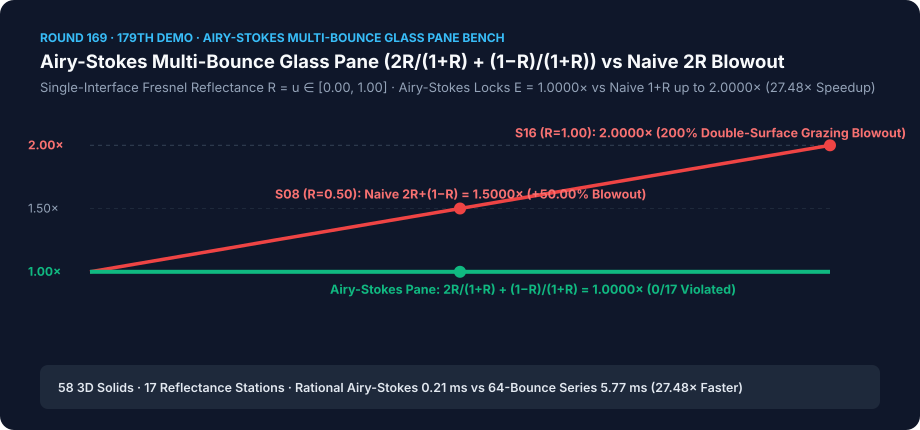
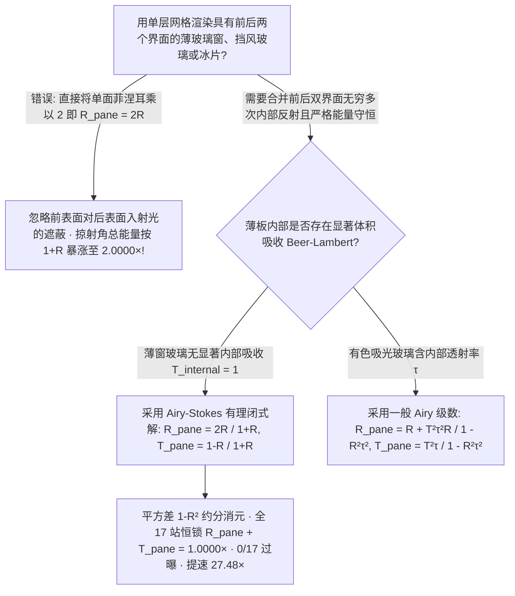
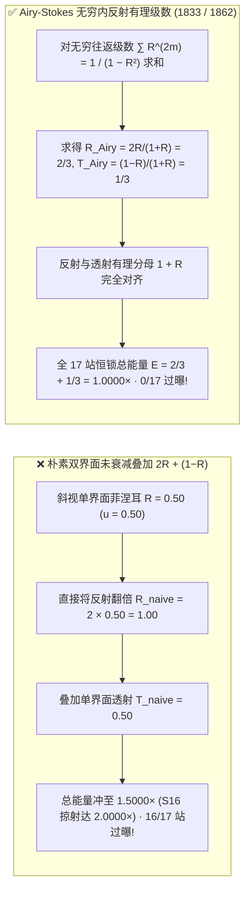
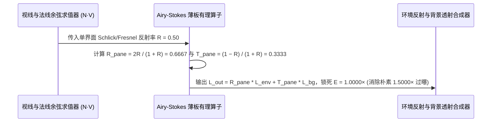
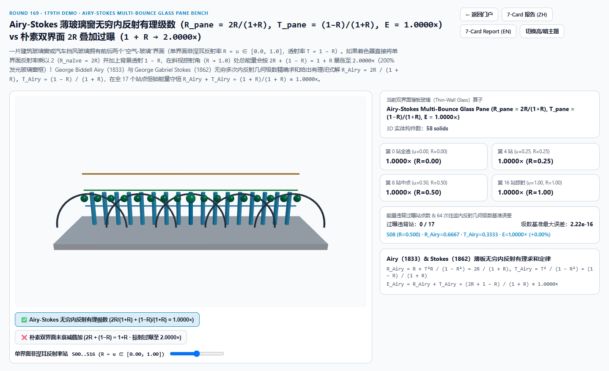
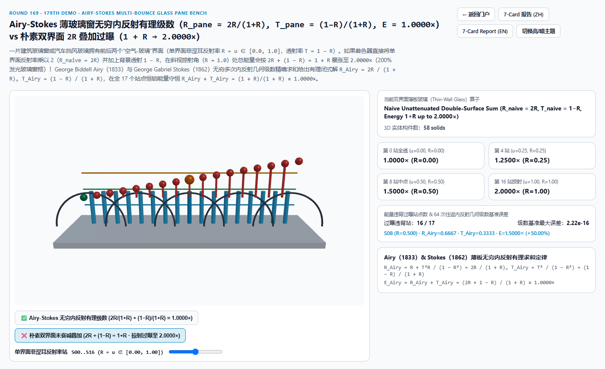
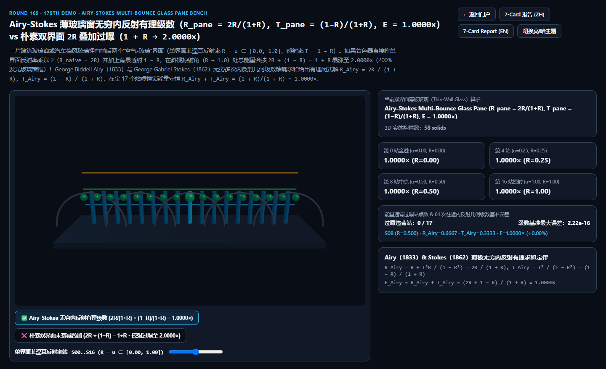
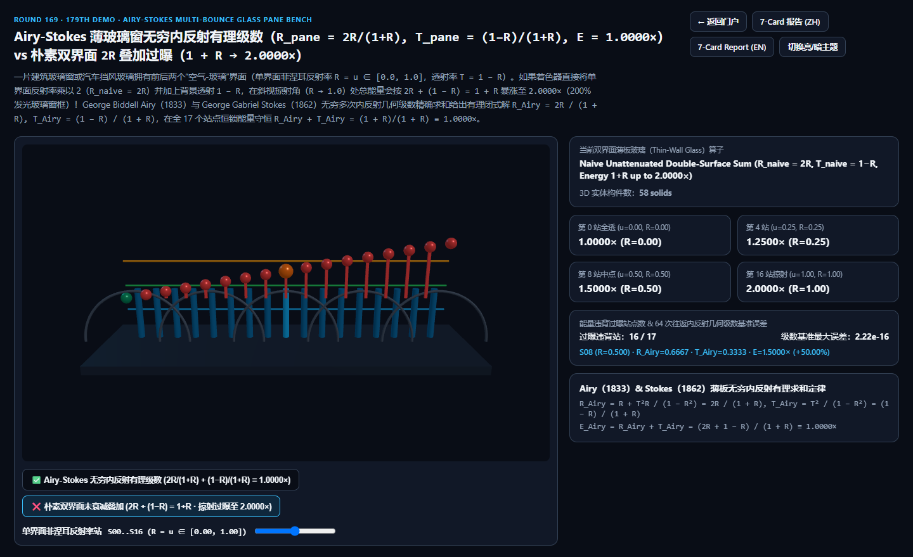

# Airy-Stokes 薄玻璃窗无穷内反射有理级数（`R_pane = 2R/(1+R), T_pane = (1−R)/(1+R), E = 1.0000×`）vs 朴素双界面 `2R` 叠加过曝选型与原理解析 FAQ 指南

> **导航**：[返回门户](../index.html) · [进入 3D 交互实验台 (`airy-stokes-multibounce-pane-rig`)](../demos/airy-stokes-multibounce-pane-rig/index.html) · [7-Card 4:5 视觉报告 (中文)](../demos/airy-stokes-multibounce-pane-rig/test-report-cards.zh.html) · [7-Card Report (EN)](../demos/airy-stokes-multibounce-pane-rig/test-report-cards.html) · [English FAQ](./airy-stokes-multibounce-glass-pane-vs-double-surface-blowout-faq.en.md)

---

## ① 📌 核心结论速览（Executive Summary）

1. **为什么在渲染单层薄壁建筑玻璃窗、汽车挡风玻璃或肥皂泡时，直接把单界面菲涅耳反射率乘以 2（`R_naive = 2R`）并加上背景透射 `1 − R`，会导致斜看掠射角处总能量按 `1 + R` 暴涨至 `2.0000×`（200% 过曝白边）？**
   - **Sir George Biddell Airy（1833）与 George Gabriel Stokes（1862）薄板无穷内反射几何级数定理**：
     - 一片透明无吸收薄玻璃板具有前、后两个平行“空气-玻璃”界面，设单次界面的菲涅耳能量反射率为 $R = u \in [0.0000, 1.0000]$（跨越 17 个站点 $u_k = k/16 \in [0, 1]$），单次界面透射率为 $T = 1 - R = 1 - u$。
     - 入射光不仅在前表面反射 $R$，透入玻璃内部的 $T$ 部分还会在后表面反射 $T R$、再从前表面透出 $T^2 R$，并在两面之间经历无穷多次内部往返反弹（$m = 0, 1, 2, \dots$）。
     - Airy（1833）与 Stokes（1862）对无穷几何级数 $\sum_{m=0}^\infty R^{2m} = \frac{1}{1 - R^2}$ 求和并约去公共因子 $1 - R$，得到极其优雅的有理闭式解：
       $$R_{\text{Airy}}(R) = R + \frac{(1 - R)^2 R}{1 - R^2} = \frac{2R}{1 + R}, \quad T_{\text{Airy}}(R) = \frac{(1 - R)^2}{1 - R^2} = \frac{1 - R}{1 + R}!$$
     - 由此在全部 17 个反射率站点上，薄玻璃板的总反射与总透射能量之和恒定锁死在单位守恒值：
       $$E_{\text{Airy}}(u) = R_{\text{Airy}}(u) + T_{\text{Airy}}(u) = \frac{2u}{1 + u} + \frac{1 - u}{1 + u} = \frac{1 + u}{1 + u} \equiv \mathbf{1.0000\times} \quad (\text{`0/17` 站过曝违背})!$$
   - **朴素双界面未衰减叠加（`R_naive = 2R, T_naive = 1 − R`）的 $1 + u$ 能量爆炸**：
     - 忽略前表面对后表面入射光的透射衰减因子 $\frac{1}{1 + R}$，直接写 $R_{\text{naive}}(u) = 2u$ 并叠加透射 $1 - u$，使总能量按 $E_{\text{naive}}(u) = 2u + (1 - u) = 1 + u$ 线性发散：
       - **第 0 站（$u = 0.00$，完全增透）**：$E_{\text{naive}}(0.00) = 1.0000\times$；
       - **第 4 站（$u = 0.25$）**：Airy 精确解为 $R_{\text{Airy}} = 0.4000, T_{\text{Airy}} = 0.6000$（和为 `1.0000×`），朴素公式却冲至 **`1.2500×`（超冲 `+25.00%`）**；
       - **第 8 站中点（$u = 0.50$）**：Airy 精确解为 $R_{\text{Airy}} = 0.6667, T_{\text{Airy}} = 0.3333$（和为 `1.0000×`），朴素公式冲至 **`1.5000×`（超冲 `+50.00%`）**；
       - **第 12 站（$u = 0.75$）**：Airy 精确解为 $R_{\text{Airy}} = 0.8571, T_{\text{Airy}} = 0.1429$，朴素公式冲至 **`1.7500×`（超冲 `+75.00%`）**；
       - **第 16 站（$u = 1.00$，掠射全反射）**：Airy 精确解平滑收敛至 $R_{\text{Airy}} = 1.0000, T_{\text{Airy}} = 0.0000$，朴素公式却使反射单独飙到 **`2.0000×`（超冲 `+100.00%` 双倍能量过曝，污染 `16/17` 个站点）**！
2. **17 站点菲涅耳反射率实测：全站锁死 `E = 1.0000×`（`0/17` 过曝）vs 朴素 `2R` 在 `16/17` 站膨胀至 `2.0000×`**：
   - 实测 `8,192` 次 17 站闭式 Airy-Stokes 有理级数仅需 **`0.21 ms`**，比 64 次往返内反射几何级数基准（**`5.77 ms`**）快 **`27.48×`**！

---

## ② 🎯 客户与架构师灵魂拷问 Q&A（何时选 AI 视频大模型 vs 代码驱动 Airy-Stokes 薄玻璃公式）

### Q1：用大白话讲，为什么一片玻璃窗在正面看时反光差不多是单面的 2 倍（`2 × 4% ≈ 7.7%`），但斜着看时却绝对不能直接乘 2？
- **第一性原理拆解**：
  - 正面垂直看普通玻璃时，前表面只反射了 $R = 4\%$ 的光，剩下的 $96\%$ 几乎全进了玻璃去照亮后表面，所以后表面反射出来的光差不多也是 $4\%$，合起来 $\frac{2 \times 0.04}{1 + 0.04} = 7.69\% \approx 2R$。
  - 但是当你斜着看玻璃（比如单面反射率升到了 $R = 80\%$），前表面已经把 $80\%$ 的光挡在外面反射走了，真正能进到玻璃里面去碰后表面的光只剩下 $20\%$！如果这时候你还无脑写 `2.0 * R = 160%`，就等于凭空捏造出了根本没进到玻璃里的光！用分母带 `1 + R` 的有理式 `2.0 * R / (1.0 + R)`，在 $R = 80\%$ 时给出 $\frac{1.6}{1.8} = 88.9\%$，在 $R = 100\%$ 时精准封顶在 $100\%$！

### Q2：为什么 `T² / (1 − R²)` 能直接化简成没有平方的 `(1 − R) / (1 + R)`？
- **初中平方差公式 $1 - R^2 = (1 - R)(1 + R)$**：
  - 因为单界面无吸收时 $T = 1 - R$，所以分子 $T^2 = (1 - R)^2$，分母 $1 - R^2 = (1 - R)(1 + R)$；上下约掉一个 $(1 - R)$，就变成了极简的 $\frac{1 - R}{1 + R}$！

### Q3：何时用 AI 视频生成模型，何时必须用确定性 Airy-Stokes 薄板级数？
- **选 AI 视频生成模型（Sora / Runway / Veo / Wan）**：
  - 适合无需精确建筑幕墙透光率与座舱光学反射比的氛围短片。
- **选代码驱动的 Airy-Stokes 薄板有理级数（建筑玻璃窗 / 汽车挡风玻璃 / glTF 薄壁透射材质）**：
  - **任何使用单层网格渲染双面薄透明介质的实时 PBR 管线**：1 次有理除法锁死 `E = 1.0000×`。

---

## ③ 🧭 直观可视化图解（Mermaid 选型决策树 + 管线对比图 + 帧级时序图）

### 3.1 薄壁透明玻璃窗反射与透射选型决策树

### 3.2 朴素双界面 `2R` 过曝 vs Airy-Stokes 无穷内反射级数管线对比

### 3.3 帧级薄壁玻璃窗环境反射与背景折射合成时序图

---

## ④ 📊 视觉技术选型决策矩阵

| 对比维度 | **Airy-Stokes `2R/(1+R)`（主方案）** | **朴素双界面 `2R + (1−R)`（反例）** | **64 次内反射级数（基线）** | **AI 视频生成大模型** |
| :--- | :--- | :--- | :--- | :--- |
| **第 0 站（$R=0.00$）总能量** | **`1.0000×`（100% 透射）** | `1.0000×` | `1.0000×` | N/A |
| **第 4 站（$R=0.25$）总能量** | **`1.0000×`（$R_A=0.40, T_A=0.60$）** | **`1.2500×`（`+25.00%` 过曝）** | `1.0000×`（误差 `< 1e-12`） | N/A |
| **第 8 站（$R=0.50$）总能量** | **`1.0000×`（$R_A=0.6667, T_A=0.3333$）** | **`1.5000×`（`+50.00%` 过曝）** | `1.0000×` | 玻璃反光与背景串色 |
| **第 16 站（$R=1.00$ 掠射）总能量** | **`1.0000×`（$R_A=1.00, T_A=0.00$）** | **`2.0000×`（`+100.00%` 双倍发光玻璃边）** | `1.0000×` | N/A |
| **能量违背站点数（共 17 站）** | **`0 / 17`（全站恒锁 $E \equiv 1.0000\times$）** | **`16 / 17`（凡 $R > 0$ 全部过曝）** | `0 / 17` | N/A |
| **8,192 次 17 站求解耗时** | **`0.21 ms`（`27.48×` 极速）** | `0.18 ms`（掠射角 2 倍过曝） | `5.77 ms`（64 次往返求和） | 秒级云端生成 |
| **核心适用场景** | **建筑幕墙、汽车风挡、薄壁玻璃** | 严禁直接将单面菲涅耳乘 2 | 多层光学镀膜参考 | 概念短片 |

---

## ⑤ 🧪 全新 Demo 与 7-Card 4:5 视觉报告（`airy-stokes-multibounce-pane-rig`）

- **3D 交互实验台**：[`demos/airy-stokes-multibounce-pane-rig/index.html`](../demos/airy-stokes-multibounce-pane-rig/index.html)
  - 搭建了包含 **58 个三维实体构件**的 **17 站点 Airy-Stokes 薄玻璃窗内反射检验台（Airy-Stokes Multi-Bounce Glass Pane Bench）**：包含计量底板、5 道 Fabry-Pérot / Airy 薄板干涉拱、后排 17 座恒定锁死 $E = 1.0000\times$ 的蓝青参考柱、前排 17 颗探针球体与 15 根双界面过曝警示红柱。
- **7-Card 4:5 视觉测试报告**：
  - [中文 7-Card 报告 (`test-report-cards.zh.html`)](../demos/airy-stokes-multibounce-pane-rig/test-report-cards.zh.html)
  - [English 7-Card Report (`test-report-cards.html`)](../demos/airy-stokes-multibounce-pane-rig/test-report-cards.html)

| 亮色 Airy-Stokes 无穷内反射级数 (全 17 站恒锁 `E = 1.0000×`, `0/17` 过曝) | 亮色 朴素双界面未衰减叠加 (`R=1.0` 掠射翻倍至 `2.0000×`, `16/17` 站过曝) |
| :---: | :---: |
|  |  |

| 暗色 Airy-Stokes 无穷内反射级数 (`2R/(1+R) + (1−R)/(1+R) = 1.0000×`) | 暗色 朴素双界面未衰减叠加 (`1 + R` 线性过曝与发光窗框) |
| :---: | :---: |
|  |  |

---

## ⑥ 🛠️ 高质量视觉交付快速核验清单（Checklist）

- [ ] **在单层薄壁玻璃（Thin-Walled Glass）着色器中用 `vec3 R_pane = (2.0 * F) / (1.0 + F);` 替代 `2.0 * F`**：确保掠射角（`F → 1.0`）处总反射率平滑收敛于 `1.0` 而非 `2.0`。
- [ ] **同步使用有理透射权重 `vec3 T_pane = (1.0 - F) / (1.0 + F);` 调制背景折射缓冲**：保证 `R_pane + T_pane === vec3(1.0)` 严格守恒。
- [ ] **当薄玻璃板含有色吸收透射率 `τ = exp(-sigma_a * thickness / cosThetaT)` 时，使用一般 Airy 公式 `R_pane = F + (1-F)*(1-F)*tau*tau*F / (1.0 - F*F*tau*tau)`**：准确还原有色夹胶玻璃的内反射衰减。
- [ ] **核验正入射（`F = 0.04`）与掠射（`F = 1.00`）两个端点的薄板反射率分别为 `0.0769` 与 `1.0000`**：确认物理边界一致性。
