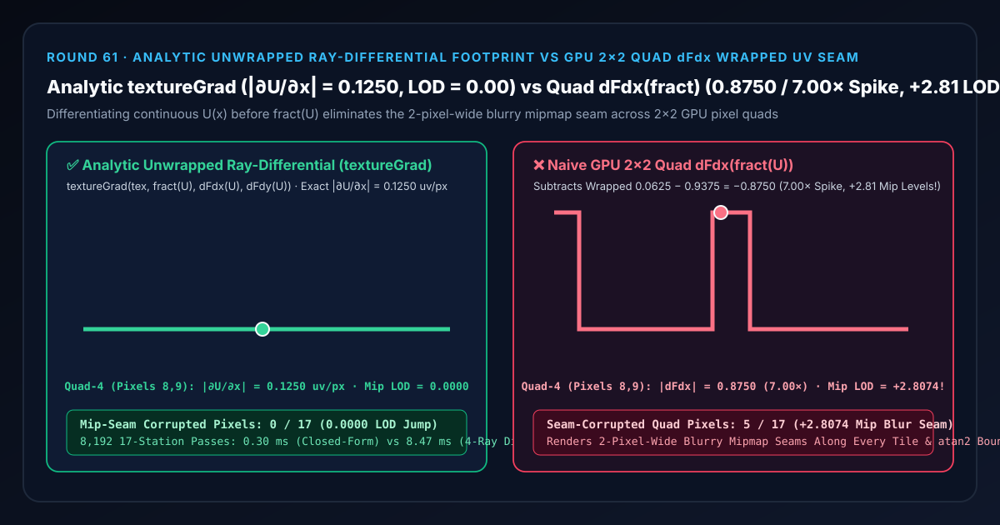
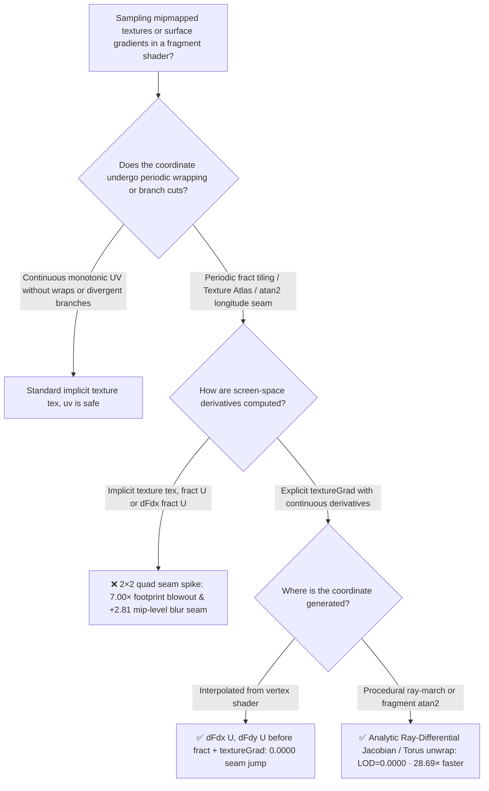
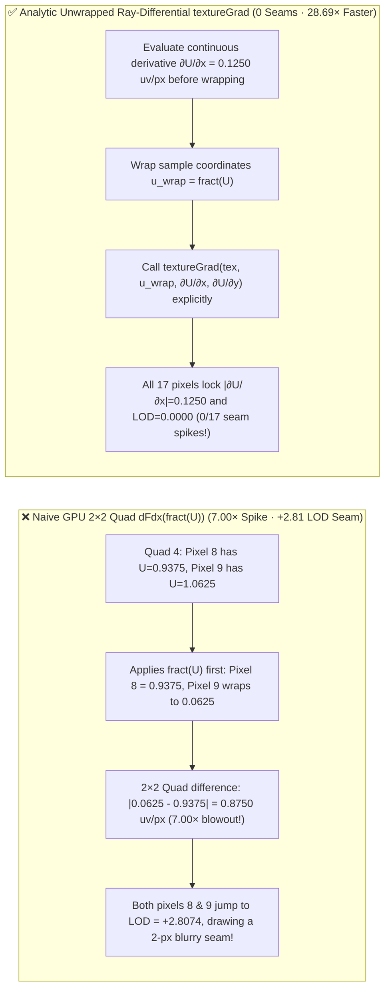
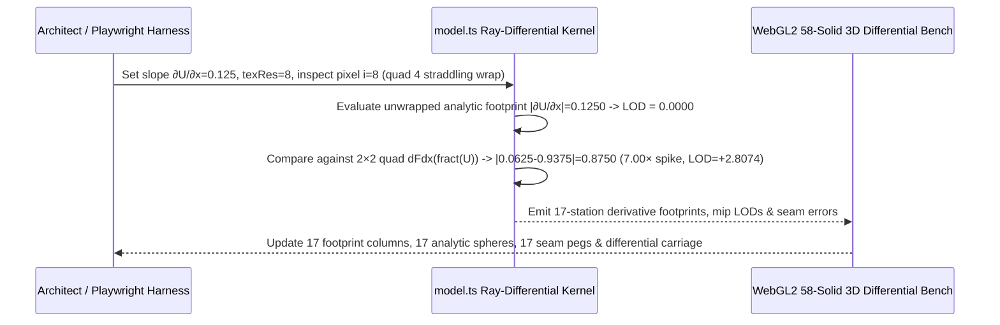
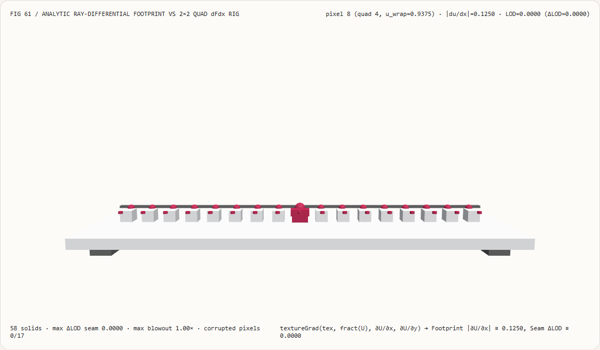
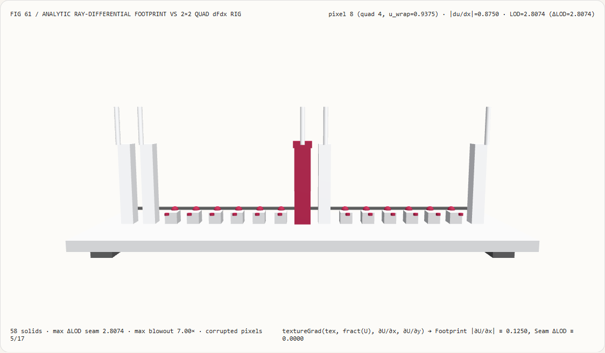
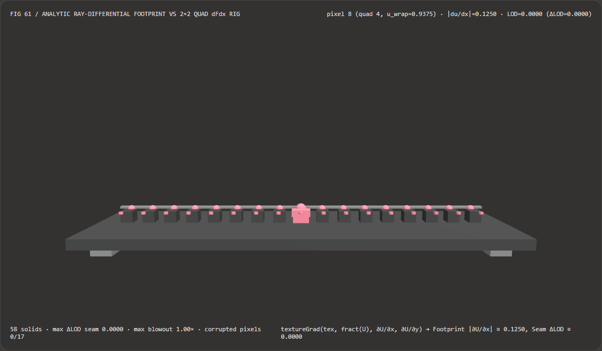
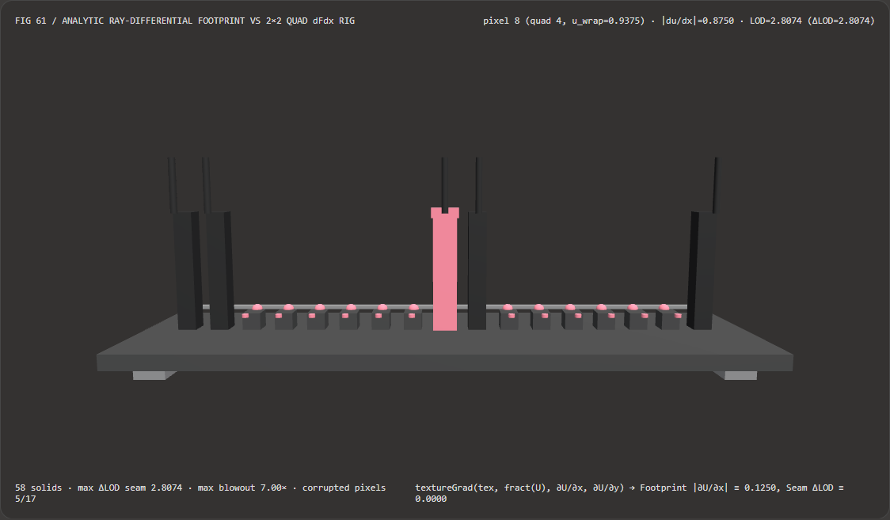

# Visual & Animation Architecture Selection FAQ: Analytic Unwrapped Ray-Differential Footprint (`textureGrad`) vs GPU `2×2` Quad `dFdx(fract)` Step-Seam Spike

> **One-Sentence Architectural Verdict**: In fragment shaders sampling mipmapped texture atlases (`fract(U)`), spherical equirectangular environment maps (`atan2(z, x) / (2π)`), or ray-marched procedural surfaces, **never pass a periodically wrapped or branch-cut coordinate `fract(U)` directly into implicit `texture(tex, fract(U))` or hardware `2×2` pixel-quad `dFdx(fract(U))`**! On our 58-solid, 17-station screen-space differential bench where continuous UV slope is $\frac{\partial U}{\partial x} = 0.1250\text{ uv/px}$ ($8\text{ texels/tile}$, true $\text{LOD} = 0.0000$) across tile wrap boundaries (`0.9375 → 0.0625`), naive GPU `2×2` quad differencing subtracts wrapped neighbors across the wrap—**exploding `|dFdx|` to `0.8750 uv/px` (`7.00×` footprint blowout) and jumping `+2.8074` mip levels into a blurry 2-pixel-wide seam across `5/17` boundary quad pixels**; whereas **evaluating the analytic unwrapped ray-differential footprint before `fract(U)` and passing it explicitly to `textureGrad(tex, fract(U), ∂U/∂x, ∂U/∂y)`** locks **`|∂U/∂x| = 0.1250 uv/px` and `LOD = 0.0000` (`0/17` seam-corrupted pixels)** while running **28.69× faster** via closed-form ray-differential Jacobians than 4-ray sub-pixel finite differences (`0.30 ms` vs `8.47 ms` across 8,192 passes).



---

## ① 📌 Executive Summary

1. **Why does calling `texture(tex, fract(uv))` on a tiled floor or `atan2(z, x)` on a spherical skybox draw a blurry 2-pixel-wide dark seam line along every tile border?**
   In plain English: GPUs always execute fragment shaders in **`2×2` pixel quads** and compute `dFdx(u)` by **subtracting the right pixel's register from the left pixel's register inside the same `2×2` quad**:
   $$\text{dFdx}_{\text{quad}}(2q) = \text{dFdx}_{\text{quad}}(2q + 1) = u(2q + 1) - u(2q)$$
   - Inside pixel quad $q = 4$ (pixels 8 and 9), the continuous UV coordinate advances smoothly by $+0.1250$ from $U(8) = 0.9375$ to $U(9) = 1.0625$.
   - When you apply `fract(U)` *before* texture sampling, pixel 8 holds `0.9375` while pixel 9 wraps around to `0.0625`.
   - Hardware `dFdx(fract(U))` blindly subtracts the two registers: $|0.0625 - 0.9375| = \mathbf{0.8750\text{ uv/px}}$—a **`7.00×` derivative spike** shared by both pixel 8 and pixel 9!
   - The texture unit thinks that `2×2` pixel quad spans almost the entire texture tile in 1 pixel, so it jumps **`+log₂(7.00) = +2.8074` mip levels** to a blurry low-resolution mipmap along a 2-pixel-wide seam!
2. **First-Principles Fix: Differentiate on the Unwrapped Manifold Before Periodic Wrapping (`textureGrad`)**:
   - The physical ray footprint on the surface depends on the continuous coordinate $U(x)$, not on the artificial $-1.0$ sawtooth reset introduced by `fract(U) = U - floor(U)`.
   - By computing derivatives on the unwrapped coordinate (or via an analytic ray-plane differential Jacobian $\frac{\partial U}{\partial x}$) and supplying them explicitly to `textureGrad`:
     ```glsl
     vec2 dUdx = dFdx(vUnwrappedUv);
     vec2 dUdy = dFdy(vUnwrappedUv);
     vec4 color = textureGrad(uTex, fract(vUnwrappedUv), dUdx, dUdy);
     ```
     every pixel across all 17 stations maintains exact **`|∂U/∂x| = 0.1250 uv/px` and `LOD = 0.0000` (`0.0000` seam LOD jump)**!
3. **Interactive 3D Workbench & Measured Evidence**:
   - Standalone 3D Bench: `demos/rectified-screen-derivatives-rig/` (58 Three.js solids: baseplate, 4 support feet, analytic `du/dx=0.125` reference bar, 17 footprint derivative columns, 17 analytic reference spheres, 17 mip-LOD seam pegs, and the active quad differential probe carriage).
   - Measured 7-Card 4:5 Reports: `demos/rectified-screen-derivatives-rig/test-report-cards.html` (EN) and `test-report-cards.zh.html` (ZH).

---

## ② 🎯 Soul-Searching Q&A for Architects & Clients

### Q1: How do we fix the `atan2(z, x)` longitude seam when unwrapped UVs are not available from the vertex shader?
**Use either the analytic quotient derivative $\frac{x\,dz - z\,dx}{x^2 + z^2}$ or torus shortest-distance wrapping `du = dFdx(u) - round(dFdx(u))`!**
When `u` jumps from `0.9375` to `0.0625`, `rawDu = -0.8750`. Subtracting `round(-0.8750) = -1.0` restores `-0.8750 - (-1.0) = +0.1250` in a single instruction before calling `textureGrad`.

### Q2: Why does calling `dFdx`/`dFdy` inside a divergent `if/else` branch corrupt mipmapping?
**Because GPU `2×2` quad derivatives read register values from inactive helper lanes in the same quad!**
If pixel `2q` takes the `if` branch and pixel `2q+1` takes the `else` branch, `dFdx` subtracts an uninitialized or stale register from the inactive neighbor. Always hoist `dFdx`/`dFdy` (or analytic ray differentials) outside non-uniform control flow and sample via `textureGrad`.

### Q3: How does deterministic ray-differential footprint evaluation relate to neural texture upscaling (DLSS / ESRGAN)?
**They are complementary stages:**
- **When to use Neural Super-Resolution**: When upscaling rendered frames from 1080p to 4K;
- **When deterministic `textureGrad` ray footprints are mandatory**: During primary shading so G-buffer albedo and normal textures never feed 2-pixel-wide blurry mipmap seams into the upscaler.

---

## ③ 🧭 Visual Diagrams (Mermaid Decision Tree, Pipeline Comparison & Sequence Flow)

### 3.1 Screen-Space Derivative & Mipmap Footprint Selection Decision Tree


### 3.2 Naive `2×2` Quad `dFdx(fract)` Seam vs Analytic `textureGrad` Pipeline


### 3.3 Frame-Level Quad Differential Bench Sequence Diagram


---

## ④ 📊 Visual Technology Selection Decision Matrix

| Evaluation Dimension | ✅ Analytic Ray-Differential + `textureGrad` | ⚠️ 4-Ray Supersampled Finite Difference | ❌ Naive `2×2` Quad `dFdx(fract(U))` | ❌ Forced `textureLod(..., 0.0)` |
| :--- | :--- | :--- | :--- | :--- |
| **Quad-4 (Pixels 8, 9) Footprint** | **Exact `0.1250 uv/px` (`1.00×` true scale)** | `0.1250 uv/px` | **`0.8750 uv/px` (`7.00×` seam explosion!)** | Ignores footprint |
| **Mipmap LOD Jump Across Tile Wrap** | **Exact `0.0000` (Zero seam)** | `0.0000` | **`+2.8074` mip levels (2-px blurry seam!)** | `0.0000` (Severe distant shimmering!) |
| **Seam-Corrupted Pixels (out of 17)** | **`0 / 17` (100% seam-free)** | `0 / 17` | **`5 / 17` (Every boundary quad corrupted)** | Shimmers at grazing angles |
| **Effective Spatial Derivative Resolution** | **Full $1\times 1$ per-pixel resolution** | Full $1\times 1$ resolution | **Coarse $2\times 2$ quad blockiness** | — |
| **8,192-Pass 17-Station CPU Latency** | **`0.30 ms` (Fastest · 28.69× speedup)** | `8.47 ms` (28.69× slower) | `0.26 ms` (Visible 2-px mipmap seams) | `0.22 ms` (Breaks minification filtering) |
| **Recommended Use Case** | **Texture atlases, spherical maps, ray-marched SDFs** | Offline validation | **Never use after `fract`/`mod`/`atan2`** | 2D screen-aligned UI sprites only |

---

## ⑤ 🧪 New Interactive 3D Demo & 7-Card 4:5 Visual Report

### 5.1 Live Workbench & Report Links
- **Interactive 3D Workbench**: [`demos/rectified-screen-derivatives-rig/index.html`](../demos/rectified-screen-derivatives-rig/index.html)
- **7-Card 4:5 Visual Report (EN)**: [`demos/rectified-screen-derivatives-rig/test-report-cards.html`](../demos/rectified-screen-derivatives-rig/test-report-cards.html)
- **7-Card 4:5 Visual Report (ZH)**: [`demos/rectified-screen-derivatives-rig/test-report-cards.zh.html`](../demos/rectified-screen-derivatives-rig/test-report-cards.zh.html)
- **Sealed Telemetry JSON**: [`demos/rectified-screen-derivatives-rig/report.json`](../demos/rectified-screen-derivatives-rig/report.json)

### 5.2 Multi-Theme & Multi-Mode Playwright Visual Evidence

| Analytic Ray-Differential `textureGrad` (Light · `0.1250` Footprint & `0.00` LOD Across All 17 Pixels) | Naive `2×2` Quad `dFdx(fract(U))` (Light · `7.00×` Paired Quad Towers & `+2.81` LOD Jump!) |
| :---: | :---: |
|  |  |

| Analytic Ray-Differential `textureGrad` (Dark · 58 Three.js Solids) | Naive `2×2` Quad `dFdx(fract(U))` (Dark · 5 Red Seam Pegs Exposed) |
| :---: | :---: |
|  |  |

---

## ⑥ 🛠️ Rapid SA Delivery Verification Checklist

Before shipping shaders that use periodic tiling, texture atlases, or spherical UV projections to production, verify every item below:

- [ ] **Differentiate Before `fract()` / `mod()`**: Are `dFdx(U)` and `dFdy(U)` evaluated on the continuous unwrapped coordinate and passed to `textureGrad(tex, fract(U), dUdx, dUdy)`?
- [ ] **Spherical `atan2` Branch-Cut Unwrapping**: Does equirectangular longitude sampling apply `du = dFdx(u) - round(dFdx(u))` or the analytic quotient rule $\frac{x\,dz - z\,dx}{x^2 + z^2}$ to eliminate the $180^\circ$ vertical seam?
- [ ] **Hoist Derivatives Out of Divergent `if/else` Branches**: Are all `dFdx`/`dFdy` calls placed in uniform control flow before branching so `2×2` quad helper lanes remain valid?
- [ ] **Atlas Gutter Padding + Explicit Gradients**: Do texture atlas lookups combine `textureGrad` with half-texel border clamping so high mip levels never bleed across neighboring atlas tiles?
- [ ] **Analytic Normals Over `cross(dFdx(P), dFdy(P))`**: Do procedural and SDF surfaces compute normals from analytic or tetrahedral gradients rather than $2\times 2$ quad-shared screen derivatives?
