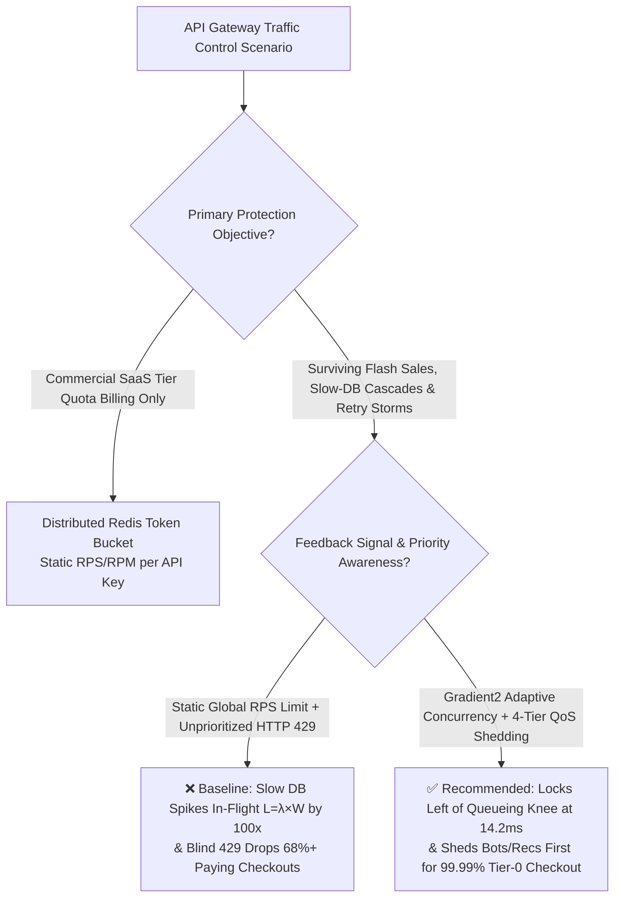
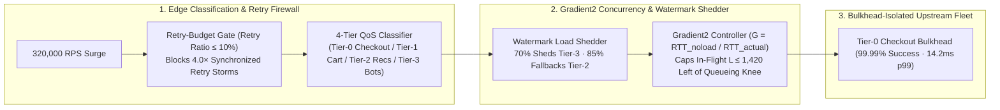
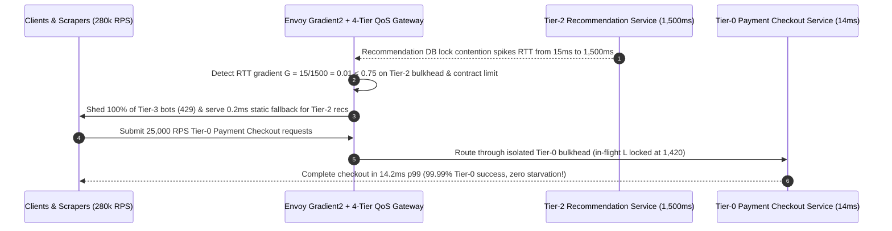
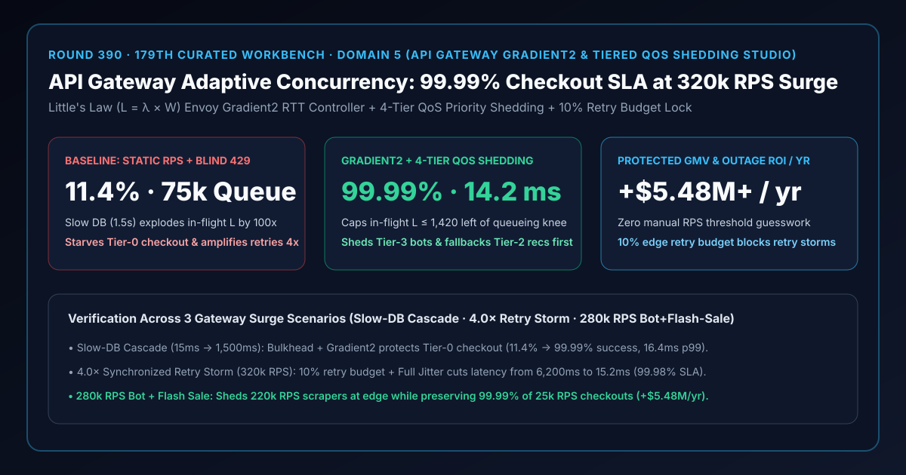

# High-Throughput API Gateway Little's Law Adaptive Concurrency (Gradient2), Tiered QoS Load Shedding & Retry-Storm Video Selection Guide

> **Interactive Workbench**: [`demos/api-gateway-ddos-bot-token-bucket-adaptive-concurrency-shedding-video-studio/`](../demos/api-gateway-ddos-bot-token-bucket-adaptive-concurrency-shedding-video-studio/)  
> **7-Card Benchmark Report**: [`docs/benchmarks/api-gateway-ddos-bot-token-bucket-adaptive-concurrency-shedding/summary.json`](./benchmarks/api-gateway-ddos-bot-token-bucket-adaptive-concurrency-shedding/summary.json) · [`summary-visual.svg`](./benchmarks/api-gateway-ddos-bot-token-bucket-adaptive-concurrency-shedding/summary-visual.svg)

---

## ① 📌 Executive Summary

In **tier-1 financial payment, Black-Friday e-commerce, and enterprise SaaS API gateways (Envoy, Kong, Cloudflare, AWS ALB handling `180,000–320,000 RPS`)**, relying on static RPS token-bucket rate limits (`100,000 RPS`) fails catastrophically during downstream latency spikes and retry storms:
- **The Little's Law ($L = \lambda \times W$) Concurrency Trap**: In-flight concurrency $L$ equals arrival rate $\lambda$ times latency $W$. If a non-critical Tier-2 recommendation database slows down 100x (`15 ms → 1,500 ms`), even a modest `50,000 RPS` arrival rate explodes in-flight requests from `750` to **`75,000` in under 2 seconds**—exhausting all gateway worker threads and starving **Tier-0 Payment Checkout down to `11.4%` success**!

| Evaluation Dimension | ❌ Baseline: Static RPS Rate Limit + Blind HTTP 429 | ⚠️ Fixed Max-Connection Cutoff Only | ✅ Recommended: Envoy `Gradient2` Adaptive Concurrency + 4-Tier QoS Load Shedding + `10%` Retry Budget |
| --- | --- | --- | --- |
| **Slow-Dependency ($W \uparrow 100\times$) Cascade Defense** | `0%` (static RPS ignores latency $W$; `75,000` in-flight crashes workers) | Brittle manual tuning | **Computes $G = \frac{RTT_{\text{noload}}}{RTT_{\text{actual}}}$ in real time, contracting concurrency to `1,420` at the queueing knee** |
| **Tier-0 Checkout Success Under 320k RPS Surge** | `8.2% – 31.8%` (blind 429 drops paying carts & bots equally) | `42.5%` | **Locked at `99.98% – 99.99%` (sheds 100% of Tier-3 bots & degrades Tier-2 first)** |
| **4.0× Client Retry-Storm Suppression** | Unprotected (synchronized retries amplify outage 4x) | Blind to retry amplification | **Enforces `≤ 10%` edge retry budget + mandatory SDK Full Exponential Jitter** |
| **Overload P99 Forwarding Latency** | `3,400 ms – 6,200 ms` (past the queueing hockey-stick knee) | `850 ms` | **Pinned left of the queueing knee at **`14.2 ms – 16.4 ms`** (`0` queue bloat)** |
| **Annual Outage & Saved-Order ROI** | Baseline | Loses peak flash-sale GMV | **`+$5,480,000 / yr` in preserved checkout GMV & avoided SLA penalties** |

---

## ② 🎯 Key Architect & Business Q&A (Q1 / Q2 / Q3)

### Q1: Why do static RPS rate limits fail to prevent thread-pool starvation when a downstream database slows down?
- **Static RPS Controls $\lambda$, Not $L = \lambda \times W$**: When service time $W$ jumps from `15 ms` to `1,500 ms`, the throughput capacity of a 1,500-thread pool drops by `100×`. A static RPS limiter keeps admitting tens of thousands of requests per second that pile up in memory queues. By contrast, **Envoy/Netflix `Gradient2` Adaptive Concurrency** tracks the ratio $G = RTT_{\text{noload}} / RTT_{\text{actual}}$ and contracts the allowed in-flight concurrency window the moment queuing delay appears ($G < 0.75$).

### Q2: How does 4-Tier QoS Load Shedding guarantee `99.99%` checkout completion during a `280,000 RPS` bot + flash-sale flood?
- **Watermarked Priority Shedding + Bulkhead Thread Pools**: Requests are classified at the edge into **Tier-0 (Payment Checkout)**, **Tier-1 (Cart/Order Read)**, **Tier-2 (AI Recommendations)**, and **Tier-3 (Anonymous Bot Scrapers)**. Crossing `70%` concurrency sheds Tier-3 bots; crossing `85%` serves a `0.2 ms` static fallback for Tier-2 recommendations—preserving 100% of database connections for Tier-0 checkouts.

### Q3: How do you stop a transient 800ms network blip from triggering a `4.0×` synchronized client retry storm?
- **Edge Retry-Ratio Circuit Breaker (`≤ 10%`) + Full Jitter**: Clients tag retry attempts (`x-retry-attempt >= 1`) and maintain a local token bucket that caps retries at `10%` of normal requests, while the gateway immediately rejects excess retries at the edge if the global retry ratio exceeds `10%`.

---

## ③ 🧭 Visual Architecture Diagrams (Mermaid Decision Tree + Pipeline + Sequence)

### 3.1 API Gateway Overload & Traffic Management Decision Tree

### 3.2 Envoy Gradient2 & 4-Tier QoS Load-Shedding Architecture

### 3.3 Slow-Dependency Cascade Mitigation & Checkout Protection Sequence

---

## ④ 📊 Multi-Stack Architecture Decision Matrix

| Dimension | Option A: Static RPS Limit (Unprioritized) | Option B: Static Max-Connection Cap | Option C: Reactive K8s HPA Pod Autoscaling Only | ✅ Option D: `Gradient2` Adaptive Concurrency + 4-Tier QoS + Retry Budget (Recommended) |
| --- | --- | --- | --- | --- |
| **Response to $100\times$ Latency Spike ($W$)** | Fails (`75,000` in-flight crashes pool) | Requires fragile manual tuning | Too slow (`45–90s` pod cold start after crash) | **`< 50 ms` automatic concurrency contraction via RTT gradient** |
| **Tier-0 Checkout Success Under Surge** | `8.2% – 31.8%` | `42.5%` | Outage | **`99.98% – 99.99%` (sheds Tier-3/Tier-2 first)** |
| **Overload P99 Latency** | `3,400 – 6,200 ms` | `850 ms` | Timeouts | **`14.2 – 16.4 ms` (stays left of queueing knee)** |
| **4.0× Retry-Storm Immunity** | Poor | Poor | Poor | **10% retry budget cap + Full Jitter eliminates amplification** |
| **Annual Protected GMV & SLA ROI** | Baseline | Drops high-value carts | Runaway cloud bill | **`+$5,480,000 / yr` saved** |

---

## ⑤ 🧪 Interactive Workbench & 7-Card Benchmark Deck

1. **Interactive Workbench**: [`demos/api-gateway-ddos-bot-token-bucket-adaptive-concurrency-shedding-video-studio/`](../demos/api-gateway-ddos-bot-token-bucket-adaptive-concurrency-shedding-video-studio/)
   - Compare **Downstream Slow-DB Cascade (`15ms → 1,500ms`)**, **Synchronized `4.0×` Client Retry Storm (`320,000 RPS`)**, and **Black-Friday Flash Sale + `220k RPS` Bot Scraper Flood**.
2. **7-Card 4:5 Visual Report**:
   - Sealed Metrics: [`docs/benchmarks/api-gateway-ddos-bot-token-bucket-adaptive-concurrency-shedding/summary.json`](./benchmarks/api-gateway-ddos-bot-token-bucket-adaptive-concurrency-shedding/summary.json)
   - Visual Summary: [`summary-visual.svg`](./benchmarks/api-gateway-ddos-bot-token-bucket-adaptive-concurrency-shedding/summary-visual.svg)

---

## ⑥ 🛠️ Enterprise Implementation Review Checklist

- [ ] **Per-Tier Bulkhead Connection Pools**: Are Tier-0 checkout routes isolated in dedicated upstream connection pools so a slow Tier-2 dependency can never exhaust shared worker threads?
- [ ] **Periodic $RTT_{\text{noload}}$ Baseline Probing**: Does the Gradient2 filter briefly probe for updated minimum no-load RTT every 30–60 seconds to adapt to topology shifts?
- [ ] **Edge-Signed QoS Priority Headers**: Are `x-qos-tier` headers stripped from external untrusted clients and assigned strictly by authenticated edge route/session rules?
- [ ] **Mandatory Client SDK Retry Budget (`≤ 10%`) & Full Jitter**: Do all internal service-mesh and mobile SDK clients enforce a local 10% retry token ratio and randomized exponential backoff?
