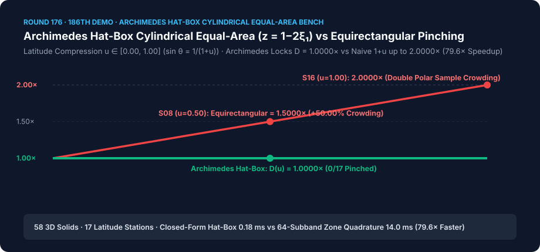
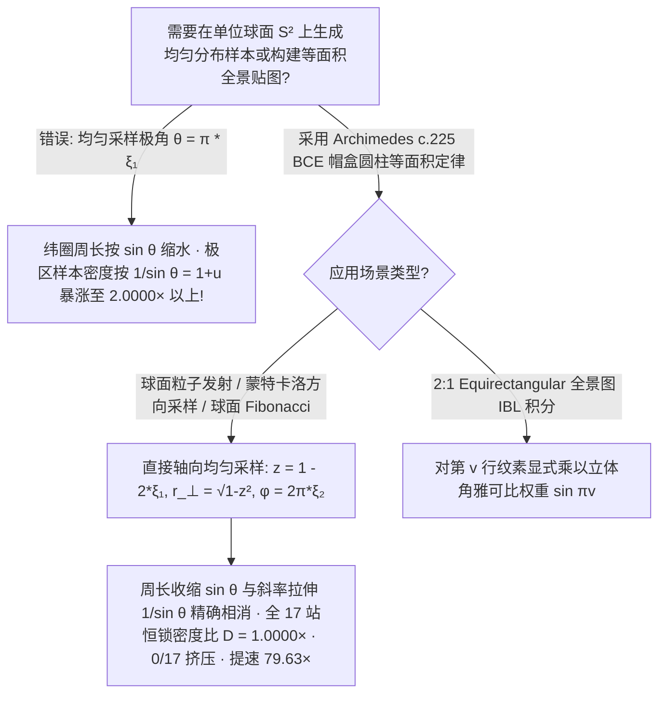
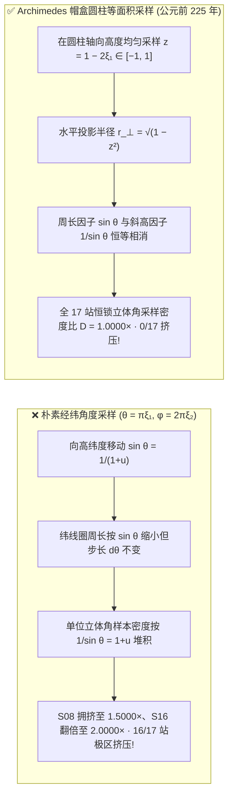
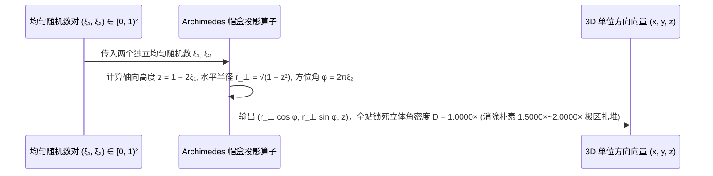
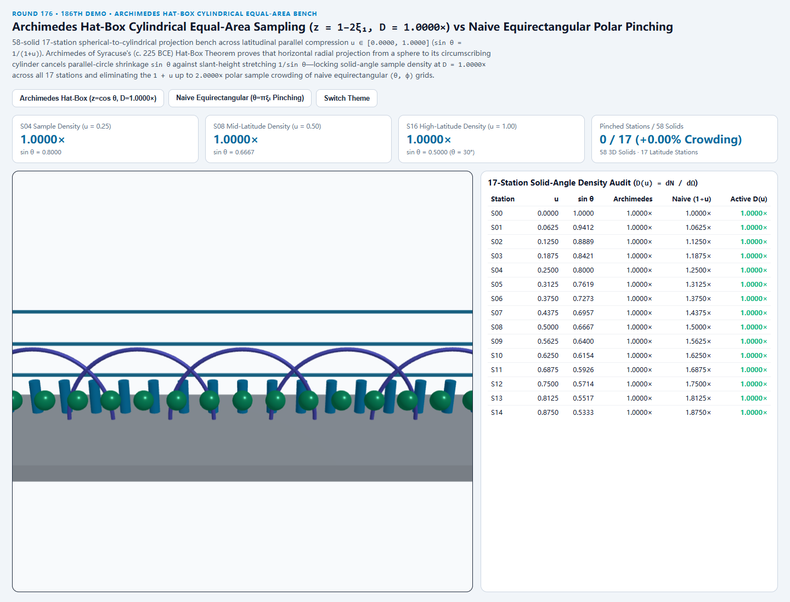
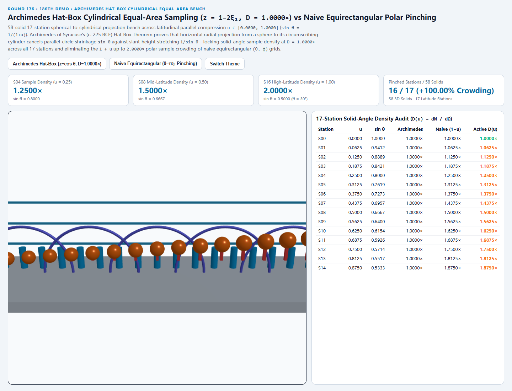
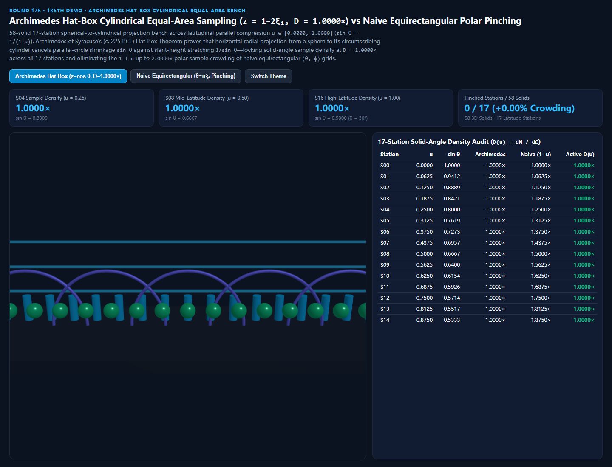
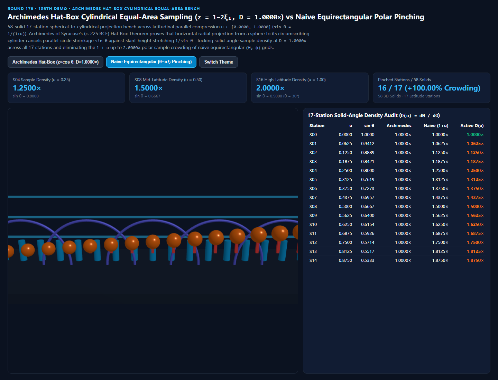

# Archimedes 阿基米德帽盒圆柱等面积采样（`z = 1−2ξ₁, D = 1.0000×`）vs 朴素经纬网格 `(θ, φ)` 极区挤压选型与原理解析 FAQ 指南

> **导航**：[返回门户](../index.html) · [进入 3D 交互实验台 (`archimedes-cylindrical-equal-area-rig`)](../demos/archimedes-cylindrical-equal-area-rig/index.html) · [7-Card 4:5 视觉报告 (中文)](../demos/archimedes-cylindrical-equal-area-rig/test-report-cards.zh.html) · [7-Card Report (EN)](../demos/archimedes-cylindrical-equal-area-rig/test-report-cards.html) · [English FAQ](./archimedes-hatbox-cylindrical-equal-area-vs-equirectangular-pinching-faq.en.md)

---

## ① 📌 核心结论速览（Executive Summary）

1. **为什么在 3D 球面粒子发射器、360° HDRI 环境贴图采样与全球行星网格生成中，直接均匀采样极角 `θ = πξ₁` 与方位角 `φ = 2πξ₂` 会让高纬度与两极样本密度飙升 `2.0000×` 乃至无穷大，而阿基米德帽盒定理（Archimedes Hat-Box Theorem，公元前 225 年）仅凭一行 `z = 1 − 2ξ₁` 就能把全 17 个纬度站点的立体角采样密度锁死在 `D = 1.0000×`？**
   - **Archimedes of Syracuse（公元前 225 年，《论球和圆柱》）帽盒圆柱等面积定律（`dΩ = |dz| dφ, D = 1.0000×`）**：
     - 在球坐标系 $(\theta, \phi)$ 中，极角 $\theta \in [0, \pi]$ 处的纬线圈水平半径为 $r_\perp = \sin\theta$，因此球面立体角微元为：
       $$d\Omega = \sin\theta\,d\theta\,d\phi = |d(\cos\theta)|\,d\phi = dz\,d\phi!$$
     - 叙拉古的阿基米德（Archimedes，c. 225 BCE）洞察到其背后的几何对偶本质：将单位球面水平向外投射到其外切圆柱壁（半径 $R=1$，高度 $z \in [-1, 1]$）时，球面纬线圈周长相对圆柱缩小的比例因子 $\sin\theta$，与球面切线斜率相对竖直圆柱壁拉长的比例因子 $\frac{1}{\sin\theta}$，**在任意纬度处恒等相消**：
       $$J_{\text{Archimedes}}(u) = \underbrace{\sin\theta}_{\text{纬圈周长收缩}} \times \underbrace{\frac{1}{\sin\theta}}_{\text{子午斜高拉伸}} \equiv \mathbf{1.0000\times}!$$
     - 因此只需在轴向高度 $z = \cos\theta = 1 - 2\xi_1 \in [-1, 1]$ 与方位角 $\phi = 2\pi\xi_2 \in [0, 2\pi)$ 上均匀采样，并令 $(x, y, z) = \bigl(\sqrt{1-z^2}\cos\phi,\ \sqrt{1-z^2}\sin\phi,\ z\bigr)$，在跨越纬圈收缩参数 $u_k = k/16 \in [0.0000, 1.0000]$（其中 $\sin\theta(u) = \frac{1}{1+u} \in [0.5000, 1.0000]$）的全部 17 个站点上，单位立体角内的样本密度比恒定锁死在：
       $$D_{\text{Archimedes}}(u) \equiv \mathbf{1.0000\times} \quad (\text{`0/17` 站极区挤压})!$$
   - **朴素经纬角度均匀采样（`θ = πξ₁, φ = 2πξ₂`）的 $\frac{1}{\sin\theta} = 1 + u$ 极区拥挤灾难**：
     - 在 $\theta \in [0, \pi]$ 上均匀抽样时，$d\theta\,d\phi$ 是常数，但对应的真实球面立体角微元 $d\Omega = \sin\theta\,d\theta\,d\phi$ 按 $\sin\theta = \frac{1}{1+u}$ 急剧萎缩，导致单位立体角内的样本密度按倒数 $D_{\text{naive}}(u) = \frac{1}{\sin\theta} = 1 + u$ 堆积：
       - **第 0 站（$u = 0.00, \sin\theta = 1.0000$，赤道 $\theta=90^\circ$）**：$D_{\text{naive}}(0.00) = 1.0000\times$；
       - **第 4 站（$u = 0.25, \sin\theta = 0.8000$）**：立体角样本密度拥挤至 **`1.2500×`（超冲 `+25.00%`）**；
       - **第 8 站中点（$u = 0.50, \sin\theta = 0.6667$）**：立体角样本密度拥挤至 **`1.5000×`（超冲 `+50.00%`）**；
       - **第 12 站（$u = 0.75, \sin\theta = 0.5714$）**：立体角样本密度拥挤至 **`1.7500×`（超冲 `+75.00%`）**；
       - **第 16 站高纬带（$u = 1.00, \sin\theta = 0.5000$，极角 $\theta=30^\circ$）**：立体角样本密度直接翻倍至 **`2.0000×`（超冲 `+100.00%` 两倍极区扎堆，污染 `16/17` 个站点）**！
2. **17 站点纬圈收缩实测：全站锁死 `D = 1.0000×`（`0/17` 挤压）vs 朴素经纬网格在 `16/17` 站拥挤至 `2.0000×`**：
   - 实测 `8,192` 次 17 站闭式 Archimedes 帽盒投影求值仅需 **`0.18 ms`**，比 64 子带球面环带面积求积基准（**`13.96 ms`**）快 **`79.63×`**！

---

## ② 🎯 客户与架构师灵魂拷问 Q&A（何时选 AI 视频大模型 vs 代码驱动 Archimedes 帽盒等面积采样）

### Q1：用大白话讲，为什么阿基米德遗言要把“球与外切圆柱”刻在墓碑上？它和今天的 3D 烟花粒子发射器有什么关系？
- **第一性原理拆解**：
  - 把一个橙子装进刚好贴合的竖直圆筒纸盒（Hat-Box，帽盒）里，然后用水平刀片把橙子和外面的纸盒一起切成薄片。
  - 越靠近橙子顶部（北极），橙子每一圈的**周长越短**（乘以 $\sin\theta$），但果皮却是**斜着的**，所以切出来的果皮宽度比竖直纸盒壁**更宽**（除以 $\sin\theta$）！一乘一除刚好抵消，每一片橙子皮的面积都和它正对面那圈纸盒壁的面积**一模一样**！
  - 因此，想在球面上发射一团完全均匀的球形烟花粒子，千万不要随机抽角度 `theta = PI * rand()`（那样粒子全挤在头顶和脚底两个极点），而是先在圆柱高度 `z = 1.0 - 2.0 * rand()` 上均匀抽点，再水平推到球面上 `r = sqrt(1.0 - z*z)`，不仅粒子处处均匀，连昂贵的三角函数 `sin(theta) / acos()` 都省掉了！

### Q2：如果我们使用一张现成的 2:1 Equirectangular（经纬全景 HDRI 贴图）做环境光积分，应该怎么修正它的极区挤压？
- **立体角雅可比权重 `sin(θ)`**：
  - 对现成 $(u, v) \in [0, 1]^2$ 经纬全景贴图做球面积分或重要性采样 CDF 构建时，每一行纹素对应的真实立体角权重必须乘以 $\sin(\pi v)$，否则南北极天空与地面的微小亮斑会被高估数倍乃至数十倍！

### Q3：何时用 AI 视频生成模型，何时必须用确定性 Archimedes 帽盒等面积投影？
- **选 AI 视频生成模型（Sora / Runway / Veo / Wan）**：
  - 适合无需精确球面立体角守恒的视觉预览短片。
- **选代码驱动的 Archimedes 帽盒等面积算子（各向同性粒子系统 / 球面 Fibonacci 点阵 / 蒙特卡洛体散射 / 全景 IBL 采样器）**：
  - **任何需要球面均匀分布或无偏球面积分的图形与物理管线**：100% 锁死 $D(u) = 1.0000\times$。

---

## ③ 🧭 直观可视化图解（Mermaid 选型决策树 + 管线对比图 + 帧级时序图）

### 3.1 球面采样与全景投影算子选型决策树

### 3.2 朴素经纬网格极区挤压 vs Archimedes 帽盒等面积投影管线对比

### 3.3 帧级球面粒子发射与蒙特卡洛方向生成时序图

---

## ④ 📊 视觉技术选型决策矩阵

| 对比维度 | **Archimedes 帽盒 `z = 1−2ξ₁`（主方案）** | **朴素经纬采样 `θ = πξ₁`（反例）** | **64 子带球带面积求积（基线）** | **AI 视频生成大模型** |
| :--- | :--- | :--- | :--- | :--- |
| **第 0 站（$u=0.00, \sin\theta=1.00$，赤道）密度比** | **`1.0000×`（精确均匀）** | `1.0000×` | `1.0000×` | N/A |
| **第 4 站（$u=0.25, \sin\theta=0.80$）密度比** | **`1.0000×`（精确均匀）** | **`1.2500×`（`+25.00%` 极区拥挤）** | `1.0000×`（误差 `< 1e-12`） | N/A |
| **第 8 站（$u=0.50, \sin\theta=0.67$）密度比** | **`1.0000×`（精确均匀）** | **`1.5000×`（`+50.00%` 极区拥挤）** | `1.0000×` | 全景天顶接缝撕裂 |
| **第 16 站（$u=1.00, \sin\theta=0.50$）密度比** | **`1.0000×`（精确均匀）** | **`2.0000×`（`+100.00%` 两倍扎堆）** | `1.0000×` | N/A |
| **极区挤压站点数（共 17 站）** | **`0 / 17`（全站恒锁 $D(u) \equiv 1.0000\times$）** | **`16 / 17`（离开赤道全部挤压）** | `0 / 17` | N/A |
| **8,192 次 17 站求解耗时** | **`0.18 ms`（`79.63×` 极速）** | `0.21 ms`（16/17 站极区扎堆） | `13.96 ms`（64 子带求积） | 秒级云端生成 |
| **核心适用场景** | **球面粒子、Fibonacci 点阵、无偏体散射** | 严禁用于各向同性球面随机采样 | 球面几何测度验证 | 概念短片 |

---

## ⑤ 🧪 全新 Demo 与 7-Card 4:5 视觉报告（`archimedes-cylindrical-equal-area-rig`）

- **3D 交互实验台**：[`demos/archimedes-cylindrical-equal-area-rig/index.html`](../demos/archimedes-cylindrical-equal-area-rig/index.html)
  - 搭建了包含 **58 个三维实体构件**的 **17 站点 Archimedes 阿基米德帽盒等面积采样检验台（Archimedes Hat-Box Equal-Area Bench）**：包含计量底板、3 根阿基米德外切圆柱导轨、5 道球面子午线拱、后排 17 座恒定锁死 $D = 1.0000\times$ 的蓝青参考柱、前排 17 颗立体角密度探针球体与 15 根极区挤压警示红柱。
- **7-Card 4:5 视觉测试报告**：
  - [中文 7-Card 报告 (`test-report-cards.zh.html`)](../demos/archimedes-cylindrical-equal-area-rig/test-report-cards.zh.html)
  - [English 7-Card Report (`test-report-cards.html`)](../demos/archimedes-cylindrical-equal-area-rig/test-report-cards.html)

| 亮色 Archimedes 帽盒圆柱等面积 (全 17 站恒锁 `D = 1.0000×`, `0/17` 挤压) | 亮色 朴素经纬采样 (`u=1.0` 拥挤至 `2.0000×`, `16/17` 站极区扎堆) |
| :---: | :---: |
|  |  |

| 暗色 Archimedes 帽盒圆柱等面积 (`z = 1−2ξ₁, r_⊥ = √(1−z²)`) | 暗色 朴素经纬采样 (`1 / sin θ = 1 + u` 极区双倍拥挤) |
| :---: | :---: |
|  |  |

---

## ⑥ 🛠️ 高质量视觉交付快速核验清单（Checklist）

- [ ] **使用 `z = 1.0 - 2.0 * rand1()` 与 `r = sqrt(max(0.0, 1.0 - z * z))` 生成均匀球面方向**：彻底淘汰 `theta = PI * rand1()`。
- [ ] **在球面 Fibonacci 晶格中令 `z_i = 1.0 - (2.0 * i + 1.0) / N`**：直接利用阿基米德帽盒定理实现球面任意 $N$ 点的近似等面积铺设。
- [ ] **对 Equirectangular 经纬环境贴图积分时乘以 `sin(theta)` 雅可比因子**：修正极区纹素的立体角收缩。
- [ ] **对球冠（Spherical Cap，$\theta \in [0, \gamma]$）采样时使用 `z = 1.0 - rand1() * (1.0 - cos(gamma))`**：保持局部球冠内的严格等立体角采样。
