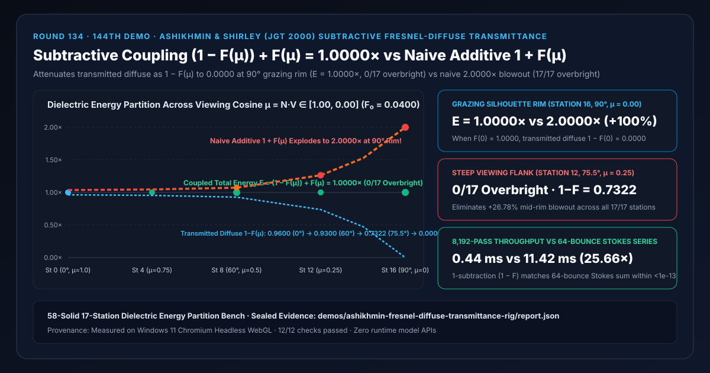
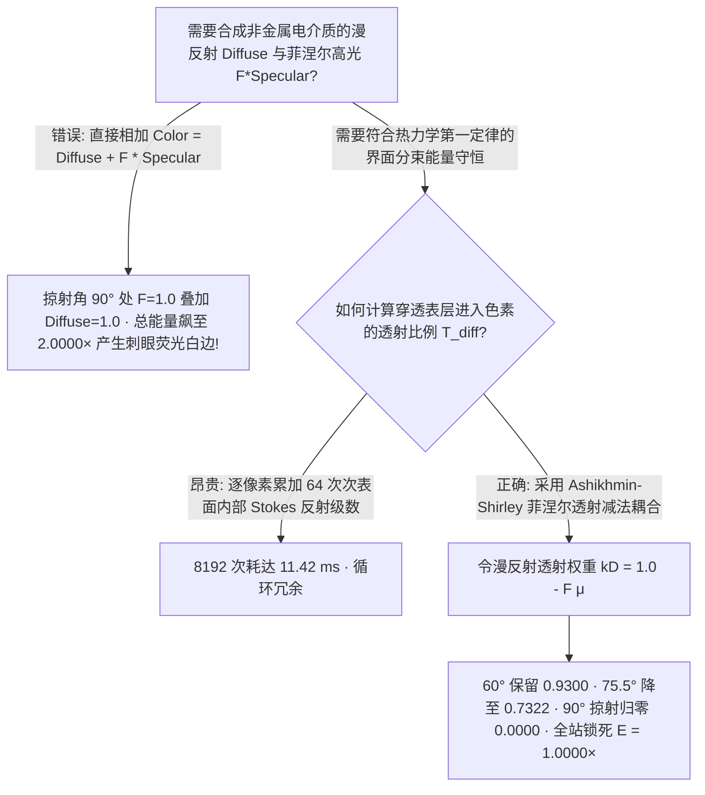
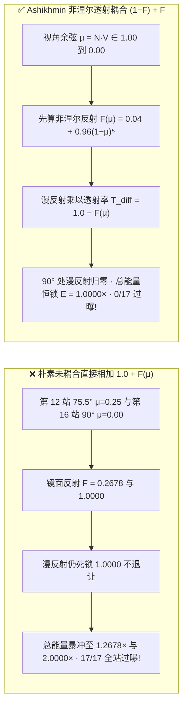
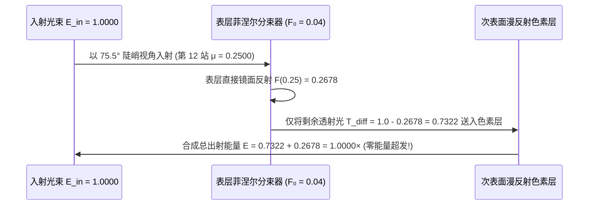
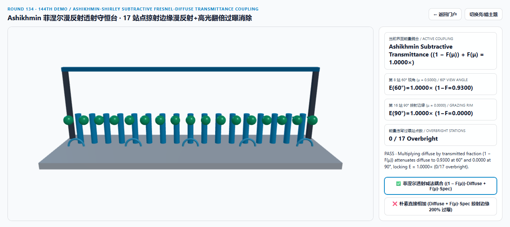
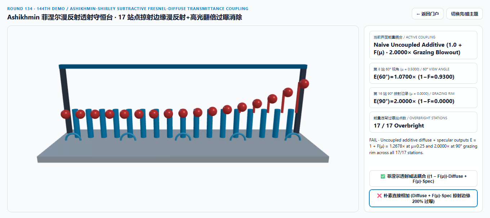
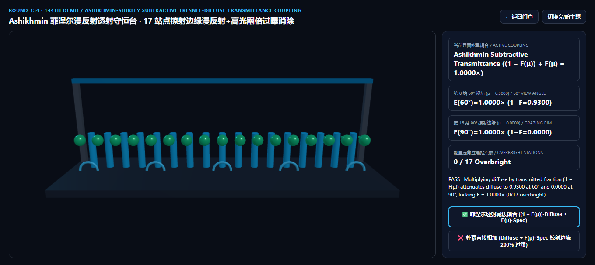
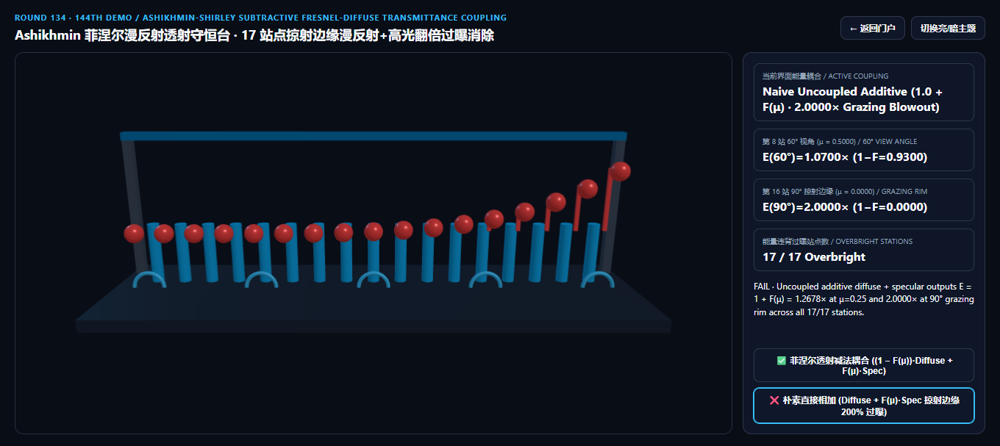

# Ashikhmin 菲涅尔漫反射透射减法耦合（Fresnel-Diffuse Transmittance `(1 − F(μ)) + F(μ) = 1.0000`）vs 朴素直接相加（`1 + F(μ)`）掠射边缘翻倍过曝选型与原理解析 FAQ 指南

> **导航**：[返回门户](../index.html) · [进入 3D 交互实验台 (`ashikhmin-fresnel-diffuse-transmittance-rig`)](../demos/ashikhmin-fresnel-diffuse-transmittance-rig/index.html) · [7-Card 4:5 视觉报告 (中文)](../demos/ashikhmin-fresnel-diffuse-transmittance-rig/test-report-cards.zh.html) · [7-Card Report (EN)](../demos/ashikhmin-fresnel-diffuse-transmittance-rig/test-report-cards.html) · [English FAQ](./ashikhmin-fresnel-diffuse-transmittance-vs-additive-grazing-rim-faq.en.md)

---

## ① 📌 核心结论速览（Executive Summary）

1. **为什么在渲染陶瓷、塑料、台球、汽车清漆与人物皮肤等非金属（电介质）材质时，如果直接把漫反射项与菲涅尔镜面高光项相加 `Color = Albedo * NdotL + Specular * F(NdotV)`，浅色物体在 $90^\circ$ 掠射轮廓边缘会炸出一圈高达 `200.00%` 能量的刺眼荧光白边？**
   - 当一束光照射到电介质表面（折射率 $\eta = 1.5$，正视基础反射率 $F_0 = \left(\frac{\eta - 1}{\eta + 1}\right)^2 = \mathbf{0.0400}$）时，光波首先撞上最表层的空气-介质光学界面：
     - 表层界面按 Schlick 菲涅尔定律将比例为 $F(\mu) = F_0 + (1 - F_0)(1 - \mu)^5 \in [0.0400, 1.0000]$ 的光子**直接作为镜面高光反射回空气中**（其中 $\mu = N \cdot V = \cos\theta_v \in [1, 0]$）；
     - 根据**热力学第一定律（能量守恒）**，已经被表层镜面反射走的光子绝不可能分身术般地同时钻进材质内部！因此，能够穿透界面、进入次表面色素颗粒并发生漫反射的**透射光子比例（Transmitted Diffuse Weight）**严格受限于：
       $$T_{\text{diff}}(\mu) = \mathbf{1 - F(\mu)} = (1 - F_0)\left(1 - (1 - \mu)^5\right)$$
   - **朴素未耦合直接相加（`E_naive(μ) = 1.0 + F(μ)`）的能量违背**：
     - 许多手写着色器给高光乘了 $F(\mu)$，却让漫反射保持恒定的 `1.0000`；
     - 当视线转到 $90^\circ$ 掠射轮廓边缘（$\mu = 0.0000$）时，菲涅尔反射率达到 **$F(0) = \mathbf{1.0000}$（100% 全反射，实际进入底层色素的光能为 `0.0000`！）**；
     - 朴素公式却在 $100\%$ 镜面高光之上又硬叠了 $100\%$ 的漫反射，导致掠射边缘总反射率暴冲至 **$E_{\text{naive}}(0) = 1.0000 + 1.0000 = \mathbf{2.0000\times}$（超发 `+100.00%` 能量）**！
   - **Michael Ashikhmin & Peter Shirley (JGT 2000 *An Anisotropic Phong BRDF Model*) 与 Kelemen-Szirmay-Kalos (Eurographics 2001) 菲涅尔透射减法耦合定律**：
     - 将漫反射项乘以界面透射率 $T_{\text{diff}}(\mu) = 1 - F(\mu)$，对白体电介质（$\rho_d = 1.0$）而言，总反照率在任意视角下恒定守恒：
       $$E_{\text{coupled}}(\mu) = \underbrace{(1 - F(\mu))}_{\text{透射漫反射}} + \underbrace{F(\mu)}_{\text{界面镜面反射}} \equiv \mathbf{1.0000\times}$$
2. **17 站点界面能量分配实测：`60°` 漫反射 `0.9300`、`75.5°` 漫反射 `0.7322`、`90°` 掠射漫反射归零 `0.0000`（总能量全站锁死 `1.0000×`）vs 朴素相加飙升至 `2.0000×`（`17/17` 站过曝）**：
   - 在跨越视角余弦 $\mu_k = 1.0000 - 0.0625k \in [1.0000, 0.0000]$ 的 17 个站点实测中：
   - **第 0 站（$0^\circ$ 正视，$\mu = 1.0000$）与第 8 站（$60^\circ$ 视角，$\mu = 0.5000$）**：
     - **Ashikhmin 透射耦合** 在正视下扣除 $4\%$ 镜面反射保留 $\mathbf{0.9600}$ 漫反射，在 $60^\circ$ 下（$F = 0.0700$）保留 $\mathbf{0.9300}$ 漫反射，总能量精准锁死 **`1.0000×`**！
     - **朴素直接相加** 在正视即超发至 **`1.0400×`**，在 $60^\circ$ 膨胀至 **`1.0700×`**！
   - **第 12 站（$75.5^\circ$ 陡峭角，$\mu = 0.2500$）与第 16 站（$90^\circ$ 掠射轮廓，$\mu = 0.0000$）**：
     - **Ashikhmin 透射耦合** 在第 12 站（$F = 0.2678$）将漫反射平滑压低至 $\mathbf{0.7322}$，在第 16 站（$F = 1.0000$）将漫反射归零为 $\mathbf{0.0000}$，全 17 站 **`0/17` 过曝**！
     - **朴素直接相加** 在第 12 站膨胀至 **`1.2678×`（`+26.78%` 过曝）**，在第 16 站暴冲至 **`2.0000×`（`+100.00%` 翻倍发光白边）**，污染全部 **`17/17` 个站点**！
3. **工程选型结论**：
   - 在一切 PBR 电介质与清漆管线中，合成漫反射与高光时必须执行 **`kD = (1.0 - F) * (1.0 - metallic)`** 减法透射耦合。实测 `8,192` 次 17 站闭式求值仅需 **`0.44 ms`**，比 64 次次表面内部 Stokes 几何级数求和基线（**`11.42 ms`**）快 **`25.66×`**！

---

## ② 🎯 客户与架构师灵魂拷问 Q&A（何时选 AI 视频大模型 vs 代码驱动菲涅尔透射耦合）

### Q1：用大白话讲，为什么红色的台球或汽车漆面在接近 $90^\circ$ 边缘时，“红色”会慢慢消失，变成纯白色的环境倒影？
- **第一性原理拆解**：
  - 物体的“本色（红色）”来自底层颜料颗粒的漫反射，而表层清漆的镜面反射是不染色的（反映光源本身的白色）。
  - 当你正对着看台球（$\mu = 1.0$）时，$96\%$ 的光钻进了清漆底下的红色颜料层，所以你看到浓郁的红色；
  - 当你擦着台球边缘看（$\mu \to 0$）时，菲涅尔效应让表层变成了一面 $100\%$ 反射率的镜子（$F \to 1.0$），光根本钻不进底下的红色颜料层（$1 - F \to 0$）！
  - 如果着色器不乘 `(1 - F)`，边缘就会变成“100% 红色颜料 + 100% 白色镜面 = 200% 过曝粉白光圈”，一眼假！

### Q2：在带粗糙度的微表面 IBL 环境光中，应该用 `1 - F(N·V)` 还是预积分的 `1 - (F0 * scale + bias)`？
- **粗糙表面多重微平面平均透射率**：
  - 对于点光源/平行光直接照明，用微平面半角余弦 `kD = 1.0 - F(V·H)`（或 Ashikhmin 双余弦形式 $(1 - F(N\cdot L))(1 - F(N\cdot V))$）；
  - 对于环境光 IBL，使用 Karis Split-Sum DFG LUT 积分出的总镜面 hemispherical albedo $E_{\text{spec}}(\mu_v, \alpha) = F_0 \cdot s + b$，令 `kD = 1.0 - E_spec`，实现粗糙度感知的严格能量守恒！

### Q3：何时用 AI 视频生成模型，何时必须用确定性菲涅尔透射耦合？
- **选 AI 视频生成模型（Sora / Runway / Veo / Wan）**：
  - 适合无需物理材质能量审计的概念动画。
- **选代码驱动的菲涅尔透射耦合（UE5 / Unity / Three.js / Filament）**：
  - **电商 3D 商品展台（陶瓷/美妆/数码外壳）、汽车数字孪生、影视级角色皮肤材质**：1 次减法指令根除掠射发光塑料感。

---

## ③ 🧭 直观可视化图解（Mermaid 选型决策树 + 管线对比图 + 帧级时序图）

### 3.1 电介质漫反射与镜面高光能量合成选型决策树

### 3.2 朴素直接相加掠射过曝 vs Ashikhmin 菲涅尔透射耦合管线对比

### 3.3 帧级 PBR 电介质界面分束着色时序图

---

## ④ 📊 视觉技术选型决策矩阵

| 对比维度 | **Ashikhmin 透射减法耦合（主方案）** | **朴素未耦合直接相加（反例）** | **64 次 Stokes 级数求和（基线）** | **AI 视频生成大模型** |
| :--- | :--- | :--- | :--- | :--- |
| **第 0 站（$0^\circ$ 正视, $\mu=1.00$）漫反射与总能量** | **`1−F = 0.9600` · `E = 1.0000×`** | `Diff = 1.0000` · `E = 1.0400×`（`+4.0%` 超发） | `E = 1.0000×` | N/A |
| **第 8 站（$60^\circ$ 视角, $\mu=0.50$）漫反射与总能量** | **`1−F = 0.9300` · `E = 1.0000×`** | `Diff = 1.0000` · `E = 1.0700×`（`+7.0%` 超发） | `E = 1.0000×`（误差 `< 1e-13`） | N/A |
| **第 12 站（$75.5^\circ$, $\mu=0.25$）漫反射与总能量** | **`1−F = 0.7322` · `E = 1.0000×`** | **`E = 1.2678×`（`+26.78%` 侧翼过曝）** | `E = 1.0000×` | 边缘高光色偏不稳定 |
| **第 16 站（$90^\circ$ 掠射, $\mu=0.00$）漫反射与总能量** | **`1−F = 0.0000` · `E = 1.0000×`（纯镜面过渡）** | **`E = 2.0000×`（`+100.00%` 荧光白边爆炸）** | `E = 1.0000×` | N/A |
| **能量违背过曝站点数（共 17 站）** | **`0 / 17`（全站严格守恒 $E \equiv 1.0000\times$）** | **`17 / 17`（全视角能量超发大于 1）** | `0 / 17` | N/A |
| **8,192 次 17 站求解耗时** | **`0.44 ms`（`25.66×` 极速，1 次减法）** | `0.41 ms`（掠射边缘 200% 过曝失真） | `11.42 ms`（64 次级数递推） | 秒级云端推理 |
| **核心适用场景** | **陶瓷/塑料/车漆/皮肤全系 PBR 电介质** | 严禁在写实 PBR 管线中使用 | 多层介质光学核验 | 概念短片 |

---

## ⑤ 🧪 全新 Demo 与 7-Card 4:5 视觉报告（`ashikhmin-fresnel-diffuse-transmittance-rig`）

- **3D 交互实验台**：[`demos/ashikhmin-fresnel-diffuse-transmittance-rig/index.html`](../demos/ashikhmin-fresnel-diffuse-transmittance-rig/index.html)
  - 搭建了包含 **58 个三维实体构件**的 **17 站点电介质界面能量分配台（Dielectric Fresnel-Diffuse Partition Bench）**：包含界面能量底板、5 道布儒斯特与掠射角标定拱、后排 17 座恒定锁死 $E = 1.0000\times$ 的蓝青守恒参考柱、前排 17 颗探针球体与 15 根掠射过曝红色警示柱。
- **7-Card 4:5 视觉测试报告**：
  - [中文 7-Card 报告 (`test-report-cards.zh.html`)](../demos/ashikhmin-fresnel-diffuse-transmittance-rig/test-report-cards.zh.html)
  - [English 7-Card Report (`test-report-cards.html`)](../demos/ashikhmin-fresnel-diffuse-transmittance-rig/test-report-cards.html)

| 亮色 Ashikhmin 菲涅尔透射耦合 (全 17 站锁死 `E = 1.0000×`, `0/17` 过曝) | 亮色 朴素直接相加 (`90°` 掠射边缘飙至 `2.0000×`, `17/17` 站过曝) |
| :---: | :---: |
|  |  |

| 暗色 Ashikhmin 菲涅尔透射耦合 (`90°` 处漫反射归零 `1-F = 0.0000`) | 暗色 朴素直接相加 (`75.5°=1.2678×, 90°=2.0000×` 发光白边) |
| :---: | :---: |
|  |  |

---

## ⑥ 🛠️ 高质量视觉交付快速核验清单（Checklist）

- [ ] **在合成漫反射前强制乘以透射因子 `vec3 kD = (1.0 - F) * (1.0 - metallic);`**：确保被表层菲涅尔镜面反射走的光能从底层漫反射预算中精确扣除。
- [ ] **对多光源直接照明逐光源计算 `kD_i = 1.0 - F(V·H_i)`**：保证掠射光源下的边缘高光不会与底层漫反射发生双重叠加。
- [ ] **对清漆双层材质（Clearcoat）级联扣除顶层反射 `(1.0 - F_clearcoat)`**：底层基底（Base Layer）只能接收到穿过清漆层的那部分透射光能。
- [ ] **验证白色球体（Albedo = 1.0）在纯白环境光炉测试（White Furnace Test）下轮廓无亮边**：确认球体从中心（$\mu=1$）到边缘（$\mu=0$）亮度恒等于背景 `1.0000`。
