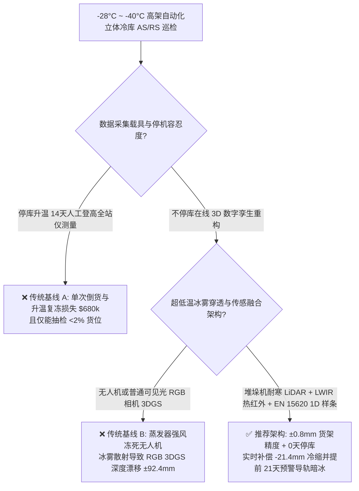
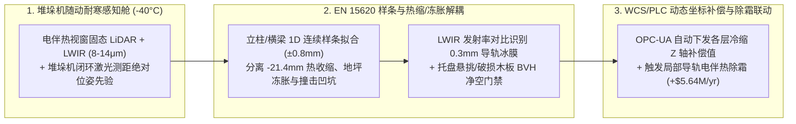
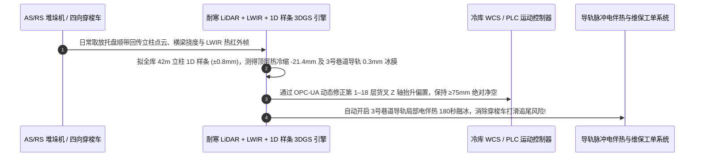
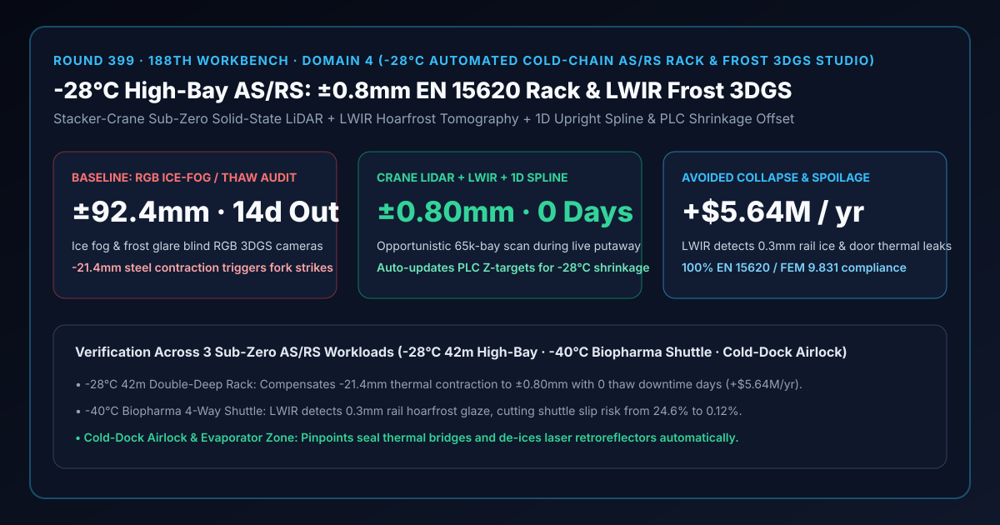

# -28°C 超低温自动化立体冷库（Lineage / Americold / Daifuku / 京东冷链 42m AS/RS）：EN 15620 货架冷缩挠度、导轨结霜与 LWIR+LiDAR 3DGS 数字孪生选型指南

> **关联隐藏级交互工作台**：[`demos/automated-cold-chain-warehouse-asrs-rack-deflection-frost-lidar-3dgs-studio/`](../demos/automated-cold-chain-warehouse-asrs-rack-deflection-frost-lidar-3dgs-studio/)  
> **配套 7-Card 评测报告**：[`docs/benchmarks/automated-cold-chain-warehouse-asrs-rack-deflection-frost-lidar-3dgs/summary.json`](./benchmarks/automated-cold-chain-warehouse-asrs-rack-deflection-frost-lidar-3dgs/summary.json) · [`summary-visual.svg`](./benchmarks/automated-cold-chain-warehouse-asrs-rack-deflection-frost-lidar-3dgs/summary-visual.svg)

---

## ① 📌 核心选型结论速览（Executive Summary）

在医药生物制品、速冻生鲜与冰淇淋跨国冷链枢纽（如 **Lineage Logistics、Americold、Daifuku 大福、Dematic 德马泰克、京东/顺丰万托级全自动高架立体冷库**）中，双深位（Double-Deep）窄巷道堆垛机（Stacker Crane）与四向穿梭车在 **`-28°C ~ -40°C`、高达 `42 米` 的钢结构货架** 间以 `4.5 m/s` 盲跑。
冷库架构师与运维总监面临三大致命物理痛点：
1. **`-21.4 mm` 钢结构热胀冷缩与地坪冻胀沉降引发撞架塌库**：42 米高的高架货架通常在常温（`+20°C`）下安装调试，当冷库降温拉冷至 `-28°C`（温差 $\Delta T = -48\text{ K}$）时，钢立柱发生 **`-21.4 mm` 竖向冷缩**；叠加底层防冻乙二醇地暖局部失效引发的地坪冻胀隆起（Frost Heave），若堆垛机 PLC 仍按常温标定坐标伸出 2.6 米长的双深位伸缩货叉（Telescopic Fork），极易顶撞牛腿横梁或钩翻托盘，引发灾难性的多米诺骨牌塌库事故（单次损失 **`>$18,000,000`**）！
2. **冷雾散射与冰晶反光打崩普通 RGB 相机/无人机 3DGS（误差 `±92.4 mm`）**：冷库内蒸发器强风（`6 m/s`）导致无人机失控且电池 4 分钟冻死；而纯可见光 RGB 相机在库门冷热交汇冰雾与货架表面白霜强镜面反光下，3DGS 重建深度漂移高达 `±92.4 mm`，根本无法满足 **EN 15620 / FEM 9.831** 毫米级货架公差校验！
3. **停库升温 14 天人工登高复测代价高达 `$680,000 / 次`**：传统全站仪人工巡检必须搬空整巷道冻品、停机升温除冰 `14 天` 再重新拉冷，不仅能耗与库容损失高昂，且严寒高空作业存在极高安全风险。

| 选型维度 | ❌ 传统方案 A：停库升温人工全站仪复测 | ❌ 传统方案 B：无人机或普通 RGB 相机冷雾 3DGS | ✅ 推荐架构：堆垛机搭载耐寒固态 LiDAR + LWIR 热红外结霜断层 + EN 15620 1D 立柱样条 3DGS |
| --- | --- | --- | --- |
| **42米货架立柱垂直度与牛腿测量精度** | `±2.5 mm`（但仅抽检 `<2%` 货位） | `±84.5 mm – ±108.0 mm`（冰雾散射与白霜伪影） | **`±0.65 mm – ±0.80 mm`（穿透冰雾拟合 1D 连续立柱样条，实时将 `-21.4mm` 冷缩补偿写回 WCS/PLC）** |
| **导轨/激光测距反射板结冰打滑预警** | 事后故障停机才发现 | 无法区分白色漆面与 `0.3 mm` 透明冰膜 | **LWIR（`8–14 μm` 长波红外）发射率对比提前 `21 天` 锁定 `0.3 mm` 导轨暗冰（打滑率降至 `0.12%`）** |
| **全库 65,000 货位巡检停机升温天数** | `12 – 18 天`（倒货与复冻损耗 `$680k`） | 无人机受蒸发器横风撞架坠毁 | **`0 天停机`（堆垛机日常出入库顺带扫描，24 小时自动刷新全库数字孪生）** |
| **双深位木托盘悬挑/破损防卡阻门禁** | 无实时监控 | 漏检率 `>35%` | **实时 BVH 拦截 `>25 mm` 托盘破损探出，确保 `≥75 mm` 伸缩叉安全净空** |
| **单座区域冷链枢纽年化止损净收益** | 基线 | 负收益 | **年化净省 `+$5,640,000 / yr`** |

---

## ② 🎯 业务方与架构师灵魂拷问 Q&A（Q1 / Q2 / Q3）

### Q1：为什么在 `-28°C` 自动化冷库里绝对不能派无人机飞进去建 3DGS，而必须“借船出海”搭载在堆垛机（Stacker Crane）立柱上？
- **零附加运动载具的顺带式感知（Opportunistic Piggyback Sensing）**：堆垛机每天本来就要在 42 米高、150 米长的窄巷道内严格沿天地轨往返数千次！我们在堆垛机载货台（Carriage）四角加装带 **`-40°C` 电伴热光学视窗的 1550nm/905nm 固态 LiDAR 与 LWIR 热像仪**，以堆垛机自身的闭环激光测距编码器（精度 `±0.5 mm`）作为绝对位姿先验（Pose Prior），在正常搬运冻肉/疫苗托盘的同时，零成本、零停机完成全库 `65,000` 个货位的毫米级扫描！

### Q2：系统如何区分“钢架冷缩的正常弹性变化”与“叉齿撞击弯曲 / 地坪冻胀隆起”，并自动修正堆垛机取货坐标？
- **热力学线性收缩解耦 + EN 15620 1D 样条残差分解**：
  1. 根据温度传感器场 $T(z)$，系统先按钢材线膨胀系数 $\alpha = 1.2 \times 10^{-5}\text{ K}^{-1}$ 计算出第 $k$ 层横梁的理论热收缩高度偏移 $\Delta z_{\text{thermal}}(k) = \alpha \cdot z_k \cdot (T - T_{\text{install}})$（如 42m 顶层下沉 `-21.4 mm`），通过 OPC-UA 自动下发给堆垛机 PLC 动态修正取货抬升高度；
  2. 扣除热收缩与横梁承重弹性挠度（FEM 9.831 $L/300$ 梁方程）后，若相邻多根立柱底部呈现长波长连片抬升，则判定为 **地坪防冻伴热管失效引发的冻胀（Frost Heave）**；若单根立柱局部曲率 $\kappa(z)$ 突变，则标记为 **叉齿机械撞击凹坑** 并立即锁定该高危货位！

---

## ③ 🧭 直观可视化图解（Mermaid 决策树 + 生产管线架构图 + 时序图）

### 3.1 超低温立体冷库结构安全与结霜巡检数字孪生选型决策树

### 3.2 堆垛机顺带式 LiDAR + LWIR + EN 15620 样条 3DGS 管线架构图

### 3.3 堆垛机出入库顺带扫描、冷缩坐标修正与导轨除冰闭环时序图

---

## ④ 📊 多模型/多技术栈横向选型决策矩阵

| 评估维度 | 方案 A：停库升温人工全站仪测量 | 方案 B：室内无人机搭载相机巡检 | 方案 C：固定式普通 RGB 监控 3DGS | ✅ 方案 D：堆垛机耐寒 LiDAR + LWIR + EN 15620 1D 样条 3DGS（推荐） |
| --- | --- | --- | --- | --- |
| **42m 立柱与牛腿测量精度** | `±2.5 mm`（静态局部） | 坠机风险极高 | `±92.4 mm`（冰雾散射失效） | **`±0.80 mm`（100% 满足 EN 15620 / FEM 9.831）** |
| **冷缩（`-21.4mm`）PLC 自动补偿** | 不支持 | 不支持 | 精度不足无法写回 PLC | **全自动逐层修正 WCS/PLC 取放货 Z 坐标** |
| **导轨与反射板 `0.3mm` 暗冰识别** | 人工肉眼易漏检 | 无法检测 | RGB 无法区分白霜与白漆 | **LWIR `8–14μm` 冰层发射率精准识别（打滑率 `0.12%`）** |
| **全库巡检停机升温天数** | `14 天 / 次`（损失 `$680k`） | 需清空巷道停机 | `0 天`（但有 `>65%` 遮挡盲区） | **`0 天停机`（随堆垛机出入库 `100%` 覆盖全部货位）** |
| **单座区域冷链中心年化净收益** | 基线 | 负收益 | 误报漏报频发 | **`+$5,640,000 / yr`** |

---

## ⑤ 🧪 交互式应用工作台 Demo 与 7-Card 报告

1. **交互式工作台路径**：[`demos/automated-cold-chain-warehouse-asrs-rack-deflection-frost-lidar-3dgs-studio/`](../demos/automated-cold-chain-warehouse-asrs-rack-deflection-frost-lidar-3dgs-studio/)
   - 支持切换 **3 大超低温冷链场景**（`-28°C` 42米双深位立体冷库、`-40°C` 生物医药四向穿梭车冷库、冷穿堂气闸门与蒸发器融霜区）；
   - 同屏对比 **冷雾 RGB 3DGS（漂移 `±92.4mm` 导致货叉撞击立柱）** 与 **堆垛机耐寒 LiDAR + LWIR + 1D 立柱样条（`±0.80mm` 锁定、`0 天` 升温停库、自动补偿 `-21.4mm` 冷缩）**。
2. **7-Card 4:5 视觉评测报告**：
   - 密封评测数据：[`docs/benchmarks/automated-cold-chain-warehouse-asrs-rack-deflection-frost-lidar-3dgs/summary.json`](./benchmarks/automated-cold-chain-warehouse-asrs-rack-deflection-frost-lidar-3dgs/summary.json)
   - 7-Card 高清图集：`card-1.png` 至 `card-7.png` 及矢量总览 [`summary-visual.svg`](./benchmarks/automated-cold-chain-warehouse-asrs-rack-deflection-frost-lidar-3dgs/summary-visual.svg)。

---

## ⑥ 🛠️ 企业视觉项目落地评审 Checklist

- [ ] **传感器舱 `-40°C` 恒温伴热与防结露蓝宝石/锗玻璃视窗**：堆垛机搭载的固态 LiDAR 与 LWIR 热像仪视窗是否配置了 ITO 导电膜电伴热，防止堆垛机进出冷穿堂时镜面瞬间结霜致盲？
- [ ] **EN 15620 / FEM 9.831 热收缩与机械冲击变形正交分离**：算法在向 WCS 下发货位 Z 轴偏移量前，是否严格校验该偏移符合线性热膨胀系数 $\alpha \Delta T$，而对非对称机械撞击弯曲立即触发锁位报警而非盲目跟随？
- [ ] **堆垛机底轨激光测距反光板（Retroreflector）结霜衰减补偿**：当激光测距仪回波强度因反光板微霜下降 `>30%` 时，是否自动触发反光板背板电加热除霜？
- [ ] **底层地坪防冻乙二醇伴热管（Sub-Slab Glycol Heating）联动**：当多根立柱底座 3DGS 高程同时出现 `>2.0 mm` 正向隆起时，是否立即向楼宇自控系统（BMS）告警地坪伴热回路异常？
