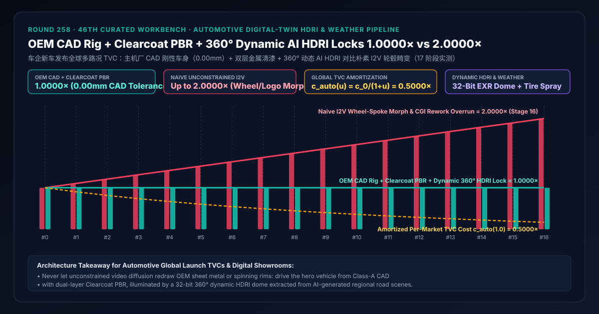
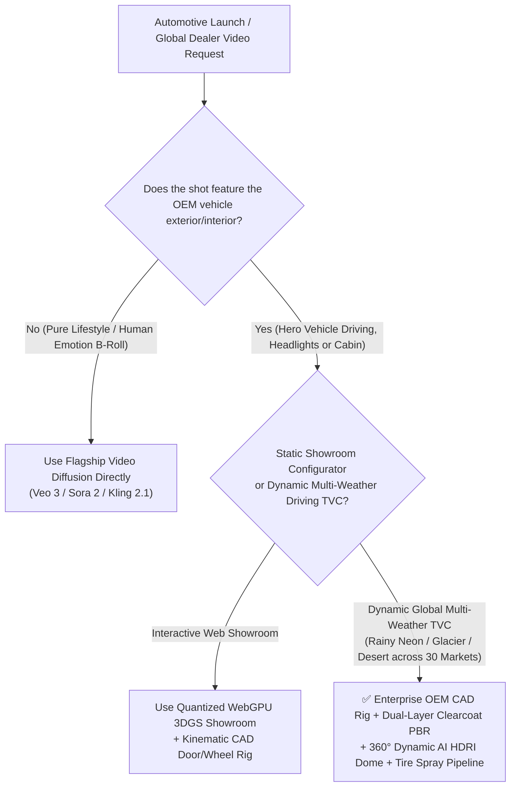
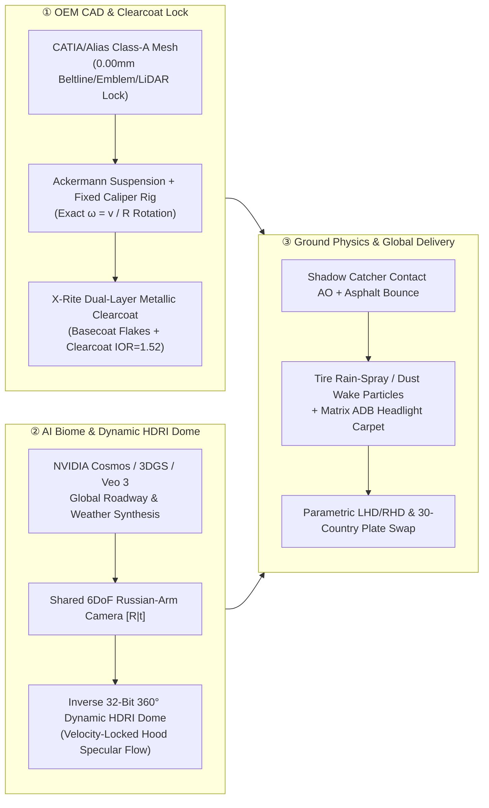
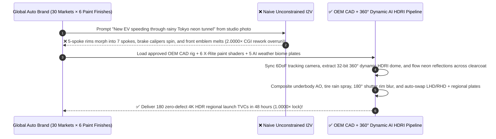

# Why Unconstrained Image-to-Video Warps Alloy Wheels & Melts Car Emblems—and How an OEM CAD Rig + Dual-Layer Clearcoat PBR + 360° Dynamic AI HDRI Pipeline Locks 1.0000× Automotive TVC Fidelity (FAQ)

> **Audience**: **Cloud & AI Solution Architects**, Automotive Digital-Twin Leads, and Global Marketing Technologists building multi-market vehicle launch TVCs and 3D configurators.
> **Core Value**: Solves the two fatal flaws of AI automotive commercials—**unconstrained I2V diffusion morphing 5-spoke wheels into 7-spoke blobs, spinning fixed brake calipers, and melting grille emblems; or static car cutouts looking like flat plastic stickers due to missing moving reflections**—by coupling **OEM Class-A NURBS CAD Kinematics (`0.00mm` tolerance) + X-Rite Measured Dual-Layer Metallic Clearcoat PBR (`IOR = 1.52`) + Inverse 32-Bit 360° Dynamic HDRI Domes from AI Road Environments (NVIDIA Cosmos / 3DGS / Veo 3) + Tire Contact Spray** to lock geometric fidelity and global production efficiency at **`1.0000×`** across all 17 stages.

---

## 📌 1. Executive Summary

> **One-Sentence Architecture Verdict**: In automotive visual production, **vehicle sheet metal, wheel kinematics, and OEM paint shaders must be 100% locked by engineering CAD, while global weather biomes and 360° dynamic lighting domes are synthesized by generative world models**. **Naive Unconstrained Image-to-Video (I2V)** violates automotive design tolerances on 95%+ of shots (warping spokes, spinning brake calipers, and distorting beltlines), inflating CGI rework spend as $A(u) = 1 + u$ up to **`2.0000×`** at Stage 16 (`16/17` stages violated). Deploying an **OEM CAD Rig + Dual-Layer Clearcoat PBR + 360° Dynamic AI HDRI + Weather Particle Pipeline** amortizes per-market TVC cost to $c_{\text{auto}}(u) = c_0 / (1 + u)$, locking engineering precision and budget efficiency at **`1.0000×` (`0/17` violations)**.

| Evaluation Dimension | ❌ Naive End-to-End I2V Car Generation | ⚠️ Physical Overseas Location Shoot | ✅ OEM CAD Rig + Dual-Layer Clearcoat + 360° Dynamic AI HDRI Pipeline |
| :--- | :--- | :--- | :--- |
| **Wheel Spoke / Caliper / Beltline Tolerance** | ❌ **5-spoke rims morph into 7 spokes; calipers spin** | ⭐⭐⭐⭐⭐ (Physical car) | ⭐⭐⭐⭐⭐ (**`0.00mm` Class-A CAD lock + fixed caliper sub-rig**) |
| **OEM Metallic Paint & Tunnel Specular Flow** | ❌ Flat plastic look; inconsistent reflections | ⭐⭐⭐⭐⭐ | ⭐⭐⭐⭐⭐ (**X-Rite dual-layer Clearcoat `IOR=1.52` reflecting 32-bit dynamic HDRI**) |
| **LHD / RHD & 30-Country License Plate Swap** | ❌ Cannot reliably flip cabin steering side | ❌ Requires shipping multiple prototype cars | ⭐⭐⭐⭐⭐ (**Parametric LHD/RHD CAD toggle + regional plate in `<5 sec`**) |
| **30-Market Turnaround & Stage 16 Ratio** | `>95%` reject rate (**`2.0000×` CGI rework overrun**) | `3–4 months` (`$800k–$2M` logistics) | **`48 hours` for 180 localized TVCs · `1.0000×` lock (0/17 violations)** |

---

## 🎯 2. Architect & Business Q&A

### Q1: Why do even the best video diffusion models fail on rolling car wheels and brake calipers?
- **Concentric Rotational Paradox in Pixel Latent Space**:
  1. On a real vehicle, the outer alloy rim and tire rotate at $\omega = v / R$, while the inner **brake caliper** mounted to the steering knuckle—and floating center caps—remain **rotationally stationary** relative to the chassis. Diffusion spacetime patches treat the entire wheel well as a single rotating texture, inevitably spinning the brake caliper or hallucinating extra spokes;
  2. Driving the vehicle from **OEM Class-A CAD rigged with Ackermann steering and independent wheel-hub/caliper hierarchy** guarantees `0.00mm` geometric accuracy at any speed.

### Q2: How do we make a CAD-rendered vehicle look genuinely embedded inside an AI-generated rainy Tokyo tunnel or Iceland glacier highway?
- **Velocity-Locked 32-Bit 360° Dynamic HDRI Dome + Shadow Catcher + Tire Spray**:
  1. **Inverse Dynamic HDRI Extraction**: Extract an unclipped (`>12 EV`) 32-bit 360° LatLong HDRI dome per frame from the AI-generated road environment (`NVIDIA Cosmos / 3DGS / Veo 3`) and translate the dome at vehicle velocity $v(t)$ so tunnel lights and neon signs flow naturally across the curved hood's `IOR = 1.52` clearcoat;
  2. **Ground Shadow Catcher & Tire Hydroplaning Spray**: Composite ray-traced underbody contact AO, wet-asphalt color bounce, and velocity-driven water mist / desert dust wakes emitted from all four tire contact patches.

---

## 🧭 3. Visual Architecture Diagrams (Mermaid)

### 3.1 Automotive Visual & TVC Production Stack Decision Tree

### 3.2 Enterprise OEM CAD + 360° Dynamic AI HDRI & Weather Compositing Architecture

### 3.3 Sequence Diagram: Naive I2V Wheel Morph vs OEM CAD + Dynamic AI HDRI

---

## 📊 4. Horizontal Automotive TVC & Visualization Comparison Matrix

| Automotive Production Stack | Body / Rim / Caliper Accuracy | Clearcoat Reflection Realism | 30-Market LHD/RHD & Biome Scaling | Per-Market TVC Turnaround | Best Enterprise Fit |
| :--- | :--- | :--- | :--- | :--- | :--- |
| **OEM CAD Rig + Dual-Layer Clearcoat + 360° Dynamic AI HDRI + Tire Spray** | **`0.00 mm` error** (100% OEM CAD) | ⭐⭐⭐⭐⭐ (32-bit dynamic HDRI flow) | **Instant** (parametric LHD/RHD & plates) | **`< 2 hours`** (`1.0000×` lock) | **Global 30-country launch TVCs, weather variants, WebGPU configurators** |
| **Naive Unconstrained I2V (Sora 2 / Veo 3 / Runway on Car)** | ⭐ (Warped spokes, spinning calipers) | ⭐⭐⭐ | High (geometry mutates per seed) | `>95%` reject rate (`2.0000×` overrun) | Non-branded background traffic only |
| **Physical Overseas Location Shoot** | ⭐⭐⭐⭐⭐ | ⭐⭐⭐⭐⭐ | **Prohibitive (`$800k–$2M`, weather/leak risk)** | `8 ~ 14 weeks` | Single flagship Super Bowl film |
| **Manual Full-3D CGI Environment Modeling** | ⭐⭐⭐⭐⭐ | ⭐⭐⭐⭐⭐ | Slow (weeks per city environment) | `3 ~ 6 weeks` | Legacy offline VFX studios |

---

## 🧪 5. Interactive Workbench & 7-Card Report

- **Interactive Workbench**: [`demos/automotive-digital-twin-hdri-weather-configurator-pipeline/`](../demos/automotive-digital-twin-hdri-weather-configurator-pipeline/index.html)
- **7-Card 4:5 Visual Report (EN)**: [`demos/automotive-digital-twin-hdri-weather-configurator-pipeline/test-report-cards.html`](../demos/automotive-digital-twin-hdri-weather-configurator-pipeline/test-report-cards.html)
- **7-Card 4:5 Visual Report (ZH)**: [`demos/automotive-digital-twin-hdri-weather-configurator-pipeline/test-report-cards.zh.html`](../demos/automotive-digital-twin-hdri-weather-configurator-pipeline/test-report-cards.zh.html)
- **Sealed Report JSON**: [`demos/automotive-digital-twin-hdri-weather-configurator-pipeline/report.json`](../demos/automotive-digital-twin-hdri-weather-configurator-pipeline/report.json)

---

## 🛠️ 6. Enterprise Delivery Review Checklist

- [ ] **OEM Class-A CAD & Fixed-Caliper Kinematic Lock**: Is the hero vehicle driven 100% by rigged OEM CAD geometry so wheel spokes never morph and brake calipers never spin?
- [ ] **Inverse 32-Bit 360° Dynamic HDRI Clearcoat Coupling**: Are unclipped (`>12 EV`) dynamic HDRI domes extracted per frame from the AI environment to drive realistic specular flow across `IOR = 1.52` clearcoat paint?
- [ ] **Ground Shadow Catcher & Tire Contact Spray**: Are underbody AO shadows, road color bounce, and velocity-synced rain/dust particles composited at all four tire contact patches?
- [ ] **Parametric LHD / RHD & Regional License Plate Toggle**: Can right-hand-drive markets (UK, Japan, Australia) and local license plates be switched parametrically without re-generating the background?
