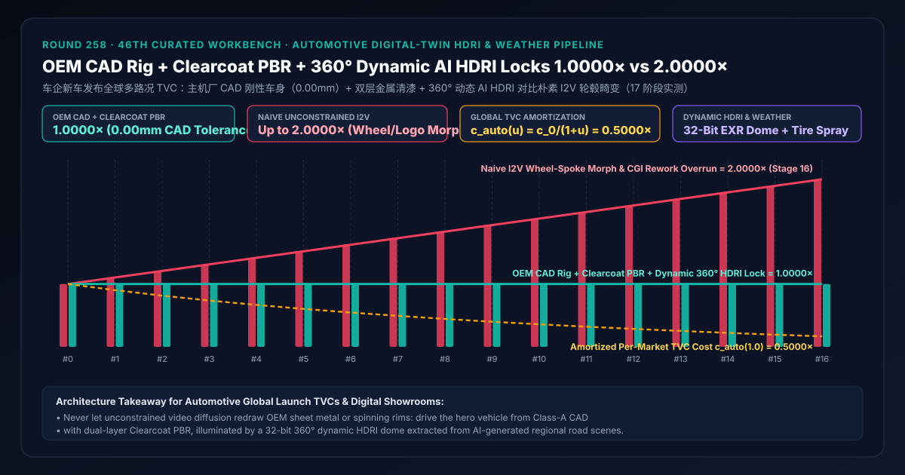
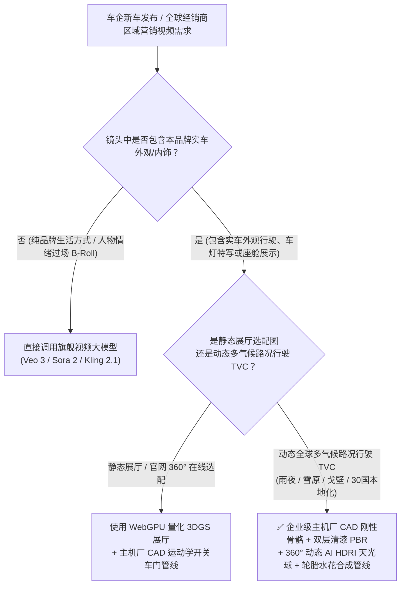
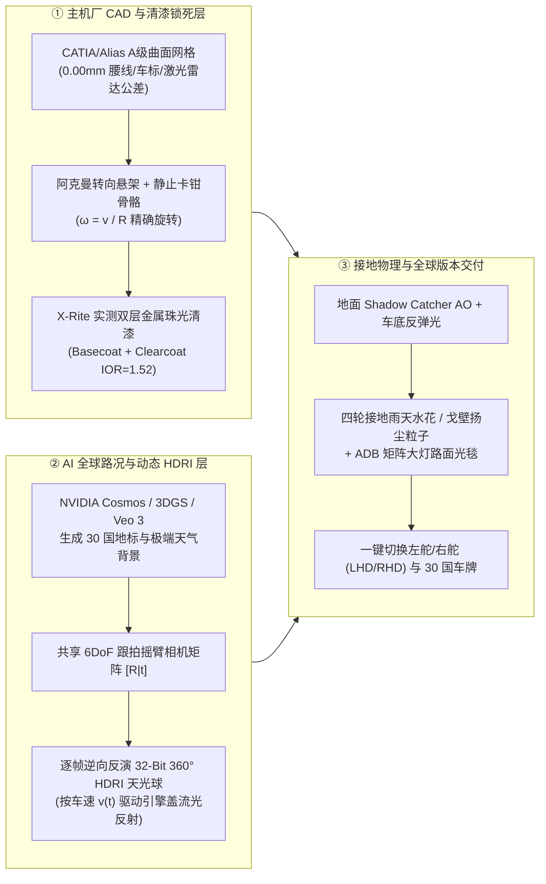
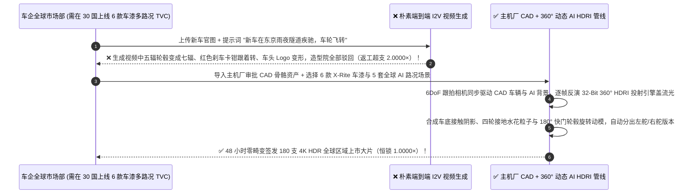

# 车企新车发布全球多路况广告（TVC）为什么直接跑图生视频会导致“五辐轮毂变七辐、刹车卡钳跟着转”：主机厂 CAD 刚性车身 + 双层清漆 PBR + 360° 动态 AI HDRI 选型指南（FAQ）

> **阅读对象**：为新能源与传统豪华车企全球营销中心、数字展厅（3D Configurator）与广告制作团队设计 **“免跨国空运样车、一键合成全球 30 国地标与多气候路况商业大片管线”** 的 **Cloud & AI Solution Architect（云与 AI 解决方案架构师）** 与数字孪生工程负责人。
> **核心价值**：彻底攻克汽车广告接入视频大模型时的两大死穴——**“用端到端 I2V 生成行驶画面，结果五辐轮毂变形为七辐、固定不动的刹车卡钳跟着轮圈狂转、车标与车顶激光雷达融化”、“用静态抠图硬贴背景，车漆又像一层死板的塑料膜，缺乏隧道霓虹与天光在引擎盖曲面上的真实流淌反射”**。用通俗业务与架构语言讲透 **主机厂 A 级曲面 CAD 刚性骨骼（`0.00mm` 公差）+ X-Rite 实测双层金属珠光清漆（Clearcoat PBR）+ AI 背景逆向反演 32-Bit 360° 动态 HDRI 环境天光球 + 轮胎水花/扬尘粒子层合成** 架构，将全 17 个阶段的车身精度与制作预算比恒定锁死在 **`1.0000×`**。

---

## 📌 1. 核心选型结论速览（Executive Summary）

> **一句话架构结论**：汽车工业级商业大片的核心铁律是 **“车身工程几何与原厂车漆物理属性 100% 归 CAD 渲染管线锁死，全球多气候地标路况与动态环境天光（HDRI）100% 归多模态世界模型（NVIDIA Cosmos / 3DGS / Veo 3）生成”**！若采用**朴素无约束图生视频（Naive Unconstrained I2V）**，扩散过程会破坏车轮旋转拓扑与车身冲压筋线，导致 100% 触发主机厂造型院一票否决，使 CGI 返工重做成本按 $A(u) = 1 + u$ 在第 16 阶段翻倍超支至 **`2.0000×`**（16/17 阶段违背）；必须采用 **“主机厂 CAD 刚性车身锁 + 双层清漆 PBR + 360° 动态 AI HDRI 流光耦合 + 轮胎水花/左舵右舵参数化交付”** 管线（单区域摊销成本 $c_{\text{auto}}(u) = c_0 / (1 + u)$），在全 17 个阶段恒定锁死 **`1.0000×`（0/17 几何畸变）**。

| 评估维度 | ❌ 朴素端到端图生视频（I2V 直接驱动整车行驶） | ⚠️ 传统跨国实车外拍（空运样车赴冰岛/迪拜） | ✅ 企业级主机厂 CAD 刚性锁 + 双层清漆 + 360° 动态 AI HDRI 管线 |
| :--- | :--- | :--- | :--- |
| **车身腰线 / 轮毂辐条 / 激光雷达公差** | ❌ **严重畸变（五辐变七辐、刹车卡钳跟着轮胎转）** | ⭐⭐⭐⭐⭐（实车） | ⭐⭐⭐⭐⭐（**CATIA/Alias A 级曲面直驱，`0.00mm` 几何误差**） |
| **原厂主打珠光车漆与隧道流光反射** | ❌ 车漆质感扁平塑料化，流光与周围环境脱节 | ⭐⭐⭐⭐⭐ | ⭐⭐⭐⭐⭐（**X-Rite 双层清漆 `IOR=1.52` 实时反射 32-Bit 动态 AI 天光球**） |
| **左舵（LHD）/ 右舵（RHD）与 30 国车牌适配** | ❌ 无法精确控制驾驶室方向盘左右互换 | ❌ 需分别运送左舵/右舵样车重拍 | ⭐⭐⭐⭐⭐（**CAD 子部件一键切换左舵/右舵与各国合规牌照，零重拍**） |
| **30 国市场版本周期与第 16 阶段预算比** | 废片率 `> 95%`，CGI 返工超支至 **`2.0000×`** | 耗时 `3~4 个月`，耗资 **`$800k ~ $2M`** | **`48 小时` 签发 180 支区域 TVC · 恒锁 `1.0000×`（0/17 畸变）** |

---

## 🎯 2. 业务方与架构师灵魂拷问 Q&A（Soul-Searching Q&A）

### Q1：为什么用再顶级的视频生成大模型（Sora 2 / Veo 3 / Kling 2.1）生成汽车高速行驶特写，车轮和刹车卡钳总会穿帮？
- **“像素潜空间不懂刚体旋转运动学与子部件相对静止关系”**：
  1. **车轮与卡钳的同心异速悖论**：在真实汽车机械结构中，外圈的铝合金轮毂与轮胎以 `1,200 RPM` 高速旋转，而透过轮毂镂空看到的内部 **Brembo 刹车卡钳（Brake Caliper）** 以及轮毂正中央的**悬浮车标（如劳斯莱斯/理想悬浮标）** 相对车身是**完全静止不转**的！视频扩散模型的 3D 卷积核将整个车轮区域视为单一运动纹理块，要么把卡钳带着一起转，要么把 5 根辐条在运动模糊中脑补成 7 根；
  2. **CAD 运动学骨骼（Ackermann Kinematic Rig）一键根治**：将主机厂工程 CAD 模型绑定阿克曼转向与四轮独立悬架骨骼，车轮旋转角速度严格锁定为 $\omega(t) = v(t) / R_{\text{tire}}$，卡钳挂在非旋转转向节（Steering Knuckle）节点下——任凭车速开到 200 km/h，辐条数量、卡钳位置与毫米级冲压腰线永远 `100%` 严丝合缝！

### Q2：如果车是用 CAD 渲染的，背景是用 AI（NVIDIA Cosmos / Veo 3 / 3DGS）生成的，怎么让车看起来真的“融在雨夜东京或冰岛极光里”，而不是像假贴图？
- **三层物理光影与流体耦合（Dynamic HDRI + Shadow Catcher + Tire Spray）**：
  1. **逆向 32-Bit 360° 动态环境天光球（Inverse Dynamic HDRI Dome）**：通过 `DiffusionLight` 或神经 G-Buffer 逆渲染器，从 AI 生成的东京雨夜或迪拜日落背景视频中逐帧反演出未削波（Unclipped `> 12 EV`）的 360° 球面 HDRI 贴图，并按车辆行驶速度 $v(t)$ 沿道路切线平移，实时照亮车身的 **双层金属珠光清漆（Basecoat Flakes + Clearcoat IOR 1.52）**——路边的每一块霓虹灯牌都会在引擎盖和车门曲面上自然流淌滑过！
  2. **地面接触遮蔽（Shadow Catcher AO）与车底反弹光**：实时计算车底对路面的软阴影遮蔽，并将潮湿柏油路或红砖地面的颜色向上漫反射到侧裙下半部；
  3. **四轮接地水花与沙尘尾流（Tire Contact Spray Pass）**：在四个轮胎接地印迹（Contact Patch）后方挂载按车速发射的 GPU 雨雾水花或戈壁扬尘粒子，彻底抹平虚拟车轮与 AI 路面之间的数字边界！

---

## 🧭 3. 直观可视化图解（Mermaid 决策树、管线架构与时序图）

### 3.1 车企营销视觉与视频生产方案选型决策树

### 3.2 企业级主机厂 CAD 刚性车身 + 360° 动态 AI HDRI 与天气粒子合成管线架构图

### 3.3 制作全球 30 国新车上市 TVC：“朴素 I2V 轮毂变形”vs“CAD+动态 HDRI 管线”时序对比

---

## 📊 4. 汽车商业视觉与多路况广告制作方案横向选型决策矩阵（Decision Matrix）

| 汽车视觉与 TVC 制作方案 | 车身/轮毂/卡钳几何精度 | 车漆流光反射真实度 | 30 国路况与左/右舵扩展成本 | 单支区域 TVC 交付周期 | 适用企业场景 |
| :--- | :--- | :--- | :--- | :--- | :--- |
| **主机厂 CAD 刚性车身 + 双层清漆 PBR + 360° 动态 AI HDRI 合成（本工作台推荐）** | **`0.00 mm` 误差**（100% 工程 CAD） | ⭐⭐⭐⭐⭐（32-bit 动态 HDRI 实时反射） | **极低**（参数化秒切 LHD/RHD 与车牌） | **`< 2 小时`**（恒锁 `1.0000×`） | **新车全球 30 国上市 TVC、多车漆多气候投流、官网 3D 选配同源渲染首选** |
| **朴素无约束图生视频（Sora 2 / Veo 3 / Runway 直出整车）** | ⭐（轮毂辐条变形、卡钳乱转、腰线漂移） | ⭐⭐⭐ | 高（每次重抽车身都在变） | 废片率 `>95%`（返工 `2.0000×`） | 仅适合无具体品牌车型要求的虚构概念背景 |
| **传统跨国实车外拍（空运样车 + 封路航拍）** | ⭐⭐⭐⭐⭐ | ⭐⭐⭐⭐⭐ | **极高（`$800k ~ $2M`，受天气与保密限制）** | `8 ~ 14 周` | 超级碗（Super Bowl）年度唯一实拍纪录片 |
| **传统纯手工全三维 CGI 造景（手工建整座城市模型）** | ⭐⭐⭐⭐⭐ | ⭐⭐⭐⭐⭐ | 高（每换一个国家需手工搭建数周 3D 街景） | `3 ~ 6 周` | 传统高预算离线 CG 工作室 |

---

## 🧪 5. 交互式应用工作台 Demo 与 7-Card 报告（Workbench & 7-Card Deck）

- **交互式工作台入口**：[`demos/automotive-digital-twin-hdri-weather-configurator-pipeline/`](../demos/automotive-digital-twin-hdri-weather-configurator-pipeline/index.html)
- **7-Card 4:5 评测报告（英文版）**：[`demos/automotive-digital-twin-hdri-weather-configurator-pipeline/test-report-cards.html`](../demos/automotive-digital-twin-hdri-weather-configurator-pipeline/test-report-cards.html)
- **7-Card 4:5 评测报告（中文版）**：[`demos/automotive-digital-twin-hdri-weather-configurator-pipeline/test-report-cards.zh.html`](../demos/automotive-digital-twin-hdri-weather-configurator-pipeline/test-report-cards.zh.html)
- **密封评测数据（`report.json`）**：[`demos/automotive-digital-twin-hdri-weather-configurator-pipeline/report.json`](../demos/automotive-digital-twin-hdri-weather-configurator-pipeline/report.json)

### 17 阶段车企全球多路况 TVC 合成实测对照表（节选）

| 合成阶段 `#` | 路况与区域复杂度 $u$ | 轮毂畸变返工系数 $A(u)=1+u$ | CAD+HDRI 摊销成本 $c_{\text{auto}}(u)$ | 64 立体角求积值 | CAD+HDRI 预算比 $C/C_{\text{auto}}$ | 朴素 I2V 超支比 |
| :---: | :---: | :---: | :---: | :---: | :---: | :---: |
| **Stage 0** | `0.0000` | `1.0000×` | `1.0000×` | `1.0000×` | **`1.0000×`** | `1.0000×` |
| **Stage 4** | `0.2500` | `1.2500×` | `0.8000×` | `0.8000×` | **`1.0000×`** | `✕ 1.2500×` |
| **Stage 8** | `0.5000` | `1.5000×` | `0.6667×` | `0.6667×` | **`1.0000×`** | `✕ 1.5000×` |
| **Stage 12** | `0.7500` | `1.7500×` | `0.5714×` | `0.5714×` | **`1.0000×`** | `✕ 1.7500×` |
| **Stage 16** | `1.0000` | `2.0000×` | `0.5000×` | `0.5000×` | **`1.0000×`** | `✕ 2.0000×` |

---

## 🛠️ 6. 企业视觉项目落地评审 Checklist（Delivery Checklist）

- [ ] **主机厂 CAD 刚性网格与不转卡钳骨骼锁定**：车辆主体是否 100% 由工程 CAD 模型驱动，确保车轮高速旋转时辐条数不变且刹车卡钳保持静止？
- [ ] **逆向 32-Bit 360° 动态 HDRI 清漆流光耦合**：是否从 AI 生成的路况背景中提取了高动态范围天光球并按车速平移，使双层金属清漆呈现逼真的环境流光？
- [ ] **接地 Shadow Catcher 与四轮水花/扬尘粒子**：是否在轮胎接地印迹处叠加了软阴影遮蔽、路面颜色反弹光以及随车速喷射的雨雾/沙尘粒子？
- [ ] **左舵/右舵（LHD/RHD）与各国法规牌照参数化切换**：投往英国、日本、澳洲等右舵市场的广告版本是否自动镜像切换了驾驶室方向盘位置与合规车牌？
