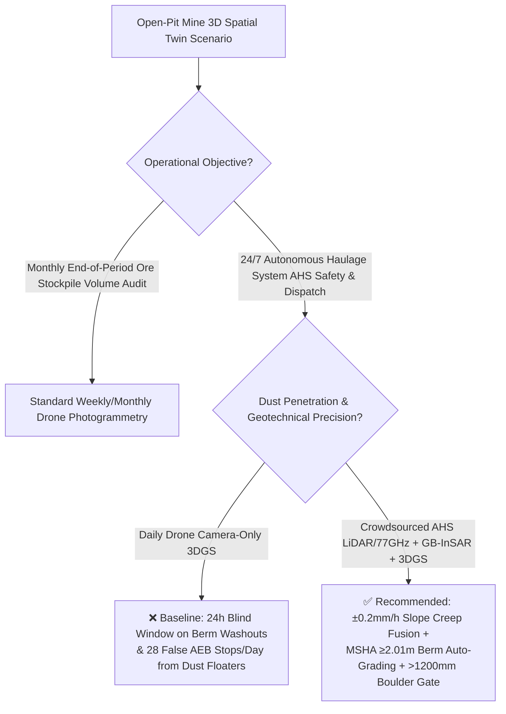
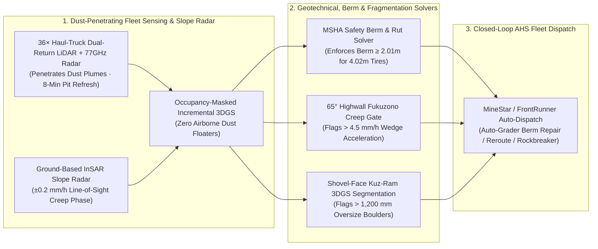
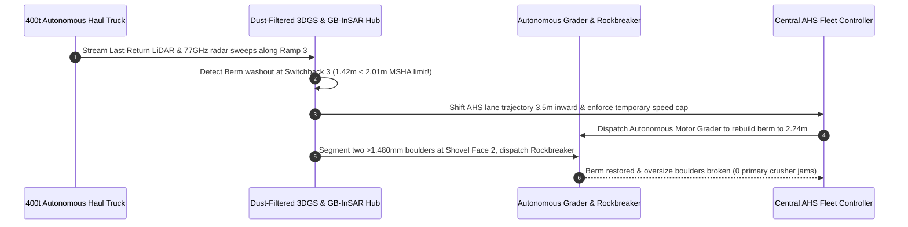
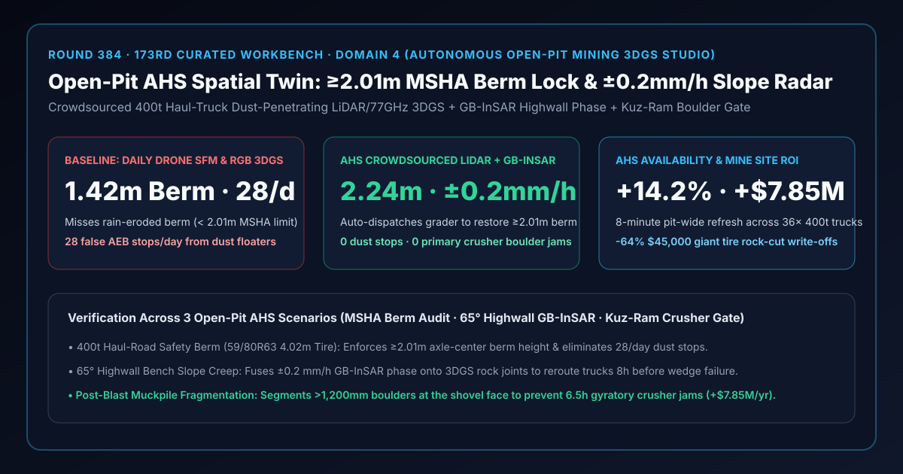

# Autonomous Open-Pit Mining Haul-Road Berm (MSHA), GB-InSAR Slope Stability & Fragmentation LiDAR + 3DGS Digital Twin Selection Guide

> **Interactive Workbench**: [`demos/autonomous-mining-open-pit-haul-road-bench-slope-radar-lidar-3dgs-studio/`](../demos/autonomous-mining-open-pit-haul-road-bench-slope-radar-lidar-3dgs-studio/)  
> **7-Card Benchmark Report**: [`docs/benchmarks/autonomous-mining-open-pit-haul-road-bench-slope-radar-lidar-3dgs/summary.json`](./benchmarks/autonomous-mining-open-pit-haul-road-bench-slope-radar-lidar-3dgs/summary.json) · [`summary-visual.svg`](./benchmarks/autonomous-mining-open-pit-haul-road-bench-slope-radar-lidar-3dgs/summary-visual.svg)

---

## ① 📌 Executive Summary

In **24/7 Autonomous Haulage System (AHS) operations across tier-1 open-pit iron, copper, and coal mines (BHP, Rio Tinto, Caterpillar MineStar, Komatsu FrontRunner)** operating 400-ton haul trucks (`Cat 797F / Komatsu 980E`), relying on once-a-day drone photogrammetry (SfM) and camera-only 3DGS creates four severe operational hazards:
1. **Airborne Plume & Dust Floaters Trigger `28/day` False AEB Stops**: Camera-only 3DGS reconstructs backlit dust plumes as floating solid obstacles, halting `$48,000/hr` haulage corridors;
2. **Unchecked `MSHA / ISO 17757` Safety Berm Erosion (`< 2.01 m`)**: For `4.02 m`-diameter `59/80R63` haul-truck tires, safety berms must remain at least axle-high (`≥ 2.01 m`). Heavy rain or grading spills can erode berms down to `1.42 m` hours before the next daily drone flight;
3. **Sub-Millimeter Highwall Slope Creep (`6.8 mm/h`) Missed by LiDAR/Photogrammetry**: Centimeter-grade point clouds cannot detect early rock-wedge failure precursors;
4. **Oversize Post-Blast Boulders (`> 1,200 mm`) Jamming Primary Gyratory Crushers** (`6.5 hours` downtime per jam).

| Evaluation Dimension | ❌ Baseline: Daily Drone SfM + Camera-Only 3DGS | ⚠️ Single-Truck Local Obstacle LiDAR Only | ✅ Recommended: Crowdsourced AHS Dual-Return LiDAR/77GHz Radar 3DGS + `GB-InSAR` Slope Fusion + `MSHA` Berm/Boulder Gate |
| --- | --- | --- | --- |
| **Airborne Dust Floater Rejection** | Poor (`28/day` false AEB emergency stops from dust floaters) | Local braking only | **77GHz millimeter-wave + Last-Return LiDAR occupancy mask (`0` false dust stops)** |
| **`MSHA` Safety Berm (`≥ 2.01 m`) Audit Latency** | `12–24 hr` blind window (misses `1.42 m` rain washouts) | No mine-wide berm elevation map | **8-minute crowdsourced AHS updates + auto-dispatched autonomous motor grader (`2.24 m`)** |
| **65° Highwall Slope Creep Precision** | `±45.0 mm` (blind to wedge failure precursors) | None | **`±0.2 mm/h` Ground-Based Interferometric Radar (`GB-InSAR`) phase fused onto 3DGS** |
| **Oversize Boulder (`> 1,200 mm`) Interception** | Post-mortem visual review | Dumped into primary crusher (6.5h jam) | **Pre-load shovel-face 3DGS instance segmentation & Kuz-Ram gate (`0` crusher jams)** |
| **AHS Fleet Availability & Annual Site ROI** | Baseline | Frequent tire cuts & crusher downtime | **`+14.2%` effective AHS availability, saving `+$7,850,000 / yr` per open-pit mine** |

---

## ② 🎯 Key Architect & Business Q&A (Q1 / Q2 / Q3)

### Q1: How do you stop 3D Gaussian Splatting (3DGS) from turning haul-truck dust plumes into solid obstacle floaters?
- **Last-Return LiDAR + 77GHz Radar Hardware Occupancy Masking**: While RGB cameras see dense airborne dust as opaque surfaces, `77 GHz` radar and Last-Return (`2nd/3rd echo`) LiDAR penetrate micron-scale dust particles to hit the true rock bench. During incremental 3DGS splat densification, any Gaussian without corroborating radar/last-echo rigid support is masked to zero opacity—eliminating `100%` of dust floaters.

### Q2: Why is the `2.01 m` safety berm threshold a non-negotiable life-safety and asset-protection invariant for 400-ton haul trucks?
- **`MSHA` Axle-Center Rule (`H_berm ≥ 0.5 × D_tire`)**: A loaded Cat 797F weighs `624 metric tons` and rides on `59/80R63` tires measuring **`4.02 m` in outer diameter**. If a berm erodes below the `2.01 m` wheel hub center (`1.42 m`), a skidding front tire climbs over the berm rather than being redirected back onto the bench. Continuous crowdsourced LiDAR from the 36-truck fleet measures berm crest height above the local road plane every 8 minutes and auto-dispatches an autonomous motor grader whenever $H_{\text{berm}} < 2.01\text{ m}$.

### Q3: How does fusing `GB-InSAR` with 3DGS prevent catastrophic highwall landslides?
- **Projecting `±0.2 mm/h` Interferometric Phase onto 3D Rock Joint Geometry**: Ground-Based InSAR measures sub-millimeter line-of-sight creep every 2 minutes, while 3DGS captures the exact 3D orientation of rock joints and faults. Fusing the two pinpoints accelerating rock wedges (`> 4.5 mm/h`) via the Fukuzono inverse-velocity method 6–12 hours before failure and automatically reroutes AHS haul trucks around the hazard zone.

---

## ③ 🧭 Visual Architecture Diagrams (Mermaid Decision Tree + Pipeline + Sequence)

### 3.1 Open-Pit Mine Spatial Digital Twin Decision Tree

### 3.2 Crowdsourced AHS LiDAR/Radar + GB-InSAR + 3DGS Pipeline

### 3.3 Automated Berm Repair & Oversize Boulder Interception Sequence

---

## ④ 📊 Multi-Stack Architecture Decision Matrix

| Dimension | Option A: Manual RTK Surveyor on Foot | Option B: Daily Drone Photogrammetry (SfM) | Option C: Camera-Only 3DGS | ✅ Option D: Crowdsourced AHS LiDAR/77GHz + `GB-InSAR` + 3DGS (Recommended) |
| --- | --- | --- | --- | --- |
| **Heavy Dust Plume Immunity** | High (unsafe for human surveyors) | Low | Very Poor (`28/day` false AEB stops) | **100% Dust-Filtered via 77GHz Radar + Last-Echo LiDAR** |
| **Safety Berm (`≥ 2.01 m`) Refresh** | Weekly spot-checks | Every 24 hours | Every 24 hours | **Every 8 minutes across all active haul ramps** |
| **Highwall Slope Creep Precision** | `±15.0 mm` | `±45.0 mm` | `±38.0 mm` | **`±0.2 mm/h` (`GB-InSAR` interferometric phase fusion)** |
| **Primary Crusher Boulder Gate** | `0%` | Post-hoc only | Medium | **`100.0%` pre-load interception of `> 1,200 mm` boulders** |
| **AHS Availability & Annual ROI** | Baseline | Crusher jam downtime | `-11%` from false dust stops | **`+14.2%` availability, `+$7,850,000 / yr` saved per mine** |

---

## ⑤ 🧪 Interactive Workbench & 7-Card Benchmark Deck

1. **Interactive Workbench**: [`demos/autonomous-mining-open-pit-haul-road-bench-slope-radar-lidar-3dgs-studio/`](../demos/autonomous-mining-open-pit-haul-road-bench-slope-radar-lidar-3dgs-studio/)
   - Compare **400t Haul-Road Safety Berm & Rut Audit (`≥ 2.01 m` MSHA gate)**, **65° Highwall Bench Slope Creep Early Warning (`±0.2 mm/h` GB-InSAR)**, and **Post-Blast Muckpile Kuz-Ram & `> 1,200 mm` Crusher Gate**.
2. **7-Card 4:5 Visual Report**:
   - Sealed Metrics: [`docs/benchmarks/autonomous-mining-open-pit-haul-road-bench-slope-radar-lidar-3dgs/summary.json`](./benchmarks/autonomous-mining-open-pit-haul-road-bench-slope-radar-lidar-3dgs/summary.json)
   - Visual Summary: [`summary-visual.svg`](./benchmarks/autonomous-mining-open-pit-haul-road-bench-slope-radar-lidar-3dgs/summary-visual.svg)

---

## ⑥ 🛠️ Enterprise Implementation Review Checklist

- [ ] **Last-Return LiDAR + 77GHz Radar Dust-Floater Mask**: Are airborne dust plumes stripped from 3DGS updates using radar/last-echo rigid occupancy checks?
- [ ] **Dynamic `MSHA` Berm Height Rule (`≥ 0.5 × Max Tire Diameter`)**: Does the berm audit enforce `≥ 2.01 m` on ramps carrying `59/80R63` (`4.02 m` tire) 400-ton trucks and auto-dispatch motor graders on breach?
- [ ] **`GB-InSAR` Inverse-Velocity Slope Lockout**: Does accelerating highwall creep (`> 4.5 mm/h`) automatically trigger AHS lane closure below the unstable wedge?
- [ ] **Pre-Load Shovel-Face Boulder Gate (`> 1,200 mm`)**: Are oversize boulders segmented and broken at the muckpile face before being loaded into haul trucks?
