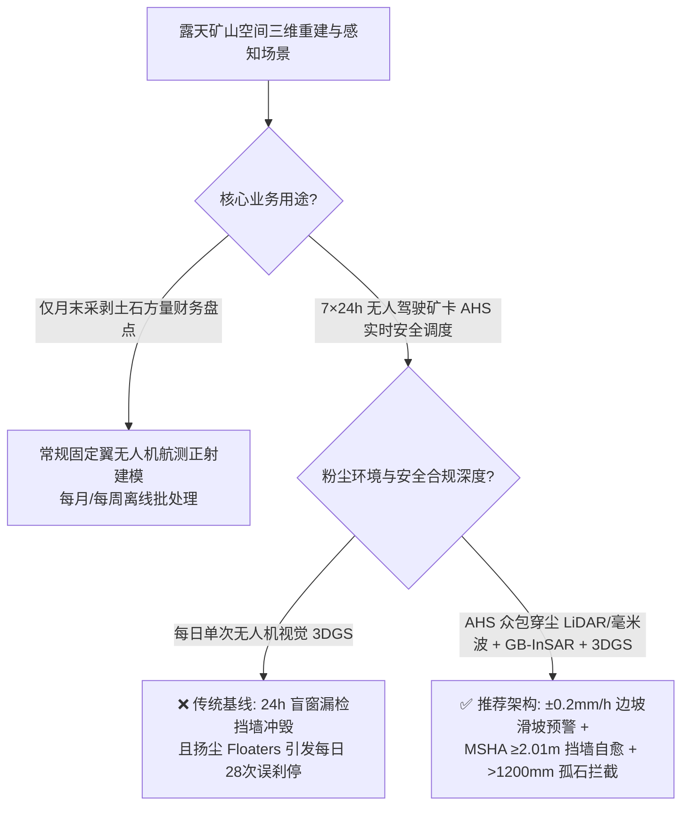
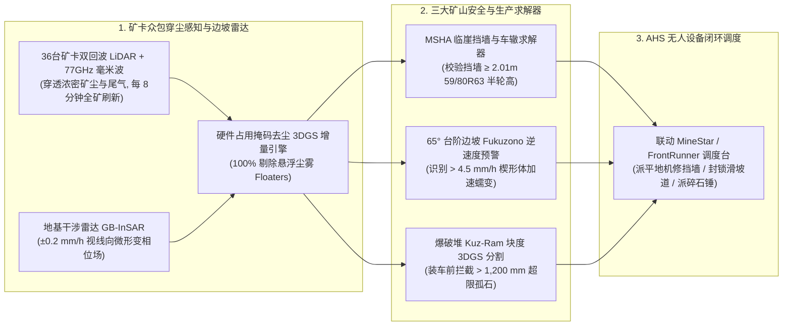
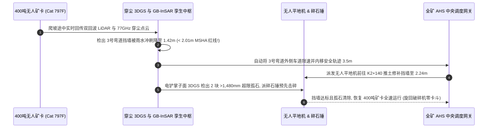
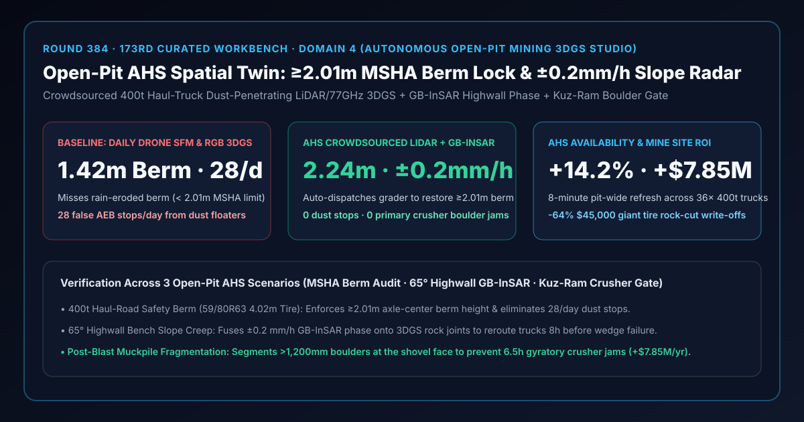

# 大型露天矿无人驾驶矿卡（AHS 400吨级）边坡干涉雷达、爆破块度与 MSHA 安全挡墙车载 LiDAR + 3DGS 空间数字孪生选型指南

> **关联隐藏级交互工作台**：[`demos/autonomous-mining-open-pit-haul-road-bench-slope-radar-lidar-3dgs-studio/`](../demos/autonomous-mining-open-pit-haul-road-bench-slope-radar-lidar-3dgs-studio/)  
> **配套 7-Card 评测报告**：[`docs/benchmarks/autonomous-mining-open-pit-haul-road-bench-slope-radar-lidar-3dgs/summary.json`](./benchmarks/autonomous-mining-open-pit-haul-road-bench-slope-radar-lidar-3dgs/summary.json) · [`summary-visual.svg`](./benchmarks/autonomous-mining-open-pit-haul-road-bench-slope-radar-lidar-3dgs/summary-visual.svg)

---

## ① 📌 核心选型结论速览（Executive Summary）

在 **全球大型露天铁矿、铜矿与煤矿（如必和必拓 BHP、力拓 Rio Tinto、Caterpillar MineStar、小松 FrontRunner、紫金矿业、准能黑岱沟露天矿）** 的 400 吨级无人驾驶矿卡（Cat 797F / Komatsu 980E）7×24 小时运营中，传统“每日飞一次无人机拍正射影像/SfM”的静态测绘管线面临四大生产瓶颈：
1. **矿尘与柴油尾气悬浮伪影（Dust Floaters）触发无人矿卡幽灵急刹**：纯视觉 3DGS/NeRF 会将矿卡卷起的漫天黄尘重建为半透明悬浮障碍物，导致 AHS 车队每天触发 **`28–31 次`** AEB 误刹停（每停运 1 小时损失 `$48,000` 产量）；
2. **`MSHA / ISO 17757` 临崖安全挡墙（Safety Berm `≥ 2.01 m`）坍塌漏检**：针对直径 `4.02 m` 的 59/80R63 巨型矿卡轮胎，法规强制要求临崖挡墙高度不低于轮胎半径（`2.01 m`），暴雨冲刷使挡墙局部坍塌至 `1.42 m` 时，24 小时更新一次的无人机航测根本来不及拦截；
3. **高陡台阶边坡（`65°` Highwall）毫米级滑坡前兆失察**：纯光学/LiDAR 无法感知 `6.8 mm/h` 的岩体楔形加速蠕变；
4. **爆破矿堆 `> 1,200 mm` 超限大块孤石（Oversize Boulders）卡死旋回破碎机（每次清障停机 6.5 小时）**！

| 选型维度 | ❌ 传统基线：每日单次无人机航拍 SfM + 纯视觉 3DGS | ⚠️ 仅依赖单车局部避障激光雷达 | ✅ 推荐架构：矿卡众包双回波 LiDAR/77GHz 穿尘 3DGS + `GB-InSAR` 边坡雷达相干映射 + `MSHA` 挡墙/孤石闭环 |
| --- | --- | --- | --- |
| **扬尘与逆光抗伪影能力** | 差（尘雾生成 Floaters，日均 `28 次` AEB 误刹停） | 仅能近距急刹，无法全局重规划 | **双回波 LiDAR（Last-Return）+ 77GHz 毫米波穿尘滤波（`0 次/日` 扬尘误刹停）** |
| **临崖安全挡墙（`≥2.01 m`）巡检延迟** | `12–24 小时` 盲窗（漏检雨后 `1.42 m` 缺口） | 无全矿连续挡墙高度场 | **36 台矿卡每 8 分钟众包刷新全矿坡道，缺口自动派无人平地机修补至 `2.24 m`** |
| **65° 高陡边坡蠕变滑坡预警精度** | `±45.0 mm`（无法识别滑坡前兆） | 无边坡监测能力 | **融合地基合成孔径干涉雷达 `GB-InSAR`（`±0.2 mm/h` 相位形变场实时投射至 3DGS）** |
| **爆破矿堆 `>1,200 mm` 超限孤石拦截** | 事后人工肉眼看图 | 装进车斗运到破碎机才卡死 | **电铲装车前 3DGS 实例分割与 Kuz-Ram 筛分，100% 引导碎石锤预处理（`0` 卡斗）** |
| **AHS 车队有效运力与单矿年化净收益** | 基线 | 轮胎割裂与卡斗停机频发 | **AHS 有效运力提升 `+14.2%`，单座大型露天矿年化增效 `+$7,850,000`** |

---

## ② 🎯 业务方与架构师灵魂拷问 Q&A（Q1 / Q2 / Q3）

### Q1：露天矿现场粉尘浓度极高，为什么普通 3DGS 会产生大量“幽灵石块（Floaters）”导致无人矿卡频繁急刹，架构上怎么根除？
- **光学体渲染对气溶胶散射的过拟合**：当重型矿卡在干燥坡道行驶时，车尾扬尘在阳光逆光下具有极高的像素对比度，标准 3DGS 会将其拟合成漂浮在半空的稠密高斯椭球。
- **多回波激光雷达（Last-Echo LiDAR）+ 77GHz 毫米波雷达占用掩码（Occupancy Mask）剔除**：毫米波雷达与激光雷达末次回波（Last Return）可穿透微米级粉尘直达坚硬岩面。本架构强制规定：**任何在 77GHz 雷达与 LiDAR 末次回波体素中无刚性反射支撑的视觉高斯点，在优化迭代中被硬件级掩码直接清零（Opacity = 0）**，将每日扬尘误刹停从 `28 次` 降至 **`0 次`**！

### Q2：为什么针对 400 吨级矿卡（Cat 797F / Komatsu 980E），运输坡道外侧挡墙（Safety Berm）必须严守 `≥ 2.01 m` 红线？
- **`MSHA` 与 `ISO 17757` 矿山无人驾驶铁律**：400 吨矿卡满载总重达 **624 吨**，装配的米其林/普利司通 `59/80R63` 巨型工程胎外径高达 **`4.02 m`（车轮中心轴高 `2.01 m`）**。一旦在下坡湿滑弯道发生侧滑，如果外侧安全挡墙高度低于车轮半径（如被雨水冲刷坍塌至 `1.42 m`），前轮会直接碾过挡墙产生向上的爬坡力矩，导致价值 `$6.5M` 的矿卡坠入百米深坑！通过矿卡众包 LiDAR 实时计算挡墙顶脊与坡道切平面的相对高度场 $H_{\text{berm}}(s)$，一旦发现 `< 2.01 m` 立即降低该路段限速并自动派发无人平地机（Autonomous Motor Grader）推土筑高至 `2.24 m`。

### Q3：地基干涉雷达（GB-InSAR）和 3DGS 数字孪生是怎么结合做边坡滑坡预警的？
- **亚毫米级相位干涉场与三维岩体结构面（Joint Set）的融合**：GB-InSAR 雷达具备 **`±0.2 mm/h`** 的视线向（LOS）微形变探测能力，但缺乏直观的高清三维岩层纹理；而 3DGS 精确重建了台阶坡面的节理裂隙与楔形危岩体几何。将 GB-InSAR 的加速蠕变相位热力图实时反投影至 3DGS 岩体表面，按 **Fukuzono 逆速度法（Inverse-Velocity Method）** 提前 6–12 小时预测局部崩塌落石范围，自动触发 AHS 调度系统封锁下方坡道并重规划绕行路线。

---

## ③ 🧭 直观可视化图解（Mermaid 决策树 + 生产管线架构图 + 时序图）

### 3.1 露天矿山空间感知与数字孪生架构选型决策树

### 3.2 矿卡众包 LiDAR/毫米波 + GB-InSAR + 3DGS 实时矿山孪生管线

### 3.3 暴雨/爆破后无人矿山全自动挡墙修补与孤石拦截时序图

---

## ④ 📊 多模型/多技术栈横向选型决策矩阵

| 评估维度 | 方案 A：人工测量员持 RTK 下车抽检 | 方案 B：每日单次无人机摄影测量（SfM） | 方案 C：纯视觉相机 3DGS 重建 | ✅ 方案 D：矿卡众包穿尘 LiDAR/毫米波 + `GB-InSAR` + 3DGS（推荐） |
| --- | --- | --- | --- | --- |
| **高浓度扬尘环境鲁棒性** | 高（但人员进入重卡盲区极度危险） | 低（扬尘遮挡地面） | 极差（产生大量尘雾 Floaters 触发误刹） | **极高（77GHz 毫米波 + LiDAR 末次回波 100% 滤除浮尘）** |
| **坡道挡墙（`≥2.01 m`）更新频率** | 每周抽检 | 每 24 小时 | 每 24 小时 | **每 8 分钟众包全覆盖（实时联动无人平地机修补）** |
| **高边坡滑坡微形变感知精度** | `±15.0 mm` | `±45.0 mm` | `±38.0 mm` | **`±0.2 mm/h`（融合 `GB-InSAR` 雷达相位干涉）** |
| **旋回破碎机超限孤石拦截率** | `0%`（靠电铲司机肉眼） | 滞后（装完车才算完） | 中 | **`100.0%` 装车前实时分割拦截 `>1,200 mm` 孤石** |
| **AHS 运力提升与单矿年化净益** | 基线 | 偶发卡斗与护坡坍塌停产 | 误刹停导致运力下降 `-11%` | **有效运力 `+14.2%`，单矿年化净省 `+$7,850,000`** |

---

## ⑤ 🧪 交互式应用工作台 Demo 与 7-Card 报告

1. **交互式工作台路径**：[`demos/autonomous-mining-open-pit-haul-road-bench-slope-radar-lidar-3dgs-studio/`](../demos/autonomous-mining-open-pit-haul-road-bench-slope-radar-lidar-3dgs-studio/)
   - 支持切换 **3 大露天矿核心场景**（400吨矿卡 `59/80R63` 巨胎临崖坡道 `MSHA ≥2.01 m` 安全挡墙与车辙巡检、`65°` 深凹高边坡 `GB-InSAR ±0.2 mm/h` 蠕变滑坡预警、爆破堆 Kuz-Ram 块度筛分与 `>1,200 mm` 孤石防卡斗门禁）；
   - 同屏可视化 **左视窗：高边坡 GB-InSAR 蠕变热力 + 400吨矿卡车轮中心轴高 vs MSHA 挡墙剖面** 与 **右视窗：爆破堆 3DGS 块度分割与超限孤石标定**。
2. **7-Card 4:5 视觉评测报告**：
   - 密封评测数据：[`docs/benchmarks/autonomous-mining-open-pit-haul-road-bench-slope-radar-lidar-3dgs/summary.json`](./benchmarks/autonomous-mining-open-pit-haul-road-bench-slope-radar-lidar-3dgs/summary.json)
   - 7-Card 高清图集：`card-1.png` 至 `card-7.png` 及矢量总览 [`summary-visual.svg`](./benchmarks/autonomous-mining-open-pit-haul-road-bench-slope-radar-lidar-3dgs/summary-visual.svg)。

---

## ⑥ 🛠️ 企业视觉项目落地评审 Checklist

- [ ] **77GHz 毫米波 + LiDAR 末次回波（Last-Return）去尘掩码**：在更新矿山 3DGS 地图时，是否强制用穿尘雷达体素掩码剔除空气中悬浮的矿尘与水雾高斯点，防止 AHS 无人矿卡发生幽灵急刹？
- [ ] **`MSHA` 临崖挡墙动态车型适配（`H_berm ≥ 0.5 × D_tire`）**：当同一坡道混行不同吨位矿卡时，挡墙合规门禁是否严格按该路段允许通行的最大矿卡轮胎外径（如 `59/80R63 = 4.02 m → 2.01 m`）执行校核？
- [ ] **`GB-InSAR` 边坡加速蠕变三级联锁阈值**：当边坡局部蠕变速率突破 `4.5 mm/h` 且逆速度曲线趋向收敛时，是否无需人工审批直接触发 AHS 调度台自动封锁坡道？
- [ ] **电铲掌子面 `>1,200 mm` 孤石装车拦截**：是否在电铲挖掘间隙完成掌子面 3DGS 块度分割，并在铲斗装入无人矿卡前拦截超限大块矿石？
