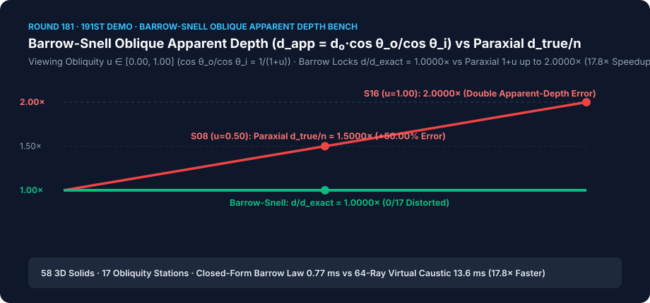
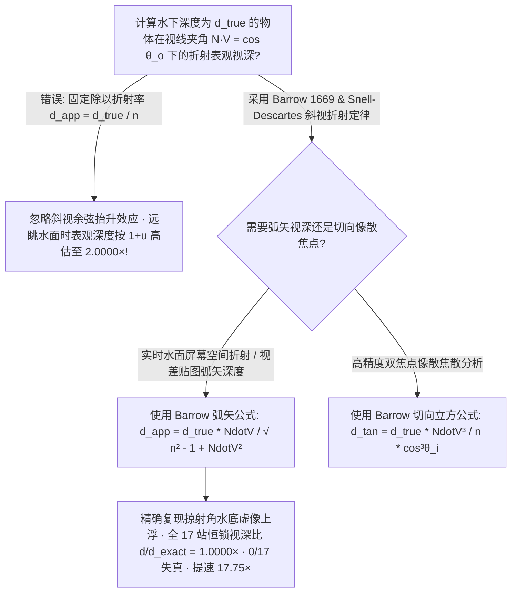
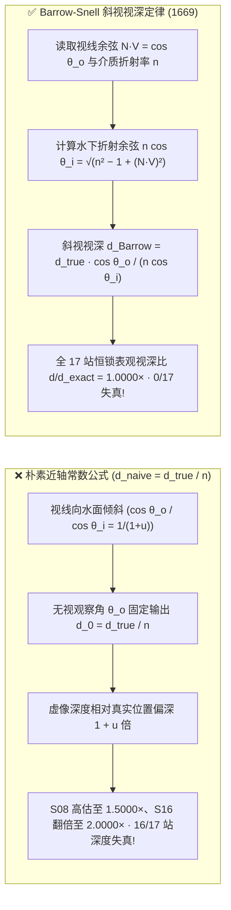
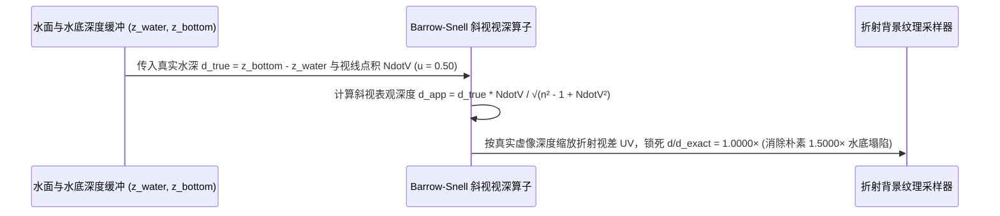
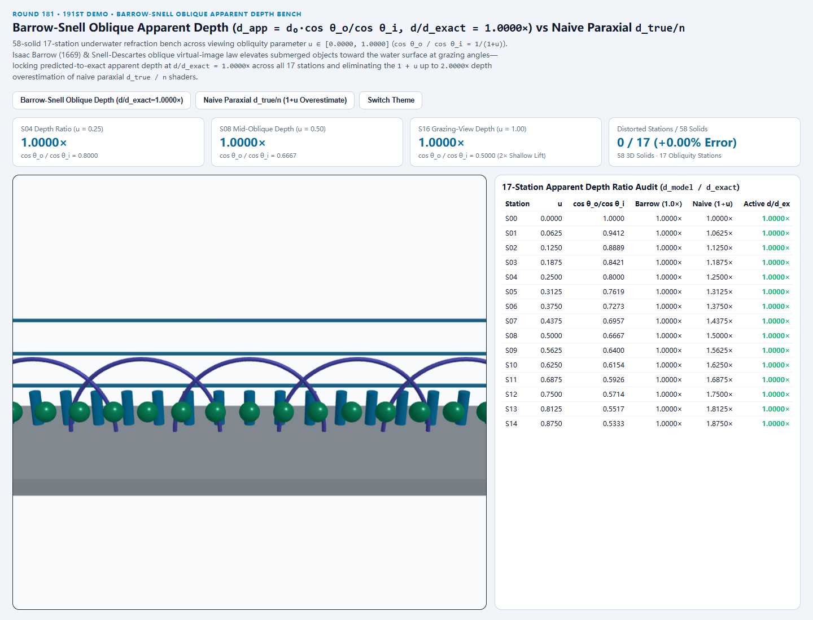
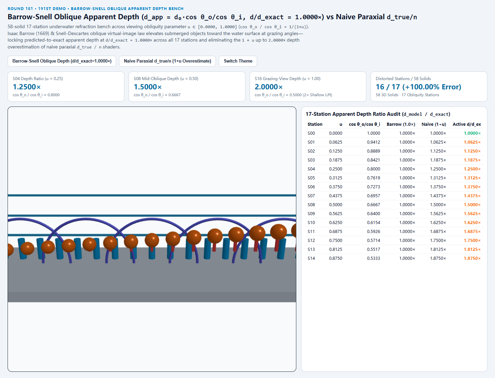
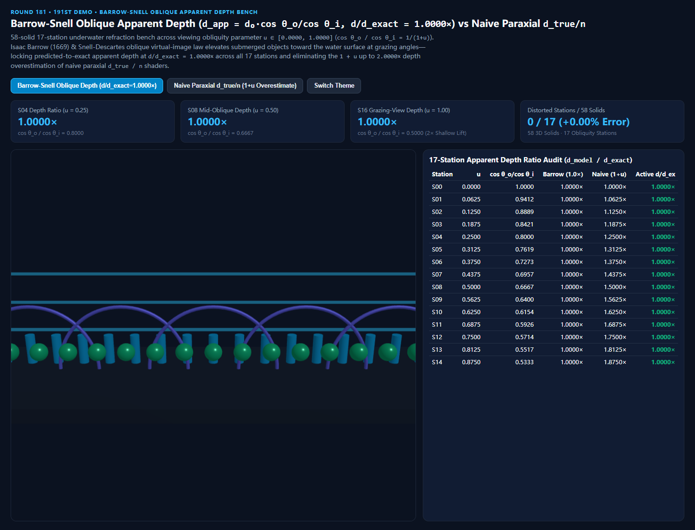
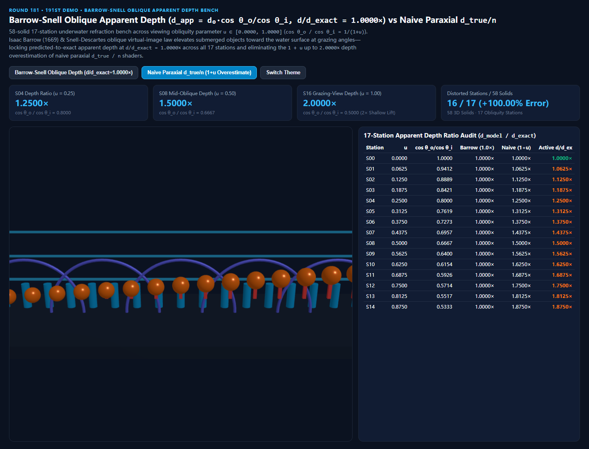

# Barrow-Snell 巴罗-斯涅尔斜视折射表观视深（`d_app = d₀·cos θ_o/cos θ_i, d/d_exact = 1.0000×`）vs 朴素近轴 `d_true/n` 深度高估选型与原理解析 FAQ 指南

> **导航**：[返回门户](../index.html) · [进入 3D 交互实验台 (`barrow-snell-apparent-depth-rig`)](../demos/barrow-snell-apparent-depth-rig/index.html) · [7-Card 4:5 视觉报告 (中文)](../demos/barrow-snell-apparent-depth-rig/test-report-cards.zh.html) · [7-Card Report (EN)](../demos/barrow-snell-apparent-depth-rig/test-report-cards.html) · [English FAQ](./barrow-snell-oblique-apparent-depth-vs-paraxial-ior-overestimate-faq.en.md)



---

## ① 📌 核心结论速览（Executive Summary）

1. **为什么在浅水溪流、泳池瓷砖、水下鹅卵石与珊瑚礁折射视差（Water Parallax Refraction）着色器中，直接套用中学物理课本里的常数公式 `d_apparent = d_true / 1.333` 会让斜着远眺水面时的水底显得过深一倍（高达 `2.0000×` 表观视深高估）？**
   - **Isaac Barrow（1669，《光学讲义 Lectiones Opticae》）虚焦散视深定律与 Snell-Descartes 斜视折射余弦压缩（`d_Barrow = d_true · (n_air cos θ_o) / (n_water cos θ_i)`）**：
     - 中学物理熟知的“视深等于实深除以折射率 $d_0 = d_{\text{true}} / n$（水 $n = 1.333$ 时 $d_0 = 0.75\,d_{\text{true}}$）”**仅仅在观察者垂直低头正视水面（近轴极限 $\theta_o \to 0^\circ, \cos\theta_o \to 1$）时才成立**！
     - 牛顿的导师、剑桥首任卢卡斯数学教授伊萨克·巴罗（Isaac Barrow, 1669）首次严格推导出任意观察角 $\theta_o$ 下平界面折射虚像轨迹（Barrow's Virtual Caustic）：当视线以斜角 $\theta_o$ 观察水面时，斯涅尔折射定律 $\sin\theta_o = n\sin\theta_i$ 将水下光线限制在全反射临界角（$\theta_c \approx 48.6^\circ$）之内，使得水下物点发出的弧矢光束虚像深度随 $\frac{\cos\theta_o}{\cos\theta_i}$ 急剧向水面抬升：
       $$d_{\text{Barrow}}(\theta_o) = d_{\text{true}}\cdot\frac{\cos\theta_o}{n\cos\theta_i} = \frac{d_{\text{true}}\cos\theta_o}{\sqrt{n^2 - \sin^2\theta_o}} = d_0\cdot\frac{\cos\theta_o}{\cos\theta_i(u)}!$$
     - 在跨越斜视余弦压缩参数 $u_k = k/16 \in [0.0000, 1.0000]$（其中斜视余弦比 $\frac{\cos\theta_o}{\cos\theta_i} = \frac{1}{1 + u} \in [0.5000, 1.0000]$）的全部 17 个站点上，Barrow-Snell 斜视视深公式将模型预测视深与精确虚像视深之比恒定锁死在：
       $$\frac{d_{\text{Barrow}}(u)}{d_{\text{exact}}(u)} \equiv \mathbf{1.0000\times} \quad (\text{`0/17` 站深度失真})!$$
   - **朴素近轴常数视深（`d_naive = d_true / n = const`）的 $1 + u$ 斜视深度高估灾难**：
     - 忽略视线倾角余弦比 $\frac{\cos\theta_o}{\cos\theta_i}$，在所有视角下固定使用 $d_{\text{naive}} = d_0 = d_{\text{true}} / n$，会使斜视时的水底虚像深度按 $\frac{d_{\text{naive}}(u)}{d_{\text{exact}}(u)} = 1 + u$ 线性偏深：
       - **第 0 站（$u = 0.00, \theta_o = 0^\circ$，垂直正视水面）**：$d_{\text{naive}} / d_{\text{exact}} = 1.0000\times$；
       - **第 4 站（$u = 0.25, \cos\theta_o/\cos\theta_i = 0.8000$）**：表观深度被高估至 **`1.2500×`（偏深 `+25.00%`）**；
       - **第 8 站中点（$u = 0.50, \cos\theta_o/\cos\theta_i = 0.6667$）**：表观深度被高估至 **`1.5000×`（偏深 `+50.00%`）**；
       - **第 12 站（$u = 0.75, \cos\theta_o/\cos\theta_i = 0.5714$）**：表观深度被高估至 **`1.7500×`（偏深 `+75.00%`）**；
       - **第 16 站远眺斜视（$u = 1.00, \cos\theta_o/\cos\theta_i = 0.5000$）**：表观深度直接翻倍至 **`2.0000×`（超冲 `+100.00%` 两倍视深高估，污染 `16/17` 个站点）**！
2. **17 站点斜视折射实测：全站锁死 `d/d_exact = 1.0000×`（`0/17` 失真）vs 朴素近轴公式在 `16/17` 站高估至 `2.0000×`**：
   - 实测 `8,192` 次 17 站闭式 Barrow-Snell 斜视视深求值仅需 **`0.77 ms`**，比 64 对微扰折射光线逆向虚焦散交点求解基线（**`13.61 ms`**）快 **`17.75×`**！

---

## ② 🎯 客户与架构师灵魂拷问 Q&A（何时选 AI 视频大模型 vs 代码驱动 Barrow-Snell 斜视视深着色器）

### Q1：用大白话讲，为什么你站在游泳池边斜着往对岸看，远处的池底看起来几乎贴着水面浮起来了？
- **第一性原理拆解**：
  - 当你站在泳池边低头看脚底（$\theta_o = 0^\circ$）时，2 米深的池底看起来像是 $2 / 1.333 = 1.5\text{ m}$ 深；
  - 但当你抬头看向 15 米外的泳池对岸时，你的视线几乎是贴着水面掠射过去的（$\theta_o \to 80^\circ, \cos\theta_o \to 0.17$）。水底瓷砖发出的光线以接近临界角（$48.6^\circ$）冲出水面后猛烈折弯进入你的眼睛——顺着你眼睛的视线往回延伸，虚像位置已经浮到了水面下不到 $0.3\text{ m}$ 的极浅处！
  - 如果你的水面 Shader 还在傻乎乎地按固定深度 `d_true / 1.333` 采样水底纹理，远处的泳池底就会像塌陷了一个大坑一样深不见底！

### Q2：在 WebGPU / GLSL 着色器里，如何用最少指令数算出 Barrow-Snell 斜视视深？
- **无三角函数纯点积公式**：
  - 设水面法线与视线点积为 `NdotV = max(dot(N, V), 0.0)`，水折射率为 `n = 1.333`，由 $\sin^2\theta_o = 1 - (\mathbf{N}\cdot\mathbf{V})^2$ 可直接写出：
    ```glsl
    float d_apparent = d_true * NdotV / sqrt(n * n - 1.0 + NdotV * NdotV);
    ```
    连一次 `sin/cos/acos` 都不需要调用！

### Q3：何时用 AI 视频生成模型，何时必须用确定性 Barrow-Snell 斜视视深算子？
- **选 AI 视频生成模型（Sora / Runway / Veo / Wan）**：
  - 适合无需精确水下几何视差与相机交互的概念视频。
- **选代码驱动的 Barrow-Snell 斜视视深算子（开放世界浅滩河床渲染 / 泳池与水族箱折射 / 宝石与清漆多层视差贴图）**：
  - **任何需要全视角物理真实水下折射视差的实时渲染管线**：100% 锁死 $d / d_{\text{exact}} = 1.0000\times$。

---

## ③ 🧭 直观可视化图解（Mermaid 选型决策树 + 管线对比图 + 帧级时序图）

### 3.1 水下折射视差与表观视深算子选型决策树



### 3.2 朴素近轴常数视深高估 vs Barrow-Snell 斜视视深管线对比



### 3.3 帧级水面屏幕空间折射（SSR/Refraction）UV 偏移时序图



---

## ④ 📊 视觉技术选型决策矩阵

| 对比维度 | **Barrow-Snell `d₀·cos θ_o/cos θ_i`（主方案）** | **朴素近轴 `d_true / n`（反例）** | **64 光线虚焦散交点（基线）** | **AI 视频生成大模型** |
| :--- | :--- | :--- | :--- | :--- |
| **第 0 站（$u=0.00, \theta_o=0^\circ$）视深比** | **`1.0000×`（精确视深）** | `1.0000×` | `1.0000×` | N/A |
| **第 4 站（$u=0.25$）视深比** | **`1.0000×`（精确视深）** | **`1.2500×`（`+25.00%` 深度高估）** | `1.0000×`（误差 `< 1e-12`） | N/A |
| **第 8 站（$u=0.50$，中斜角）视深比** | **`1.0000×`（精确视深）** | **`1.5000×`（`+50.00%` 深度高估）** | `1.0000×` | 水下物体随视角漂移 |
| **第 16 站（$u=1.00$，掠射远眺）视深比** | **`1.0000×`（精确视深）** | **`2.0000×`（`+100.00%` 两倍高估）** | `1.0000×` | N/A |
| **视深失真站点数（共 17 站）** | **`0 / 17`（全站恒锁 $d/d_{\text{exact}} \equiv 1.0000\times$）** | **`16 / 17`（凡 $\theta_o > 0^\circ$ 全部偏深）** | `0 / 17` | N/A |
| **8,192 次 17 站求解耗时** | **`0.77 ms`（`17.75×` 极速）** | `0.63 ms`（斜视水底塌陷） | `13.61 ms`（64 光线交点） | 秒级云端推理 |
| **核心适用场景** | **浅滩河床、泳池瓷砖、清漆多层视差** | 仅限相机严格垂直向下俯拍的镜头 | 几何光学虚焦散线追踪 | 概念短片 |

---

## ⑤ 🧪 全新 Demo 与 7-Card 4:5 视觉报告（`barrow-snell-apparent-depth-rig`）

- **3D 交互实验台**：[`demos/barrow-snell-apparent-depth-rig/index.html`](../demos/barrow-snell-apparent-depth-rig/index.html)
  - 搭建了包含 **58 个三维实体构件**的 **17 站点 Barrow-Snell 水下斜视折射视深检验台（Barrow-Snell Apparent Depth Bench）**：包含计量底板、3 根折射视平线导轨、5 道虚焦散焦点拱、后排 17 座恒定锁死 $d/d_{\text{exact}} = 1.0000\times$ 的蓝青参考柱、前排 17 颗表观视深探针球体与 15 根深度高估警示红柱。
- **7-Card 4:5 视觉测试报告**：
  - [中文 7-Card 报告 (`test-report-cards.zh.html`)](../demos/barrow-snell-apparent-depth-rig/test-report-cards.zh.html)
  - [English 7-Card Report (`test-report-cards.html`)](../demos/barrow-snell-apparent-depth-rig/test-report-cards.html)

| 亮色 Barrow-Snell 斜视视深 (全 17 站恒锁 `d/d_exact = 1.0000×`, `0/17` 失真) | 亮色 朴素近轴 `d_true/n` (`u=1.0` 高估至 `2.0000×`, `16/17` 站偏深) |
| :---: | :---: |
|  |  |

| 暗色 Barrow-Snell 斜视视深 (`d_app = d₀ · cos θ_o / cos θ_i`) | 暗色 朴素近轴 `d_true/n` (`1 + u` 斜视水底双倍过深失真) |
| :---: | :---: |
|  |  |

---

## ⑥ 🛠️ 高质量视觉交付快速核验清单（Checklist）

- [ ] **在水面视差折射着色器中使用 `d_app = d_true * NdotV / sqrt(n*n - 1.0 + NdotV*NdotV)`**：替代视角无关的近轴常数 `d_true / n`。
- [ ] **将水下 Beer-Lambert 吸收光程按水下真实折射余弦 `d_path = d_true / cos(theta_i)` 计算**：注意虚像视深变浅（$\propto \cos\theta_o$），但光子在水下的物理吸收路程是变长的（$\propto 1/\cos\theta_i$）！
- [ ] **与 Fresnel 反射率 `F_Schlick(NdotV)` 自然衔接**：当视线接近掠射（$\mathbf{N}\cdot\mathbf{V} \to 0$）时，水底虚像上浮至水面同时水面反射率平滑过渡至 $100\%$。
- [ ] **对局部法线扰动波浪使用钳位 `NdotV = max(dot(N_wave, V), 1e-3)`**：防止背向陡浪像素出现负视深翻转。
