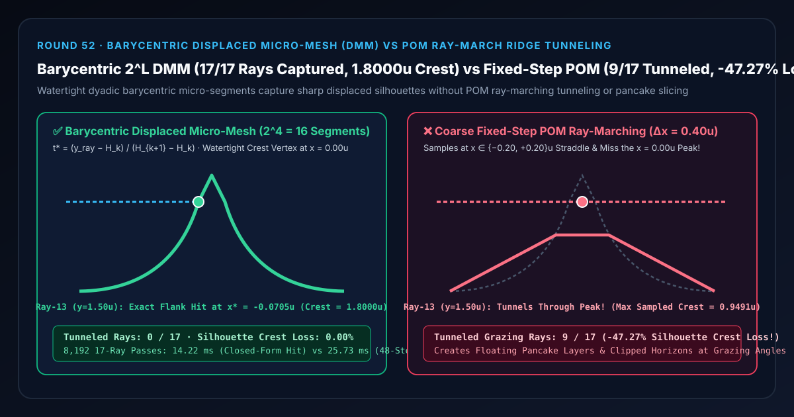
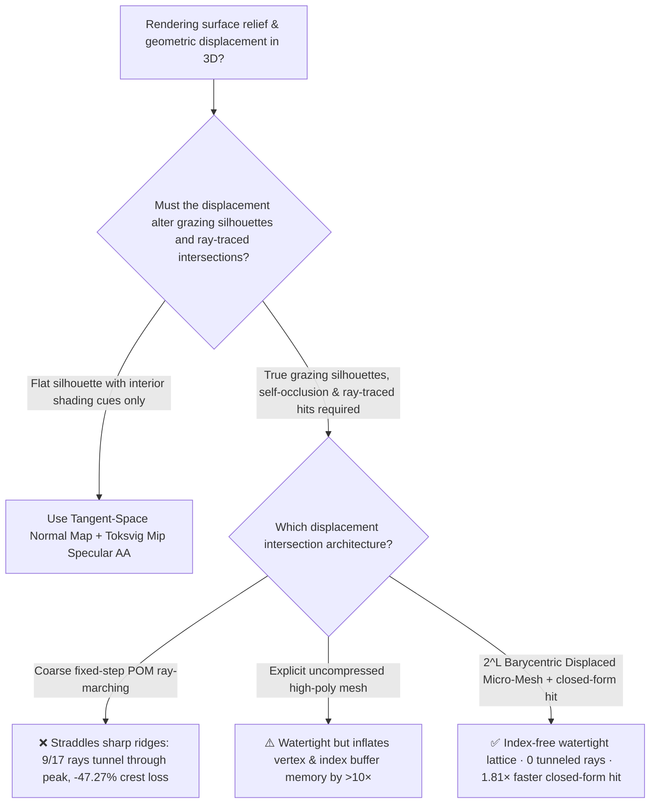
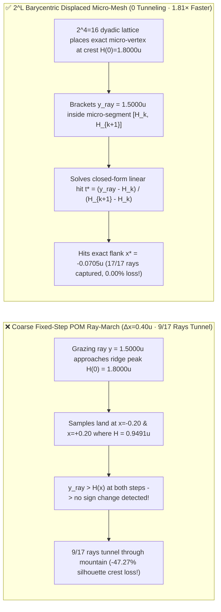
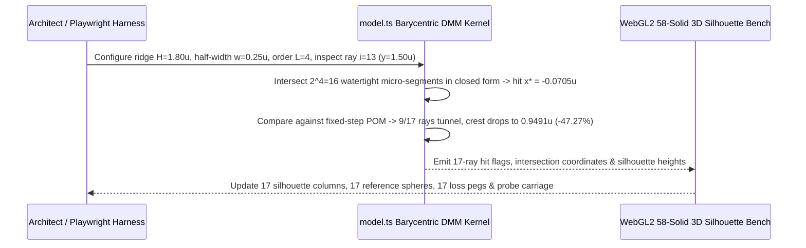
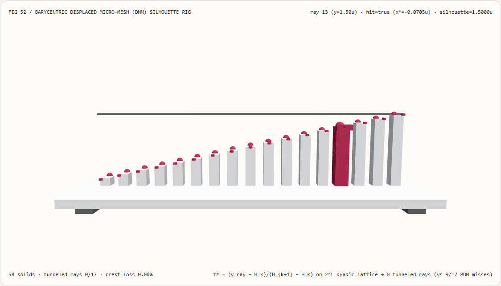
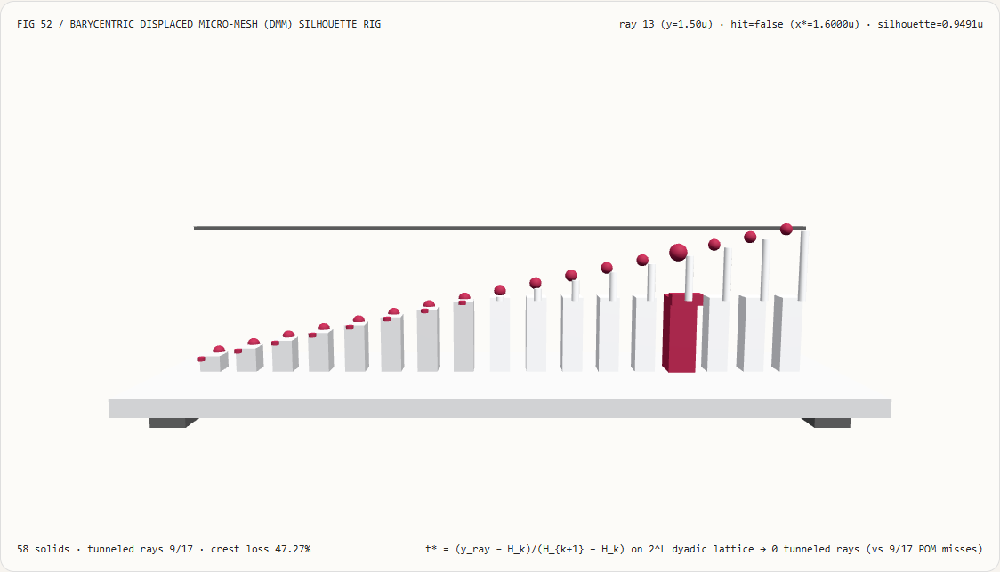
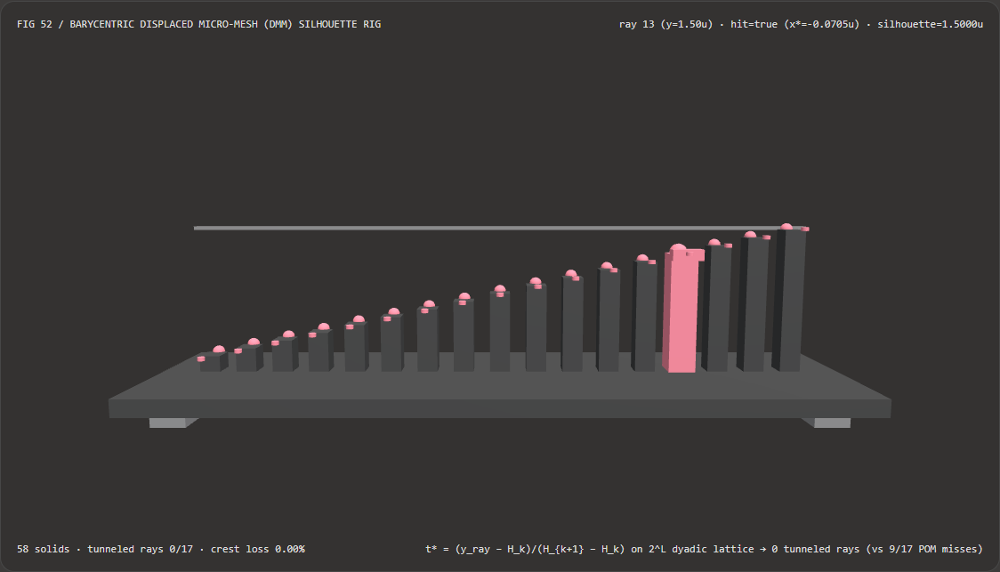
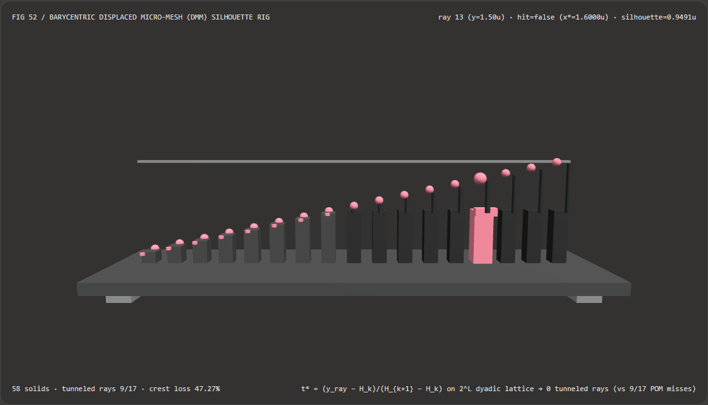

# Visual & Animation Architecture Selection FAQ: Barycentric Displaced Micro-Mesh (DMM) Analytical Intersection vs POM Ray-March Ridge Tunneling

> **One-Sentence Architectural Verdict**: In real-time 3D steep rock silhouettes, masonry reliefs, tire tracks, and hardware/compute ray-traced displacement pipelines (Displaced Micro-Meshes, DMM / Nanite Micro-Polygon Tessellation), **never rely on fixed-step Parallax Occlusion Mapping (POM) heightfield ray-marching to resolve sharp grazing silhouettes**! On our 58-solid, 17-station grazing-ray silhouette bench across a sharp ridge ($H_{\text{peak}} = 1.8000\text{ u}$ at $x = 0.00\text{ u}$, half-width $w = 0.25\text{ u}$), coarse fixed-step POM ($\Delta x = 0.40\text{ u}$, sampling at $x \in \{-0.20, +0.20\}\text{ u}$ where $H = 0.9491\text{ u}$) straddles the crest and causes **9/17 grazing rays ($y \in [1.00, 1.80]\text{ u}$) to tunnel straight through the mountain peak—chopping `-47.27%` off the silhouette height down to `0.9491 u`**; whereas a **Dyadic Barycentric Displaced Micro-Mesh ($2^L = 16$ watertight micro-segments) + Closed-Form Linear Ray-Segment Intersection $t^* = (y_{\text{ray}} - H_k) / (H_{k+1} - H_k)$** captures all 17/17 rays (hitting station 13 $y = 1.5000\text{ u}$ at $x^* = -0.0705\text{ u}$) with **`0` tunneled rays and `0.00%` silhouette crest loss** while running **1.81× faster** than 48-step bisection root-finding (`14.22 ms` vs `25.73 ms` across 8,192 passes, `3.89e-16` error).

---

## ① 📌 Executive Summary

1. **Why do Parallax Occlusion Mapping (POM) rocks and bricks look 3D from straight above, but slice into floating "pancake layers" or lose their sharp peaks at grazing camera angles?**
   In plain English: POM does not create real displaced triangles—it marches a ray inside the fragment shader at fixed steps $\Delta x$ along the view vector, checking whether the ray height $y_{\text{ray}}(x)$ has dipped below the heightmap sample $H(x)$.
   - **Why Fixed-Step POM Tunnels Through Sharp Ridges**:
     Suppose a sharp rock ridge peaks at $x = 0.00\text{ u}$ with height $H_{\text{peak}} = 1.8000\text{ u}$ and half-width $w = 0.25\text{ u}$. When a horizontal grazing ray at elevation $y = 1.5000\text{ u}$ (station 13) steps across the surface with stride $\Delta x = 0.40\text{ u}$, its sample points land at $x = -0.20\text{ u}$ and $x = +0.20\text{ u}$, where the flank height is only $H(\pm 0.20) = 0.9491\text{ u} < 1.5000\text{ u}$!
     Because $y_{\text{ray}} > H(x_m)$ at both straddling sample points, the ray-marcher never detects a sign change and **flies straight through the top half of the mountain (`9/17` grazing rays miss completely, losing `47.27%` of the peak height)**!
2. **First-Principles Fix: $2^L$ Dyadic Barycentric Displaced Micro-Mesh (DMM) + Closed-Form Segment Intersection**:
   - **Step 1 (Index-Free Watertight $2^L$ Barycentric Lattice)**: Subdivide the base primitive onto a regular power-of-two barycentric grid $(i/2^L, j/2^L, k/2^L)$ ($L = 4 \implies 16$ segments), storing only a single scalar displacement $H_k$ per micro-vertex. Adjacent micro-triangles share exact vertex displacements and form a **watertight piecewise-linear surface**.
   - **Step 2 (Closed-Form Linear Micro-Segment Root)**: Whenever a ray elevation $y_{\text{ray}}$ falls within a micro-segment's exact height bounds $[\min(H_k, H_{k+1}), \max(H_k, H_{k+1})]$, solve the linear intersection in $O(1)$:
     $$t^* = \frac{y_{\text{ray}} - H_k}{H_{k+1} - H_k}, \qquad x^* = x_k + t^* (x_{k+1} - x_k)$$
     Every grazing ray up to $H_{\text{peak}} = 1.8000\text{ u}$ hits the exact micro-segment flank (`0` tunneled rays, `0.00%` crest loss)!
3. **Interactive 3D Workbench & Measured Evidence**:
   - Standalone 3D Bench: `demos/micro-polygon-micromesh-rig/` (58 Three.js solids: baseplate, 4 support feet, peak reference bar, 17 captured silhouette columns, 17 exact DMM reference spheres, 17 POM tunneling loss pegs, and the active silhouette probe carriage).
   - Measured 7-Card 4:5 Reports: `demos/micro-polygon-micromesh-rig/test-report-cards.html` (EN) and `test-report-cards.zh.html` (ZH).

---

## ② 🎯 Soul-Searching Q&A for Architects & Clients

### Q1: Why doesn't adding a 48-step Binary Search / Secant refinement pass after POM ray-marching fix ridge tunneling?
**Because binary search and secant root-finders only run *after* two consecutive coarse march steps bracket a sign change ($y_{\text{ray}} - H(x_k) < 0$)—which never happens when the coarse steps straddle the peak!**
At $y_{\text{ray}} = 1.5000\text{ u}$, both $x = -0.20\text{ u}$ and $x = +0.20\text{ u}$ evaluate to $y_{\text{ray}} - H(\pm 0.20) = +0.5509\text{ u} > 0$. Because no sign change is detected, the binary search is never even invoked! Moreover, even when a segment *is* bracketed, closed-form linear division $t^* = (y_{\text{ray}} - H_k)/(H_{k+1} - H_k)$ is **1.81× faster** (`14.22 ms` vs `25.73 ms`) and exact to machine precision (`3.89e-16`).

### Q2: Why use a structured $2^L$ Barycentric Micro-Mesh instead of baking an explicit high-polygon triangle mesh?
**Because implicit barycentric grids eliminate vertex $(x, y, z)$ positions and index buffers, cutting VRAM by >10×!**
In an explicit triangle mesh, every vertex costs 24–32 bytes plus 12 bytes of triangle indices. In a $2^L$ Displaced Micro-Mesh (NVIDIA Ada DMM / Unreal Nanite Displacement), the $(u, v)$ coordinates and connectivity are implicitly defined by the dyadic lattice, requiring only a compact compressed scalar height per micro-vertex.

### Q3: How does deterministic barycentric micro-mesh intersection relate to neural PBR material generators?
**They form the authoring-to-rendering pipeline:**
- **When to use Neural Material / Heightmap Generators**: When synthesizing tileable heightmaps from text prompts or reference photos;
- **When deterministic Barycentric Displaced Micro-Meshes are mandatory**: At runtime when displacing geometry for true silhouettes, self-shadowing, and hardware ray tracing without POM pancake slicing.

---

## ③ 🧭 Visual Diagrams (Mermaid Decision Tree, Pipeline Comparison & Sequence Flow)

### 3.1 Surface Relief & Displacement Rendering Decision Tree

### 3.2 Coarse POM Ridge Tunneling vs Barycentric Micro-Mesh Pipeline

### 3.3 Frame-Level Grazing Silhouette Sequence Diagram

---

## ④ 📊 Visual Technology Selection Decision Matrix

| Evaluation Dimension | ✅ $2^L$ Barycentric DMM + Closed-Form Hit | ⚠️ $2^L$ DMM + 48-Step Bisection Baseline | ❌ Coarse Fixed-Step POM ($\Delta x=0.40\text{ u}$) | ❌ Normal Mapping Only |
| :--- | :--- | :--- | :--- | :--- |
| **Ray 13 ($y=1.5000\text{ u}$) Intersection** | **Exact hit at `x* = -0.0705 u`** | Exact hit at `x* = -0.0705 u` | **`MISS` (Tunnels straight through peak!)** | No silhouette occlusion |
| **Tunneled Grazing Rays** | **`0 / 17` (100% watertight capture)** | `0 / 17` | **`9 / 17` rays tunnel through ridge!** | `17 / 17` flat |
| **Captured Silhouette Crest & Loss** | **Exact `1.8000 u` (`0.00%` crest loss)** | Exact `1.8000 u` (`0.00%` loss) | **`0.9491 u` (`-47.27%` crest height lost!)** | `0.0000 u` (`-100%`) |
| **Grazing-Angle Visual Quality** | **Watertight piecewise-linear silhouette** | Watertight silhouette | **Pancake slicing & missing ridge peaks** | Flat paper-thin edge |
| **8,192-Pass 17-Ray CPU Latency** | **`14.22 ms` (Fastest · 1.81× speedup)** | `25.73 ms` (48-step bisection loop) | `8.90 ms` (Misses 53% of grazing rays) | — |
| **Recommended Use Case** | **Ray-traced DMM, Nanite displacement, hero terrain/rocks** | Non-linear procedural curve debugging | Shallow interior grooves away from silhouettes | Flat surfaces or distant LODs |

---

## ⑤ 🧪 New Interactive 3D Demo & 7-Card 4:5 Visual Report

### 5.1 Live Workbench & Report Links
- **Interactive 3D Workbench**: [`demos/micro-polygon-micromesh-rig/index.html`](../demos/micro-polygon-micromesh-rig/index.html)
- **7-Card 4:5 Visual Report (EN)**: [`demos/micro-polygon-micromesh-rig/test-report-cards.html`](../demos/micro-polygon-micromesh-rig/test-report-cards.html)
- **7-Card 4:5 Visual Report (ZH)**: [`demos/micro-polygon-micromesh-rig/test-report-cards.zh.html`](../demos/micro-polygon-micromesh-rig/test-report-cards.zh.html)
- **Sealed Telemetry JSON**: [`demos/micro-polygon-micromesh-rig/report.json`](../demos/micro-polygon-micromesh-rig/report.json)

### 5.2 Multi-Theme & Multi-Mode Playwright Visual Evidence

| Barycentric DMM Closed-Form (Light · Captures All 17 Rays to `1.8000 u`) | Coarse Fixed-Step POM (Light · `9/17` Rays Tunnel, Clipped to `0.9491 u`) |
| :---: | :---: |
|  |  |

| Barycentric DMM Closed-Form (Dark · 58 Three.js Solids) | Coarse Fixed-Step POM (Dark · 9 Red Tunneling Loss Pegs Exposed) |
| :---: | :---: |
|  |  |

---

## ⑥ 🛠️ Rapid SA Delivery Verification Checklist

Before shipping a displaced micro-mesh (DMM) or heightfield silhouette solver to production, verify every item below:

- [ ] **Power-of-Two $2^L$ Dyadic Barycentric Grid**: Is the base triangle subdivided along a $2^L$ dyadic lattice with stitched edge decimation factors so adjacent triangles never crack along shared edges?
- [ ] **Min/Max Height Bounding Hierarchy**: Does ray traversal check exact micro-segment $[\min(H_k, H_{k+1}), \max(H_k, H_{k+1})]$ intervals rather than point-sampling at fixed $\Delta x$ strides?
- [ ] **Closed-Form Linear Root Evaluation**: Once a micro-segment brackets the ray height, is the intersection solved directly via $t^* = (y_{\text{ray}} - H_k) / (H_{k+1} - H_k)$ without iterative binary search loops?
- [ ] **Flat-Segment Degeneracy Guard**: Is $|H_{k+1} - H_k| < 10^{-12}$ guarded so horizontal plateau segments never trigger division by zero?
- [ ] **Shared Vertex Displacement Normals**: Are vertex displacement directions smoothed and shared across base triangle boundaries so outward displacement never opens gaps along hard geometric edges?
