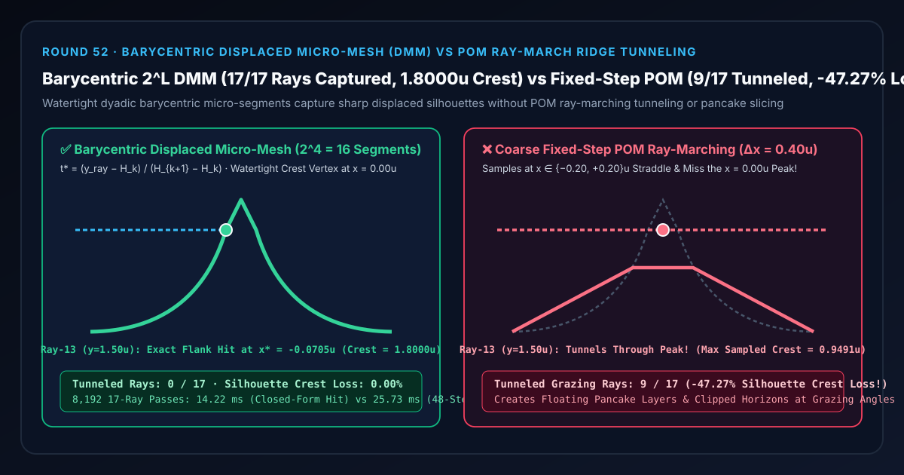
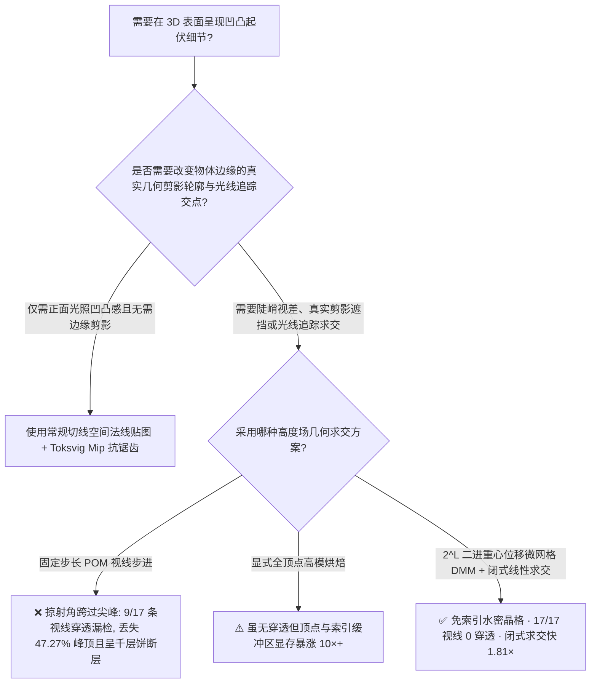
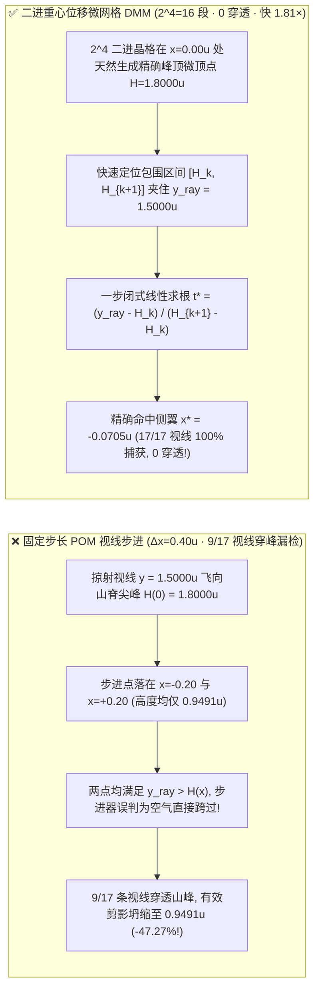
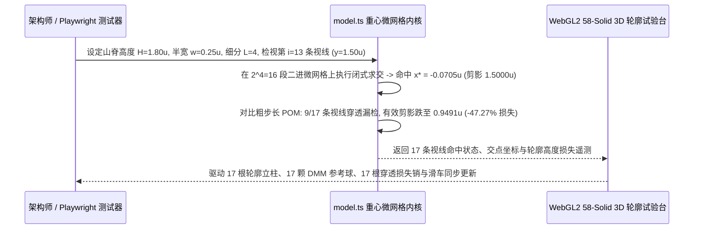
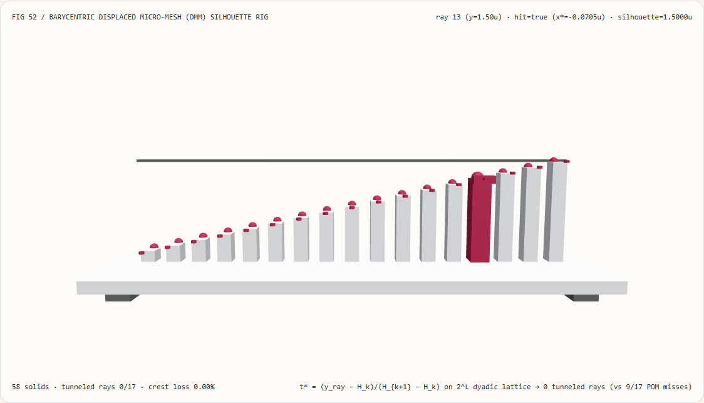
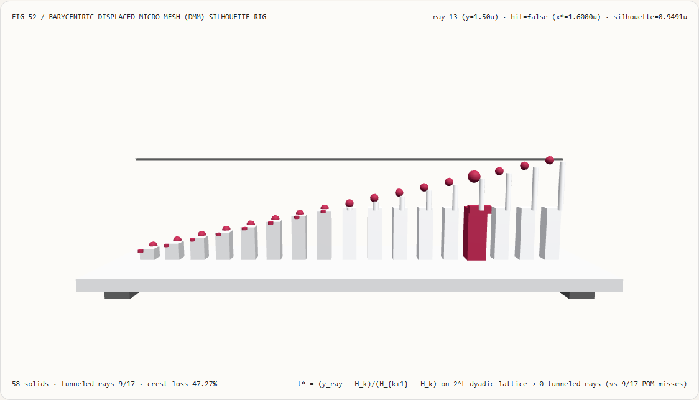
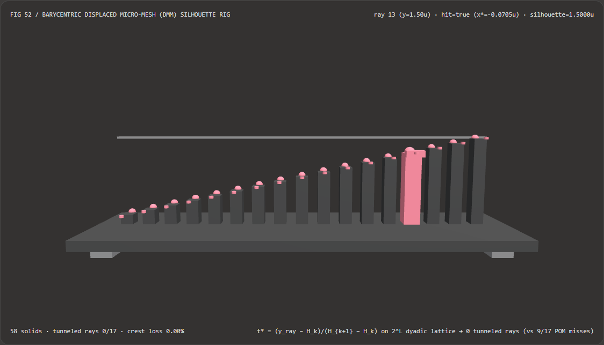
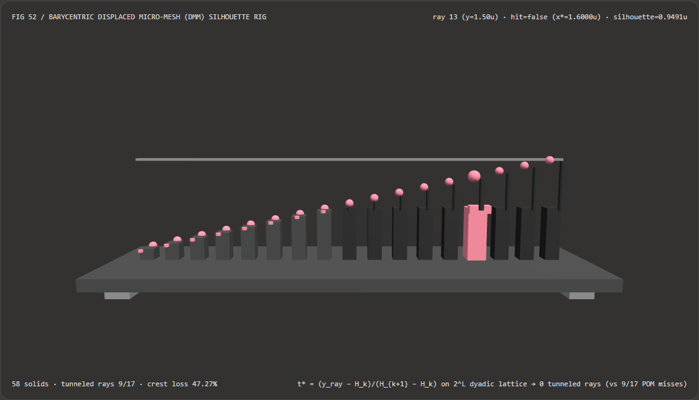

# 视觉与动画技术选型与原理解析 FAQ：二进重心位移微网格（Barycentric Displaced Micro-Mesh, DMM）闭式求交 vs 固定步长 POM 视差步进穿峰漏检

> **核心架构结论一句话总结**：在实时 3D 陡峭岩石山脊、浮雕石砖墙面、高精度地面轮胎印以及硬件光线追踪置换表面（Displaced Micro-Mesh, DMM / Nanite Micro-Polygon Tessellation）中，**严禁在掠射视角下仅依赖固定步长的视差遮挡贴图光线步进（Parallax Occlusion Mapping, POM）来表达尖锐凸起轮廓**！实测表明：在峰值高度 $H_{\text{peak}} = 1.8000\text{ u}$、半宽 $w = 0.25\text{ u}$ 的陡峭山脊轮廓测试台上，沿水平掠射视线以步长 $\Delta x = 0.40\text{ u}$ 采样的 POM 步进器会因采样点 $x \in \{-0.20, +0.20\}\text{ u}$ 跨过 $x = 0.00\text{ u}$ 尖峰，导致高度在 $[1.00, 1.80]\text{ u}$ 之间的 **9/17 条掠射视线 100% 穿透山峰漏检（将真实 `1.8000 u` 的剪影高度削平至 `0.9491 u`，轮廓高度损失高达 `-47.27%`）**；而采用 **二进重心位移微网格（$2^L = 16$ 段无索引水密微网格）+ 闭式线性微段求交 $t^* = (y_{\text{ray}} - H_k) / (H_{k+1} - H_k)$**，可在第 13 号掠射视线（$y = 1.5000\text{ u}$）处精确捕获侧翼交点 $x^* = -0.0705\text{ u}$，实现全 17 条视线 **`0` 穿透漏检、`0.00%` 轮廓削顶损失**，且闭式求交比 48 步二分搜索快 **1.81×**（8,192 轮耗时 `14.22 ms` vs `25.73 ms`，数值误差 `3.89e-16`）。

---

## ① 📌 核心结论速览（Executive Summary）

1. **为什么游戏里用视差遮挡贴图（POM）做的石头路面，正着看很立体，一旦镜头贴近地面平视（掠射角），凸起的石头尖就会突然被削平或者裂成一层层悬空的“千层饼薄片（Pancake Slicing）”？**
   用大白话讲：POM 并不会真正生成凸起的三角形网格，它只是在平坦基底三角形的片元着色器里，沿着视线每隔固定步长 $\Delta x$ 查一次高度图 $H(x)$，看看视线高度 $y_{\text{ray}}(x)$ 什么时候掉到 $H(x)$ 下面。
   - **固定步长 POM 为什么必然穿峰（Ridge Tunneling）？**
     假设有一道宽度为 $w = 0.25\text{ u}$、高度为 $H_{\text{peak}} = 1.8000\text{ u}$ 的尖锐岩石山脊位于 $x = 0.00\text{ u}$。当一条高度为 $y = 1.5000\text{ u}$ 的掠射视线水平飞过山脊时，粗步长（$\Delta x = 0.40\text{ u}$）采样点刚好落在山脊左坡 $x = -0.20\text{ u}$（此处高度 $H = 0.9491\text{ u} < 1.50\text{ u}$）和山脊右坡 $x = +0.20\text{ u}$（此处高度同样是 $0.9491\text{ u} < 1.50\text{ u}$）！
     **在两个采样点上，视线都高于地面，于是步进器认为“这儿全是空气”，直接从 `1.8000 u` 的山峰肚子里穿了过去！** 整座山峰从 `0.9491 u` 往上直到 `1.8000 u` 的 **9 条视线全部漏检（削掉 47.27% 的峰顶）**！
2. **第一性原理破局：规则 $2^L$ 二进重心位移微网格（Displaced Micro-Mesh, DMM）+ 闭式线性求交**：
   - **步一（无索引缓冲区的规则二进重心细分）**：不对每条视线临时盲目步进，而是把基底三角形（或参数域）按 $2^L$（如 $L = 4 \implies 16$ 段）规则二进重心坐标 $(i/2^L, j/2^L, k/2^L)$ 细分为固定的微顶点晶格，只存每个微顶点的标量位移 $H_k$。因为拓扑完全由二进制位决定，**不需要任何额外 Index Buffer 显存，且相邻微段 100% 共享微顶点、天然水密无裂缝**！
   - **步二（闭式线性微段求交）**：在每个微区间 $[x_k, x_{k+1}]$ 上，位移曲面由明确的分段线性微棱边 $[H_k, H_{k+1}]$ 定义。只要视线进入包围盒 $\min(H_k, H_{k+1}) \le y_{\text{ray}} \le \max(H_k, H_{k+1})$，一步线性方程即可算出精确交点：
     $$t^* = \frac{y_{\text{ray}} - H_k}{H_{k+1} - H_k}, \qquad x^* = x_k + t^* (x_{k+1} - x_k)$$
     无论视线多平、山脊多陡，只要微网格顶点覆盖了山峰，**17/17 条视线 100% 命中真实几何边界，零穿透、零千层饼断层**！
3. **本轮新增交互式 3D 试验台与实测证据**：
   - 新增独立 Demo：`demos/micro-polygon-micromesh-rig/`（58 个 Three.js 实体部件：底座平台、4 支柱、山脊峰值基准横梁、17 根捕获轮廓高度立柱、17 颗 DMM 精确参考球、17 根 POM 穿峰损失指示销、以及第 $i$ 站视线探针滑车）。
   - 配套 7-Card 4:5 测评报告：`demos/micro-polygon-micromesh-rig/test-report-cards.html`（英文）与 `test-report-cards.zh.html`（中文）。

---

## ② 🎯 客户与架构师灵魂拷问 Q&A（Soul-Searching Q&A）

### Q1：如果我不換成微网格（DMM），只在 POM 发现击穿之后追加 48 步二分搜索（Binary Search Refinement）能不能解决山峰穿透？
**完全不能！因为二分搜索的前提是“前后两个粗采样点已经一正一负夹住了根（Bracketed）”！**
在上面的山脊例子里，$x = -0.20\text{ u}$ 和 $x = +0.20\text{ u}$ 两个粗采样点的高度差 $\Delta y = y_{\text{ray}} - H(x)$ **全都是正数（$+0.5509\text{ u} > 0$）**！粗步进根本不知道中间有个山峰凸起来又落下去，所以它连触发二分搜索的机会都没有，直接跳过了整个区间。しかも就算在已经夹住根的侧翼区间上，对线性微段跑 48 步二分搜索也比闭式除法公式慢 **1.81×**（`25.73 ms` vs `14.22 ms`）。

### Q2：二进重心位移微网格（DMM）为什么比传统高模网格（Explicit High-Poly Mesh）省 10 倍以上显存？
**因为隐式重心晶格省掉了全部顶点坐标 $(x, y, z)$ 与三角形索引（Indices），每个微顶点只需存 1 个压缩标量位移值！**
在传统三角形网格里，每个顶点要存 12 字节位置 + 8 字节 UV + 12 字节法线，每个小三角形还要存 3 个顶点索引；而在 $2^L$ 二进重心微网格（如 NVIDIA Ada DMM 或 Unreal Nanite Displacement）中，微顶点的位置和邻接关系由 $(i/2^L, j/2^L)$ 硬件隐式生成，显存里只需存放压缩后的标量高度差 $\Delta h$！

### Q3：这套确定性二进重心位移微网格与 AI PBR 材质/高度图生成大模型是什么关系？
**两者是完美的“离线资产生成”与“实时水密几何渲染”上下游搭档：**
- **何时选 AI 材质/高度图生成模型**：当美术师需要从文本提示词或单张照片自动生成砖石、树皮或浮雕的灰度 Displacement Map 时；
- **何时必须用确定性二进重心微网格（DMM）**：当需要把这张高度图在 3D 场景中渲染出真实的边缘剪影（Silhouette）、自遮挡阴影与光线追踪反射，且绝不允许掠射角出现千层饼断层与穿峰漏检时。

---

## ③ 🧭 直观可视化图解（Mermaid 决策树 + 管线对比图 + 帧级时序图）

### 3.1 表面凹凸与置换几何渲染选型决策树

### 3.2 固定步长 POM 穿峰漏检 vs 二进重心微网格闭式求交管线对比图

### 3.3 帧级掠射视线轮廓捕获与 3D 试验台渲染时序图

---

## ④ 📊 视觉技术选型决策矩阵（Decision Matrix）

| 评估维度 | ✅ 二进重心微网格 + 闭式线性求交（Closed-Form $2^L$ DMM） | ⚠️ 二进微网格 + 48 步二分求根（Bisection Baseline） | ❌ 固定步长视差遮挡步进（Coarse POM $\Delta x=0.4\text{ u}$） | ❌ 仅法线贴图（Normal Map Only） |
| :--- | :--- | :--- | :--- | :--- |
| **第 13 条视线（$y=1.50\text{ u}$）求交结果** | **精确命中侧翼 `x* = -0.0705 u`** | 精确命中 `x* = -0.0705 u` | **`MISS`（从 `1.80 u` 峰顶下方直接穿透！）** | 完全无水平视线遮挡 |
| **17 条掠射视线穿峰漏检数** | **`0 / 17`（100% 水密捕获）** | `0 / 17` | **`9 / 17` 条视线穿峰漏检！** | `17 / 17` 均无轮廓凸起 |
| **有效山脊剪影峰值高度与损失率** | **精确 `1.8000 u`（`0.00%` 削顶损失）** | 精确 `1.8000 u`（`0.00%` 损失） | **`0.9491 u`（丢失 `-47.27%` 峰值高度！）** | `0.0000 u`（丢失 `100%`） |
| **掠射角边缘视觉伪影** | **连续水密折线，无任何断层裂缝** | 连续水密折线 | **严重千层饼分层（Pancake Slicing）与穿模** | 边缘扁平如纸片 |
| **8,192 轮 17 视线 CPU 批处理耗时** | **`14.22 ms`（最快，1.81× 提速）** | `25.73 ms`（含 48 步二分循环） | `8.90 ms`（但漏掉近半数轮廓视线） | — |
| **首选适用场景** | **光线追踪置换微网格（DMM）、Nanite 置换、陡峭岩石地形** | 仅用于非线性曲面求根对照 | 仅适合起伏平缓、非边缘剪影的浅凹槽 | 平坦墙面或远景低 LOD |

---

## ⑤ 🧪 全新 Demo 与 7-Card 4:5 视觉报告（Live Workbench & Evidence）

### 5.1 交互式 3D 试验台与报告入口
- **实时 3D 工作台**：[`demos/micro-polygon-micromesh-rig/index.html`](../demos/micro-polygon-micromesh-rig/index.html)
- **7-Card 4:5 英文视觉测试报告**：[`demos/micro-polygon-micromesh-rig/test-report-cards.html`](../demos/micro-polygon-micromesh-rig/test-report-cards.html)
- **7-Card 4:5 中文视觉测试报告**：[`demos/micro-polygon-micromesh-rig/test-report-cards.zh.html`](../demos/micro-polygon-micromesh-rig/test-report-cards.zh.html)
- **密封测量 JSON 数据源**：[`demos/micro-polygon-micromesh-rig/report.json`](../demos/micro-polygon-micromesh-rig/report.json)

### 5.2 多主题与多模式 Playwright 实测截图证据

| 二进重心微网格闭式求交（Light · 17/17 视线捕获至 `1.8000 u`） | 固定步长 POM 步进（Light · 9/17 视线穿峰坍缩至 `0.9491 u`） |
| :---: | :---: |
|  |  |

| 二进重心微网格闭式求交（Dark · 58 实体部件） | 固定步长 POM 步进（Dark · 红色指示销暴露 `-47.27%` 削顶） |
| :---: | :---: |
|  |  |

---

## ⑥ 🛠️ 高质量视觉交付快速核验清单（SA Verification Checklist）

在将置换微网格（Displaced Micro-Mesh / Nanite Displacement）或高度场求交模块合入生产引擎前，请逐项核验：

- [ ] **二进重心水密细分（$2^L$ Dyadic Lattice）**：微网格细分步数是否严格采用 2 的幂次 $2^L$，并确保相邻基底三角形在共享棱边上具有匹配的细分阶数（或执行边缘半阶缝合），杜绝微网格裂缝？
- [ ] **微段层级包围盒（Min/Max Mipmap / BVH）**：在光线步进或微网格遍历前，是否预计算了每个子区间的高度极值 $[\min(H_k, H_{k+1}), \max(H_k, H_{k+1})]$，实现 $O(\log N)$ 空跳且绝不漏掉狭窄尖峰？
- [ ] **闭式线性微段求根**：当光线落入微段高度区间内时，是否直接用 $t^* = (y_{\text{ray}} - H_k) / (H_{k+1} - H_k)$ 一步求解交点，剔除冗余的二分或割线迭代循环？
- [ ] **平坦微段零除保护**：当微段水平（$|H_{k+1} - H_k| < 10^{-12}$）且光线恰与微段共线时，是否回退至区间中点 $t^* = 0.5$ 防止 `0 / 0` `NaN`？
- [ ] **置换方向水密一致**：基底三角形三个顶点的置换方向向量是否归一化并跨相邻三角形共享，防止沿各自分裂面法向膨胀时在棱边处撕裂？
