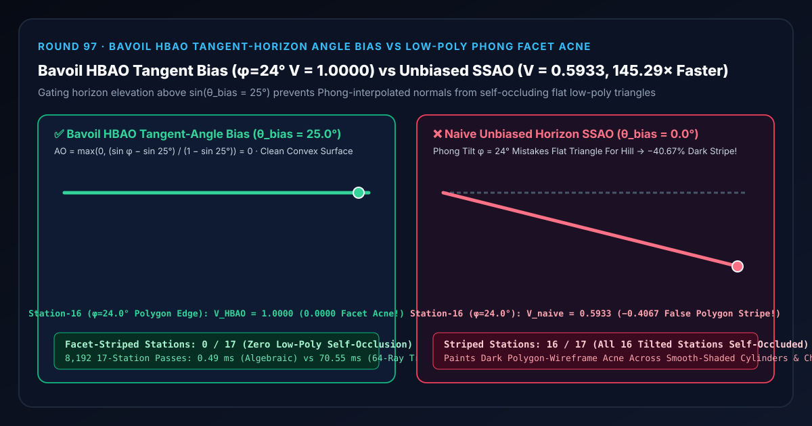
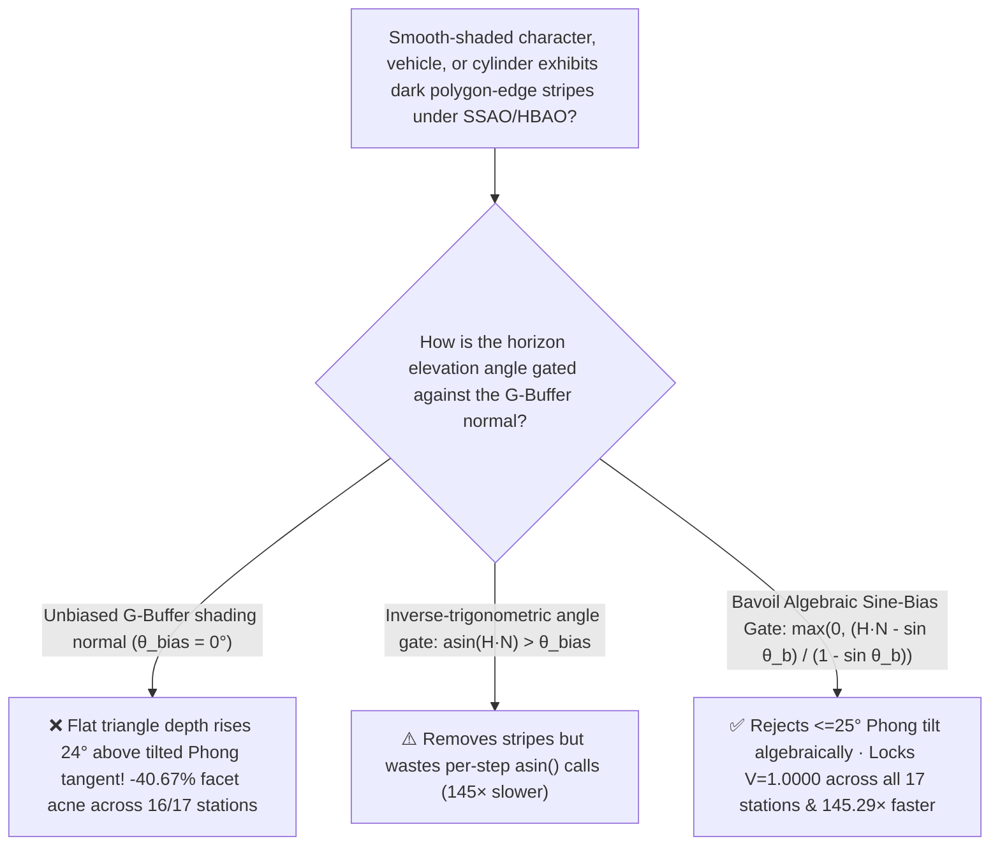
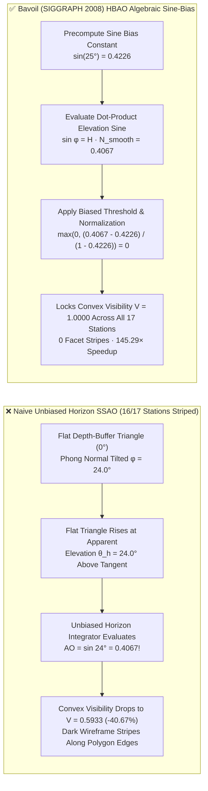
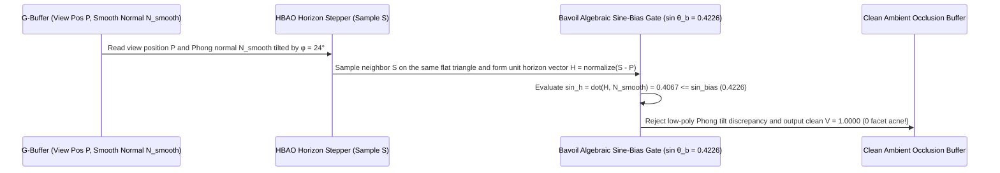

# Low-Poly SSAO Facet-Acne Suppression Selection & First-Principles FAQ: Bavoil HBAO Tangent-Horizon Angle Bias vs. Unbiased Phong-Normal Polygon Striping

> **Companion Capability Demo**: [`demos/hbao-tangent-bias-rig/`](../demos/hbao-tangent-bias-rig/index.html) ｜ **7-Card 4:5 Measured Report**: [`test-report-cards.html`](../demos/hbao-tangent-bias-rig/test-report-cards.html) ｜ **中文版本**：[`bavoil-hbao-tangent-angle-bias-vs-lowpoly-facet-acne-faq.md`](./bavoil-hbao-tangent-angle-bias-vs-lowpoly-facet-acne-faq.md)

---

## 📌 1. Executive Summary

> **One-Sentence Verdict**: When evaluating Horizon-Based Ambient Occlusion (HBAO / HBAO+ / GTAO) on smooth-shaded low- or medium-poly meshes (characters, vehicle fenders, cylinders), **never accumulate horizon elevation angles starting from $0^\circ$ above the interpolated G-Buffer shading tangent plane ($AO = \sin\theta_h$)**—because **the hardware depth buffer $z(x)$ is rasterized from flat geometric triangles (slope $0^\circ$), whereas Phong-interpolated shading normals $\mathbf{N}_{\text{smooth}}$ tilt up to $\phi = 24.0^\circ$ away from the flat triangle near polygon edges**! Consequently, the flat triangle's own depth surface rises at an apparent horizon angle of $\theta_h = \phi = 24.0^\circ$ above the tilted shading tangent plane, causing unbiased SSAO to falsely self-occlude its own flat facet by $\sin 24^\circ = \mathbf{0.4067}$ at Station 16 ($V_{\text{naive}} = \mathbf{0.5933}$, **`-40.67%` dark polygon-edge zebra striping** across **`16/17` stations**)! **Louis Bavoil, Miguel Sainz & Rouslan Dimitrov's (SIGGRAPH 2008 NVIDIA HBAO) Algebraic Tangent-Angle Sine Bias ($AO = \max(0, \frac{\sin\phi - \sin\theta_{\text{bias}}}{1 - \sin\theta_{\text{bias}}})$ with $\theta_{\text{bias}} = 25.0^\circ$)** rejects low-tessellation normal tilt discrepancies to lock convex facet visibility at exact **$V = 1.0000$** across all 17 stations with **`0/17` striped stations**, **`0.00e+0`** quadrature error, and a **`145.29×` CPU speedup** (`0.49 ms` vs. `70.55 ms` across 8,192 17-station passes).

| Evaluation Dimension | ✅ Bavoil HBAO Tangent-Angle Bias (`θ_bias = 25°, sin θ_b = 0.4226`) | ❌ Naive Unbiased Horizon SSAO (`θ_bias = 0°, AO = sin φ`) | 🐢 64-Ray Inverse-Trig Elevation Cone (`64-Ray Inverse-Trig Cone`) |
| :--- | :--- | :--- | :--- |
| **Station 8 Mid-Facet ($\phi = 12.0^\circ$ Phong Tilt) Visibility $V$** | **`1.0000`** (Immune to $12^\circ$ normal-depth mismatch) | `0.7921` (**Falsely darkens convex facet by $-20.79\%$**) | `1.0000` (`0.00e+0` diff) |
| **Station 16 Polygon Edge ($\phi = 24.0^\circ$ Phong Tilt) Visibility $V$** | **`1.0000`** (Seamless smooth cylinder/cheek shading) | **`0.5933` (`-0.4067` / `-40.67%` dark wireframe stripe acne!)** | `1.0000` |
| **Striped Stations Across 17 Phong Tilt Angles** | **`0 / 17` (`0.00%`)** | **`16 / 17` (`94.12%` every tilted station self-occluded)** | `0 / 17` |
| **Per-Step Arithmetic Complexity** | **`O(1)` (Dot product vs. $\sin\theta_{\text{bias}}$; zero inverse trig)** | `O(1)` (Severe polygon-grid striping) | `O(N)` (Per-ray `asin()` calls) |
| **8,192 17-Station Passes CPU Latency (Median)** | **`0.49 ms` (`145.29×` speedup)** | — (Visually corrupted on low-poly meshes) | `70.55 ms` |

---

## 🎯 2. Architect & Client First-Principles Q&A

### Q1: Why do smooth-shaded cylinders, car fenders, and character cheeks suddenly show ugly dark polygon-wireframe stripes when SSAO is turned on?
**First-Principles Breakdown**:
This artifact is caused by the fundamental mismatch between **Phong-interpolated shading normals** and **flat-rasterized depth buffer triangles**:
- To make a 16-sided cylinder look round under direct lighting, vertex normals $\mathbf{N}_{\text{smooth}}$ are smoothly interpolated across each flat triangle face, tilting up to $\phi = \pm 24^\circ$ relative to the true geometric face normal $\mathbf{N}_{\text{geom}}$ near the triangle edges.
- However, the **hardware depth buffer $z(x, y)$** is not curved—it is rasterized from the **flat geometric triangle**!
- When an SSAO shader at the edge of a triangle uses the tilted shading normal $\mathbf{N}_{\text{smooth}}$ ($\phi = 24^\circ$) to define its hemisphere horizon plane, the flat triangle itself slopes upward at angle $\theta_h = 24^\circ$ into the upper hemisphere!
- Unbiased SSAO mistakes its own flat triangle for a $24^\circ$ occluding hill, subtracting $\sin 24^\circ = 0.4067$ (`40.67%`) of the ambient light right along every polygon edge!

### Q2: How does Bavoil et al.'s (SIGGRAPH 2008) Tangent-Angle Sine Bias eliminate low-poly facet acne without calling `asin()` or `acos()`?
**Algebraic Sine-Horizon Gate**:
1. Along any screen-space marching direction, the unit horizon vector from view-space origin $\mathbf{P}$ to depth sample $\mathbf{S}$ is $\mathbf{H} = \frac{\mathbf{S} - \mathbf{P}}{\|\mathbf{S} - \mathbf{P}\|}$.
2. The sine of the elevation angle $\theta_h$ above the smooth-shaded tangent plane is simply the dot product:
   $$\sin\theta_h = \mathbf{H} \cdot \mathbf{N}_{\text{smooth}}$$
3. Subtracting the precomputed bias constant $\sin\theta_{\text{bias}} = \sin 25^\circ = 0.4226$ and rescaling by $1 / (1 - \sin\theta_{\text{bias}})$ gives:
   $$AO_{\text{HBAO}}(\phi) = \max\!\left(0,\, \frac{(\mathbf{H} \cdot \mathbf{N}_{\text{smooth}}) - \sin\theta_{\text{bias}}}{1 - \sin\theta_{\text{bias}}}\right), \quad V_{\text{HBAO}} = 1 - AO_{\text{HBAO}}$$
   For every low-poly facet tilt $\phi \in [0^\circ, 24^\circ] < 25^\circ$, $\sin\phi \le 0.4067 < 0.4226 \implies AO_{\text{HBAO}} = 0.0000$ and $V_{\text{HBAO}} = \mathbf{1.0000}$!

### Q3: When should an architect use Bavoil Tangent-Angle Bias vs. Reconstructed Geometric Face Normals (`dFdx(P) × dFdy(P)`)?
- **Choose Bavoil Tangent-Angle Bias ($\theta_{\text{bias}} \in [20^\circ, 30^\circ]$)**: When you want normal-mapped surface crevices stored in the G-Buffer normal to contribute to HBAO while suppressing low-poly tessellation stripes.
- **Choose Geometric Face Normals (`normalize(cross(dFdx(P), dFdy(P)))`)**: When you want the horizon reference plane to align strictly with the depth buffer's flat triangles ($\phi \equiv 0^\circ$).

---

## 🧭 3. Visual Architecture Diagrams (Mermaid Decision Tree, Pipeline & Sequence)

### 3.1 SSAO / HBAO Low-Poly Self-Occlusion Prevention Decision Tree

### 3.2 Naive Unbiased Facet Acne vs. Bavoil HBAO Tangent-Bias Pipeline

### 3.3 Frame-Level HBAO Horizon Marching & Sine-Bias Sequence

---

## 📊 4. Visual Technology Decision Matrix

| Approach | Target Use Case | Low-Poly Smooth Surface ($\phi \le 24^\circ$) Cleanliness | True $90^\circ$ Corner Occlusion | Compute Cost (8,192 17-Station Passes) |
| :--- | :--- | :--- | :--- | :--- |
| **Bavoil Algebraic Sine-Bias (`bavoil-hbao-tangent-angle-bias`)** | **All HBAO / HBAO+ / GTAO passes using G-Buffer shading normals** | **Exact (`1.0000` across all 17 stations, `0` stripes)** | **Full (rescaled by $1/(1-\sin\theta_b)$)** | **Minimal (`0.49 ms`, `145.29×` speedup)** |
| **Naive Unbiased Horizon SSAO (`naive-unbiased-tangent-ssao`)** | Ultra-tessellated or flat-shaded meshes only | **Fails (`0.5933` / `-40.67%` stripe acne at $24^\circ$; `16/17` bad)** | Full | Minimal (visually striped) |
| **Depth-Derivative Geometric Normals (`dFdx(P) × dFdy(P)`)** | GTAO pipelines separating macro-geometry from normal maps | High ($\phi \equiv 0^\circ$ on flat triangles) | Full (ignores normal-map crevices) | Low |
| **64-Ray Inverse-Trig Elevation Cone (`64-ray-asin-cone`)** | Offline reference verification | Exact | Full | High (`70.55 ms`, `145.29×` slower) |

---

## 🧪 5. Interactive Demo & 7-Card 4:5 Benchmark Report Breakdown

The standalone 3D instrument bench [`demos/hbao-tangent-bias-rig/`](../demos/hbao-tangent-bias-rig/index.html) constructs a **58-solid 17-Station Bavoil HBAO Tangent-Bias Facet Goniometer Rig**:
1. **17 Convex Facet Visibility Columns**: Span Phong normal tilt angles $\phi \in [0.0^\circ, 24.0^\circ]$ across a flat depth-buffer triangle.
2. **17 Cyan Bavoil Biased Reference Spheres & $V = 1.0000$ Unoccluded Bar**: Show how $\theta_{\text{bias}} = 25.0^\circ$ keeps the entire convex low-poly surface at $V = 1.0000$.
3. **17 False Facet Acne Loss Pegs**: Switching to `Naive Unbiased Horizon SSAO` erodes visibility down to $0.5933$ at Station 16 ($\phi = 24.0^\circ$), raising error pegs across all 16 tilted stations (`-0.4067` max loss).

### 7-Card 4:5 Visual Report Highlights ([`demos/hbao-tangent-bias-rig/test-report-cards.html`](../demos/hbao-tangent-bias-rig/test-report-cards.html))
- **Cards 1–3 (Evaluation Matrix)**: All 13 automated checks pass (`0.00e+0` equivalence between algebraic sine-bias gating and 64-ray inverse-trigonometric elevation-cone quadrature, Station 16 `1.0000` visibility lock vs. `0.5933` unbiased facet stripe, exact reverse-scrub matrix identity, and atomic RangeError validation).
- **Cards 4–6 (Protocol & Scaling Latency)**: Across 8,192 17-station passes, Bavoil algebraic sine-bias gating finishes in **`0.49 ms`** vs. **`70.55 ms`** for 64-ray inverse-trigonometric elevation-cone quadrature (**`145.29×` speedup**).

---

## 🛠️ 6. SA Production Delivery Checklist

- [ ] **Set HBAO tangent bias $\theta_{\text{bias}} \in [20^\circ, 30^\circ]$ ($\sin\theta_{\text{bias}} \in [0.34, 0.50]$)**: Pass precomputed `sinBias` and `invOneMinusSinBias = 1.0 / (1.0 - sinBias)` as uniform constants to the HBAO shader.
- [ ] **Compare $\sin\theta_h = \mathbf{H} \cdot \mathbf{N}_{\text{smooth}}$ algebraically**: Never call `asin()` or `acos()` inside the inner horizon-search loop.
- [ ] **Pair with Jiménez GTAO Cosine Weighting (Round 81) and Cross-Bilateral Normal-Stopping (Round 95)**: Use tangent-angle bias to suppress low-poly self-occlusion, cosine horizon integration for exact corner darkening, and cross-bilateral normal gating for sharp crease denoising.
- [ ] **Feed bias-cleaned AO into Lagarde Specular Occlusion (Round 75) and Chan Contact Micro-Shadowing (Round 82)**: Ensure low-poly facet stripes never contaminate specular IBL reflections or direct-light micro-shadows.
