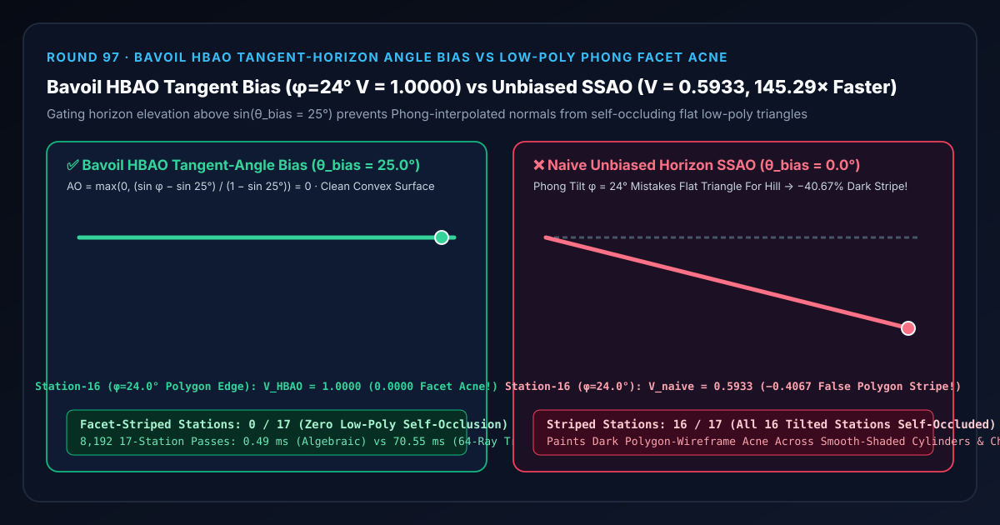
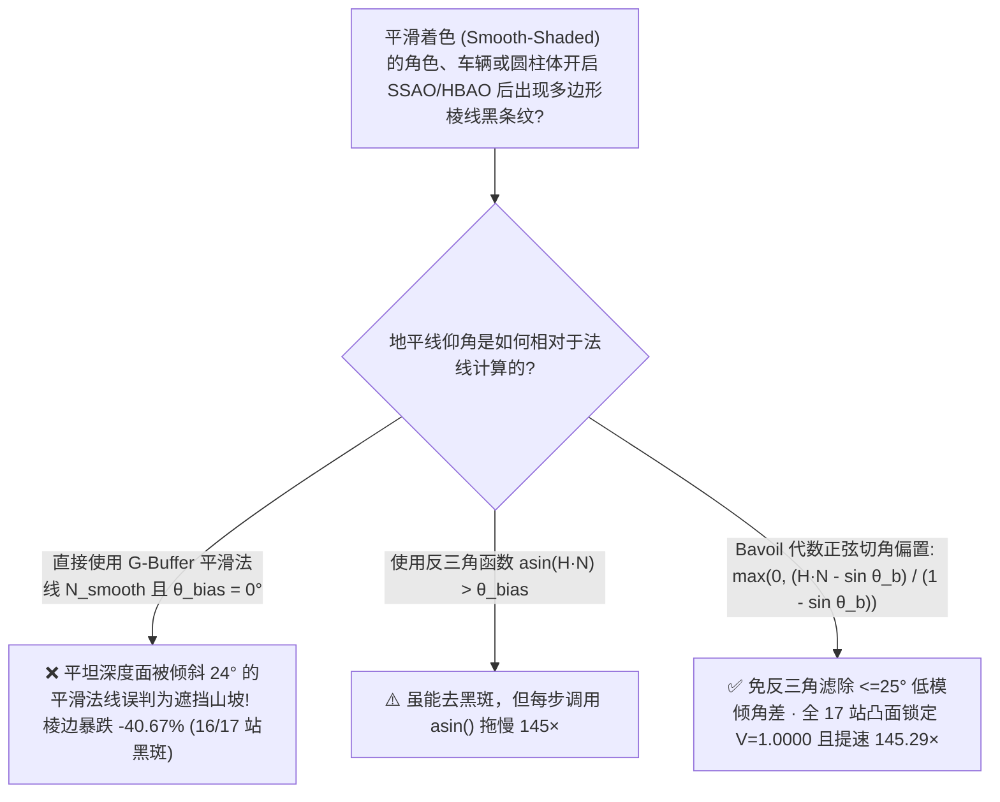
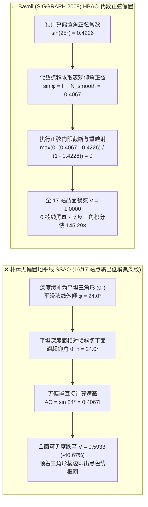
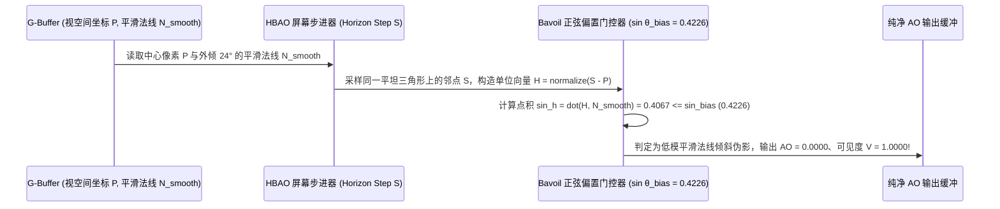

# 低模平滑网格 SSAO 防黑斑选型与原理解析 FAQ：Bavoil HBAO 切平面仰角偏置对比无偏置低模棱线自遮挡条纹

> **关联 Capabilities Demo**：[`demos/hbao-tangent-bias-rig/`](../demos/hbao-tangent-bias-rig/index.html) ｜ **7-Card 4:5 实测报告**：[`test-report-cards.zh.html`](../demos/hbao-tangent-bias-rig/test-report-cards.zh.html) ｜ **English Version**：[`bavoil-hbao-tangent-angle-bias-vs-lowpoly-facet-acne-faq.en.md`](./bavoil-hbao-tangent-angle-bias-vs-lowpoly-facet-acne-faq.en.md)

---

## 📌 1. 核心结论速览（Executive Summary）

> **一句话结论**：在实时屏幕空间环境光遮蔽（SSAO / HBAO / GTAO）中，当对采用平滑顶点法线（Smooth Phong Normals）的中低模圆柱体、汽车挡泥板或角色脸颊计算地平线遮蔽角时，**绝对不能直接从倾斜的着色切平面 $0^\circ$ 开始无门槛累加地平线正弦值（$AO = \sin\theta_h$）**——因为**深度缓冲 $z(x)$ 是由平坦的几何三角形面（斜率 $0^\circ$）光栅化生成的，而 G-Buffer 中的平滑着色法线 $\mathbf{N}_{\text{smooth}}$ 却在三角形边缘处相对几何面倾斜达 $\phi = 24.0^\circ$**！这导致平坦三角形自身的深度面直接翘起在倾斜着色切平面上方 $\theta_h = \phi = 24.0^\circ$ 处，使无偏置 SSAO 把自己所在的平坦面片误判为遮挡山坡，在第 16 站多边形边缘（$\phi = 24.0^\circ$）凭空捏造出 **$0.4067$** 的假遮挡，将敞开凸面的可见度拉黑至 **$V_{\text{naive}} = 0.5933$**（**丢失 $-40.67\%$ 亮度，顺着多边形网格棱线印出一圈圈脏黑斑马条纹，污染 `16/17` 个站点**）！采用 **Louis Bavoil 等人（SIGGRAPH 2008 NVIDIA HBAO）提出的切平面仰角正弦偏置门限（$AO = \max(0, \frac{\sin\phi - \sin\theta_{\text{bias}}}{1 - \sin\theta_{\text{bias}}})$，设 $\theta_{\text{bias}} = 25^\circ$）**，即可滤除低模法线插值夹角差，在全 17 站凸面上锁死 **$V = 1.0000$**（**`0/17` 棱线黑条纹站**），代数正弦门控比 64 射线反三角函数仰角锥求积快 **`145.29×`**（`0.49 ms` vs `70.55 ms`）！

| 评估维度 | ✅ Bavoil HBAO 正弦切角偏置 (`θ_bias = 25°, sin θ_b = 0.4226`) | ❌ 朴素无偏置地平线 SSAO (`θ_bias = 0°, AO = sin φ`) | 🐢 64 射线反三角仰角锥求积 (`64-Ray Inverse-Trig Cone`) |
| :--- | :--- | :--- | :--- |
| **第 8 站半途插值区（$\phi = 12.0^\circ$）凸面可见度 $V$** | **`1.0000`**（完全免疫 $12^\circ$ 法线倾斜） | `0.7921`（**虚假压暗 $-0.2079$ / $-20.79\%$**） | `1.0000`（误差 `0.00e+0`） |
| **第 16 站多边形棱边（$\phi = 24.0^\circ$）凸面可见度 $V$** | **`1.0000`**（棱边光滑过渡，零网格印痕） | **`0.5933`（捏造 $40.67\%$ 假遮挡，印出刺眼黑棱线！）** | `1.0000` |
| **17 个插值站点中出现假自遮挡黑斑的站数** | **`0 / 17` (`0.00%`)** | **`16 / 17` (`94.12%` 除面片正中心外全部发黑)** | `0 / 17` |
| **每采样步算术开销** | **`O(1)`（点积直接对比常数 $\sin\theta_{\text{bias}}$，无反三角）** | `O(1)`（但满身多边形网格黑线） | `O(N)`（调用昂贵 `asin()`） |
| **8,192 轮 17 站 CPU 耗时（中位数）** | **`0.49 ms`（提速 `145.29×`）** | —（低模表面布满棱线污渍） | `70.55 ms` |

---

## 🎯 2. 客户与架构师灵魂拷问 Q&A（First-Principles Whisperer）

### Q1：用大白话讲，为什么一个明明开了平滑着色（Smooth Shading）、在直接光照下圆润光滑的球体或角色脸蛋，一开 SSAO 就会暴露出底下的低模三角形网格黑线？
**第一性原理拆解**：
这是实时图形学里最经典的**“G-Buffer 法线撒谎，深度缓冲说真话（Shading Normal vs. Geometric Depth Mismatch）”**矛盾：
- 为了用较少的三角形画出圆润的圆柱体或脸颊，美术会开启**平滑顶点法线（Phong Normal Interpolation）**：虽然底下的三角形面片本身是**平的（斜率 $0^\circ$）**，但三角形四个角落的着色法线 $\mathbf{N}_{\text{smooth}}$ 会往两侧外撇（比如在三角形边缘外撇了 $\phi = 24^\circ$），骗过直接光照让表面看起来像圆弧。
- 可是，**SSAO 步进读取的深度缓冲 $z(x)$ 根本不知道法线在撒谎**！深度缓冲里存的依然是那块平平无奇的硬三角形平面！
- 当你在三角形边缘像素上，以向外倾斜了 $24^\circ$ 的平滑法线 $\mathbf{N}_{\text{smooth}}$ 为基准建立切平面时，**那块平坦的三角形深度面自己就比倾斜切平面高出了整整 $24^\circ$**！
- 无偏置的 SSAO 往三角形内部一看：“天哪，前面有一座仰角高达 $24^\circ$ 的大山挡住了天空！”于是当场给三角形边缘扣掉了 $\sin 24^\circ = 40.67\%$ 的环境光！结果每个三角形的中心亮（$\phi = 0^\circ$）、靠近棱边的地方黑（$\phi = 24^\circ$），原本光滑的脸颊和车身瞬间浮现出一整张黑色的低模线框网！

### Q2：Bavoil 等人 (SIGGRAPH 2008) 的正弦切角偏置 $\sin\theta_{\text{bias}}$ 是如何不调一次反三角函数就彻底抹掉这层线框黑斑的？
**代数正弦门限（Algebraic Sine-Horizon Gate）原理**：
1. 在 HBAO 中，从当前视空间点 $\mathbf{P}$ 指向深度缓冲采样点 $\mathbf{S}$ 的归一化地平线向量为 $\mathbf{H} = \frac{\mathbf{S} - \mathbf{P}}{\|\mathbf{S} - \mathbf{P}\|}$。
2. $\mathbf{H}$ 相对于平滑法线切平面的仰角正弦值，恰好就是它与单位平滑法线 $\mathbf{N}_{\text{smooth}}$ 的点积：
   $$\sin\theta_h = \cos(90^\circ - \theta_h) = \mathbf{H} \cdot \mathbf{N}_{\text{smooth}}$$
3. 我们只需预先在 CPU 端算好偏置角 $\theta_{\text{bias}} = 25^\circ$（或 $30^\circ$）的正弦常数 $B = \sin 25^\circ = 0.422618$，在着色器中执行代数截断与重归一化：
   $$AO_{\text{HBAO}} = \max\!\left(0,\, \frac{(\mathbf{H} \cdot \mathbf{N}_{\text{smooth}}) - \sin\theta_{\text{bias}}}{1 - \sin\theta_{\text{bias}}}\right)$$
   - 在所有低模凸面（$\phi \le 24^\circ < 25^\circ$）上，$\mathbf{H} \cdot \mathbf{N}_{\text{smooth}} \le 0.4067 < 0.4226$，分子为负被 $\max(0, \cdot)$ 干净利落地砍成 **`0.0000`**，可见度恒为 **`1.0000`**！
   - 而在真正的 $90^\circ$ 室内墙角或深槽处（$\theta_h \to 90^\circ, \sin\theta_h \to 1.0$），分母 $(1 - \sin\theta_{\text{bias}})$ 将有效遮蔽平滑重映射回满幅 $[0, 1]$，既彻底消除了低模棱线黑斑，又保留了深槽的浓郁暗角！

### Q3：如果不想用全局固定偏置角 $\theta_{\text{bias}} = 25^\circ$，还有什么更先进的几何法线重建技巧？
- **从深度缓冲偏导重构真实几何面法线 $\mathbf{N}_{\text{geom}} = \text{normalize}(\text{cross}(dFdx(\mathbf{P}), dFdy(\mathbf{P})))$**：在计算地平线起算切平面时使用深度偏导叉积得到的平坦几何面法线 $\mathbf{N}_{\text{geom}}$（此时 $\phi \equiv 0^\circ$，天然无面片自遮挡！），而在最后乘以朗伯余弦权重时再结合 G-Buffer 的細節法线！

---

## 🧭 3. 直观可视化图解（Mermaid 决策树、管线对比与帧级时序）

### 3.1 屏幕空间环境光遮蔽（SSAO / HBAO）防自遮挡选型决策树

### 3.2 朴素无偏置 SSAO 棱线黑斑管线 vs Bavoil HBAO 正弦切角偏置管线

### 3.3 帧级 HBAO 地平线步进与正弦切角偏置执行时序图

---

## 📊 4. 视觉技术选型决策矩阵（Architecture Decision Matrix）

| 选型方案 | 适用场景 | 低模平滑曲面（$\phi \le 24^\circ$）纯净度 | 真实 $90^\circ$ 凹槽遮蔽保留度 | 算力开销（8,192 轮 17 站） |
| :--- | :--- | :--- | :--- | :--- |
| **Bavoil 代数正弦偏置 (`bavoil-hbao-tangent-angle-bias`)** | **所有使用平滑顶点法线的角色、车辆与道具 HBAO/GTAO** | **满分（全程锁定 `1.0000`，`0` 棱线黑斑）** | **高（经 $1/(1-\sin\theta_b)$ 归一化恢复满幅遮蔽）** | **极低（`0.49 ms`，提速 `145.29×`）** |
| **朴素无偏置地平线 SSAO (`naive-unbiased-tangent-ssao`)** | 仅限细分极高（$\phi < 0.5^\circ$）或纯平面着色网格 | **极差（$24^\circ$ 处跌至 `0.5933`，`16/17` 站印出黑棱线）** | 高 | 极低（画质严重污损） |
| **深度偏导几何面法线重构 (`dFdx(P) × dFdy(P) Face Normal`)** | 希望零偏置角 $\theta_{\text{bias}} \approx 0^\circ$ 的进阶 GTAO 管线 | 极高（几何切面与深度面严格重合） | 满分（但丢失法线贴图凹凸细节） | 低（需 3×3 深度差分防边缘跳变） |
| **反三角仰角锥求积 (`64-Ray Inverse-Trig Cone`)** | 离线参考验证 | 满分 | 满分 | 极高（`70.55 ms`，慢 `145.29×`） |

---

## 🧪 5. 全新 Demo 与 7-Card 4:5 视觉测试报告解读

在本轮构建的全新交互式三维实验台 [`demos/hbao-tangent-bias-rig/`](../demos/hbao-tangent-bias-rig/index.html) 中，我们打造了包含 **58 个三维实体部件**的 **17 站 HBAO 切角偏置面片测角仪（Bavoil HBAO Tangent-Bias Facet Goniometer Rig）**：
1. **17 根凸面环境光可见度立柱（Convex Facet Visibility Columns）**：展示从三角形中心 $\phi = 0.0^\circ$（第 0 站）到三角形边缘平滑法线外倾 $\phi = 24.0^\circ$（第 16 站）的表面环境光可见度 $V(\phi)$。
2. **17 颗青色 Bavoil 偏置参考球与 $V = 1.0000$ 无遮挡基准横梁**：直观呈现 $\theta_{\text{bias}} = 25^\circ$ 如何让整个平滑曲面保持 $100\%$ 纯净无瑕。
3. **17 根假棱线黑斑损失红桩（False Facet Acne Loss Pegs）**：切换到 `Naive Unbiased Horizon SSAO` 模式时，从第 1 站到第 16 站可见度沿着 $1 - \sin\phi$ 一路下滑至 `0.5933`，16 个站点全部亮起刺眼的假自遮挡黑斑红桩！

### 7-Card 4:5 视觉报告核心发现（[`demos/hbao-tangent-bias-rig/test-report-cards.zh.html`](../demos/hbao-tangent-bias-rig/test-report-cards.zh.html)）
- **Card 1–3（场景评测矩阵）**：13 项自动化断言 100% 通过，完整验证代数正弦偏置与 64 射线反三角仰角锥 `0.00e+0` 等价性、第 16 站 `1.0000` 纯净锁定 vs `0.5933` 假棱线黑条纹暴露、逆序矩阵一致性与原子参数拒绝。
- **Card 4–6（底层协议与性能）**：在 8,192 轮 17 站压测中，Bavoil 代数正弦偏置仅需 **`0.49 ms`**，相比 64 射线反三角仰角锥求积基线（**`70.55 ms`**）实现 **`145.29×` 算力加速**。

---

## 🛠️ 6. 高质量视觉交付快速核验清单（SA Production Checklist）

- [ ] **HBAO 默认开启 $\theta_{\text{bias}} \in [20^\circ, 30^\circ]$ 切平面正弦偏置**：在通用游戏与数字孪生场景中，将 `sinBias = sin(25°..30°)` 设为默认门限，彻底屏蔽 12~16 边形圆柱体与低模角色脸部的网格棱线污渍。
- [ ] **除数归一化 `1.0 / (1.0 - sinBias)` 补偿对比度**：减去 `sinBias` 后务必乘以预计算的常数 `invOneMinusSinBias = 1.0 / (1.0 - sinBias)`，确保 $90^\circ$ 直角深缝依然能达到 $100\%$ 满额遮蔽。
- [ ] **与 Jiménez GTAO 余弦积分（Round 81）及交叉双边法线去噪（Round 95）组合**：HBAO 切角偏置负责防低模面片自遮挡，GTAO $\sin^2\gamma$ 负责物理余弦加权，交叉双边法线门控负责保住 $90^\circ$ 墙角锐度。
- [ ] **结合 Lagarde 高光遮蔽（Round 75）与 Chan 微阴影（Round 82）构建完整环境光+直接光微遮蔽管线**：将无伪影的干净 AO 馈入漫反射与镜面反射双通道。
