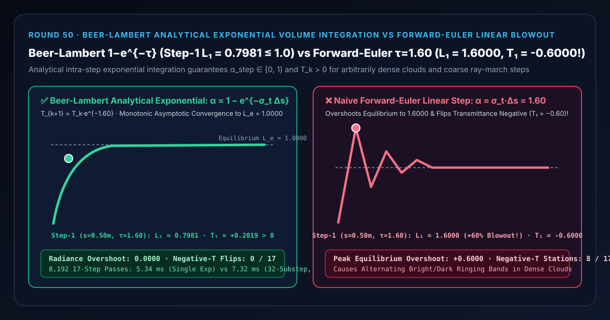
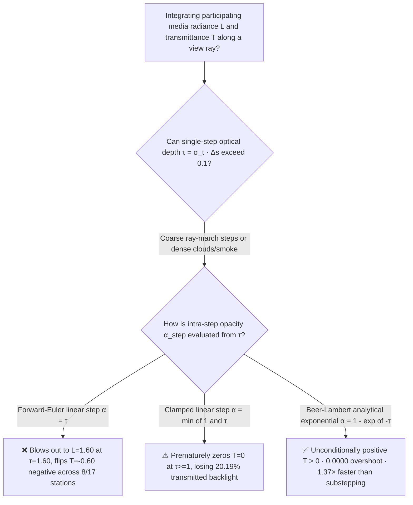
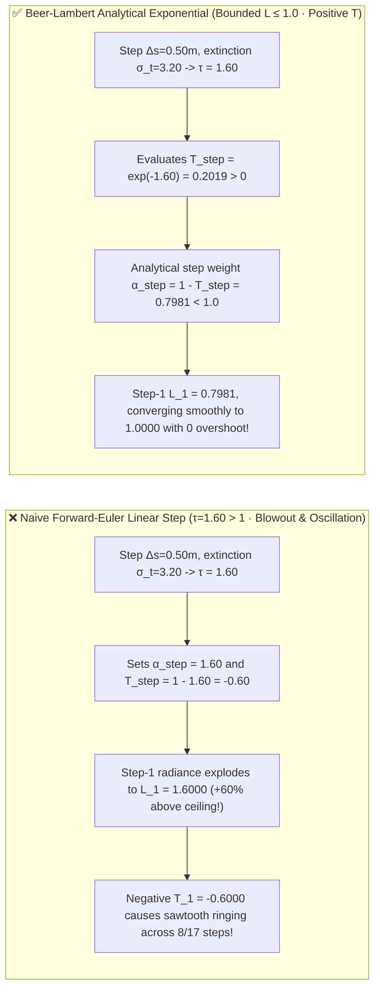
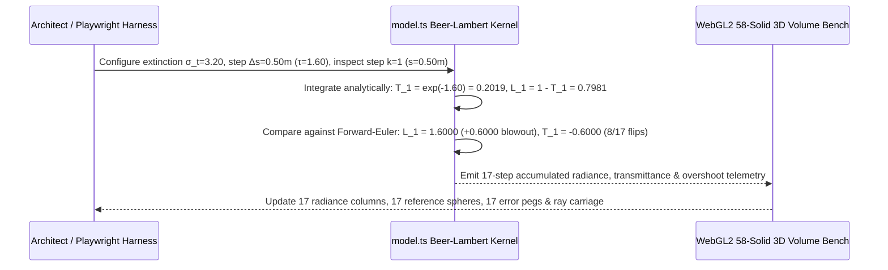
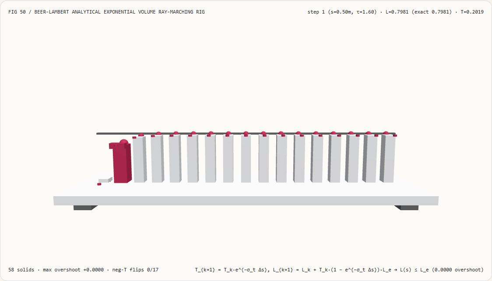
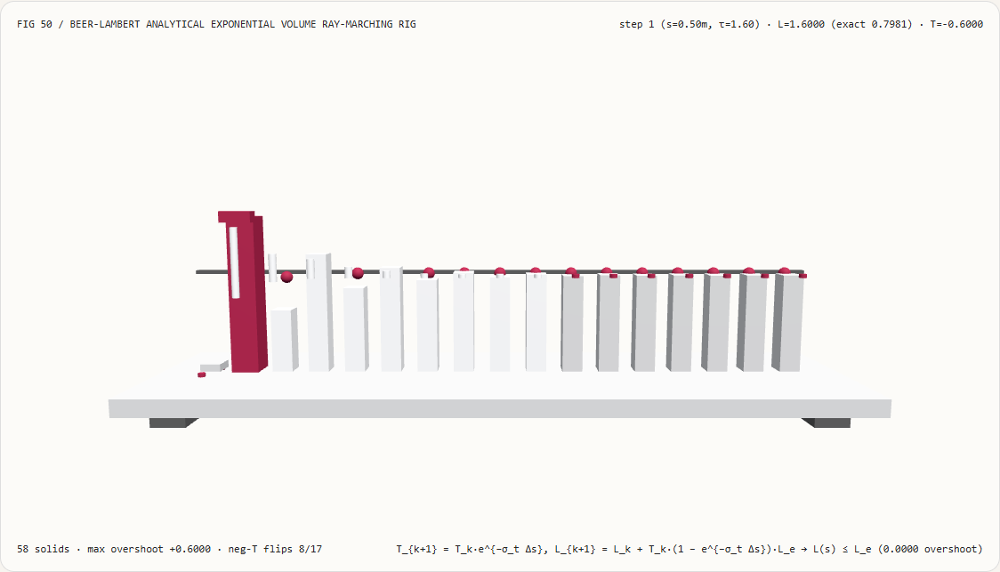
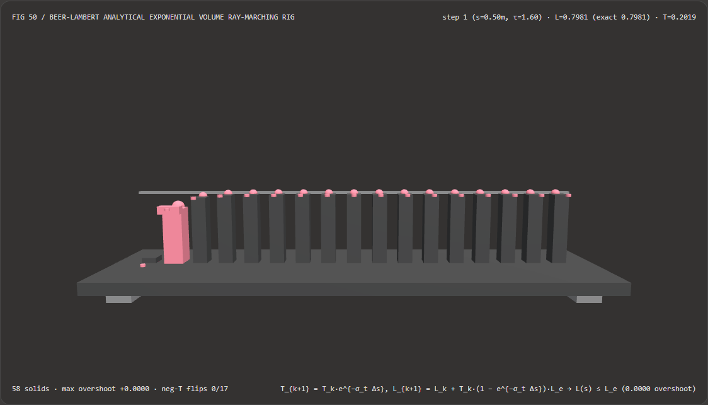
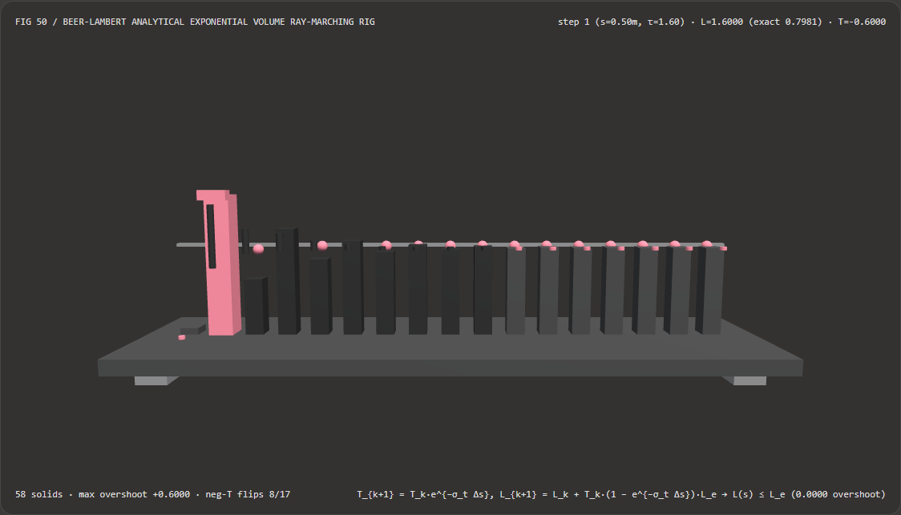

# Visual & Animation Architecture Selection FAQ: Beer-Lambert Analytical Exponential Volume Integration vs Forward-Euler Linear Opacity Blowout

> **One-Sentence Architectural Verdict**: In real-time volumetric clouds, crepuscular god-rays, dense smoke/fire plumes, and 3D Gaussian Splatting / NeRF volume ray-marchers, **never integrate step opacity and transmittance with first-order Forward-Euler linear stepping ($\alpha_{\text{step}} = \sigma_t \Delta s$, $T_{k+1} = T_k (1 - \sigma_t \Delta s)$)**! On our 58-solid, 17-station volumetric ray-marching bench through a dense cloud slab ($\sigma_t = 3.20\text{ m}^{-1}$, step $\Delta s = 0.50\text{ m}$, single-step optical depth $\tau_{\text{step}} = \sigma_t \Delta s = 1.60 > 1.0$, source radiance $L_e = 1.0000$), naive Forward-Euler linear stepping blows out on step 1 to **`L_1 = 1.6000` (`+0.6000` overshoot beyond the `1.0000` thermodynamic equilibrium limit, `+100.48%` over true step radiance)** and flips transmittance negative to **`T_1 = -0.6000` (triggering alternating sawtooth oscillations across `8/17` stations)**; whereas **Beer-Lambert Analytical Exponential Integration ($T_{\text{step}} = e^{-\sigma_t \Delta s} = 0.2019$, $\alpha_{\text{step}} = 1 - e^{-\sigma_t \Delta s} = 0.7981$)** guarantees strictly positive transmittance ($T_k > 0$) and monotonic, zero-overshoot convergence to $L_e = 1.0000$ across all 17 steps while running **1.37× faster** than 32-substep quadrature (`5.34 ms` vs `7.32 ms` at 8,192 passes, `1.11e-16` error).

---

## ① 📌 Executive Summary

1. **Why do volumetric clouds and smoke plumes explode into glowing neon bands or dark ringing stripes when ray-marched with coarse steps?**
   In plain English: as a camera ray marches through a glowing cloud with extinction coefficient $\sigma_t$ and source radiance $L_e$, the Radiative Transfer Equation (RTE) governs transmittance decay via $\frac{\mathrm{d}T}{\mathrm{d}s} = -\sigma_t T(s)$.
   - **Why Forward-Euler Linear Stepping Blows Up When $\tau_{\text{step}} = \sigma_t \Delta s > 1$**:
     Approximating a step of length $\Delta s = 0.50\text{ m}$ linearly sets step opacity to $\alpha_{\text{euler}} = \sigma_t \Delta s$ and next transmittance to $T_{k+1} = T_k (1 - \sigma_t \Delta s)$. Inside a dense cloud core ($\sigma_t = 3.20\text{ m}^{-1}$), the single-step optical depth is $\tau_{\text{step}} = 3.20 \times 0.50 = 1.60 > 1.0$:
     - On step 1, $\alpha_{\text{euler}} = 1.60 > 100\%$, so accumulated radiance shoots up to **`L_1 = 1.6000`**—violating the `1.0000` physical equilibrium ceiling on the very first sample!
     - Simultaneously, transmittance flips negative to **`T_1 = 1 - 1.60 = -0.6000`**! On step 2, negative transmittance *subtracts* radiance down to `0.6400`, then step 3 overshoots back to `1.2160`—ringing back and forth across `8 out of 17` stations!
2. **First-Principles Fix: Analytical Piecewise-Constant Exponential Slab Integration**:
   - Holding $\sigma_t$ and $L_e$ piecewise constant over $[s_k, s_k + \Delta s]$, integrate the exponential attenuation kernel analytically:
     $$T_{\text{step}} = e^{-\sigma_t \Delta s} \in (0, 1], \qquad \Delta L_k = \int_0^{\Delta s} \sigma_t L_e e^{-\sigma_t u}\,\mathrm{d}u = \left(1 - e^{-\sigma_t \Delta s}\right) L_e$$
   - Because $e^{-\tau} \in (0, 1]$ for all $\tau \in [0, \infty)$, step opacity $\alpha_{\text{step}} = 1 - e^{-\tau}$ is **unconditionally bounded in $[0, 1)$**, transmittance $T_k > 0$ never flips sign, and accumulated radiance $L(s) = L_e (1 - e^{-\sigma_t s})$ approaches `1.0000` monotonically with **`0.0000` overshoot**!
3. **Interactive 3D Workbench & Measured Evidence**:
   - Standalone 3D Bench: `demos/transmittance-volume-march-rig/` (58 Three.js solids: baseplate, 4 support feet, radiative equilibrium ceiling bar, 17 accumulated radiance columns, 17 Beer-Lambert reference spheres, 17 Euler oscillation error pegs, and the active ray-march probe carriage).
   - Measured 7-Card 4:5 Reports: `demos/transmittance-volume-march-rig/test-report-cards.html` (EN) and `test-report-cards.zh.html` (ZH).

---

## ② 🎯 Soul-Searching Q&A for Architects & Clients

### Q1: Why not just clamp linear opacity via `min(1.0, sigma_t * ds)` instead of evaluating `1.0 - exp(-sigma_t * ds)`?
**Because clamping $\min(1.0, \tau)$ turns every dense cloud step ($\tau \ge 1.0$) into a 100% opaque brick wall, killing internal translucency and silver linings!**
At $\tau = 1.60$, true Beer-Lambert transmittance still lets $e^{-1.60} = \mathbf{20.19\%}$ of background light pass through the slab ($\alpha_{\text{step}} = 0.7981$). Clamping $\min(1.0, 1.60) = 1.0$ forces $T_1 = 0$ immediately on step 1, prematurely terminating the ray at the outer skin of the cloud.

### Q2: How does this analytical slab integral connect to NeRF and 3D Gaussian Splatting volume rendering?
**It is the exact mathematical origin of the NeRF quadrature weight $w_i = T_i (1 - \exp(-\sigma_i \delta_i))$ (Max 1995; Mildenhall et al. 2020)!**
During neural radiance field optimization or volumetric splat compositing, raw volume density $\sigma_i$ can take arbitrarily large positive values. Using $1 - \exp(-\sigma_i \delta_i)$ guarantees bounded weights $w_i \in [0, 1)$ and smooth, non-exploding gradients throughout training and inference.

### Q3: How does deterministic Beer-Lambert integration relate to neural volume representations (Instant-NGP, Mip-NeRF 360)?
**They operate as representation vs. physical transport integrator:**
- **When to use Neural Radiance Fields / 3DGS**: When reconstructing 3D spatial density and radiance fields from multi-view images;
- **When deterministic Beer-Lambert exponential integration is mandatory**: Inside every volumetric ray-marcher (horizon clouds, atmospheric fog, fluid smoke, and NeRF ray-casting) that integrates density and emission along view rays.

---

## ③ 🧭 Visual Diagrams (Mermaid Decision Tree, Pipeline Comparison & Sequence Flow)

### 3.1 Volumetric Ray-Marching Integrator Selection Decision Tree

### 3.2 Forward-Euler Linear Blowout vs Beer-Lambert Exponential Pipeline

### 3.3 Frame-Level Volumetric Ray-March Sequence Diagram

---

## ④ 📊 Visual Technology Selection Decision Matrix

| Evaluation Dimension | ✅ Closed-Form Beer-Lambert ($1 - e^{-\tau}$) | ⚠️ 32-Substep Exponential Quadrature | ❌ Naive Forward-Euler ($\alpha = \tau$) | ❌ Clamped Linear Euler ($\min(1, \tau)$) |
| :--- | :--- | :--- | :--- | :--- |
| **Step-1 Radiance $L_1$ ($\tau=1.60$)** | **Exact `0.7981` ($\le 1.0000$ conserved)** | Exact `0.7981` (Agrees within $10^{-15}$) | **`1.6000` (`+60.00%` equilibrium blowout!)** | `1.0000` (Hard-clipped on step 1) |
| **Step-1 Transmittance $T_1$** | **Exact `+0.2019 > 0` (`0/17` sign flips)** | Exact `+0.2019 > 0` | **`-0.6000 < 0` (`8/17` negative-T flips!)** | `0.0000` (Loses `20.19%` backlight) |
| **Deep Slab Convergence ($k \to 16$)** | **Monotonic asymptote to `1.0000` (`0` overshoot)** | Monotonic asymptote to `1.0000` | **Violent sawtooth ringing (`0.64 ↔ 1.60`)** | Freezes at step 1 (Flat opaque shell) |
| **Exponential Calls per Ray Step** | **1 `exp(-τ)` call** | 32 substep iterations | 0 calls (Unstable for $\tau > 1$) | 0 calls (Destroys cloud depth) |
| **8,192-Pass 17-Step CPU Latency** | **`5.34 ms` (Fastest · 1.37× speedup)** | `7.32 ms` (1.37× slower) | `3.90 ms` (Unusable ringing blowouts) | `4.10 ms` (Loses silver-lining translucency) |
| **Recommended Use Case** | **Volumetric clouds, god-rays, smoke, NeRF/3DGS rays** | Offline non-uniform density reference | **Never use in volume ray-marching** | Ultra-cheap distant fog approximations |

---

## ⑤ 🧪 New Interactive 3D Demo & 7-Card 4:5 Visual Report

### 5.1 Live Workbench & Report Links
- **Interactive 3D Workbench**: [`demos/transmittance-volume-march-rig/index.html`](../demos/transmittance-volume-march-rig/index.html)
- **7-Card 4:5 Visual Report (EN)**: [`demos/transmittance-volume-march-rig/test-report-cards.html`](../demos/transmittance-volume-march-rig/test-report-cards.html)
- **7-Card 4:5 Visual Report (ZH)**: [`demos/transmittance-volume-march-rig/test-report-cards.zh.html`](../demos/transmittance-volume-march-rig/test-report-cards.zh.html)
- **Sealed Telemetry JSON**: [`demos/transmittance-volume-march-rig/report.json`](../demos/transmittance-volume-march-rig/report.json)

### 5.2 Multi-Theme & Multi-Mode Playwright Visual Evidence

| Beer-Lambert Analytical Exponential (Light · Monotonic `0.7981 → 1.0000`) | Naive Forward-Euler Linear Step (Light · `1.6000` Blowout & Sawtooth Ringing) |
| :---: | :---: |
|  |  |

| Beer-Lambert Analytical Exponential (Dark · 58 Three.js Solids) | Naive Forward-Euler Linear Step (Dark · Red Ringing Error Pegs Exposed) |
| :---: | :---: |
|  |  |

---

## ⑥ 🛠️ Rapid SA Delivery Verification Checklist

Before shipping a volumetric cloud, fog, or radiance-field ray-marching shader to production, verify every item below:

- [ ] **Analytical Exponential Step Opacity**: Does every ray-march step compute `stepT = exp(-sigma_t * ds)` and `stepAlpha = 1.0 - stepT` rather than linear `sigma_t * ds`?
- [ ] **Causal Premultiplied Accumulation Order**: Does the loop accumulate `L += T * stepAlpha * L_source` *before* updating `T *= stepT` so the current slab's emission is not self-attenuated twice?
- [ ] **Cancelled Albedo Division Guard**: Is in-scattering written as `(sigma_s / max(1e-7, sigma_t)) * (1.0 - exp(-sigma_t * ds))` so empty-space steps ($\sigma_t \to 0$) never divide zero by zero?
- [ ] **Early-Ray Termination Threshold**: Does the ray-marcher terminate cleanly when `T < 1e-4` to save GPU bandwidth inside optically thick cloud cores?
- [ ] **Sub-Step Blue-Noise / $R_2$ Ray Offset**: Is the initial ray start offset by a low-discrepancy fraction $\xi \in [0, 1)$ of $\Delta s$ so coarse step slicing never produces visible wood-grain banding?
