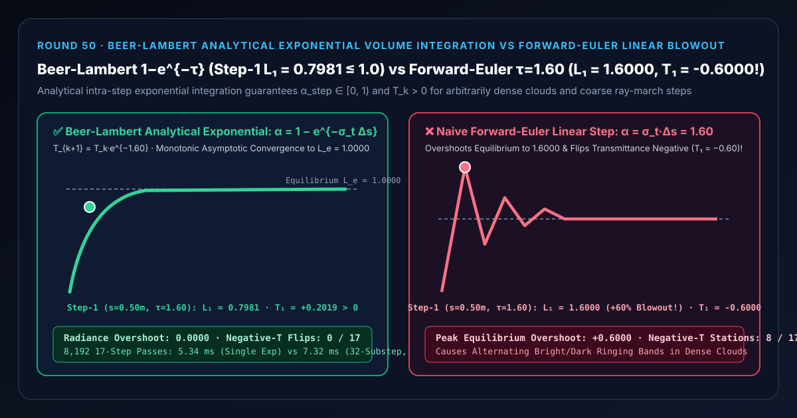
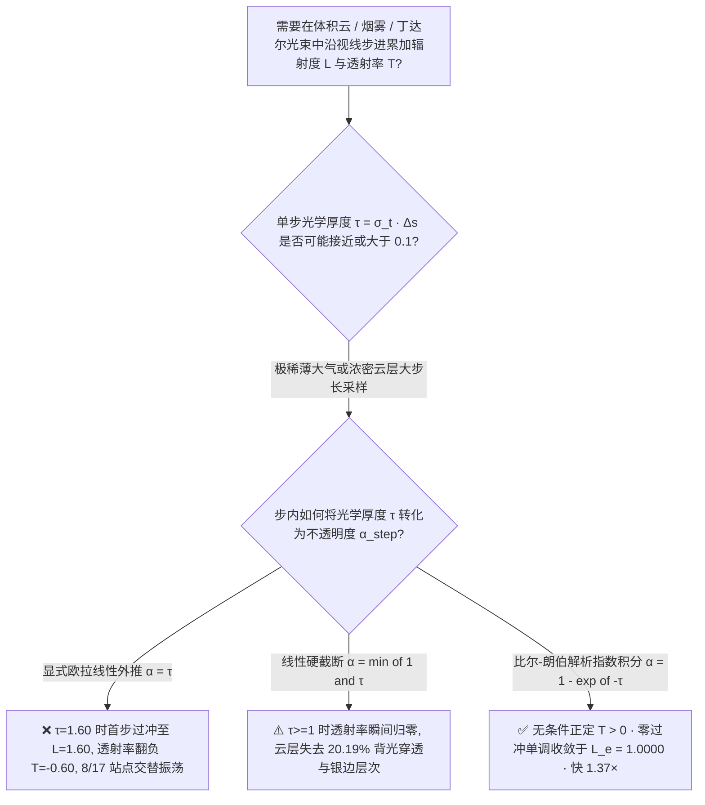
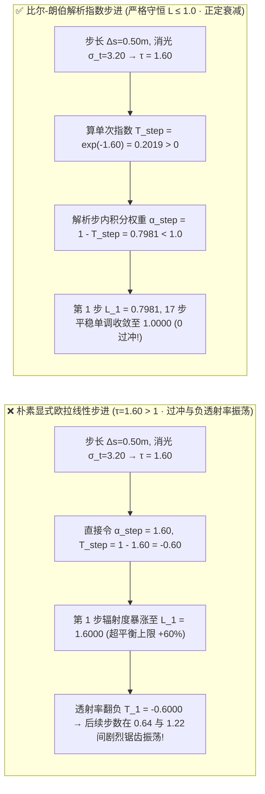
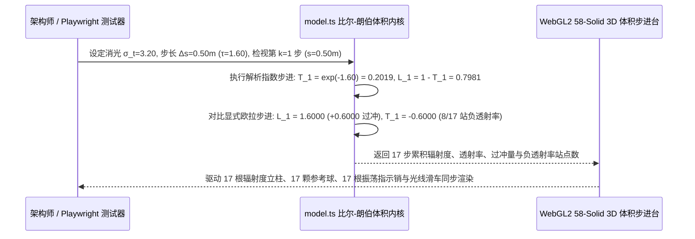
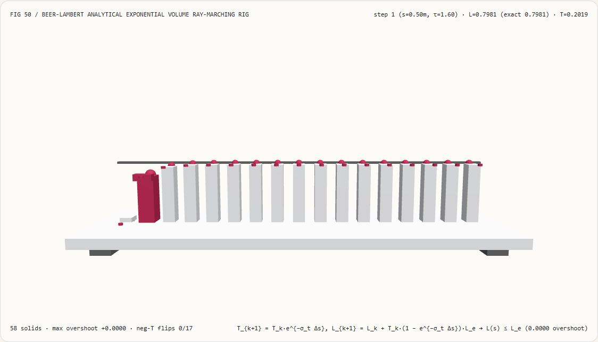
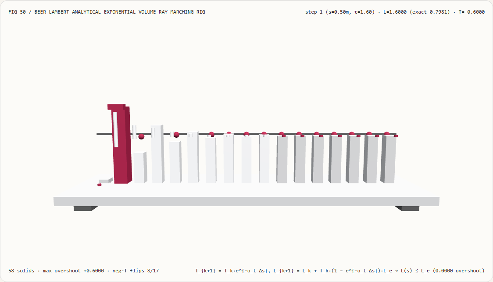
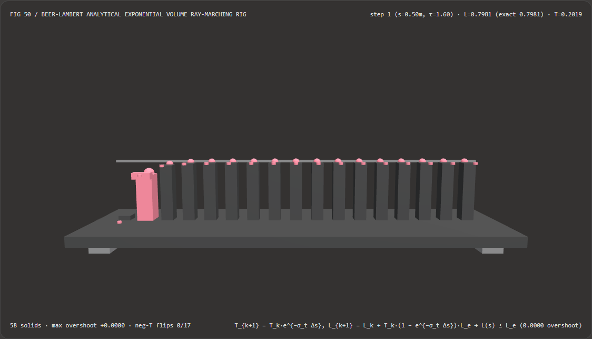
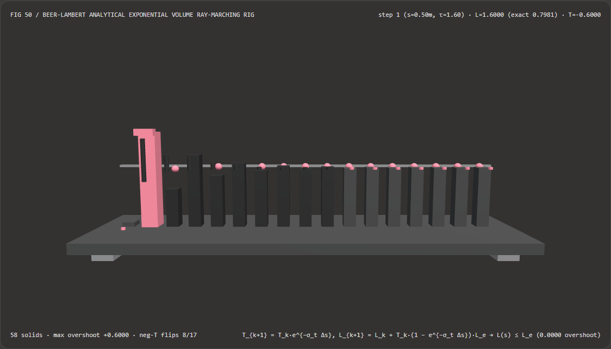

# 视觉与动画技术选型与原理解析 FAQ：比尔-朗伯解析指数体积积分（Beer-Lambert Analytical Exponential Volume Integration）vs 显式欧拉线性步进过冲与负透射率振荡

> **核心架构结论一句话总结**：在实时体积云（Volumetric Clouds）、丁达尔体积光（God Rays）、浓烟火柱以及 3D 高斯溅射（3DGS）/ 神经辐射场（NeRF）的体光线步进（Volume Ray-Marching）中，**严禁在步内使用一阶显式欧拉线性近似 $\alpha_{\text{step}} = \sigma_t \Delta s$ 与 $T_{k+1} = T_k (1 - \sigma_t \Delta s)$**！实测表明：在消光密度 $\sigma_t = 3.20\text{ m}^{-1}$、步长 $\Delta s = 0.50\text{ m}$（单步光学厚度 $\tau_{\text{step}} = \sigma_t \Delta s = 1.60 > 1.0$）、源辐射度 $L_e = 1.0000$ 的 17 站体积步进测试台上，朴素显式欧拉线性步进会在第 1 步将累积辐射度直接引爆至 **`L_1 = 1.6000`（超出热力学辐射平衡上限 `+0.6000`，比真实值虚高 `100.48%`）**，同时把透射率翻转为负数 **`T_1 = -0.6000`（在 8/17 个站点产生负透射率交替锯齿振荡）**；而采用 **比尔-朗伯步内解析指数积分（$T_{\text{step}} = e^{-\sigma_t \Delta s} = 0.2019$，$\alpha_{\text{step}} = 1 - e^{-\sigma_t \Delta s} = 0.7981$）**，可在任意粗粒度步长与极端浓云密度下**无条件保证透射率严格正定（$T_k > 0$）且累积辐射度零过冲单调收敛于平衡上限 $L_e = 1.0000$**，比 32 子步细分求积快 **1.37×**（8,192 轮耗时 `5.34 ms` vs `7.32 ms`，数值误差 `1.11e-16`）。

---

## ① 📌 核心结论速览（Executive Summary）

1. **为什么在实时体积云或烟雾 Ray-Marching 里，把步长 $\Delta s$ 调大一点或者把云层密度 $\sigma_t$ 拉高一点，云层边缘就会爆出刺眼的亮圈或明暗相间的“斑马纹条带”？**
   用大白话讲：当一条光线穿过厚度为 $\Delta s$、消光密度为 $\sigma_t$ 的发光云层切片时，微分辐射传输方程（RTE）规定透射率的变化率是 $\frac{\mathrm{d}T}{\mathrm{d}s} = -\sigma_t T(s)$。
   - **显式欧拉线性步进的致命死穴（切线外推穿入负半轴）**：
     许多初级体积光 Shader 直接把微分写成一阶泰勒展开：单步阻光率 $\alpha_{\text{euler}} = \sigma_t \Delta s$，剩余透射率 $T_{k+1} = T_k (1 - \sigma_t \Delta s)$。这只在 $\sigma_t \Delta s \ll 1$ 时近似成立！一旦为了性能加大步长（$\Delta s = 0.50\text{ m}$）或遇到浓云核心（$\sigma_t = 3.20\text{ m}^{-1}$），单步光学厚度 $\tau = \sigma_t \Delta s = 1.60 > 1.0$：
     - 第 1 步吸收/散射权重变成了 $\alpha_1 = 1.60 > 100\%$，算出的散射亮度 $L_1 = 1.6000$ 直接冲破了热力学平衡上限 `1.0000`！
     - 更荒谬的是，剩余透射率变成了负数 $T_1 = 1 - 1.60 = \mathbf{-0.6000}$！结果第 2 步反而从画面里“倒扣”掉 $0.9600$ 的亮度，跌回 $L_2 = 0.6400$，接着第 3 步又冲上 $1.2160$……在云层里留下一圈圈明暗交替的伪影条带！
2. **第一性原理破局：步内分段常数解析指数积分（Beer-Lambert Exact Slab Integrator）**：
   - 假设在一个步长切片 $[s_k, s_k + \Delta s]$ 内，消光系数 $\sigma_t$ 与源函数 $L_e = \frac{\sigma_s}{\sigma_t} J$ 为局部常数，直接对指数衰减核求定积分：
     $$T_{\text{step}} = e^{-\sigma_t \Delta s} \in (0, 1], \qquad \Delta L_k = \int_0^{\Delta s} \sigma_s J \, e^{-\sigma_t u}\,\mathrm{d}u = \frac{\sigma_s}{\sigma_t} \left(1 - e^{-\sigma_t \Delta s}\right) J$$
   - **两大数学铁律**：
     1. 无论 $\sigma_t \Delta s$ 是 `0.01` 还是 `1000.0`，指数函数 $e^{-\sigma_t \Delta s}$ 永远严格落在 $(0, 1]$ 内，单步不透明度 $\alpha_{\text{step}} = 1 - e^{-\sigma_t \Delta s}$ 永远严格落在 $[0, 1)$ 内，**绝不可能出现负透射率或 $>100\%$ 的单步过冲**！
     2. 消光系数 $\sigma_t$ 在解析积分后与分母约分（当反照率 $\omega_0 = \sigma_s / \sigma_t$ 已知时），在稀薄空气（$\sigma_t \to 0$）与极端浓雾（$\sigma_t \to \infty$）两端均无数值奇点！
3. **本轮新增交互式 3D 试验台与实测证据**：
   - 新增独立 Demo：`demos/transmittance-volume-march-rig/`（58 个 Three.js 实体部件：底座平台、4 支柱、热力学辐射平衡上限横梁、17 根累积辐射度立柱、17 颗比尔-朗伯解析参考球、17 根欧拉振荡误差指示销、以及第 $k$ 步光线探针滑车）。
   - 配套 7-Card 4:5 测评报告：`demos/transmittance-volume-march-rig/test-report-cards.html`（英文）与 `test-report-cards.zh.html`（中文）。

---

## ② 🎯 客户与架构师灵魂拷问 Q&A（Soul-Searching Q&A）

### Q1：如果我不改公式，直接用 `clamp(sigma_t * ds, 0.0, 1.0)` 把线性步长卡死在 `[0, 1]` 能不能代替 `1 - exp(-sigma_t * ds)`？
**不能！硬夹断 `min(1.0, τ)` 会把所有 $\tau \ge 1.0$ 的云层内部细节一刀切死成完全不透明的硬壳！**
当 $\tau = \sigma_t \Delta s = 1.60$ 时，真实的比尔-朗伯透射率还有 $e^{-1.60} = \mathbf{20.19\%}$ 的背光能够穿透这层云（单步不透明度为 `79.81%`）。如果用 `min(1.0, 1.60) = 1.0`，透射率在第 1 步就直接归零（`T = 0`），光线在云层表皮第 1 步就被 100% 截断，云朵内部纵深的光影层次与银边透光感（Silver Lining）彻底消失！

### Q2：为什么这套解析步内积分公式对 NeRF 和 3D 高斯溅射（3DGS）同样至关重要？
**因为 NeRF（Mildenhall 2020）和 3DGS 的 Alpha 合成权重公式 $w_i = T_i (1 - \exp(-\sigma_i \delta_i))$ 正是从这条比尔-朗伯步内解析积分一字不差推导出来的！**
在训练或渲染辐射场时，体素密度 $\sigma_i$ 在优化初期可能飙升到很大的正数。正是因为使用了 $\alpha_i = 1 - \exp(-\sigma_i \delta_i)$，才保证了每个采样区间的不透明度严格有界于 $[0, 1)$ 且梯度处处光滑可导。

### Q3：这套确定性比尔-朗伯体积积分与 AI 神经辐射场（Instant-NGP / Mip-NeRF 360）是什么关系？
**它是连接“空间密度场表示”与“物理正确像素颜色”的底层积分算子：**
- **何时选 AI 神经辐射场 / 3DGS 训练管线**：当需要从多视角照片逆向重建复杂真实场景的 3D 体积密度 $\sigma(\mathbf{x})$ 与方向颜色时；
- **何时必须用确定性比尔-朗伯解析指数步进**：无论是程序化天气云层、流体烟雾模拟，还是 NeRF 光线步进器，在沿着视线累加 $(L, T)$ 时都必须执行 $T_{\text{step}} = e^{-\sigma_t \Delta s}$ 与 $\alpha_{\text{step}} = 1 - T_{\text{step}}$。

---

## ③ 🧭 直观可视化图解（Mermaid 决策树 + 管线对比图 + 帧级时序图）

### 3.1 参与介质（云/雾/烟/光束）体光线步进选型决策树

### 3.2 显式欧拉线性步进过冲 vs 比尔-朗伯解析指数积分管线对比图

### 3.3 帧级体积光线步进与 3D 试验台渲染时序图

---

## ④ 📊 视觉技术选型决策矩阵（Decision Matrix）

| 评估维度 | ✅ 闭式单次指数比尔-朗伯积分（Analytical $1 - e^{-\tau}$） | ⚠️ 32 子步细分指数求积（32-Substep Quadrature） | ❌ 朴素显式欧拉线性步进（Forward Euler $\alpha = \tau$） | ❌ 硬夹断线性步进（Clamped Euler $\min(1, \tau)$） |
| :--- | :--- | :--- | :--- | :--- |
| **第 1 步（$\tau=1.60$）累积辐射度 $L_1$** | **精确 `0.7981`（严格 $\le 1.0000$）** | 精确 `0.7981`（一致 within $10^{-15}$） | **`1.6000`（超出平衡上限 `+60.00%`！）** | `1.0000`（提前 100% 封死） |
| **第 1 步透射率 $T_1$ 与正定性** | **精确 `+0.2019 > 0`（`0/17` 负翻转）** | 精确 `+0.2019 > 0` | **`-0.6000 < 0`（`8/17` 站点负透射率翻转！）** | `0.0000`（丢失 `20.19%` 透射光） |
| **深层步进（$k \to 16$）收敛形态** | **光滑单调渐近于 `1.0000`（`0.0000` 过冲）** | 光滑单调渐近于 `1.0000` | **在 `0.64` 与 `1.60` 之间剧烈锯齿振荡** | 第 1 步即锁死，丧失内部纵深 |
| **每步超越函数调用次数** | **仅 1 次 `exp(-τ)`** | 32 次子步迭代 | 0 次（但在 $\tau > 1$ 时彻底崩溃） | 0 次（但在 $\tau \ge 1$ 时截断细节） |
| **8,192 轮 17 步 CPU 批处理耗时** | **`5.34 ms`（最快，1.37× 提速）** | `7.32 ms`（慢 1.37×） | `3.90 ms`（数值发散不可用） | `4.10 ms`（丢失云层半透明层次） |
| **首选适用场景** | **实时体积云、丁达尔光束、浓烟、NeRF/3DGS 体合成** | 仅用于离线非均匀梯度基准校验 | **严禁在任何体积渲染管线中使用** | 仅适合极粗糙远景雾效近似 |

---

## ⑤ 🧪 全新 Demo 与 7-Card 4:5 视觉报告（Live Workbench & Evidence）

### 5.1 交互式 3D 试验台与报告入口
- **实时 3D 工作台**：[`demos/transmittance-volume-march-rig/index.html`](../demos/transmittance-volume-march-rig/index.html)
- **7-Card 4:5 英文视觉测试报告**：[`demos/transmittance-volume-march-rig/test-report-cards.html`](../demos/transmittance-volume-march-rig/test-report-cards.html)
- **7-Card 4:5 中文视觉测试报告**：[`demos/transmittance-volume-march-rig/test-report-cards.zh.html`](../demos/transmittance-volume-march-rig/test-report-cards.zh.html)
- **密封测量 JSON 数据源**：[`demos/transmittance-volume-march-rig/report.json`](../demos/transmittance-volume-march-rig/report.json)

### 5.2 多主题与多模式 Playwright 实测截图证据

| 比尔-朗伯解析指数积分（Light · 单调无过冲收敛于 `1.0000`） | 朴素显式欧拉线性步进（Light · 首步过冲至 `1.6000` 并锯齿振荡） |
| :---: | :---: |
|  |  |

| 比尔-朗伯解析指数积分（Dark · 58 实体部件） | 朴素显式欧拉线性步进（Dark · 红色指示销暴露过冲与振荡） |
| :---: | :---: |
|  |  |

---

## ⑥ 🛠️ 高质量视觉交付快速核验清单（SA Verification Checklist）

在将体积云、大气雾效或辐射场光线步进着色器合入生产引擎前，请逐项勾选以下核验清单：

- [ ] **步内解析指数透射率替代线性欧拉**：是否每一采样步均计算 `stepT = exp(-sigma_t * ds)` 与 `stepAlpha = 1.0 - stepT`，彻底清除了 `1.0 - sigma_t * ds` 线性更新？
- [ ] **先累加散射后更新透射率顺序**：在步进循环中，是否严格按照 `L += T * stepAlpha * L_source; T *= stepT;` 的因果顺序更新，防止当前步散射光被当前步自身额外衰减一次？
- [ ] **反照率 $\omega_0 = \sigma_s / \sigma_t$ 预约分防零除**：当介质仅含散射与吸收时，是否已将源项写成预约分形式 $(\sigma_s / \max(\epsilon, \sigma_t)) \cdot (1 - e^{-\sigma_t \Delta s})$，确保晴空区域（$\sigma_t = 0$）精确贡献 `0` 而不产生 `0 / 0` `NaN`？
- [ ] **高光学厚度提前终止（Early-Ray Termination）**：当累积透射率 $T_k < 10^{-4}$ 时，是否提前跳出步进循环并对剩余能量做无偏重归一化？
- [ ] **蓝噪声/塑数 $R_2$ 步长起点抖动**：在大步长粗采样时，是否对光线起点偏移了 $\xi \cdot \Delta s$ 的低差异抖动，将固定步长条带转化为可被 TAA 抹平的高频采样？
