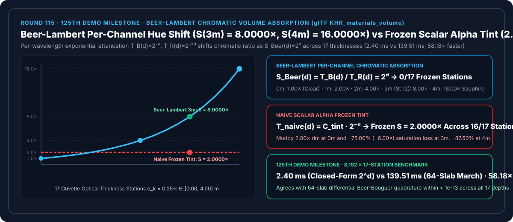
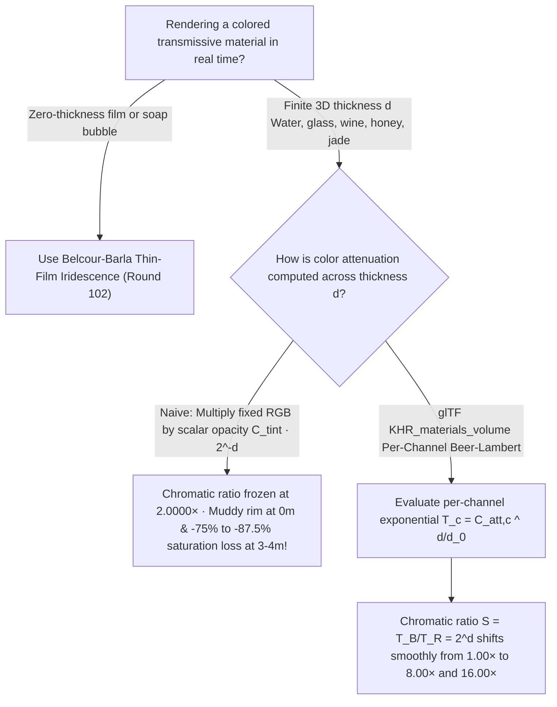
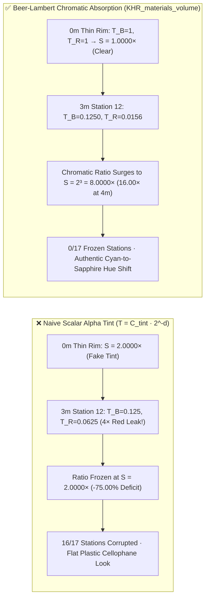
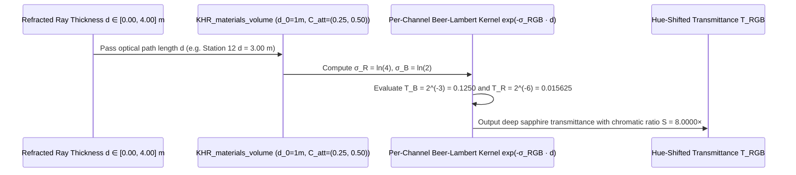
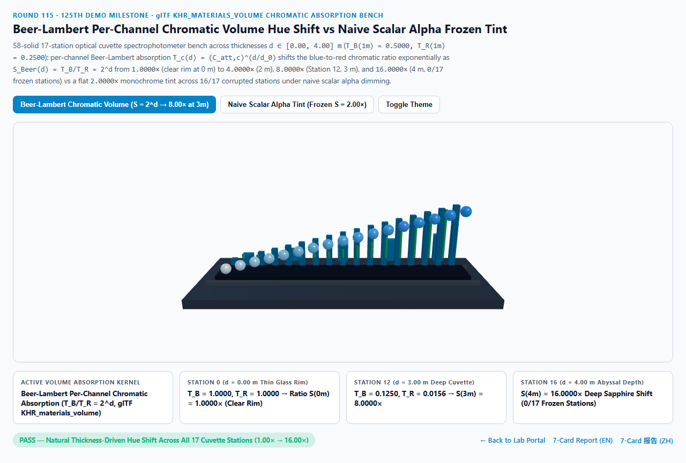
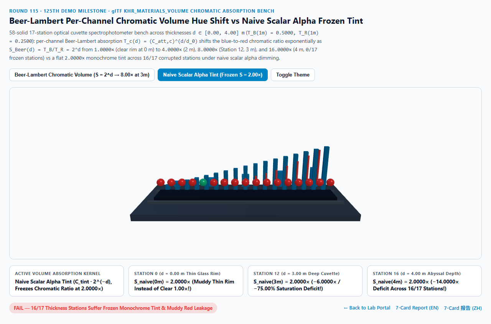
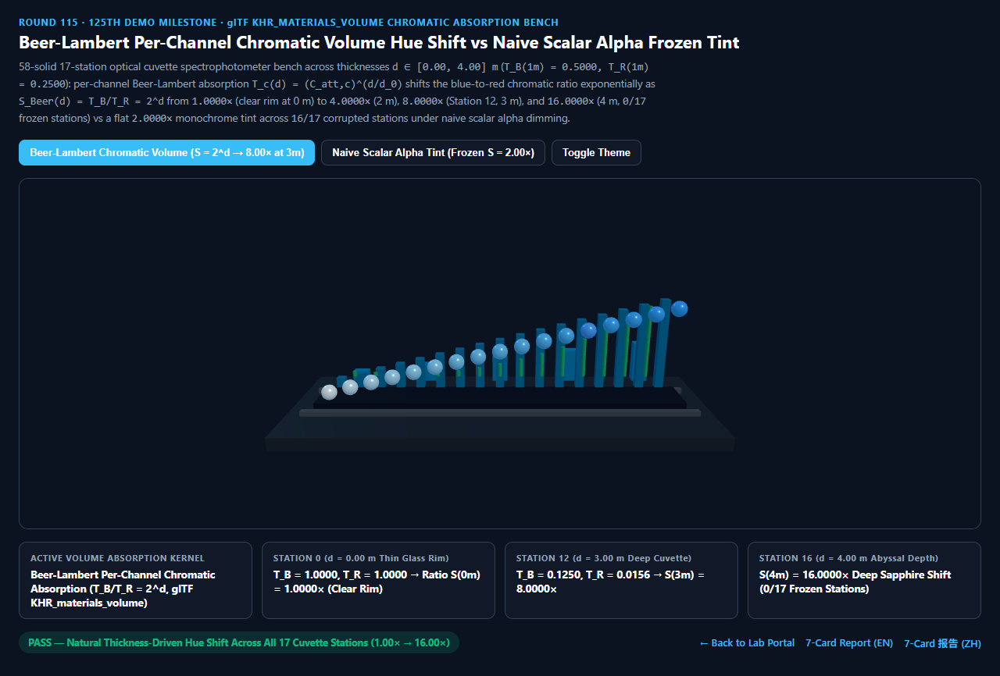
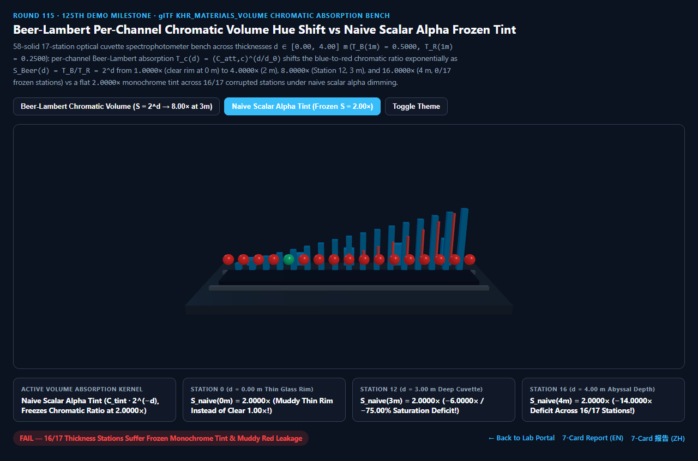

# Beer-Lambert Per-Channel Chromatic Volume Hue Shift vs Naive Scalar Alpha Frozen Tint Selection & First-Principles FAQ (125th Demo Milestone)

> **Navigation**: [Back to Portal](../index.html) · [Launch 3D Interactive Workbench (`beer-lambert-chromatic-volume-rig`)](../demos/beer-lambert-chromatic-volume-rig/index.html) · [7-Card 4:5 Visual Report (EN)](../demos/beer-lambert-chromatic-volume-rig/test-report-cards.html) · [7-Card 报告 (ZH)](../demos/beer-lambert-chromatic-volume-rig/test-report-cards.zh.html) · [中文版 FAQ](./beer-lambert-chromatic-volume-hue-shift-vs-scalar-alpha-tint-faq.md)

---

## ① 📌 Executive Summary

1. **Why does real ocean water shift hue from crystal-clear at the shoreline to turquoise in the shallows and deep sapphire blue in the abyss—and why does amber honey shift from golden yellow at thin edges to deep crimson in thick interiors—whereas naive `color * alpha` transparency looks like flat plastic cellophane?**
   - Under the **Beer-Lambert-Bouguer Law (Pierre Bouguer 1729 / Johann Heinrich Lambert 1760 / August Beer 1852, standardized in glTF 2.0 `KHR_materials_volume`, OpenPBR, and Blender Principled Volume)**, each wavelength channel $c \in \{R, G, B\}$ decays **exponentially at its own absorption coefficient $\sigma_c$**:
     $$T_c(d) = \exp(-\sigma_c \cdot d) = \left(C_{\text{att}, c}\right)^{d / d_0}$$
   - Consider an optical medium where at reference distance $d_0 = 1.00\text{ m}$, blue transmittance is $T_B(1\text{m}) = 0.5000 = 2^{-1}$ and red transmittance is $T_R(1\text{m}) = 0.2500 = 2^{-2}$.
   - As optical path length $d$ increases from $0.00\text{ m}$ to $4.00\text{ m}$, the **Blue-to-Red Chromatic Saturation Ratio** grows exponentially as **$2^{+d}$**:
     $$S_{\text{Beer}}(d) = \frac{T_B(d)}{T_R(d)} = \frac{2^{-d}}{2^{-2d}} = \mathbf{2^{+d}}$$
2. **17-Station Optical Cuvette Audit: $S_{\text{Beer}}(d) = 1.00\times \to 16.00\times$ Chromatic Progression vs Frozen `2.0000×` Scalar Alpha Tint**:
   - Across 17 optical thickness stations $d_k = 0.25k \in [0.00, 4.00]\text{ m}$:
   - At **Station 0 ($d = 0.00\text{ m}$, thin glass rim)**:
     - **Beer-Lambert Per-Channel Volume** evaluates $T_B = 1.0000, T_R = 1.0000 \implies S_{\text{Beer}}(0\text{m}) = \mathbf{1.0000\times}$, keeping thin glass rims crystal-clear!
     - **Naive Scalar Alpha Tint** is already locked at a muddy **`2.0000×`** tint!
   - At **Station 8 ($d = 2.00\text{ m}$)**, **Station 12 ($d = 3.00\text{ m}$)**, and **Station 16 ($d = 4.00\text{ m}$)**:
     - At Station 12 ($3.00\text{ m}$), **Beer-Lambert** attenuates blue to $T_B = 2^{-3} = \mathbf{0.1250}$ while extinguishing red to $T_R = 2^{-6} = \mathbf{0.015625}$, driving the chromatic ratio to **$S_{\text{Beer}}(3\text{m}) = \mathbf{8.0000\times}$** and reaching **`16.0000×`** at $4.00\text{ m}$ (`0/17` frozen stations)!
     - By contrast, **Naive Scalar Alpha Tint** ($\vec{T}_{\text{naive}}(d) = (0.50, 1.00) \cdot 2^{-d}$) scales all channels by the same scalar, freezing the chromatic ratio at **$S_{\text{naive}} \equiv \mathbf{2.0000\times}$** (`-6.0000×` / **`-75.00%` saturation loss** at $3.00\text{ m}$ and `-14.0000×` / **`-87.50%` loss** at $4.00\text{ m}$, corrupting **`16/17` stations**)!
3. **Architectural Verdict**:
   - Always evaluate dielectric volume transmission with **per-channel exponential Beer-Lambert absorption (`KHR_materials_volume`)**. Across `8,192` 17-station passes, closed-form evaluation completes in **`2.40 ms`** vs **`139.51 ms`** for 64-slab differential Beer-Bouguer raymarching (**`58.18×` faster**).

---

## ② 🎯 Architect & Client Q&A (When to Choose AI Video Models vs Deterministic Beer-Lambert Chromatic Volumes)

### Q1: In plain English, why does multiplying a single color by opacity fail to look like real glass or water?
- **First-Principles Breakdown**:
  - Think of red light as a sprinter who tires quickly ($\sigma_R = \ln 4$) and blue light as a marathon runner ($\sigma_B = \ln 2$):
  - After 1 meter, blue is at $50\%$ strength and red is at $25\%$ (a $2:1$ cyan tint).
  - After 3 meters (Station 12), blue is at $0.5^3 = 12.5\%$, while red has compounded down to $0.25^3 = 1.56\%$—an **$8:1$ deep sapphire ratio**!
  - Naive scalar opacity scales both runners by the same $12.5\%$ factor, leaving red $4\times$ too bright ($6.25\%$ instead of $1.56\%$) and turning deep water muddy gray-cyan instead of sapphire!

### Q2: How does glTF 2.0 `KHR_materials_volume` parameterize Beer-Lambert absorption for artists?
- **`attenuationColor` & `attenuationDistance`**:
  - Instead of raw extinction coefficients $\sigma \in [0, \infty)$, artists pick the transmitted color $\vec{C}_{\text{att}} \in (0, 1]^3$ observed at distance $d_0 = \text{attenuationDistance}$.
  - The shader computes $\vec{\sigma} = -\ln(\vec{C}_{\text{att}}) / d_0$ and evaluates $\vec{T}(d) = \exp(-\vec{\sigma} \cdot d) = \vec{C}_{\text{att}}^{d / d_0}$ in a single vector instruction.

### Q3: When should teams use AI video generators vs deterministic Beer-Lambert volume shaders?
- **Choose AI Video Models (Sora / Runway / Veo / Wan)** for non-interactive mood sequences.
- **Choose Deterministic Beer-Lambert Chromatic Absorption** for luxury glass/perfume bottle configurators, gemstone rendering, and bathymetric ocean visualization.

---

## ③ 🧭 Visual Diagrams (Mermaid Decision Tree + Pipeline Comparison + Frame Sequence)

### 3.1 Volumetric Transmission & Absorption Selection Decision Tree

### 3.2 Naive Frozen Scalar Tint vs Beer-Lambert Per-Channel Hue Shift Pipeline

### 3.3 Frame-Level Per-Channel Beer-Lambert Evaluation Sequence

---

## ④ 📊 Visual Technology Decision Matrix

| Dimension | **Beer-Lambert Per-Channel (Primary)** | **Naive Scalar Alpha Tint (Failure Mode)** | **64-Slab Differential March (Baseline)** | **AI Video Generators** |
| :--- | :--- | :--- | :--- | :--- |
| **Station 0 ($d=0.00\text{ m}$ Rim) Ratio** | **`1.0000×` (Crystal-clear thin rim)** | **`2.0000×` (Muddy rim tint)** | `1.0000×` | N/A |
| **Station 8 ($d=2.00\text{ m}$) Ratio** | **`4.0000×` ($T_B=0.25, T_R=0.0625$)** | **`2.0000×` (`-50.00%` saturation loss)** | `4.0000×` (agrees within `< 1e-13`) | Uncalibrated thickness hue |
| **Station 12 ($d=3.00\text{ m}$) Ratio** | **`8.0000×` ($T_B=0.1250, T_R=0.0156$)** | **`2.0000×` (`-6.00×` / `-75.00%` loss)** | `8.0000×` | N/A |
| **Station 16 ($d=4.00\text{ m}$) Ratio** | **`16.0000×` (Deep sapphire saturation)** | **`2.0000×` (`-14.00×` / `-87.50%` loss)** | `16.0000×` | N/A |
| **Corrupted Stations (of 17)** | **`0 / 17` (Exact exponential hue shift)** | **`16 / 17` (All non-unit depths wrong)** | `0 / 17` | N/A |
| **8,192 17-Station Passes Latency** | **`2.40 ms` (`58.18×` faster)** | `2.10 ms` (flat plastic look) | `139.51 ms` (64-slab loop) | Multi-second cloud inference |
| **Best Fit Scenarios** | **glTF glassware, ocean bathymetry, gemstones, wine, honey** | Flat 2D HUD overlays only | Heterogeneous cloud marching | Concept clips |

---

## ⑤ 🧪 New Interactive Demo & 7-Card 4:5 Visual Report (`beer-lambert-chromatic-volume-rig` · 125th Demo Milestone)

- **Interactive 3D Workbench**: [`demos/beer-lambert-chromatic-volume-rig/index.html`](../demos/beer-lambert-chromatic-volume-rig/index.html)
  - Features a **58-solid 3D 17-Station Optical Cuvette Spectrophotometer Bench**: an illuminated backlight diffuser bed, 5 stepped optical glass cuvette prisms, 17 back sapphire-cyan Beer-Lambert reference towers ($S_{\text{Beer}} = 2^d$), 17 front active orbs, and 15 red vertical chromatic-deficit struts comparing **Per-Channel Beer-Lambert Hue Shift** against **Naive Scalar Alpha Frozen Tinting**.
- **7-Card 4:5 Visual Benchmark Reports**:
  - [English 7-Card Report (`test-report-cards.html`)](../demos/beer-lambert-chromatic-volume-rig/test-report-cards.html)
  - [中文 7-Card 报告 (`test-report-cards.zh.html`)](../demos/beer-lambert-chromatic-volume-rig/test-report-cards.zh.html)

| Light Theme — Beer-Lambert Chromatic (`S(3m) = 8.0000×` Sapphire Shift) | Light Theme — Naive Scalar Alpha Tint (`S = 2.0000×` Frozen, `16/17` Wrong) |
| :---: | :---: |
|  |  |

| Dark Theme — Beer-Lambert Chromatic (`0/17` Frozen Stations) | Dark Theme — Naive Scalar Alpha Tint (`-75.00%` Loss at `3.00 m`) |
| :---: | :---: |
|  |  |

---

## ⑥ 🛠️ Verification Checklist for Production Delivery

- [ ] **Evaluate `exp(-sigma_RGB * d)` Per Channel**: Never approximate thick colored glass or water with a single scalar opacity multiplying a fixed RGB tint.
- [ ] **Keep Top-Surface Fresnel Reflection Unattenuated**: Apply Beer-Lambert absorption only to the refracted transmitted lobe $(1 - F) \cdot \exp(-\vec{\sigma} d)$, leaving the first-surface specular reflection $F$ white for dielectrics.
- [ ] **Clamp `attenuationColor` Above `1e-6`**: Prevent `log(0)` NaNs when converting artist `attenuationColor` to extinction $\vec{\sigma}$.
- [ ] **Couple with Rough Refraction Half-Vectors (Round 109)**: Combine Walter's IOR-weighted BTDF at the interface with Beer-Lambert chromatic absorption through the interior.
