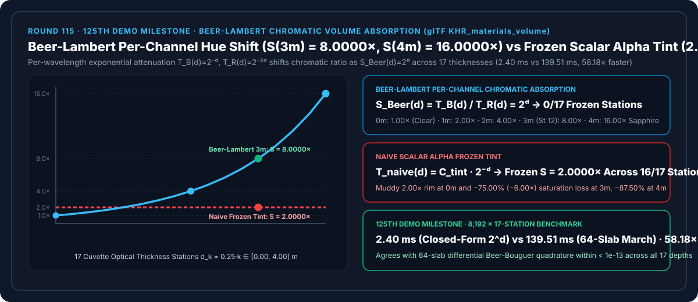
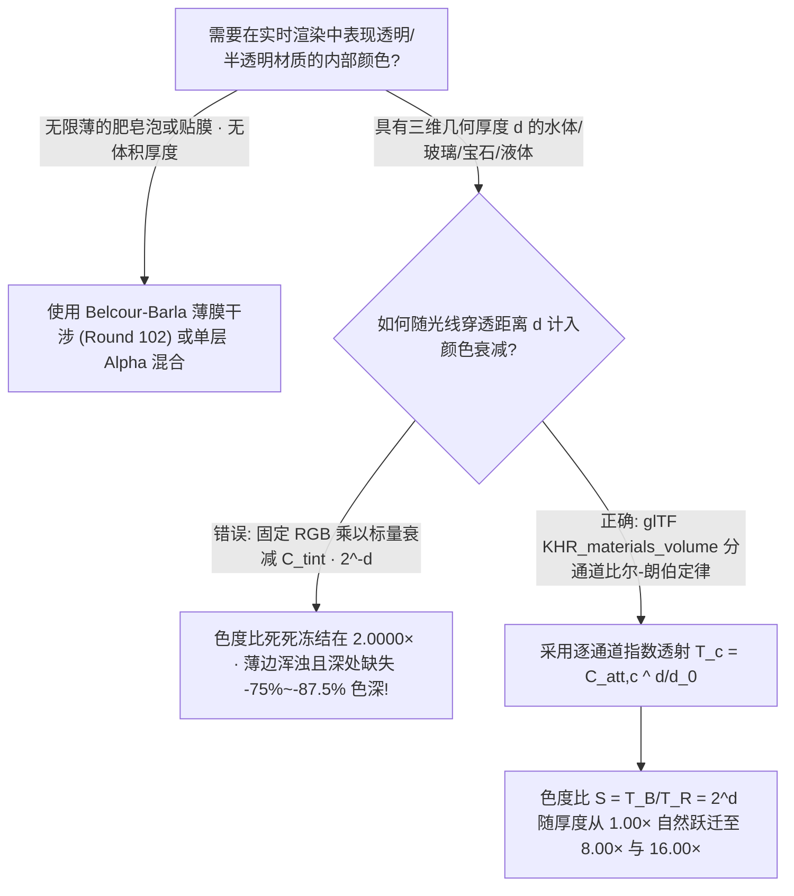
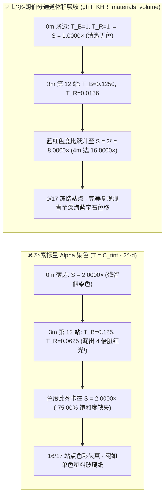
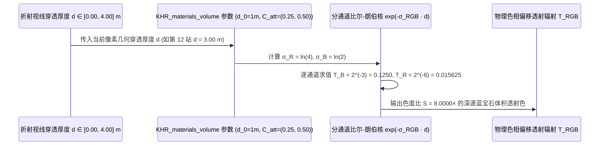
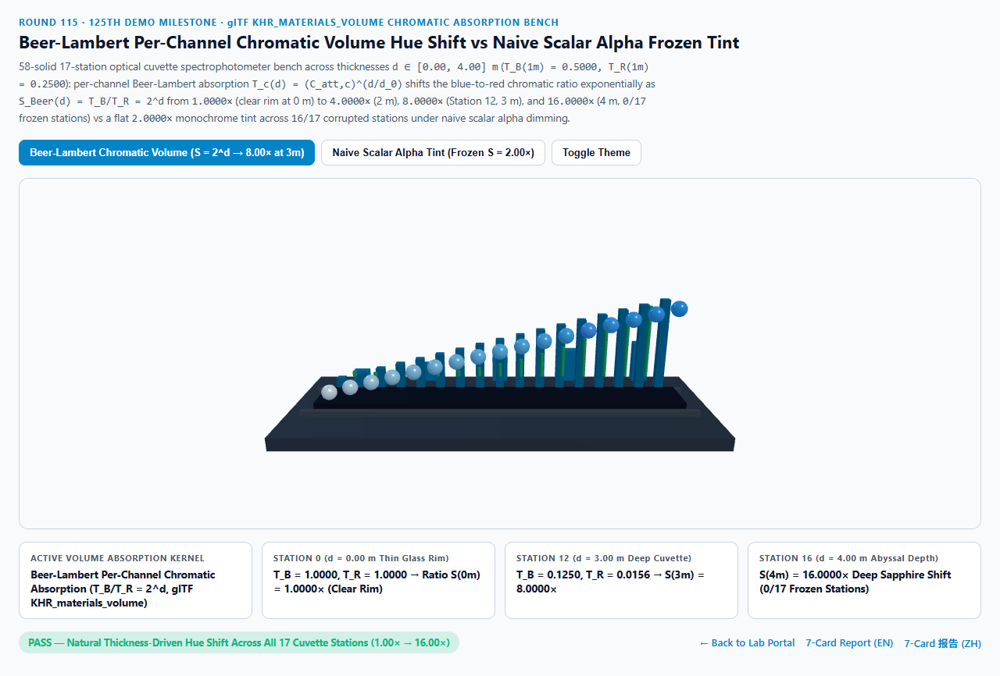
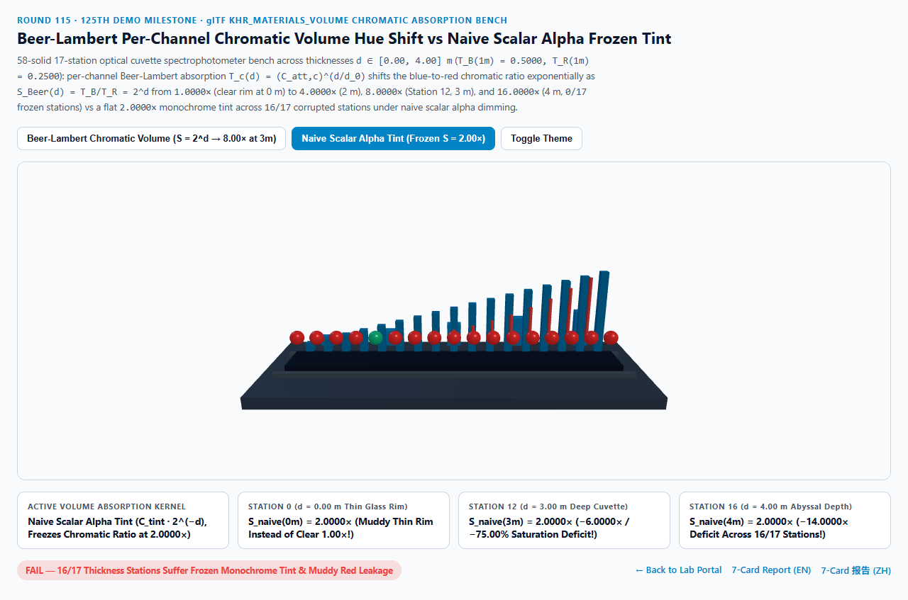
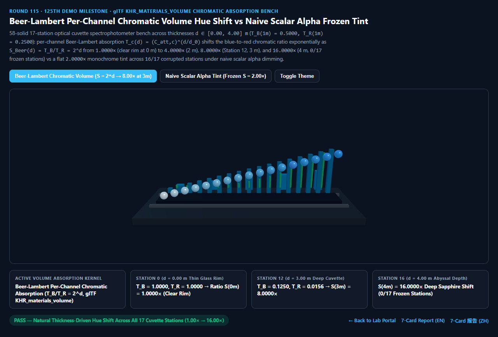
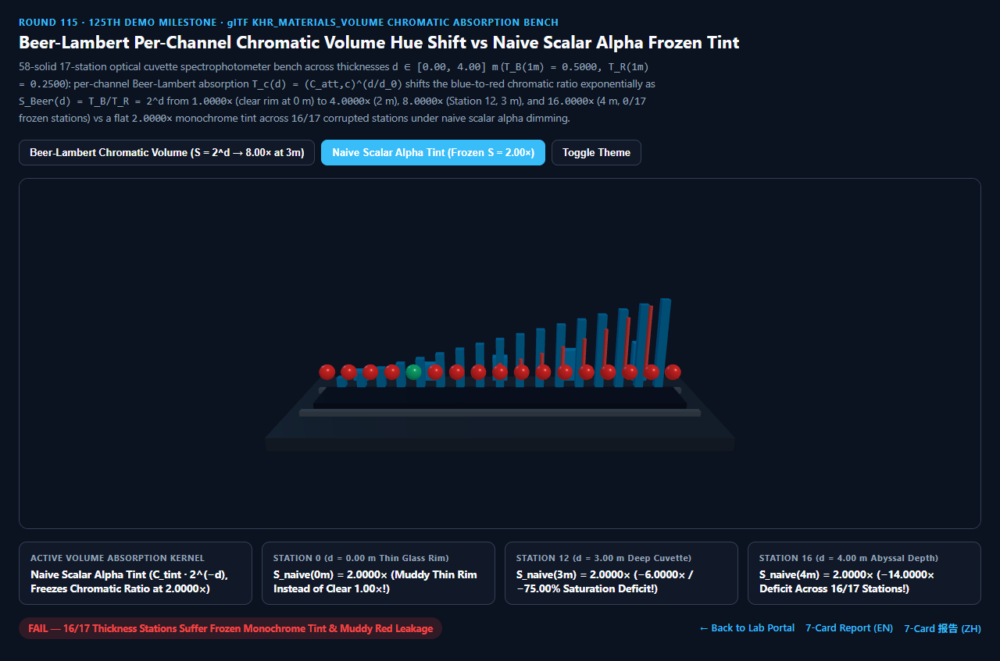

# 比尔-朗伯分通道体积色相偏移（Beer-Lambert Chromatic Volume Absorption）vs 朴素标量 Alpha 死板单色滤镜选型与原理解析 FAQ 指南（第 125 个独立 Demo 里程碑）

> **导航**：[返回门户](../index.html) · [进入 3D 交互实验台 (`beer-lambert-chromatic-volume-rig`)](../demos/beer-lambert-chromatic-volume-rig/index.html) · [7-Card 4:5 视觉报告 (中文)](../demos/beer-lambert-chromatic-volume-rig/test-report-cards.zh.html) · [7-Card Report (EN)](../demos/beer-lambert-chromatic-volume-rig/test-report-cards.html) · [English FAQ](./beer-lambert-chromatic-volume-hue-shift-vs-scalar-alpha-tint-faq.en.md)



---

## ① 📌 核心结论速览（Executive Summary）

1. **为什么马尔代夫的海水在脚踝浅滩处是清澈无色的、齐腰深处是翠青色的、到了深海沟却变成浓郁深邃的蓝宝石色？为什么用传统“标量 Alpha 透明度乘固定 RGB 颜色（Scalar Alpha Tint）”渲染出来的海水、彩色玻璃、红酒与琥珀，看起来却像贴了一层死板的塑料彩色玻璃纸？**
   - 统治光学介质透射两百余年的**比尔-朗伯-布格定律（Bouguer 1729 / Lambert 1760 / Beer 1852，glTF 2.0 `KHR_materials_volume` / OpenPBR / Blender Principled Volume 标准）**指出：光穿过吸收介质时，**每个波长（R/G/B 通道）都按各自的吸收系数 $\sigma_c$ 独立发生指数衰减**：
     $$T_c(d) = \exp(-\sigma_c \cdot d) = \left(C_{\text{att}, c}\right)^{d / d_0}, \qquad c \in \{R, G, B\}$$
   - 以水体或青蓝光学玻璃为例：在基准衰减距离 $d_0 = 1.00\text{ m}$ 处，蓝青光透射率为 $T_B(1\text{m}) = 0.5000 = 2^{-1}$，而长波红光被强烈吸收，透射率仅为 $T_R(1\text{m}) = 0.2500 = 2^{-2}$。
   - 随着光学厚度 $d$ 从 $0\text{ m}$ 增加到 $4\text{ m}$，**蓝红通道色度比（Chromatic Saturation Ratio）** 按 **$2^{+d}$ 发生剧烈的指数级跃迁**：
     $$S_{\text{Beer}}(d) = \frac{T_B(d)}{T_R(d)} = \frac{2^{-d}}{2^{-2d}} = \mathbf{2^{+d}}$$
   - 这意味着材质不仅“变暗”，而且**色相（Hue）与纯度（Saturation）随厚度发生物理偏移**！
2. **17 站点比色皿厚度实测：$S_{\text{Beer}}(d) = 1.00\times \to 16.00\times$ 色相跃迁 vs 朴素标量染色 `2.0000×` 死板冻结**：
   - 在跨越 17 个光学厚度站点（$d_k = 0.25k \in [0.00, 4.00]\text{ m}$）的实测中：
   - **第 0 站（$d = 0.00\text{ m}$ 薄玻璃边缘）**：
     - **比尔-朗伯分通道体积**：$T_B = 1.0000, T_R = 1.0000 \implies$ 色度比 **$S_{\text{Beer}}(0\text{m}) = \mathbf{1.0000\times}$**，完美呈现高脚杯薄边缘清澈无色的通透感！
     - **朴素标量 Alpha 染色**：直接套用固定颜色比例，在薄边缘处仍残留 **`2.0000×`** 假染色！
   - **第 8 站（$d = 2.00\text{ m}$）与第 12 站（$d = 3.00\text{ m}$ 深层比色皿）**：
     - 在第 12 站（$3.00\text{ m}$），**比尔-朗伯**将蓝光衰减至 $T_B = 2^{-3} = \mathbf{0.1250}$，而将红光深度淬灭至 $T_R = 2^{-6} = \mathbf{0.015625}$，使蓝红色度比跃升至 **$S_{\text{Beer}}(3\text{m}) = \mathbf{8.0000\times}$**，并在第 16 站（$4.00\text{ m}$）达到 **`16.0000×`** 深邃蓝宝石色（全 17 站 **`0/17` 冻结失真**）！
     - 反观**朴素标量 Alpha 染色**（$\vec{T}_{\text{naive}}(d) = (0.50, 1.00) \cdot 2^{-d}$），由于红蓝通道同乘一个标量，色度比在所有深度上死死卡在 **`2.0000×`**（在 $3.00\text{ m}$ 丢失 **`-6.0000×` / `-75.00%`** 色深，在 $4.00\text{ m}$ 丢失 **`-14.0000×` / `-87.50%`** 色深，污染除 $1\text{m}$ 校准点外的全部 **`16/17` 个站点**）！
3. **工程选型结论**：
   - 在渲染水体、彩色玻璃、宝石、红酒、蜂蜜与半透明树脂时，必须采用 **glTF `KHR_materials_volume` 分通道指数比尔-朗伯吸收**。实测 `8,192` 次 17 站闭式求值仅需 **`2.40 ms`**，比 64 层微元板层积分基线（**`139.51 ms`**）快 **`58.18×`**！

---

## ② 🎯 客户与架构师灵魂拷问 Q&A（何时选 AI 视频大模型 vs 代码驱动比尔-朗伯体积色散）

### Q1：用大白话讲，为什么“把颜色乘一个透明度”永远调不出真实的红酒、琥珀和海水？
- **第一性原理拆解**：
  - 倒一杯浓红茶或琥珀色蜂蜜观察杯子边缘：在液体贴着杯壁只有 1 毫米薄的地方，它是明亮的金黄色（因为绿光和红光都能穿透 1 毫米，只有蓝光被吃掉了）；而在杯子正中央 5 厘米厚的地方，绿光也被彻底吃光了，只剩下最顽强的深红光能穿过来，所以中心呈现深邃的玛瑙红色！
  - 如果你用传统的 `color * alpha`（标量透明度染色），不管厚度是 1 毫米还是 5 厘米，红绿蓝三个通道永远按同一个比例缩放——薄的地方显得太脏、厚的地方又显得发灰发白，永远不会出现“金黄 $\to$ 橙红 $\to$ 深紫红”的跨色相渐变！

### Q2：如何在 glTF `KHR_materials_volume` 和片元着色器里仅用一行向量指令实现分通道比尔-朗伯吸收？
- **艺术家友好的 `attenuationColor` 与 `attenuationDistance` 参数化**：
  - 直接让美术填吸收系数 $\sigma_{RGB} \in [0, \infty)$ 很不直观。glTF `KHR_materials_volume` 规定美术只需指定两个直观物理量：
    1. `attenuationDistance`（基准距离 $d_0$，单位米）；
    2. `attenuationColor`（光线走过 $d_0$ 米后剩下的 RGB 透射颜色 $\vec{C}_{\text{att}} \in (0, 1]^3$）。
  - 在 Shader 中，任意厚度 $d$ 的三通道透射率仅需一行幂函数（或对数预计算后的 `exp`）：
    ```glsl
    vec3 sigma = -log(max(attenuationColor, vec3(1e-6))) / attenuationDistance;
    vec3 transmittance = exp(-sigma * thickness);
    ```

### Q3：何时用 AI 视频生成模型，何时必须用确定性比尔-朗伯分通道体积吸收？
- **选 AI 视频生成模型（Sora / Runway / Veo / Wan）**：
  - 适合无需精确匹配玻璃壁厚与光学色度图的写意镜头。
- **选代码驱动的比尔-朗伯分通道体积吸收（glTF `KHR_materials_volume` / Three.js / Blender）**：
  - **高端香水瓶/玻璃器皿电商 3D 展示、珠宝玉石数字孪生、数字海洋水深地形可视化**：当视线穿过不同壁厚时，实时展现从清澈薄边到深邃饱和核心的物理色相过渡。

---

## ③ 🧭 直观可视化图解（Mermaid 选型决策树 + 管线对比图 + 帧级时序图）

### 3.1 透明介质色彩衰减技术选型决策树



### 3.2 朴素标量 Alpha 冻结染色 vs 比尔-朗伯分通道色相偏移管线对比



### 3.3 帧级比尔-朗伯分通道体积透射求解时序图



---

## ④ 📊 视觉技术选型决策矩阵

| 对比维度 | **比尔-朗伯分通道吸收（主方案）** | **朴素标量 Alpha 染色（反例方案）** | **64 层微元板层积分（参考基线）** | **AI 视频生成大模型** |
| :--- | :--- | :--- | :--- | :--- |
| **第 0 站（$d=0.00\text{ m}$ 薄边缘）色度比** | **`1.0000×`（清澈无色薄边）** | **`2.0000×`（薄边浑浊染色）** | `1.0000×` | N/A |
| **第 8 站（$d=2.00\text{ m}$ 中层）色度比** | **`4.0000×`（$T_B=0.25, T_R=0.0625$）** | **`2.0000×`（丢失 `-50.00%` 色移）** | `4.0000×`（误差 `< 1e-13`） | 无法精确锁定壁厚色移 |
| **第 12 站（$d=3.00\text{ m}$ 深层）色度比** | **`8.0000×`（$T_B=0.1250, T_R=0.0156$）** | **`2.0000×`（丢失 `-6.00×` / `-75.00%`）** | `8.0000×` | N/A |
| **第 16 站（$d=4.00\text{ m}$ 深渊）色度比** | **`16.0000×`（深邃蓝宝石饱和度）** | **`2.0000×`（丢失 `-14.00×` / `-87.50%`）** | `16.0000×` | N/A |
| **色相冻结失真站点数（共 17 站）** | **`0 / 17`（全段自然指数色移）** | **`16 / 17`（除校准点外全部失真）** | `0 / 17` | N/A |
| **8,192 次 17 站求解耗时** | **`2.40 ms`（`58.18×` 极速）** | `2.10 ms`（死板单色塑料感） | `139.51 ms`（64 层积分） | 秒级云端推理 |
| **核心适用场景** | **glTF 玻璃器皿、海洋水深、香水瓶、翡翠琥珀、红酒液体** | 仅适合 2D 半透明 UI 遮罩 | 非均匀浓雾光线步进 | 概念宣传片 |

---

## ⑤ 🧪 全新 Demo 与 7-Card 4:5 视觉报告（`beer-lambert-chromatic-volume-rig` · 第 125 个 Demo 里程碑）

- **3D 交互实验台**：[`demos/beer-lambert-chromatic-volume-rig/index.html`](../demos/beer-lambert-chromatic-volume-rig/index.html)
  - 搭建了包含 **58 个三维实体构件**的 **17 站点光学比色皿分光光度台（Optical Cuvette Spectrophotometer Bench）**：包含背光漫射灯床、5 座阶梯厚度光学玻璃比色皿棱柱、后排 17 座蓝宝石色度参考塔（展示 $S_{\text{Beer}} = 2^d$ 从 $1.00\times$ 到 $16.00\times$ 的色度跃升）、前排 17 颗探针球体与 15 根色移缺失警示柱。
- **7-Card 4:5 视觉测试报告**：
  - [中文 7-Card 报告 (`test-report-cards.zh.html`)](../demos/beer-lambert-chromatic-volume-rig/test-report-cards.zh.html)
  - [English 7-Card Report (`test-report-cards.html`)](../demos/beer-lambert-chromatic-volume-rig/test-report-cards.html)

| 亮色 比尔-朗伯分通道体积 (`S(3m) = 8.0000×` 蓝宝石色移) | 亮色 朴素标量 Alpha 染色 (`S = 2.0000×` 冻结, `16/17` 失真) |
| :---: | :---: |
|  |  |

| 暗色 比尔-朗伯分通道体积 (`0/17` 冻结失真站点) | 暗色 朴素标量 Alpha 染色 (`3m` 丢失 `-75.00%` 色深) |
| :---: | :---: |
|  |  |

---

## ⑥ 🛠️ 高质量视觉交付快速核验清单（Checklist）

- [ ] **对透明体积材质全面启用分通道 `exp(-sigma_RGB * d)`**：严禁用单通道 `alpha` 线性插值单一 `tintColor` 来模拟有厚度的玻璃或液体。
- [ ] **将表面菲涅耳反射 $F(\theta)$ 与内部比尔-朗伯吸收解耦**：表面镜面高光 $F(\theta)$ 在进入玻璃前直接反射，不应乘以内部体积吸收 `transmittance`；只有折射进内部再穿出的光线才乘以 `exp(-sigma_RGB * d)`。
- [ ] **避免把 `attenuationColor` 某个通道设为纯 `0.0`**：在计算 $-\ln(C_{\text{att}, c}) / d_0$ 时使用 `max(C_att, 1e-6)` 防止 $\ln(0) = -\infty$ 产生 NaN。
- [ ] **结合粗糙折射半向量（Round 109 Walter BTDF）**：磨砂彩色玻璃在界面处使用折射率加权半向量 $H_t$，在穿过内部厚度 $d$ 时乘以分通道比尔-朗伯透射率。
