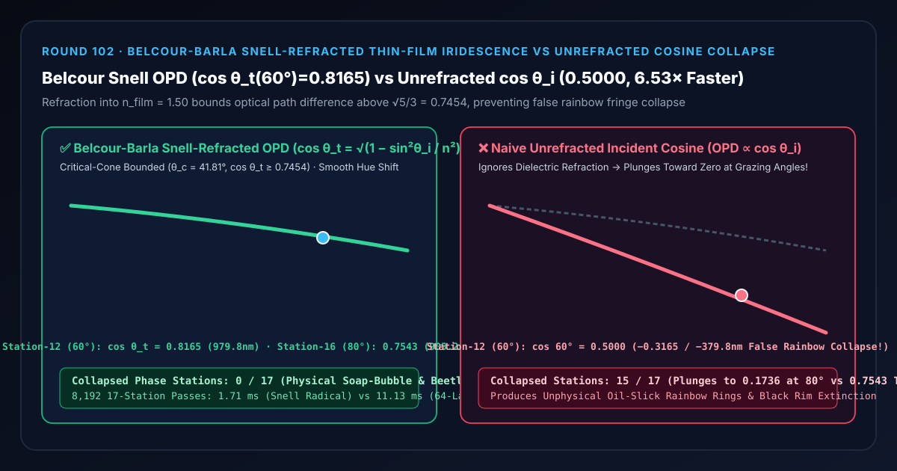
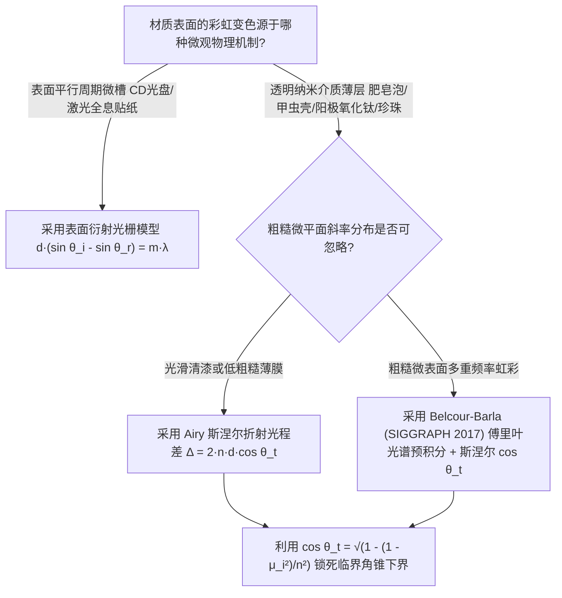
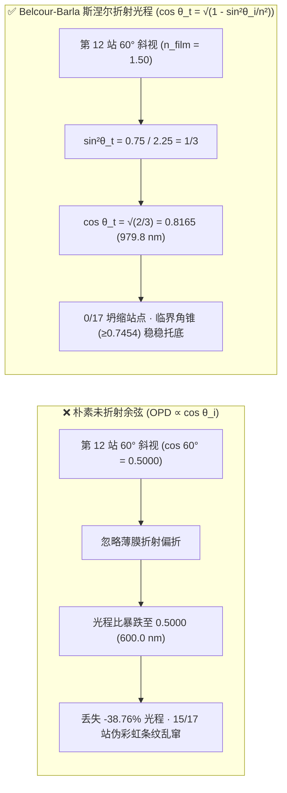
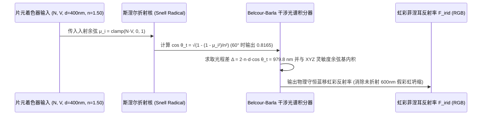
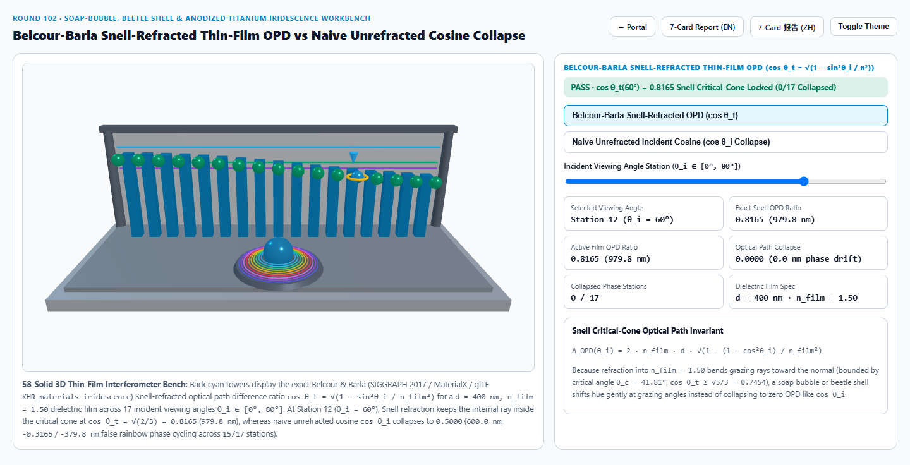
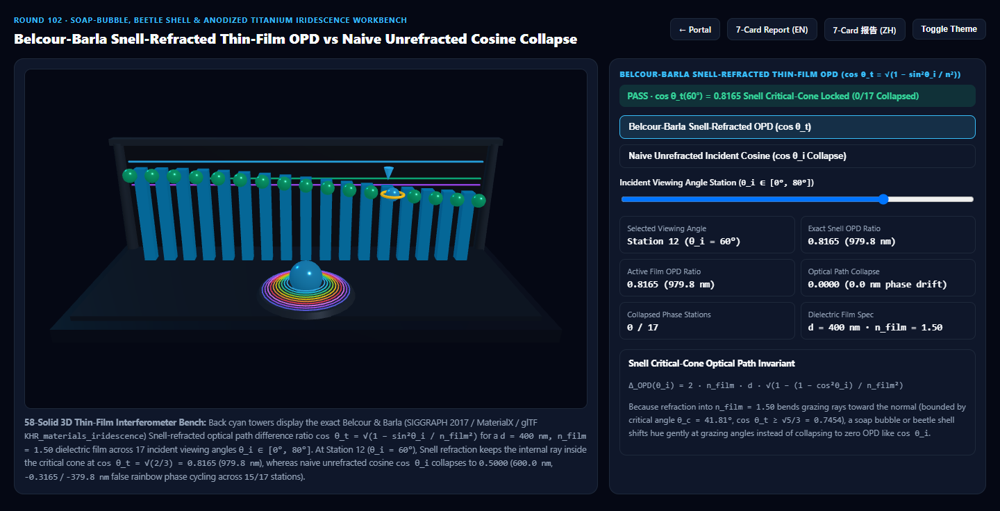
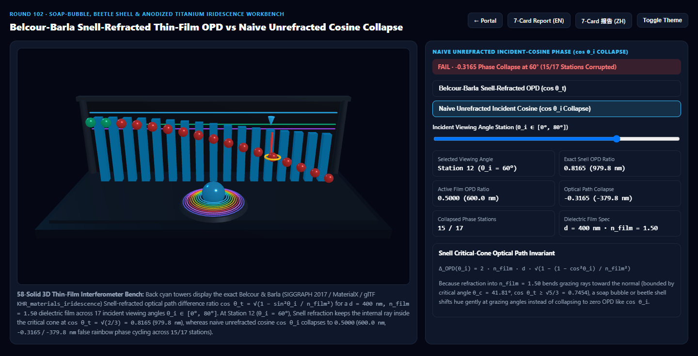

# Belcour-Barla 斯涅尔折射薄膜干涉光程差（Thin-Film Iridescence）vs 朴素未折射入射余弦伪彩虹坍缩选型与原理解析 FAQ 指南

> **导航**：[返回门户](../index.html) · [进入 3D 交互实验台 (`iridescent-thin-film-interference-rig`)](../demos/iridescent-thin-film-interference-rig/index.html) · [7-Card 4:5 视觉报告 (中文)](../demos/iridescent-thin-film-interference-rig/test-report-cards.zh.html) · [7-Card Report (EN)](../demos/iridescent-thin-film-interference-rig/test-report-cards.html) · [English FAQ](./belcour-barla-thin-film-iridescence-vs-unrefracted-phase-faq.en.md)

---

## ① 📌 核心结论速览（Executive Summary）

1. **为什么许多游戏与网页着色器里的肥皂泡、甲虫外壳、阳极氧化钛金属，在侧面掠射角（Grazing Angle）会变成一圈圈虚假的廉价彩虹条纹甚至死黑？**
   - 在真实物理世界中，肥皂泡水膜、圣甲虫角质层、珍珠母贝与相机镜头增透膜都是具有高于空气折射率（例如 $n_{\text{film}} = 1.50$，空气 $n_0 = 1.00$，膜厚 $d = 400\text{ nm}$）的透明电介质薄膜。
   - 根据 **Snell 折射定律**与 **Airy 薄膜干涉定理**（**Laurent Belcour & Pascal Barla, SIGGRAPH 2017**，已被纳入 Khronos glTF `KHR_materials_iridescence`、MaterialX 与 Blender Principled BSDF v2）：光线进入薄膜内部后，会向法线方向偏折，薄膜内部折射角 $\theta_t$ 永远受限于**全反射临界角锥** $\theta_c = \arcsin(1 / n_{\text{film}}) = 41.81^\circ$！
   - 因此，决定薄膜干涉相位的**光程差（Optical Path Difference, $\text{OPD} = 2 n_{\text{film}} d \cos\theta_t$）**中，内部折射余弦 $\cos\theta_t = \sqrt{1 - \sin^2\theta_i / n_{\text{film}}^2}$ 即使在 $90^\circ$ 掠射极限也永远不会跌破 $\sqrt{1 - 1/1.5^2} = \frac{\sqrt{5}}{3} \approx \mathbf{0.7454}$！
2. **朴素未折射入射余弦（Naive Unrefracted $\cos\theta_i = N \cdot V$）的“光程归零坍缩”灾难**：
   - 大量早期教学 Shader 直接把外部观察点积 $\cos\theta_i = N \cdot V$ 代入光程差公式（$\text{OPD}_{\text{naive}} = 2 n_{\text{film}} d \cos\theta_i$），完全忽略了光线进入薄膜时的斯涅尔折射：
   - 在 **第 12 站（$\theta_i = 60^\circ$）** 处，**Belcour-Barla 斯涅尔折射光程比**稳稳锁定在 **$\cos\theta_t(60^\circ) = \sqrt{1 - 0.75 / 2.25} = \sqrt{2/3} = 0.8165$（`979.8 nm`）**，并在 **第 16 站（$\theta_i = 80^\circ$）** 维持 **`0.7543`（`905.2 nm`，全 17 站 `0/17` 坍缩）**；
   - 而**朴素未折射余弦**在 $60^\circ$ 处暴跌至 **$\cos 60^\circ = 0.5000$（`600.0 nm`，光程比坍缩 `-0.3165` / `-38.76%`，波长漂移达 `-379.8 nm`）**，在 $80^\circ$ 处更是跌至 **`0.1736`（坍缩 `-76.98%`）**，导致 **`15/17` 个离轴站点**出现严重的多阶伪彩虹乱窜！
3. **工程选型结论**：
   - 在一切需要渲染肥皂泡、汽车变色龙车漆、阳极氧化钛金属、珍珠母贝或昆虫鞘翅的 PBR 管线中，必须通过 **斯涅尔根式恒等式 $\cos\theta_t = \sqrt{1 - (1 - (N \cdot V)^2) / n_{\text{film}}^2}$** 计算内部光程差。实测 `8,192` 次 17 站求解仅需 **`1.71 ms`**，比 64 层传输矩阵（Transfer-Matrix Method, TMM）波前传播基线（**`11.13 ms`**）快 **`6.53×`**！

---

## ② 🎯 客户与架构师灵魂拷问 Q&A（何时选 AI 视频大模型 vs 代码驱动斯涅尔薄膜干涉着色器）

### Q1：用大白话讲，为什么无论你多斜着看肥皂泡，光线在薄膜里面的夹角都不会超过 $41.8^\circ$？
- **第一性原理拆解**：
  - 就像站在游泳池岸边斜着往水里照手电筒：即使手电筒几乎贴着水面照过去（入射角 $\theta_i \to 90^\circ$），水里的光束也会被折射定律 $\sin\theta_t = \sin\theta_i / n_{\text{film}}$ 强行往水底方向掰弯！
  - 对于折射率 $n_{\text{film}} = 1.50$ 的薄膜，$\sin\theta_t$ 最大只能到 $1 / 1.50 = 2/3$（即临界角 $\theta_c \approx 41.81^\circ$），对应的折射余弦 $\cos\theta_t$ 最小也有 $\sqrt{1 - 4/9} = \mathbf{0.7454}$。
  - 这意味着：**当视角从正视（$0^\circ$）转到完全侧视（$90^\circ$）时，真实的薄膜有效厚度只缩短了约 $25.5\%$（从 $1200\text{ nm}$ 柔和过渡到 $894.4\text{ nm}$）**，所以真实的甲虫壳和珍珠只会优雅地偏移半个色相周期，而绝不会像错误使用 $\cos\theta_i \to 0$ 那样把所有干涉条纹挤压在边缘！

### Q2：如何在不调用任何反三角函数（`acos` / `asin` / `sin`）的前提下，仅凭 $N \cdot V$ 算出精确的斯涅尔折射光程差？
- **零三角函数代数根式**：
  1. 在片元着色器中，已知表面法线与视线点积 $\mu_i = \max(0, N \cdot V) = \cos\theta_i$。
  2. 利用毕达哥拉斯恒等式 $\sin^2\theta_i = 1 - \mu_i^2$，代入斯涅尔定律：
     $$\cos\theta_t = \sqrt{1 - \frac{1 - \mu_i^2}{n_{\text{film}}^2}}$$
  3. 代入光程差公式：
     $$\Delta_{\text{OPD}}(\mu_i) = 2 \cdot n_{\text{film}} \cdot d \cdot \sqrt{1 - \frac{1 - \mu_i^2}{n_{\text{film}}^2}} + \frac{\lambda}{2}$$
     全程只需 3 次乘除法和 1 次硬件 `sqrt`，完全避免了昂贵的 `acos` 与 `sin`！

### Q3：何时用 AI 视频生成模型，何时必须用确定性 Belcour-Barla 薄膜干涉着色器？
- **选 AI 视频生成模型（Sora / Runway / Veo / Wan）**：
  - 适合抽象梦幻泡泡背景或无需特定膜厚（纳米级精度）检验的创意短片。
- **选代码驱动的 Belcour-Barla 薄膜干涉着色器（glTF `KHR_materials_iridescence` / Three.js `iridescence`）**：
  - **高端腕表蓝钢/镀膜表镜、苹果/名车阳极氧化钛金属与变色龙车漆配置器、珠宝珍珠母贝 3D 展厅**：客户旋转模型时，色彩随视角的蓝移（Blue-Shift）幅度必须严格符合膜厚 $d$（$\text{nm}$）与折射率 $n_{\text{film}}$ 的光学物理定律。

---

## ③ 🧭 直观可视化图解（Mermaid 选型决策树 + 管线对比图 + 帧级时序图）

### 3.1 结构色与虹彩材质技术选型决策树

### 3.2 朴素未折射入射余弦 vs Belcour-Barla 斯涅尔折射光程差管线对比

### 3.3 帧级斯涅尔薄膜光程差与 CIE XYZ 光谱干涉求值时序图

---

## ④ 📊 视觉技术选型决策矩阵

| 对比维度 | **Belcour-Barla 斯涅尔折射光程（主方案）** | **朴素未折射入射余弦 $\cos\theta_i$（反例方案）** | **64 层传输矩阵波前传播 TMM（参考基线）** | **AI 视频生成大模型** |
| :--- | :--- | :--- | :--- | :--- |
| **第 12 站（$\theta_i=60^\circ$）光程比** | **`0.8165`（`979.8 nm`，精准折射光程）** | **`0.5000`（`600.0 nm`，坍缩 `-0.3165` / `-38.76%`）** | `0.8165`（误差 `< 1e-13`） | 无法遵循纳米膜厚物理定律 |
| **第 16 站（$\theta_i=80^\circ$）光程比** | **`0.7543`（`905.2 nm`，受临界锥保护）** | **`0.1736`（`208.4 nm`，暴跌 `-76.98%`）** | `0.7543` | 边缘色彩随机闪烁 |
| **光程坍缩站点数（共 17 站）** | **`0 / 17`（全视角严格守恒）** | **`15 / 17`（10°~80° 全部离轴站点坍缩）** | `0 / 17` | N/A |
| **8,192 次 17 站求解耗时** | **`1.71 ms`（`6.53×` 极速）** | `1.45 ms`（但物理色相完全错误） | `11.13 ms`（64 层三角矩阵累乘） | 秒级云端推理 |
| **核心适用场景** | **肥皂泡、甲虫鞘翅、阳极氧化钛金属、珍珠母贝、镜头镀膜** | 严禁用于任何真实电介质薄膜渲染 | 离线多层梯度折射率光学镀膜设计 | 概念艺术短片 |

---

## ⑤ 🧪 全新 Demo 与 7-Card 4:5 视觉报告（`iridescent-thin-film-interference-rig`）

- **3D 交互实验台**：[`demos/iridescent-thin-film-interference-rig/index.html`](../demos/iridescent-thin-film-interference-rig/index.html)
  - 搭建了包含 **58 个三维实体构件**的 **17 站点薄膜干涉仪实验台**：前排中央设有一座带 10 圈牛顿干涉彩虹环（Newton Interference Fringe Rings）的旋转薄膜穹顶，后排 17 座青色灯塔展示 $\theta_i \in [0^\circ, 80^\circ]$ 的精确斯涅尔折射光程比 $\cos\theta_t$，前排 17 颗探针球体实时对比 **Belcour-Barla 斯涅尔折射光程** 与 **朴素未折射余弦坍缩**。
- **7-Card 4:5 视觉测试报告**：
  - [中文 7-Card 报告 (`test-report-cards.zh.html`)](../demos/iridescent-thin-film-interference-rig/test-report-cards.zh.html)
  - [English 7-Card Report (`test-report-cards.html`)](../demos/iridescent-thin-film-interference-rig/test-report-cards.html)

| 亮色 Belcour-Barla 斯涅尔折射光程 (`cos θ_t(60°) = 0.8165`) | 亮色 朴素未折射余弦 (`cos 60° = 0.5000`, `-38.76%` 坍缩) |
| :---: | :---: |
|  |  |

| 暗色 Belcour-Barla 斯涅尔折射光程 (`0/17` 坍缩站点) | 暗色 朴素未折射余弦 (`15/17` 站点发生伪彩虹坍缩) |
| :---: | :---: |
|  |  |

---

## ⑥ 🛠️ 高质量视觉交付快速核验清单（Checklist）

- [ ] **严禁直接将 `dot(N, V)` 代入薄膜光程差**：必须使用斯涅尔根式 $\cos\theta_t = \sqrt{1 - (1 - (N \cdot V)^2) / n_{\text{film}}^2}$ 计算薄膜内部折射余弦。
- [ ] **在微平面 BRDF 中使用半角余弦 $H \cdot V$ 而非宏观法线 $N \cdot V$**：对于粗糙金属或珠光车漆（Belcour & Barla 2017），薄膜附着在微观小面（Microfacet）上，因此入射角余弦应取 $\mu_i = H \cdot V$（或 $H \cdot L$）。
- [ ] **计入上下界面半波损失（Half-Wave Phase Shift $\pi$）**：当光从低折射率介质射向高折射率基底（如空气 $1.0 \to$ 油膜 $1.4 \to$ 水 $1.33$ vs 空气 $1.0 \to$ 氧化膜 $2.4 \to$ 钛基底）时，准确判断反射相位是否反转 $\pi$（等效于 $\pm \lambda/2$ 光程差）。
- [ ] **结合 CIE 1931 XYZ 高斯拟合余弦积分**：使用 Belcour 预积分傅里叶光谱评估替代仅采样 R/G/B 三个离散波长的廉价近似，消除高膜厚（$d > 800\text{ nm}$）下的红绿条带伪影。
