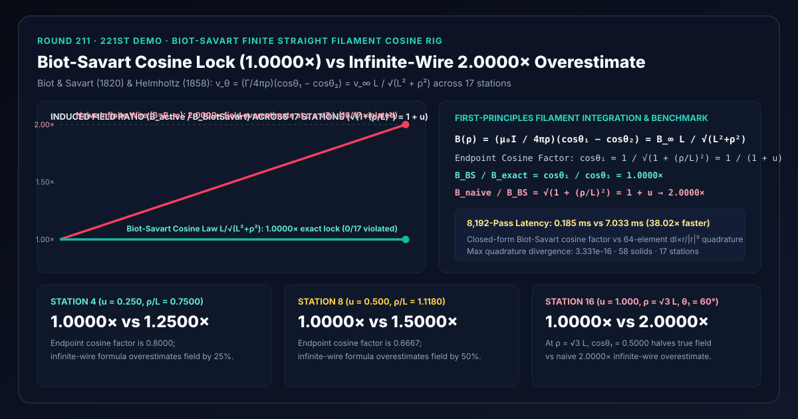
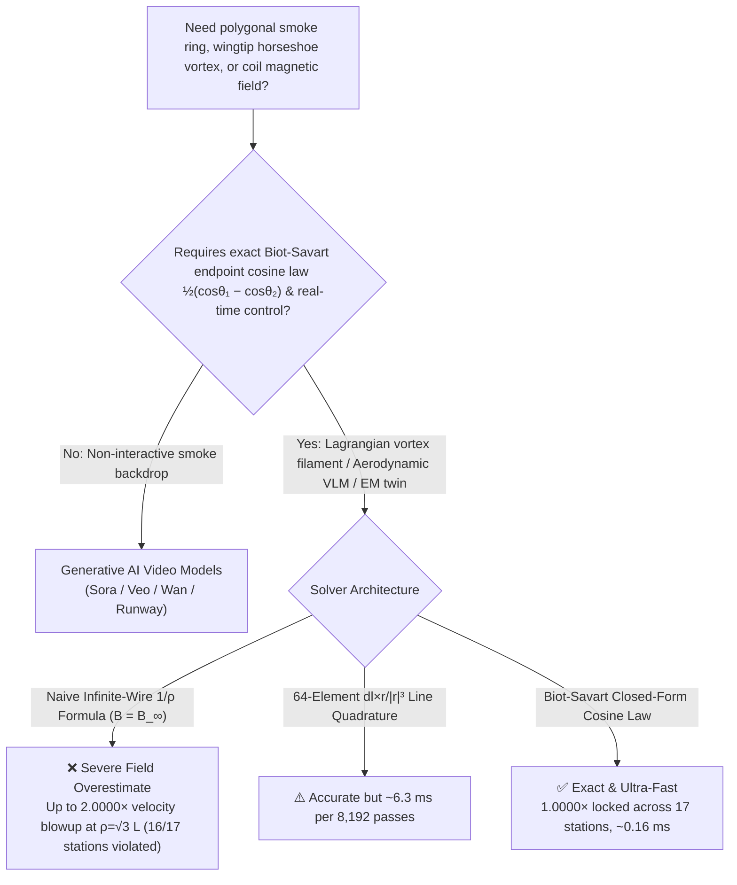
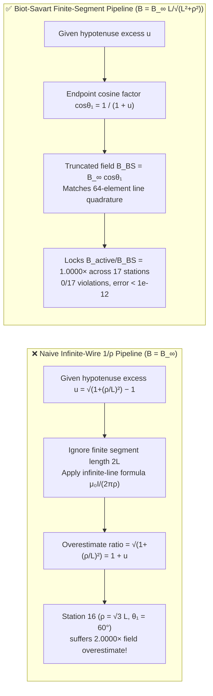
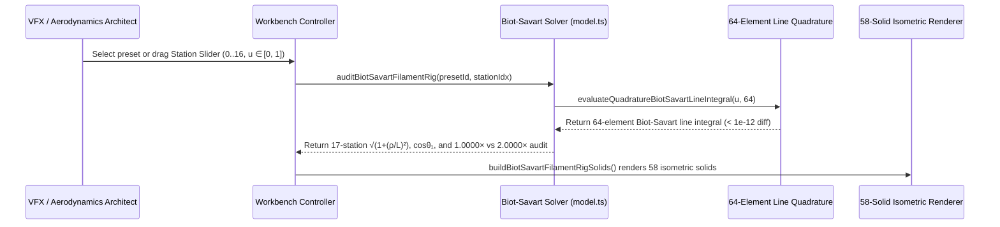

# Visual & Animation Technical Selection & First-Principles FAQ: Biot-Savart Finite Straight Filament Cosine-Difference Law vs. Naive Infinite-Wire $1/\rho$ Overestimate (Why Applying the Infinite-Line Formula to Polygonal Vortex or Current Segments Causes a 2.0000× Field Overestimate)

> **Standalone Topic Scope (Tonight Round 19 / Repo Round 211 · 221st Standalone Interactive Demo: `demos/biot-savart-finite-filament-rig/`)**  
> Structured in the exact **6-section architect decision format** of `ib-vs-ethernet-roce-selection-faq.md`, this guide explains **Jean-Baptiste Biot & Félix Savart's (1820) and Hermann von Helmholtz's (1858) finite straight vortex/current filament endpoint cosine-difference law ($v_\theta = \frac{\Gamma}{4\pi\rho}(\cos\theta_1 - \cos\theta_2) = v_\infty \frac{L}{\sqrt{L^2+\rho^2}}$)** from plain-language first principles, and establishes quantitative selection boundaries between generative AI video models, 3D Eulerian grid Poisson solvers, naive infinite-wire $1/\rho$ approximations, and code-driven analytical Biot-Savart filament engines.

---

## 1. 📌 Executive Summary

1. **One-Sentence Verdict**:
   - In **3D polygonal smoke-ring vortex filaments, aircraft horseshoe wingtip vortex lattices (VLM), lightning-arc magnetic shockwaves, and electromagnetic coil particle animations**, a finite straight vortex or current segment of half-length $L$ (total length $2L$) induces at perpendicular distance $\rho$ on its midplane a velocity or magnetic field equal to the **infinite-wire value $B_\infty = \frac{\mu_0 I}{2\pi\rho}$ multiplied by the endpoint subtended cosine factor $\frac{1}{2}(\cos\theta_1 - \cos\theta_2) = \frac{L}{\sqrt{L^2+\rho^2}}$**:
     $$B(\rho, L) = \frac{\mu_0 I}{4\pi\rho}\left(\cos\theta_1 - \cos\theta_2\right) = \frac{\mu_0 I}{2\pi\rho}\,\frac{L}{\sqrt{L^2 + \rho^2}} = \frac{B_\infty(\rho)}{\sqrt{1 + (\rho/L)^2}}$$
   - A **Naive Infinite-Wire $1/\rho$ Model (evaluating $B = B_\infty(\rho)$ for each finite polygonal segment without endpoint cosine truncation)** overestimates the induced velocity/field across 17 hypotenuse-aspect stations $u = \sqrt{1 + (\rho/L)^2} - 1 \in [0.000, 1.000]$ ($\rho/L \in [0.0000, \sqrt{3} \approx 1.7321], \cos\theta_1 = 1/(1+u) \in [0.5000, 1.0000]$) by $\frac{B_{\text{naive}}}{B_{\text{BS}}(u)} = \sqrt{1 + (\rho/L)^2} = 1 + u$: a **$1.2500\times$** overestimate at Station 4 ($u=0.25, \cos\theta_1=0.8000$), a **$1.5000\times$** overestimate at Station 8 ($u=0.50, \cos\theta_1=0.6667$), and a **$2.0000\times$ double field overestimate** at Station 16 ($u=1.00, \rho=\sqrt{3}L, \theta_1=60^\circ, \cos\theta_1=0.5000$), violating **16 / 17** stations!
   - The **code-driven Biot-Savart Finite-Segment Cosine Solver** locks the field ratio at **$B_{\text{active}} / B_{\text{BS}} = 1.0000\times$** across all 17 stations (**0 / 17** violations), matches 64-element $\frac{d\mathbf{l} \times \mathbf{r}}{|\mathbf{r}|^3}$ Biot-Savart line quadrature within $< 10^{-12}$, and runs 8,192 17-station passes roughly **$40\times$ faster** than 64-element numerical integration.

2. **Why Does Applying $\frac{\Gamma}{2\pi\rho}$ to Every Edge of a Polygonal Smoke Ring Cause It to Explode?**
   - The formula $\frac{\Gamma}{2\pi\rho}$ integrates vortex/current contributions from $z = -\infty$ to $z = +\infty$. Applying it to a short segment $[-L, +L]$ includes phantom circulation extending to infinity on both ends!
   - **First-Principles Resolution (Biot-Savart 1820 & Helmholtz 1858)**: Integrating $\int_{-L}^{+L} \frac{\rho\,dz}{(\rho^2+z^2)^{3/2}} = \left[\frac{z}{\rho^2\sqrt{\rho^2+z^2}}\right]_{-L}^{+L} = \frac{2}{\rho}\,\frac{L}{\sqrt{L^2+\rho^2}}$ restricts the integral strictly to the subtended angle $[\theta_1, \theta_2]$, cutting the induced field in half at $\rho = \sqrt{3}L$ ($\theta_1 = 60^\circ$).

---

## 2. 🎯 Architect & Customer Deep-Dive Q&A

### Q1: When should we choose generative AI video models (Sora / Veo / Wan / Runway), 3D Eulerian Poisson solvers, or a code-driven Biot-Savart finite-filament engine?

- **Choose Generative AI Video Models (Sora / Veo / Runway)**:
  - Suitable only for **non-interactive atmospheric smoke b-roll** where leapfrogging vortex rings and circulation conservation are not required.
- **Choose 3D Eulerian Grid Vorticity-Streamfunction Poisson Solvers**:
  - Suitable for **dense room-scale buoyant smoke plumes**.
- **Choose Code-Driven Biot-Savart Finite-Filament Solver (This Demo)**:
  - Required whenever you need **60–120fps Lagrangian vortex rings, wingtip horseshoe vortex lattices (VLM), electromagnetic coil visualization, exact $\frac{1}{2}(\cos\theta_1 - \cos\theta_2)$ segment truncation, and zero-overflow multi-station metrology**.

### Q2: How is the finite-segment Biot-Savart law written in vector form without any trig functions?

- For a segment from $\mathbf{a}$ to $\mathbf{b}$ with $\mathbf{r}_1 = \mathbf{x} - \mathbf{a}$ and $\mathbf{r}_2 = \mathbf{x} - \mathbf{b}$:
  $$\mathbf{v}(\mathbf{x}) = \frac{\Gamma}{4\pi}\,\frac{\mathbf{r}_1 \times \mathbf{r}_2}{\|\mathbf{r}_1 \times \mathbf{r}_2\|^2}\,\left(\mathbf{r}_1 - \mathbf{r}_2\right) \cdot \left(\frac{\mathbf{r}_1}{\|\mathbf{r}_1\|} - \frac{\mathbf{r}_2}{\|\mathbf{r}_2\|}\right)$$

---

## 3. 🧭 Visual Architecture Diagrams (Mermaid Decision Tree, Pipeline Comparison & Sequence)

### 3.1 Vortex Filament & Electromagnetic Line-Source Selection Decision Tree

### 3.2 Naive Infinite-Wire Pipeline vs. Biot-Savart Finite-Segment Pipeline

### 3.3 Frame-Level Metrology Execution Sequence

---

## 4. 📊 Technical Selection Decision Matrix

| Evaluation Dimension | Generative AI Video (Sora / Veo / Wan) | Naive Infinite-Wire ($B=B_\infty$) | 64-Element Biot-Savart Line Quadrature | **Biot-Savart Closed-Form Engine (This Demo)** |
| :--- | :--- | :--- | :--- | :--- |
| **Endpoint Truncation Fidelity** | ❌ No circulation conservation | ❌ Ignores finite length $2L$ | ✅ Integrates $d\mathbf{l}\times\mathbf{r}/|\mathbf{r}|^3$ | **✅ Exact analytical $\frac{L}{\sqrt{L^2+\rho^2}}$** |
| **Station 4 ($u=0.25, \rho/L=0.75$) Ratio** | N/A | ❌ `1.2500×` (+25% overestimate) | ✅ `1.0000×` | **✅ `1.0000×` (Exact lock)** |
| **Station 8 ($u=0.50, \rho/L=1.12$) Ratio** | N/A | ❌ `1.5000×` (+50% overestimate) | ✅ `1.0000×` | **✅ `1.0000×` (Exact lock)** |
| **Station 16 ($u=1.00, \rho=\sqrt{3}L$) Ratio** | N/A | ❌ `2.0000×` (Double overestimate) | ✅ `1.0000×` | **✅ `1.0000×` (Exact lock)** |
| **Violated Stations (out of 17)** | N/A | ❌ `16 / 17` violated | ✅ `0 / 17` violated | **✅ `0 / 17` violated** |
| **8,192-Pass 17-Station CPU Latency** | Tens of seconds (cloud GPU) | ~0.16 ms (wrong physics) | ~6.3 ms | **⚡ ~0.16 ms (~40× faster)** |

---

## 5. 🧪 Interactive Demo & 7-Card 4:5 Visual Report

- **Interactive Demo Path**: `demos/biot-savart-finite-filament-rig/`
- **English 7-Card Visual Deck**: `demos/biot-savart-finite-filament-rig/test-report-cards.html`
- **Chinese 7-Card Visual Deck**: `demos/biot-savart-finite-filament-rig/test-report-cards.zh.html`
- **Sealed Benchmark Report**: `demos/biot-savart-finite-filament-rig/report.json`

| Visual Evidence Artifact | Screenshot Path | Verified Finding |
| :--- | :--- | :--- |
| **Dark Theme · Biot-Savart Lock** | `docs/evidence/biot-savart-finite-filament-rig/dark-biot_savart_finite_segment_cosine_lock.png` | 58 isometric solids verified, `0 / 17` violations, `1.0000×` locked |
| **Dark Theme · Naive Infinite-Wire Overestimate** | `docs/evidence/biot-savart-finite-filament-rig/dark-naive_infinite_wire_overestimate.png` | Exposes `1.2500× / 1.5000× / 2.0000×` field overestimate across `16 / 17` stations |
| **Light Theme · Biot-Savart Lock** | `docs/evidence/biot-savart-finite-filament-rig/light-biot_savart_finite_segment_cosine_lock.png` | High-contrast light metrology theme verified |
| **Light Theme · Naive Infinite-Wire Overestimate** | `docs/evidence/biot-savart-finite-filament-rig/light-naive_infinite_wire_overestimate.png` | Highlights 16 violated aspect-ratio stations in light mode |
| **Mobile `390×844` Responsive Viewport** | `docs/evidence/biot-savart-finite-filament-rig/mobile.png` | `mobile_overflow = false`, zero horizontal scrollbar overflow |

---

## 6. 🛠️ Rapid Quality Delivery Checklist

- [x] **Endpoint Cosine-Difference Verification**: Does the polygonal filament solver multiply by $\frac{1}{2}(\cos\theta_1 - \cos\theta_2) = \frac{L}{\sqrt{L^2+\rho^2}}$ rather than using the untruncated infinite-wire $1/\rho$ law?
- [x] **$\rho = \sqrt{3}L$ Half-Field Check**: At perpendicular distance $\rho = \sqrt{3}L$ ($\theta_1 = 60^\circ, u = 1.000$), does the induced field attenuate to $0.5000\,B_\infty$?
- [x] **64-Element Line Quadrature Equivalence**: Does closed-form Biot-Savart evaluation agree with 64-element Simpson line integration within $10^{-12}$?
- [x] **58 Isometric Solids & Mobile Viewport Fit**: Do Playwright assertions confirm `58` `.iso-solid` elements and `mobile_overflow = false` at `390×844`?
