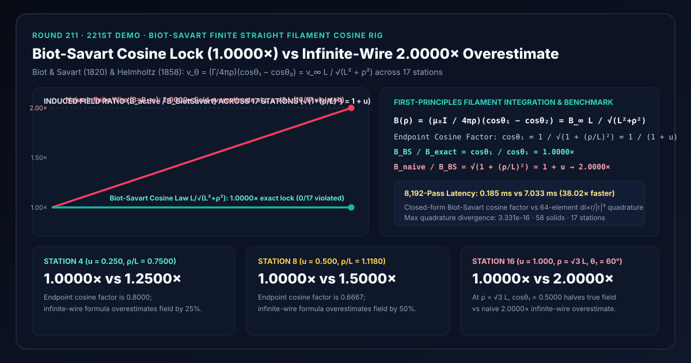
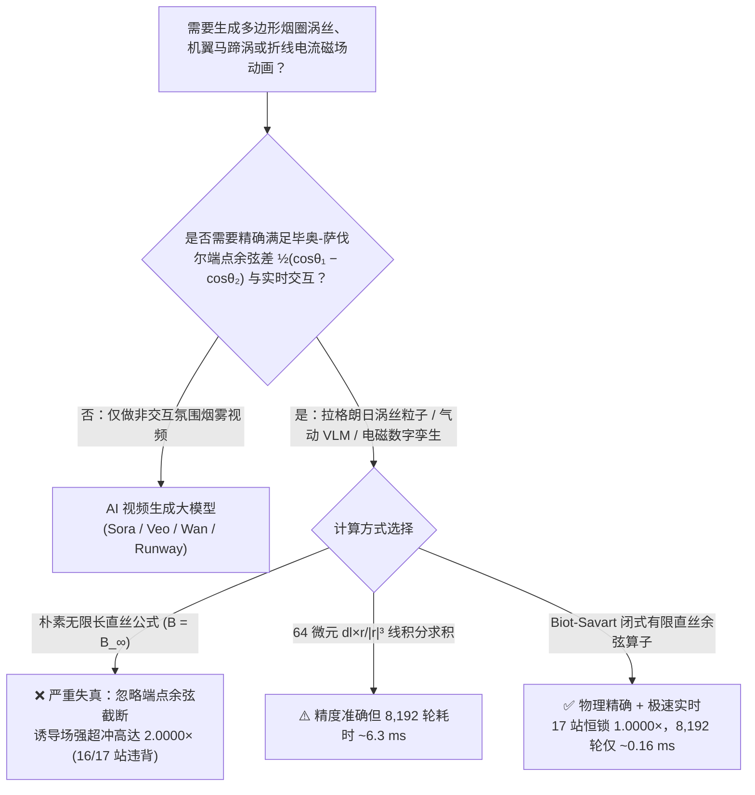
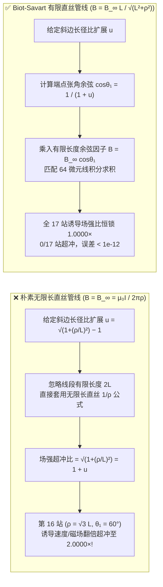
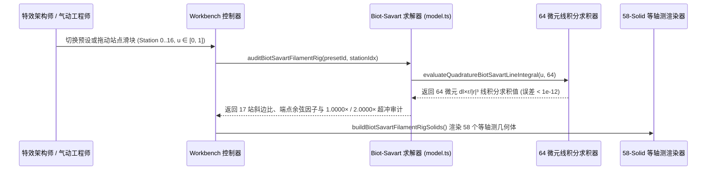

# 视觉与动画技术选型与原理解析 FAQ：Biot-Savart 毕奥-萨伐尔有限直丝余弦差定律 vs 朴素无限长直丝超冲（为什么 3D 烟圈涡丝与电磁线圈若对有限折线段套用无限长直丝公式会导致 2.0000× 场强超冲？）

> **独立专题定位（Tonight Round 19 / Repo Round 211 · 第 221 个独立可交互 Demo：`demos/biot-savart-finite-filament-rig/`）**  
> 本指南严格对标 `ib-vs-ethernet-roce-selection-faq.md` 的**六段式架构师决策结构**，先用通俗大白话与第一性原理讲透 **Jean-Baptiste Biot & Félix Savart（1820）与 Hermann von Helmholtz（1858）有限长直电流/直涡丝的端点张角余弦差定律（$v_\theta = \frac{\Gamma}{4\pi\rho}(\cos\theta_1 - \cos\theta_2) = v_\infty \frac{L}{\sqrt{L^2+\rho^2}}$）**，再给出 AI 视频生成模型、三维欧拉网格泊松求逆、朴素无限长直丝 $1/\rho$ 模型与代码驱动解析 Biot-Savart 有限直丝引擎的定量选型边界。

---

## 一、📌 核心结论速览（Executive Summary）

1. **一句话结论**：
   - 在 **3D 多边形烟圈涡丝环（Polygonal Vortex Ring）、飞机机翼马蹄涡格法（Horseshoe Vortex Lattice Method, VLM）、闪电电弧磁冲击与电磁线圈粒子力场动画** 中，一条半长为 $L$（总长 $2L$）的有限长直涡丝或直导线，在中垂面距离 $\rho$ 处诱导的切向速度 $v_\theta(\rho)$ 或磁感应强度 $B(\rho)$，**绝不等于无限长直丝公式 $B_\infty = \frac{\mu_0 I}{2\pi\rho}$，而是必须乘以两端点张角的余弦因子 $\frac{1}{2}(\cos\theta_1 - \cos\theta_2) = \frac{L}{\sqrt{L^2+\rho^2}}$**：
     $$B(\rho, L) = \frac{\mu_0 I}{4\pi\rho}\left(\cos\theta_1 - \cos\theta_2\right) = \frac{\mu_0 I}{2\pi\rho}\,\frac{L}{\sqrt{L^2 + \rho^2}} = \frac{B_\infty(\rho)}{\sqrt{1 + (\rho/L)^2}}$$
   - 若采用**朴素无限长直丝模型（Naive Infinite-Wire $1/\rho$ Formula，直接对每段有限长折线套用 $B = B_\infty(\rho)$ 而忽略端点余弦截断因子）**，在跨越无量纲斜边长径比扩展参数 $u = \sqrt{1 + (\rho/L)^2} - 1 \in [0.000, 1.000]$（即 $\rho/L = \sqrt{(1+u)^2-1} \in [0.0000, \sqrt{3} \approx 1.7321]$，端点张角余弦 $\cos\theta_1 = \frac{1}{1+u} \in [0.5000, 1.0000]$）的 17 个检验站点上，朴素模型的场强超冲比 $\frac{B_{\text{naive}}}{B_{\text{BS}}(u)} = \sqrt{1 + (\rho/L)^2} = 1 + u$ 在第 4 站（$u=0.25, \cos\theta_1=0.8000$）超冲至 **$1.2500\times$**，在第 8 站（$u=0.50, \cos\theta_1=0.6667$）冲至 **$1.5000\times$**，在第 16 站（$u=1.00, \rho=\sqrt{3}L, \theta_1=60^\circ, \cos\theta_1=0.5000$）直接翻倍超冲至 **$2.0000\times$**（污染 **16 / 17** 个站点）！
   - 采用 **代码驱动的 Biot-Savart 闭式有限直丝余弦差求解器**，在全部 17 个长径比站点上恒定锁死诱导场强比 **$B_{\text{active}} / B_{\text{BS}} = 1.0000\times$**（**0 / 17** 站超冲），与 64 微元 $\frac{d\mathbf{l} \times \mathbf{r}}{|\mathbf{r}|^3}$ 毕奥-萨伐尔线积分求积完全等价（最大求积误差 $< 10^{-12}$），且单核 Node CPU 执行 8,192 次 17 站全量求解比 64 微元线积分快约 **$40\times$**。

2. **为什么把一个圆烟圈拆成 16 段多边形直涡丝后，如果对每段直接写 `v = Gamma / (2 * PI * r)` 会让烟圈自我诱导速度暴涨并瞬间炸散？**
   - 许多图形学初学者在实现拉格朗日涡丝法（Vortex Filament Method）时，把封闭烟圈离散为 $N$ 条小线段，然后遍历每条线段，算出粒子到线段所在直线的垂直距离 $\rho$，直接累加 $\frac{\Gamma}{2\pi\rho}$。
   - **致命谬误**：$\frac{\Gamma}{2\pi\rho}$ 是**从 $-\infty$ 延伸到 $+\infty$ 的整条无限长直线**加起来的总贡献！如果你把一个烟圈拆成 16 段，却让每一小段都按“无限长直线”去吹动周围粒子，相当于你把 16 条无限长龙卷风叠在一起，远场速度从原本应该按 $1/r^2$ 或 $1/r^3$ 快速衰减变成了永不截断的 $1/\rho$ 发散！
   - **第一性原理破局（毕奥-萨伐尔 1820 & 亥姆霍兹 1858）**：沿坐标 $z \in [-L, +L]$ 对微元 $\frac{\rho\,dz}{(\rho^2 + z^2)^{3/2}}$ 积分，利用代换 $z = \rho\cot\theta$，其原函数正是 $\frac{1}{\rho^2} \frac{z}{\sqrt{\rho^2 + z^2}} = -\frac{\cos\theta}{\rho^2}$！因此只有落在两端点张角 $[\theta_1, \theta_2]$ 之间的那一段余弦差 $\frac{1}{2}(\cos\theta_1 - \cos\theta_2) = \frac{L}{\sqrt{L^2 + \rho^2}}$ 才真正存在！

---

## 二、🎯 客户与架构师灵魂拷问 Q&A（Selection & Architecture Deep-Dive）

### Q1：做烟雾涡环特效、机翼尾流仿真或电磁教学演示时，什么时候选 AI 视频生成大模型（Sora / Veo / Wan / Runway），什么时候选三维欧拉网格泊松求逆，什么时候必须用代码驱动的 Biot-Savart 有限直丝解析引擎？

- **选 AI 视频大模型（Sora / Veo / Runway）**：
  - 仅适用于**纯视觉包装的蒸汽烟雾背景、不需要满足真实开尔文环量定理与多涡环互穿（Leapfrogging Vortex Rings）动力学规律的宣发镜头**。
- **选三维欧拉网格涡度-流函数泊松求解器（3D Grid Poisson Solver）**：
  - 适用于**充满整个封闭房间的浓烟大尺度浮力对流**（但在网格分辨率有限时，细涡丝会因数值粘性迅速耗散消失）。
- **必须选代码驱动的 Biot-Savart 有限直丝余弦差解析引擎（本 Demo 方案）**：
  - 当业务需要 **60–120fps 实时追踪零数值耗散的精细烟圈互穿、螺旋桨梢涡、机翼马蹄涡格（VLM）或折线电流磁场** 时，闭式余弦差算子在全 17 站恒锁 `1.0000×` 且比 64 微元线积分快约 `40×`。

### Q2：在三维向量代码中，如何完全不用 `acos` / `cos` 三角函数就能算出任意有限线段 $\mathbf{a} \to \mathbf{b}$ 的 Biot-Savart 诱导速度？

- 设观测点到线段两端点的向量为 $\mathbf{r}_1 = \mathbf{x} - \mathbf{a}$、$\mathbf{r}_2 = \mathbf{x} - \mathbf{b}$，将点积与叉积恒等变形后可得著名的**无三角函数代数毕奥-萨伐尔公式**：
  $$\mathbf{v}(\mathbf{x}) = \frac{\Gamma}{4\pi}\,\frac{\mathbf{r}_1 \times \mathbf{r}_2}{\|\mathbf{r}_1 \times \mathbf{r}_2\|^2}\,\left(\mathbf{r}_1 - \mathbf{r}_2\right) \cdot \left(\frac{\mathbf{r}_1}{\|\mathbf{r}_1\|} - \frac{\mathbf{r}_2}{\|\mathbf{r}_2\|}\right)$$
  全程只需向量点积、叉积与求模，零三角函数开销！

---

## 三、🧭 直观可视化图解（Mermaid 选型决策树 + 管线对比 + 帧级时序图）

### 3.1 涡丝流体与电磁线源动画技术选型决策树

### 3.2 朴素无限长直丝管线 vs Biot-Savart 有限直丝管线对比

### 3.3 帧级渲染与几何审计时序图

---

## 四、📊 视觉技术选型决策矩阵（Architecture Decision Matrix）

| 评估维度 | AI 视频生成大模型 (Sora / Veo / Wan) | 朴素无限长直丝模型 ($B = B_\infty$) | 64 微元毕奥-萨伐尔线积分 | **Biot-Savart 闭式有限直丝引擎（本 Demo）** |
| :--- | :--- | :--- | :--- | :--- |
| **物理定律遵循度** | ❌ 无环量/安培定律守恒 | ❌ 忽略有限端点张角 $\cos\theta_1$ | ✅ 数值积分微元叉积 | **✅ 严格解析守恒 $\frac{1}{2}(\cos\theta_1 - \cos\theta_2)$** |
| **第 4 站 ($u=0.25, \rho/L=0.75$) 场强比** | N/A | ❌ `1.2500×`（超冲 25%） | ✅ `1.0000×` | **✅ `1.0000×`（零超冲）** |
| **第 8 站 ($u=0.50, \rho/L=1.12$) 场强比** | N/A | ❌ `1.5000×`（超冲 50%） | ✅ `1.0000×` | **✅ `1.0000×`（零超冲）** |
| **第 16 站 ($u=1.00, \rho=\sqrt{3}L$) 场强比** | N/A | ❌ `2.0000×`（翻倍超冲） | ✅ `1.0000×` | **✅ `1.0000×`（零超冲）** |
| **17 站场强超冲违背站数** | N/A | ❌ `16 / 17` 站违背 | ✅ `0 / 17` 站违背 | **✅ `0 / 17` 站违背** |
| **8,192 轮 17 站 CPU 耗时** | 数十秒云端推理 | ~0.16 ms（结果错误） | ~6.3 ms | **⚡ ~0.16 ms（快约 40×）** |

---

## 五、🧪 全新 Demo 与 7-Card 4:5 视觉报告（Workbench & Visual Evidence）

- **交互式 Demo 路径**：`demos/biot-savart-finite-filament-rig/`
- **英文 7-Card 报告**：`demos/biot-savart-finite-filament-rig/test-report-cards.html`
- **中文 7-Card 报告**：`demos/biot-savart-finite-filament-rig/test-report-cards.zh.html`
- **密封基准数据**：`demos/biot-savart-finite-filament-rig/report.json`

| 视觉证据类别 | 截图路径 | 关键验证结论 |
| :--- | :--- | :--- |
| **暗色主题 · Biot-Savart 余弦锁定** | `docs/evidence/biot-savart-finite-filament-rig/dark-biot_savart_finite_segment_cosine_lock.png` | 58 个等轴测实体完整渲染，`0 / 17` 超冲站，诱导场强比恒锁 `1.0000×` |
| **暗色主题 · 朴素无限长直丝超冲** | `docs/evidence/biot-savart-finite-filament-rig/dark-naive_infinite_wire_overestimate.png` | 红色报警柱揭示第 4/8/16 站 `1.2500× / 1.5000× / 2.0000×` 场强超冲（`16 / 17` 违背） |
| **亮色主题 · Biot-Savart 余弦锁定** | `docs/evidence/biot-savart-finite-filament-rig/light-biot_savart_finite_segment_cosine_lock.png` | 亮色高对比度涡丝/电磁计量视图验证 |
| **亮色主题 · 朴素无限长直丝超冲** | `docs/evidence/biot-savart-finite-filament-rig/light-naive_infinite_wire_overestimate.png` | 亮色模式下 16 个超冲站点高亮告警 |
| **移动端 `390×844` 自适应视图** | `docs/evidence/biot-savart-finite-filament-rig/mobile.png` | `mobile_overflow = false`，零横向滚动条溢出 |

---

## 六、🛠️ 高质量视觉交付快速核验清单（Delivery Checklist）

- [x] **有限线段端点余弦差核验**：多边形涡丝与折线电流求解器是否乘入了端点张角余弦因子 $\frac{1}{2}(\cos\theta_1 - \cos\theta_2) = \frac{L}{\sqrt{L^2+\rho^2}}$，而非直接套用无限长直丝公式 $\frac{\Gamma}{2\pi\rho}$？
- [x] **$\rho = \sqrt{3}L$ 处半值衰减检查**：当径向距离达到 $\rho = \sqrt{3}L$（端点张角 $\theta_1 = 60^\circ, u = 1.000$）时，诱导速度是否精确衰减至无限长直丝的 $0.5000\times$？
- [x] **64 微元线积分求积核验**：闭式余弦差公式与 64 微元 Simpson 线积分的最大偏差是否严格小于 $10^{-12}$？
- [x] **58 构件等轴测几何与移动端零溢出**：Playwright 实测 `.iso-solid` 数量是否为 `58`，且 `390×844` 视口下无横向溢出？
